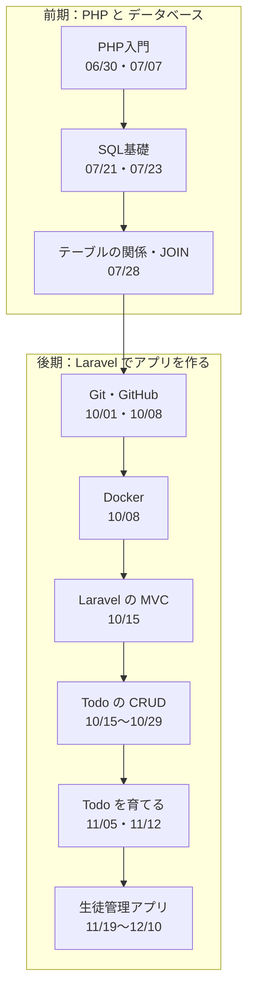

# 1年生｜データ設計とアプリ開発 — 資料の全体図

この授業では、**PHP で動くページを作る → データベースにデータを保存する → Laravel でアプリを作る** という順番で進みます。

どの資料も、**ページのいちばん下の案内** から、前後の資料やこのページに移動できます。
迷ったら、このページに戻ってきてください。

## 全体の流れ

困ったときに見るページ

| こんなとき | 見るページ |
|:--|:--|
| コマンドを忘れた | [重要コマンド一覧](後期/重要コマンド一覧.md) |
| Laravel が思ったとおりに動かない | [【重要】ログの出し方](後期/20261022/【重要】ログの出し方.md) |
| 前期の PHP・MySQL の起動方法を忘れた | [Todo管理アプリ 起動する流れ](前期/20260723/Todo管理アプリ起動する流れ.md) |

---

## 前期：PHP と データベース

| 日付 | 資料 | 演習・解答 | 補足 |
|:--|:--|:--|:--|
| 06/30 | [PHP入門](前期/20260630/20260630_資料.md) | [演習](前期/20260630/20260630_演習.md)・[解答](前期/20260630/20260630_解答.md) | [PHP開発サーバーの立て方](前期/PHP開発サーバーの立て方.md) |
| 07/07 | [PHPの基本とフォーム](前期/20260707/20260707_資料.md) | [演習](前期/20260707/20260707_演習.md)・[解答](前期/20260707/20260707_解答.md) | |
| 07/14 | [演習問題](前期/20260714/20260714_資料_1.md) | | |
| 07/21 | [なぜDBが必要か](前期/20260721/20260721_資料.md) [SQL基礎①（SELECT）](前期/20260721/20260721_資料_2.md) | [演習](前期/20260721/20260721_演習.md)・[解答](前期/20260721/20260721_解答.md) | [データベースサーバーの立て方（XAMPP編）](前期/データベースサーバーの立て方/データベースサーバーの立て方.md) [リレーショナルデータベース入門](前期/20260721/リレーショナルデータベース入門.md) |
| 07/23 | [SQL基礎②（INSERT・UPDATE・DELETE）](前期/20260723/20260723_資料.md) | [演習](前期/20260723/20260723_演習.md)・[解答](前期/20260723/20260723_解答.md) | [Todo管理アプリ 起動する流れ](前期/20260723/Todo管理アプリ起動する流れ.md) [PDO_MySQL接続エラー対処法](前期/20260723/PDO_MySQL接続エラー対処法.md) |
| 07/28 | [テーブルの関係・JOIN](前期/20260728/20260728_資料.md) | [演習](前期/20260728/20260728_演習.md)・[解答](前期/20260728/20260728_解答.md) | [JOIN入門](前期/20260728/JOIN入門.md) |

## 後期：Laravel でアプリを作る

| 日付 | 資料 | 補足 |
|:--|:--|:--|
| 10/01 | [前期のふりかえり](後期/20261001/20261001_復習.md) [ソース管理入門](後期/20261001/20261001_資料_1.md) | |
| 10/08 | [GitHubアカウントとリポジトリ](後期/20261008/20261008_資料_1.md) [練習環境をプッシュする](後期/20261008/20261008_資料_2.md) [Docker入門](後期/20261008/20261008_資料_3.md) | |
| 10/15 | [MVCのしくみ](後期/20261015/20261015_資料_1.md) [Todo一覧](後期/20261015/20261015_資料_2.md) | |
| 10/22 | [Todo追加（CREATE）](後期/20261022/20261022_資料_1.md) [Todo詳細（SHOW）](後期/20261022/20261022_資料_2.md) | [【重要】ログの出し方](後期/20261022/【重要】ログの出し方.md) |
| 10/29 | [Todo編集（UPDATE）](後期/20261029/20261029_資料_1.md) [完了の切り替え（PATCH）](後期/20261029/20261029_資料_2.md) [Todo削除（DELETE）](後期/20261029/20261029_資料_3.md) | |
| 11/05 | [Seeder・Factory](後期/20261105/20261105_資料_1.md) [バリデーション](後期/20261105/20261105_資料_2.md) | |
| 11/12 | [共通部分を部品に（@include）](後期/20261112/20261112_資料_1.md) [カテゴリをつける](後期/20261112/20261112_資料_2.md) | |
| 11/19 | [生徒管理① 一覧・詳細](後期/20261119/20261119_資料_1.md) [生徒管理② 追加・編集・削除](後期/20261119/20261119_資料_2.md) | |
| 11/26 | [生徒管理③ ログイン](後期/20261126/20261126_資料_1.md) | |
| 12/03 | [生徒管理④ リレーション](後期/20261203/20261203_資料_1.md) | |
| 12/10 | [生徒管理⑤ 先生の新規登録](後期/20261210/20261210_資料_1.md) | |

いつでも使えるページ：[重要コマンド一覧](後期/重要コマンド一覧.md)
