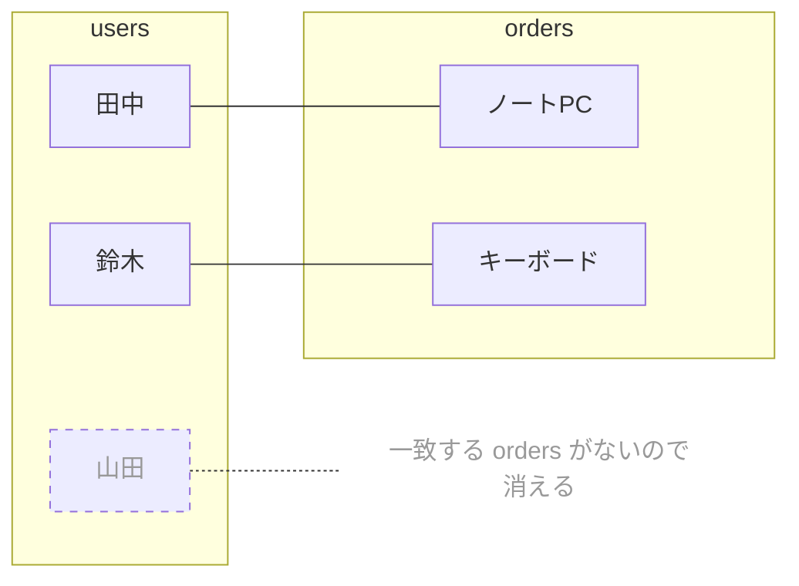
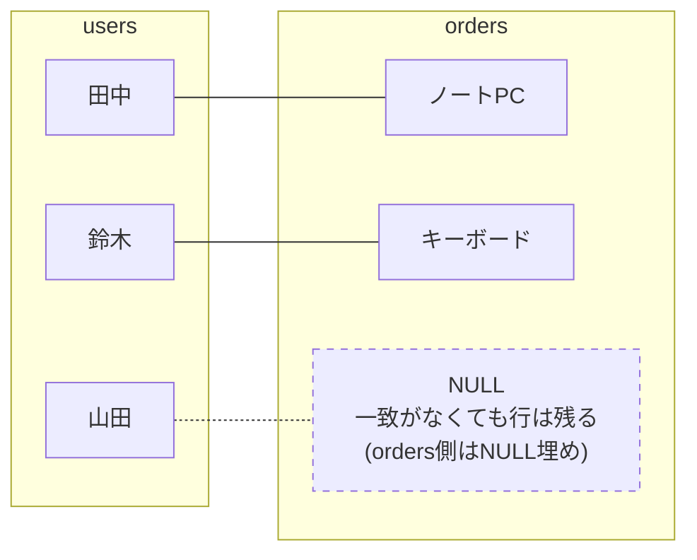

## この記事でわかること

- INNER JOIN が「両方のテーブルに存在するデータだけ」を結合すること
- LEFT JOIN が「左テーブルの全行＋右テーブルの一致分」を結合すること
- 同じ2つのテーブル・同じ結合条件でも、JOINの種類によって結果の行数が変わること

## 使う2つのテーブル

`users`(ユーザー)と`orders`(注文)で説明します。ポイントは、**山田次郎さんはまだ1回も注文していない**ことです。

### 🧑 users テーブル

| id | name |
|----|------|
| 1  | 田中太郎 |
| 2  | 鈴木花子 |
| 3  | 山田次郎 |

### 🛒 orders テーブル

| id | user_id | product |
|----|---------|---------|
| 1  | 1       | ノートPC |
| 2  | 2       | キーボード |

`orders.user_id` が `users.id` を参照しています(外部キー)。山田次郎(id=3)を参照する行は`orders`に1件もありません。

## INNER JOIN: 両方に存在するデータだけ結合

```sql
SELECT users.name, orders.product
FROM users
INNER JOIN orders ON users.id = orders.user_id;
```

**結果:**

| name | product |
|------|---------|
| 田中太郎 | ノートPC |
| 鈴木花子 | キーボード |

INNER JOIN のイメージ(つながった組だけが結果になる)



山田次郎は`orders`に一致する行が1件もないため、**結果から消えます**。「両方のテーブルに存在するデータだけを結合する」とはこういう意味です。

## LEFT JOIN: 左テーブルの全行＋右テーブルの一致分を結合

```sql
SELECT users.name, orders.product
FROM users
LEFT JOIN orders ON users.id = orders.user_id;
```

**結果:**

| name | product |
|------|---------|
| 田中太郎 | ノートPC |
| 鈴木花子 | キーボード |
| 山田次郎 | NULL    |

LEFT JOIN のイメージ(左テーブルは全員残す)



`FROM users LEFT JOIN orders`の**FROM側(左側)に書いたusersが基準**になります。山田次郎は注文がなくても行として残り、`orders`側の列は`NULL`(該当なし)で埋められます。

## 見分け方のコツ

- **`FROM A LEFT JOIN B`** → **Aが左**、Aは必ず全行残る
- 一致しない行が出たら、右側(B)の列は自動的に`NULL`になる
- `INNER JOIN`にはこの「全部残す」動きがなく、一致した行だけが残る

## どっちを使えばいいか

| やりたいこと | 使うJOIN |
|---|---|
| 注文がある人のデータだけ見たい | `INNER JOIN` |
| 注文0件の人も含めて全員をリストにしたい(例:未注文者への案内メール対象を探す) | `LEFT JOIN` |
| ユーザーごとの注文件数を数えたい(0件の人も0件として出したい) | `LEFT JOIN` + `COUNT` |

3つ目の例が`20260728_資料.md`の「5. LEFT JOIN」で扱った、注文0件のユーザーも表示するSQLです。`INNER JOIN`で同じことをすると、山田次郎のような未注文ユーザーはそもそも結果に現れません。

## まとめ

- `INNER JOIN`は「両方のテーブルに存在するデータだけ」を結合する → 一致しない行は消える
- `LEFT JOIN`は「`FROM`の左テーブルの全行＋右テーブルの一致分」を結合する → 一致しなくても左テーブルの行は残り、右側は`NULL`になる
- 「全員/全件を漏らさず見たい」ときはLEFT JOIN、「両方に揃っているデータだけでいい」ときはINNER JOIN、と覚えるとよい

<!-- nav:start -->

---

| ⬅️ もどる | 🗺️ 全体図 | 次へ ➡️ |
|:--|:--:|--:|
| [07/28 テーブルの関係・JOIN](20260728_資料.md) | [資料の全体図](../../README.md) | [07/28 SQL演習](20260728_演習.md) |

<!-- nav:end -->
