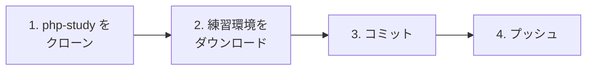
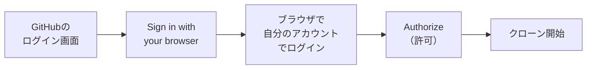
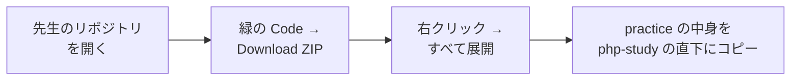
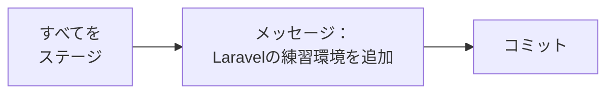

# 練習環境を自分のリポジトリにプッシュする

## 今日のゴール
- 自分のGitHubアカウントでログインして、クローン・プッシュできる
- 練習環境を自分のリポジトリにプッシュできる

[GitHubアカウントとリポジトリの作り方に戻る](./20261008_資料_1.md)

---

## 全体の流れ

[資料1](./20261008_資料_1.md) で作った `php-study` に、先生が用意した **練習環境** を入れてプッシュします。



---

## 1. php-study をクローンする

前回と同じように、SourceTreeの `Clone` から自分のPCにコピーします。
前回はトークン付きのURLでクローンしましたが、今回は **自分のGitHubアカウントでログイン** してつなぎます。

| 項目 | 入力する内容 |
|------|------------|
| 元のパス / URL | `https://github.com/<自分のユーザー名>/php-study.git` |
| 保存先のパス | `C:\Users\<ユーザー名>\Desktop\php-study` |

`クローン` を押すと、GitHubへのログイン画面が出てきます。
`Sign in with your browser`（ブラウザでサインイン）を選び、**自分のアカウント** でログインします。



- ブラウザでログインを求められたら、資料1で作ったアカウントでログインします（2要素認証の6桁コードも入力）
- `Authorize`（許可）を押すと、SourceTreeに戻ってクローンが始まります
- ログイン情報はWindowsに保存されるので、次からは聞かれません

✅ デスクトップに `php-study` フォルダができ、中に `README.md` があれば成功です。

---

## 2. 練習環境をダウンロードする

先生のリポジトリをZIPでダウンロードして、その中の `practice` フォルダの **中身** を取り出します。



**先生のリポジトリ：** https://github.com/hakobunet/iica-koyama

展開したフォルダの中の、次の場所に `practice` があります。

```
iica-koyama-main/
  docs/
    1年生_データ設計とアプリ開発/
      practice/   ← この中身をコピー
```

`practice` フォルダを開き、**中身をすべて** `php-study` の **直下** にコピーします（`practice` フォルダそのものは作りません）。

```
php-study/
  README.md          ← practice の README.md で置きかえてOK
  .gitattributes
  mysql/
    compose.yaml
  laravel/
    .gitignore
    compose.yaml
    Dockerfile
    entrypoint.sh
```

> **`README.md` が同じ名前で重なったら**
> 「ファイルを置き換える」を選んで大丈夫です。練習環境の動かし方が書かれた README になります。

> **中のファイルを1つずつ選ばない**
> `.gitattributes` や `.gitignore` のように、名前が `.` で始まるファイルは大事な設定ファイルです。
> 見えにくいこともあるので、`practice` フォルダを開いたら `Ctrl + A`（すべて選択）でまとめてコピーしましょう。

---

## 3. コミットする

SourceTreeの `ファイルステータス` を開くと、`mysql` や `laravel` の中のファイルが「ステージしていないファイル」に表示されます。



---

## 4. プッシュする

`プッシュ` ボタン → `main` にチェック → `OK` でGitHubにアップロードします。

### 確認 ✅

ブラウザで `github.com/<ユーザー名>/php-study` を開き、次のようになっていれば完成です。

- `mysql` と `laravel` フォルダが、いちばん上（直下）に表示されている

> **クローンやプッシュで `403` や `Repository not found` と出たら**
> URLの `<自分のユーザー名>` が合っているか、ブラウザで **自分のアカウント** にログインしたかを確認しましょう。

練習環境の動かし方は、`php-study` フォルダの `README.md` に書いてあります。
フォルダの場所は `C:\Users\<ユーザー名>\Desktop\php-study` になるので、README の `Desktop\practice` は `Desktop\php-study` に読みかえてください。
