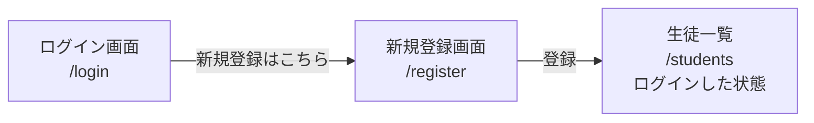
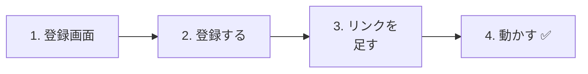
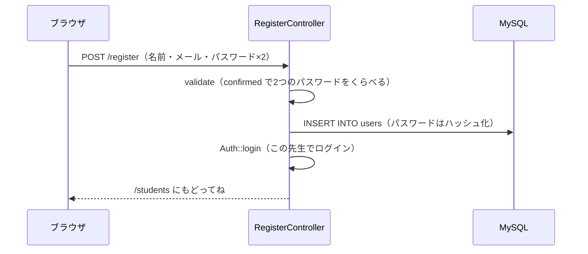

# 生徒管理アプリを作ろう⑤ — 先生の新規登録

今は、先生を **Seeder でしか登録できません**。新しい先生が来るたびに、プログラムを書きかえるのは大変です。
今日は、画面から **先生のアカウントを作れる**（新規登録）ようにします。

## 今日のゴール
- 新規登録の画面を作って、先生を `users` テーブルに保存できる
- パスワードの「確認入力」を、バリデーション（`confirmed`）でチェックできる
- 登録したら、そのままログインした状態にできる（`Auth::login`）

> 12/3の「リレーション」までができている状態から始めます。

---

## 1. 今日つくるもの



```
新規登録

名前：             [ 鈴木先生            ]
メールアドレス：   [ suzuki@example.com  ]
パスワード：       [ ●●●●●●●●            ]
パスワード（確認）：[ ●●●●●●●●            ]

[登録]
```

### ログインとのちがい

11/26のログインと、ほとんど同じ形です。

| | ログイン（11/26） | 新規登録（今日） |
|---|---|---|
| URL | `/login` | `/register` |
| すること | `users` にいる先生か **たしかめる** | `users` に新しい先生を **追加する** |
| 入力欄 | メールアドレス・パスワード | 名前・メールアドレス・パスワード・**パスワード（確認）** |
| 最後に | `Auth::attempt()` でログイン | `Auth::login()` でログイン |

> **2年生では**、この新規登録も API（`POST /api/register`）に作りかえます。
> チェックのルール（バリデーション）は、2年生でもそのまま使います。

---

## 2. 作ってみよう



さわるファイルは次のとおりです（`src` の中）。

```
src/
├─ app/Http/Controllers/
│   └─ RegisterController.php ·········· 1・2. 新規登録（新しく作る）
├─ resources/views/
│   ├─ register.blade.php ·············· 1. 新規登録画面（新しく作る）
│   ├─ login.blade.php ················· 3. 新規登録へのリンク
│   └─ layouts/header.blade.php ········ 3. 新規登録へのリンク
└─ routes/web.php ······················ 1・2. ルート
```

---

### 1. 新規登録の画面を作る

> いまここ：**🟢 1. 登録画面** → 2. 登録する → 3. リンク → 4. 動かす

#### ① コントローラーを作る

```powershell
docker compose exec laravel php artisan make:controller RegisterController
```

`app/Http/Controllers/RegisterController.php` を、次のようにします。

```php
<?php

namespace App\Http\Controllers;

use App\Models\User;
use Illuminate\Http\Request;
use Illuminate\Support\Facades\Auth;

class RegisterController extends Controller
{
    // 新規登録の画面を見せる
    public function showForm()
    {
        return view('register');
    }
}
```

#### ② ビューを作る

`resources/views/register.blade.php` を作ります。

```html
@include('layouts.header', ['title' => '新規登録'])

    <h1>新規登録</h1>

    <form method="POST" action="/register">
        @csrf

        <p>
            名前：
            <input type="text" name="name" value="{{ old('name') }}" required>
            @error('name') <span style="color: red;">{{ $message }}</span> @enderror
        </p>

        <p>
            メールアドレス：
            <input type="email" name="email" value="{{ old('email') }}" required>
            @error('email') <span style="color: red;">{{ $message }}</span> @enderror
        </p>

        <p>
            パスワード（8文字以上）：
            <input type="password" name="password" required>
            @error('password') <span style="color: red;">{{ $message }}</span> @enderror
        </p>

        <p>
            パスワード（確認）：
            <input type="password" name="password_confirmation" required>
        </p>

        <button type="submit">登録</button>
    </form>

    <a href="/login">ログインはこちら</a>

@include('layouts.footer')
```

| コード | 意味 |
|--------|------|
| `name="password"` | パスワード |
| `name="password_confirmation"` | パスワードの **確認入力**。名前は `password` のうしろに `_confirmation` をつける **決まり** |

> **なぜパスワードを2回入れるの？**
> パスワードは `●●●` で表示されるので、打ちまちがえても気づけません。
> 2回入れてもらって、**同じかどうか** をくらべれば、打ちまちがいに気づけます。

#### ③ ルートを書く

`routes/web.php` に、★ の部分を書き足します。

```php
use App\Http\Controllers\RegisterController;  // ★ 追加（上の方に書く）

Route::get('/register', [RegisterController::class, 'showForm']);  // ★ 追加
```

✅ **確認**：http://localhost:8000/register を開いて、新規登録の画面が出ればOKです。

---

### 2. 登録できるようにする

> いまここ：1. 登録画面 → **🟢 2. 登録する** → 3. リンク → 4. 動かす

#### ① register メソッドを書く

`RegisterController.php` に、★ の `register` を書き足します。

```php
    // ★ ここから追加
    public function register(Request $request)
    {
        // ① 入力をチェックする
        $request->validate([
            'name' => 'required|string|max:255',
            'email' => 'required|email|unique:users,email',
            'password' => 'required|min:8|confirmed',
        ], [
            'name.required' => '名前を入力してください。',
            'name.max' => '名前は255文字以内で入力してください。',
            'email.required' => 'メールアドレスを入力してください。',
            'email.email' => 'メールアドレスの形で入力してください。',
            'email.unique' => 'そのメールアドレスは、すでに登録されています。',
            'password.required' => 'パスワードを入力してください。',
            'password.min' => 'パスワードは8文字以上で入力してください。',
            'password.confirmed' => 'パスワード（確認）が一致しません。',
        ]);

        // ② 先生を保存する
        $user = new User();
        $user->name = $request->input('name');
        $user->email = $request->input('email');
        $user->password = $request->input('password');  // 保存するときに、自動でハッシュ化される
        $user->save();

        // ③ そのままログインさせる
        Auth::login($user);
        $request->session()->regenerate();

        // ④ 生徒一覧へ
        return redirect('/students');
    }
    // ★ ここまで
```

新しく出てくるものです。

| コード | 意味 |
|--------|------|
| `string` | 文字であること |
| `unique:users,email` | `users` テーブルの `email` 列に、同じ値がないか（同じメールアドレスで2回登録できない） |
| `min:8` | 8文字以上（`integer` がないので、**文字の数** でチェックする） |
| `confirmed` | `password` と `password_confirmation` が **同じか** |
| `Auth::login($user)` | パスワードをたしかめずに、**この先生でログインさせる** |

> **`Auth::attempt` と `Auth::login` のちがい**
>
> | | `Auth::attempt($credentials)`（11/26） | `Auth::login($user)`（今日） |
> |---|---|---|
> | パスワードを | たしかめる | たしかめない |
> | 使う場面 | ログイン画面（本人かどうかわからない） | 新規登録の直後（今登録した本人だとわかっている） |
>
> 登録した直後に、もう一度ログイン画面でパスワードを入れてもらうのは、めんどうですよね。
> 今登録したばかりの本人なので、そのままログインさせます。

> **パスワードは、そのまま入れて大丈夫？**
> 11/26で学んだとおり、`User` モデルの `'password' => 'hashed'` のおかげで、**保存するときに自動でハッシュ化** されます。
> 2年生の資料では `Hash::make(...)` と自分でハッシュ化していますが、Laravelは「すでにハッシュ化された値」を二重にハッシュ化しないので、どちらの書き方でも正しく動きます。

#### ② ルートを書き足す

```php
Route::get('/register', [RegisterController::class, 'showForm']);
Route::post('/register', [RegisterController::class, 'register']);  // ★ 追加
```



---

### 3. 新規登録へのリンクを足す

> いまここ：1. 登録画面 → 2. 登録する → **🟢 3. リンク** → 4. 動かす

#### ① ログイン画面に

`resources/views/login.blade.php` の `</form>` の下に、★ の1行を書き足します。

```html
        <button type="submit">ログイン</button>
    </form>

    <a href="/register">新規登録はこちら</a>  {{-- ★ 追加 --}}
```

#### ② ヘッダーに

`resources/views/layouts/header.blade.php` の `@guest` の中に、★ の1行を書き足します。

```html
        @guest
            <a href="/login">ログイン</a>
            <a href="/register">新規登録</a>  {{-- ★ 追加 --}}
        @endguest
```

ログインしていないときだけ、ヘッダーに「新規登録」が出ます。

---

### 4. 動かす ✅

> いまここ：1. 登録画面 → 2. 登録する → 3. リンク → **🟢 4. 動かす**

ログアウトしてから、次の順番で試しましょう。

| | やること | こうなればOK |
|---|---|---|
| ① | 新規登録で、名前「鈴木先生」・メールアドレス `suzuki@example.com`・パスワード `password123`（2回とも同じ）で登録 | 生徒一覧に移動し、ヘッダーに「鈴木先生 さん」と出る |
| ② | 生徒一覧を見る | **生徒が0人**（鈴木先生は、まだだれも登録していないから。12/3のリレーションのおかげ） |
| ③ | phpMyAdminで `users` テーブルを見る | 鈴木先生がいて、`password` がハッシュ化（`$2y$12$...`）されている |
| ④ | ログアウトして、鈴木先生のメールアドレスとパスワードでログイン | ログインできる |
| ⑤ | もう一度、`suzuki@example.com` で新規登録する | 「そのメールアドレスは、すでに登録されています。」と出る |
| ⑥ | パスワードと確認に、ちがうものを入れて登録する | 「パスワード（確認）が一致しません。」と出る |
| ⑦ | パスワードを `abc` にして登録する | 「パスワードは8文字以上で入力してください。」と出る |

---

## 3. ルートのまとめ

ログイン・新規登録まわりのルートは、次のようになりました。

```php
// ログイン・ログアウト
Route::get('/login', [LoginController::class, 'showForm'])->name('login');
Route::post('/login', [LoginController::class, 'login']);
Route::post('/logout', [LoginController::class, 'logout']);

// 新規登録
Route::get('/register', [RegisterController::class, 'showForm']);
Route::post('/register', [RegisterController::class, 'register']);
```

新規登録のルートは、`Route::middleware('auth')` の **外** に書きます。
まだアカウントがない（ログインできない）人が使うページだからです。

---

## 4. うまくいかないとき

> **🔥 動かないなら、ログを出せ！** → [【重要】ログの出し方](../20261022/【重要】ログの出し方.md)

| 症状 | 原因の場所 | 対処 |
|------|----------|------|
| 同じパスワードを入れたのに「一致しません」と出る | ビュー | 確認の入力欄の名前が `password_confirmation` になっているか確認（つづりが1文字でもちがうと、くらべられない） |
| 新規登録の画面を開くと、ログイン画面に飛ばされる | ルート | `/register` のルートが、`Route::middleware('auth')` の `{ }` の **外** にあるか確認 |
| 登録したのに、ログインした状態にならない | コントローラー | `Auth::login($user);` を書いたか確認 |
| 登録した先生で、ログインできない | データ | phpMyAdminで `password` がハッシュ化されているか確認。`User.php` の `'password' => 'hashed'` を消していないか確認 |
| `Class "App\Http\Controllers\User" not found` | コントローラー | `RegisterController.php` の上に `use App\Models\User;` があるか確認 |
| `Target class [RegisterController] does not exist.` | ルート | `web.php` の上に `use App\Http\Controllers\RegisterController;` があるか確認 |

---

## 5. まとめ

| 今日書いたもの | ひとことで |
|--------------|-----------|
| `name="password_confirmation"` | パスワードの確認入力。名前は決まり |
| `confirmed` | `password` と `password_confirmation` が同じかチェックする |
| `unique:users,email` | 同じメールアドレスの先生は、2人登録できない |
| `min:8` | パスワードは8文字以上 |
| `new User()` → `save()` | 先生を保存する（パスワードは自動でハッシュ化） |
| `Auth::login($user)` | パスワードをたしかめずに、その先生でログインさせる |

**新規登録は「ユーザーを追加して、そのままログイン」。ログインは「本人かたしかめて、ログイン」。**

これで、先生が自分でアカウントを作り、自分の生徒を管理できるアプリになりました。

<!-- nav:start -->

---

| ⬅️ 前へ | 🗺️ 全体図 | 次へ ➡️ |
|:--|:--:|--:|
| [12/03 生徒管理④ リレーション](../20261203/20261203_資料_1.md) | [資料の全体図](../../README.md) | — |

<!-- nav:end -->
