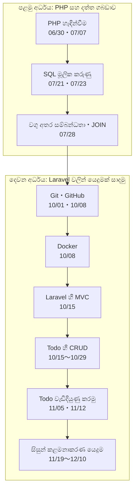

# 1 වසර｜දත්ත සැලසුම සහ යෙදුම් සංවර්ධනය — පාඩම් ද්‍රව්‍යවල සමස්ත සිතියම

> 🇯🇵 මුල් පිටපත (ජපන් භාෂාවෙන්): [README.md](<../1年生_データ設計とアプリ開発/README.md>) <!-- original-ja-link -->

මෙම පාඨමාලාවේදී අපි **PHP වලින් ක්‍රියා කරන පිටු සාදනවා → දත්ත ගබඩාවක (database) දත්ත සුරකිනවා → Laravel වලින් යෙදුමක් සාදනවා** යන පිළිවෙළට ඉදිරියට යනවා.

සෑම පාඩම් ද්‍රව්‍යයකම **පිටුවේ පහළින්ම ඇති මාර්ගෝපදේශය** හරහා පෙර සහ ඊළඟ ද්‍රව්‍යවලට හෝ මෙම පිටුවට යා හැකියි.
අතරමං වුණොත්, මෙම පිටුවට නැවත එන්න.

## සමස්ත ක්‍රියාවලිය

ගැටලුවක් ඇති වූ විට බලන පිටු

| මෙවැනි අවස්ථාවක | බලන පිටුව |
|:--|:--|
| විධානයක් (command) අමතක වුණා | [වැදගත් command ලැයිස්තුව](後期/重要コマンド一覧.md) |
| Laravel බලාපොරොත්තු වූ ලෙස ක්‍රියා නොකරයි | [【වැදගත්】ලොග් (log) පෙන්වන ආකාරය](後期/20261022/【重要】ログの出し方.md) |
| පළමු අර්ධයේ PHP・MySQL ආරම්භ කරන ආකාරය අමතක වුණා | [Todo කළමනාකරණ යෙදුම ආරම්භ කිරීමේ ක්‍රියාවලිය](前期/20260723/Todo管理アプリ起動する流れ.md) |

---

## පළමු අර්ධය: PHP සහ දත්ත ගබඩාව

| දිනය | ද්‍රව්‍ය | අභ්‍යාස・පිළිතුරු | අමතර |
|:--|:--|:--|:--|
| 06/30 | [PHP හැඳින්වීම](前期/20260630/20260630_資料.md) | [අභ්‍යාස](前期/20260630/20260630_演習.md)・[පිළිතුරු](前期/20260630/20260630_解答.md) | [PHP සංවර්ධන සේවාදායකයක් සකසන ආකාරය](前期/PHP開発サーバーの立て方.md) |
| 07/07 | [PHP හි මූලික කරුණු සහ පෝරම (form)](前期/20260707/20260707_資料.md) | [අභ්‍යාස](前期/20260707/20260707_演習.md)・[පිළිතුරු](前期/20260707/20260707_解答.md) | |
| 07/14 | [අභ්‍යාස ගැටලු](前期/20260714/20260714_資料_1.md) | | |
| 07/21 | [DB අවශ්‍ය වන්නේ ඇයි](前期/20260721/20260721_資料.md) [SQL මූලික කරුණු ①（SELECT）](前期/20260721/20260721_資料_2.md) | [අභ්‍යාස](前期/20260721/20260721_演習.md)・[පිළිතුරු](前期/20260721/20260721_解答.md) | [දත්ත ගබඩා සේවාදායකයක් සකසන ආකාරය (XAMPP සංස්කරණය)](前期/データベースサーバーの立て方/データベースサーバーの立て方.md) [සම්බන්ධතා දත්ත ගබඩා හැඳින්වීම](前期/20260721/リレーショナルデータベース入門.md) |
| 07/23 | [SQL මූලික කරුණු ②（INSERT・UPDATE・DELETE）](前期/20260723/20260723_資料.md) | [අභ්‍යාස](前期/20260723/20260723_演習.md)・[පිළිතුරු](前期/20260723/20260723_解答.md) | [Todo කළමනාකරණ යෙදුම ආරම්භ කිරීමේ ක්‍රියාවලිය](前期/20260723/Todo管理アプリ起動する流れ.md) [PDO_MySQL සම්බන්ධතා දෝෂ විසඳුම්](前期/20260723/PDO_MySQL接続エラー対処法.md) |
| 07/28 | [වගු අතර සම්බන්ධතා・JOIN](前期/20260728/20260728_資料.md) | [අභ්‍යාස](前期/20260728/20260728_演習.md)・[පිළිතුරු](前期/20260728/20260728_解答.md) | [JOIN හැඳින්වීම](前期/20260728/JOIN入門.md) |

## දෙවන අර්ධය: Laravel වලින් යෙදුමක් සාදමු

| දිනය | ද්‍රව්‍ය | අමතර |
|:--|:--|:--|
| 10/01 | [පළමු අර්ධ වාරයේ පුනරීක්ෂණය](後期/20261001/20261001_復習.md) [Source Control හැඳින්වීම](後期/20261001/20261001_資料_1.md) | |
| 10/08 | [GitHub account සහ repository](後期/20261008/20261008_資料_1.md) [පුහුණු පරිසරය push කිරීම](後期/20261008/20261008_資料_2.md) [Docker හැඳින්වීම](後期/20261008/20261008_資料_3.md) | |
| 10/15 | [MVC ක්‍රියා කරන ආකාරය](後期/20261015/20261015_資料_1.md) [Todo ලැයිස්තුව](後期/20261015/20261015_資料_2.md) | |
| 10/22 | [Todo එකතු කිරීම (CREATE)](後期/20261022/20261022_資料_1.md) [Todo විස්තර (SHOW)](後期/20261022/20261022_資料_2.md) | [【වැදගත්】ලොග් (log) පෙන්වන ආකාරය](後期/20261022/【重要】ログの出し方.md) |
| 10/29 | [Todo සංස්කරණය (UPDATE)](後期/20261029/20261029_資料_1.md) [සම්පූර්ණ බව මාරු කිරීම (PATCH)](後期/20261029/20261029_資料_2.md) [Todo මකා දැමීම (DELETE)](後期/20261029/20261029_資料_3.md) | |
| 11/05 | [Seeder・Factory](後期/20261105/20261105_資料_1.md) [වලංගුකරණය (validation)](後期/20261105/20261105_資料_2.md) | |
| 11/12 | [පොදු කොටස් සංරචක (parts) බවට පත් කිරීම（@include）](後期/20261112/20261112_資料_1.md) [ප්‍රවර්ග (category) එකතු කරමු](後期/20261112/20261112_資料_2.md) | |
| 11/19 | [ශිෂ්‍ය කළමනාකරණය ① ලැයිස්තුව, විස්තර](後期/20261119/20261119_資料_1.md) [ශිෂ්‍ය කළමනාකරණය ② එකතු කිරීම, සංස්කරණය, මකා දැමීම](後期/20261119/20261119_資料_2.md) | |
| 11/26 | [ශිෂ්‍ය කළමනාකරණය ③ Login](後期/20261126/20261126_資料_1.md) | |
| 12/03 | [ශිෂ්‍ය කළමනාකරණය ④ Relation](後期/20261203/20261203_資料_1.md) | |
| 12/10 | [ශිෂ්‍ය කළමනාකරණය ⑤ ගුරුවරුන් අලුතින් ලියාපදිංචි කිරීම](後期/20261210/20261210_資料_1.md) | |

ඕනෑම වේලාවක භාවිත කළ හැකි පිටුව: [වැදගත් command ලැයිස්තුව](後期/重要コマンド一覧.md)
