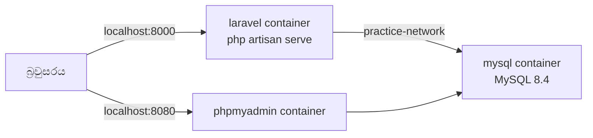
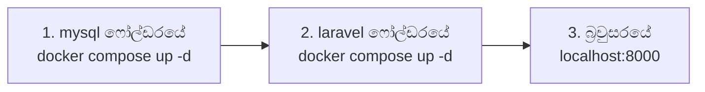

# Laravel × MySQL පුහුණු පරිසරය（Docker）

> 🇯🇵 මුල් පිටපත (ජපන් භාෂාවෙන්): [README.md](<../../1年生_データ設計とアプリ開発/practice/README.md>) <!-- original-ja-link -->

Laravel සහ MySQL, **වෙන වෙනම container** ලෙස ආරම්භ කරනවා.
container 2 `practice-network` නම් ජාලයක් (network) හරහා එකිනෙක සම්බන්ධ වී ඇත.



```
practice/
  mysql/
    compose.yaml    ← MySQL සහ phpMyAdmin
  laravel/
    compose.yaml    ← Laravel
    Dockerfile
    entrypoint.sh
    src/            ← පළමු වරට ආරම්භ කරන විට Laravel ස්වයංක්‍රීයව සෑදේ
```

> Docker Desktop ආරම්භ කර, වම් පස පහළ කෙළවරේ **Engine running** ලෙස පෙන්වන බව තහවුරු කරගත් පසු පටන් ගන්න.
> Docker Desktop ස්ථාපනය කරන ආකාරය → [Docker Desktop ස්ථාපනය කරමු](../後期/20261008/20261008_資料.md)

> **XAMPP නවත්වා තබන්න**
> XAMPP භාවිත කරනවා නම්, XAMPP Control Panel විවෘත කර, ක්‍රියාත්මක වන සියල්ල（Apache・MySQL ආදිය）**Stop** කළ පසු පටන් ගන්න.
> XAMPP හි MySQL ක්‍රියාත්මක වෙමින් තිබුණොත්, එය එකම `3306` port එක භාවිත කරන නිසා MySQL container එක ආරම්භ කළ නොහැක.

---

## 1. තබන ස්ථානය

C drive එකේ `git` නමින් ෆෝල්ඩරයක් සාදා, එක් එක් ව්‍යාපෘතිය ඒ තුළ තබන්න.

```
C:\git\practice
```

Desktop එකේ තැබුවත් කමක් නැත.

> **සුරැකූ ස්ථානය මතක තබාගන්න**
> ආරම්භ කරන හා නවත්වන සෑම වරකම, `cd` භාවිතයෙන් එම ෆෝල්ඩරයට යනවා. සුරැකූ ස්ථානය අමතක වුණොත් කිසිවක් කළ නොහැක.

> **OneDrive ඇතුළත තැබීමෙන් වළකින්න**
> `C:\Users\<ඔබේ පරිශීලක නාමය>\OneDrive\...` ඇතුළත තැබුවොත්, සමමුහුර්තකරණය (sync) සමඟ ගැටී මන්දගාමී වීම හෝ දෝෂ ඇති වීම සිදු විය හැක.
> සමහර PC වල Desktop එක OneDrive ඇතුළත ඇති නිසා, සැකයක් ඇත්නම් `C:\git` තුළ තබන්න.

---

## 2. ආරම්භ කිරීම（පිළිවෙළ වැදගත්）

**අනිවාර්යයෙන්ම mysql → laravel යන පිළිවෙළට** ආරම්භ කරන්න.
`practice-network` ජාලය සාදනු ලබන්නේ mysql පැත්තෙන් නිසාය.



PowerShell හි ක්‍රියාත්මක කරන්න.（`C:\git\practice` හැර වෙනත් තැනක තැබුවා නම්, ඔබ සුරැකූ ස්ථානයට ගැළපෙන ලෙස වෙනස් කරගන්න）

```powershell
cd C:\git\practice\mysql
docker compose up -d
```

```powershell
cd C:\git\practice\laravel
docker compose up -d
```

**පළමු වරට පමණක්**, Laravel ස්ථාපනයට මිනිත්තු කිහිපයක් ගත වේ. ප්‍රගතිය පහත විධානයෙන් බැලිය හැක（බැලීම නැවැත්වීමට `Ctrl + C`）.

```powershell
docker compose logs -f
```

`Server running on [http://0.0.0.0:8000]` ලෙස පෙන්වූ විට සූදානම් වී ඇත.

| විවෘත කරන URL | පෙන්වන දේ |
|---------|--------------|
| http://localhost:8000 | Laravel හි මුල් පිටුව ✅ |
| http://localhost:8080 | phpMyAdmin（`laravel` දත්ත ගබඩාවේ වගු සෑදී ඇත ✅） |

---

## 3. නැවැත්වීම

ආරම්භ කළ පිළිවෙළේ **ප්‍රතිවිරුද්ධ පිළිවෙළට**（laravel → mysql）නවත්වන්න.

```powershell
cd C:\git\practice\laravel
docker compose down
```

```powershell
cd C:\git\practice\mysql
docker compose down
```

`down` කළත් දත්ත ගබඩාවේ අන්තර්ගතය මැකී යන්නේ නැත（`mysql-data` volume එකේ ඉතිරි වී ඇත）.

---

## 4. සම්බන්ධතා තොරතුරු

| අයිතමය | Laravel සිට | PC（A5:SQL Mk-2 ආදිය）සිට |
|------|-------------|--------------------------|
| ධාරකය (host) | `mysql` | `127.0.0.1` |
| Port | `3306` | `3306` |
| දත්ත ගබඩාව | `laravel` | `laravel` |
| පරිශීලක නාමය | `laravel` | `laravel` |
| මුරපදය | `password` | `password` |

PC පැත්තේ port එක XAMPP හි MySQL හා සමාන `3306` වේ. එම නිසා XAMPP හි MySQL නවත්වා තබන්න.
Laravel හි සැකසුම් `laravel/src/.env` හි ලියා ඇත.

---

## 5. artisan විධාන භාවිත කිරීම

`php artisan`, laravel container එක ඇතුළේ ක්‍රියාත්මක කරනවා. laravel ෆෝල්ඩරයේ සිට පහත ආකාරයට ටයිප් කරන්න.

```powershell
docker compose exec laravel php artisan migrate
docker compose exec laravel php artisan make:controller TodoController
```

---

## 6. හරියට ක්‍රියා නොකරන විට

| රෝග ලක්ෂණය | විසඳුම |
|------|------|
| `network practice-network declared as external, but could not be found` | mysql මුලින් ආරම්භ කර නැත → mysql ෆෝල්ඩරයේ `docker compose up -d` |
| ලොග් එකේ `MySQL の起動を待っています...`（MySQL ආරම්භ වන තෙක් බලා සිටී...）දිගටම පෙන්වයි | mysql container එක ක්‍රියාත්මක දැයි Docker Desktop හි `Containers` තුළ පරීක්ෂා කරන්න |
| `port is already allocated`（port එක දැනටමත් භාවිතයේ ඇත） | XAMPP Control Panel හි MySQL ආදිය Stop කරන්න. `php -S` වැනි එකම port එක භාවිත කරන වෙනත් දේද නවත්වන්න |
| පළමු ස්ථාපනය අතරමැද අසාර්ථක විය | laravel ෆෝල්ඩරයේ `docker compose down` → `src` ෆෝල්ඩරය මකන්න → නැවත `docker compose up -d` |
| දත්ත ගබඩාව මුල සිටම නැවත පටන් ගන්න ඕනෑ | mysql ෆෝල්ඩරයේ `docker compose down -v`（**සියලු දත්ත මැකී යයි**） |
