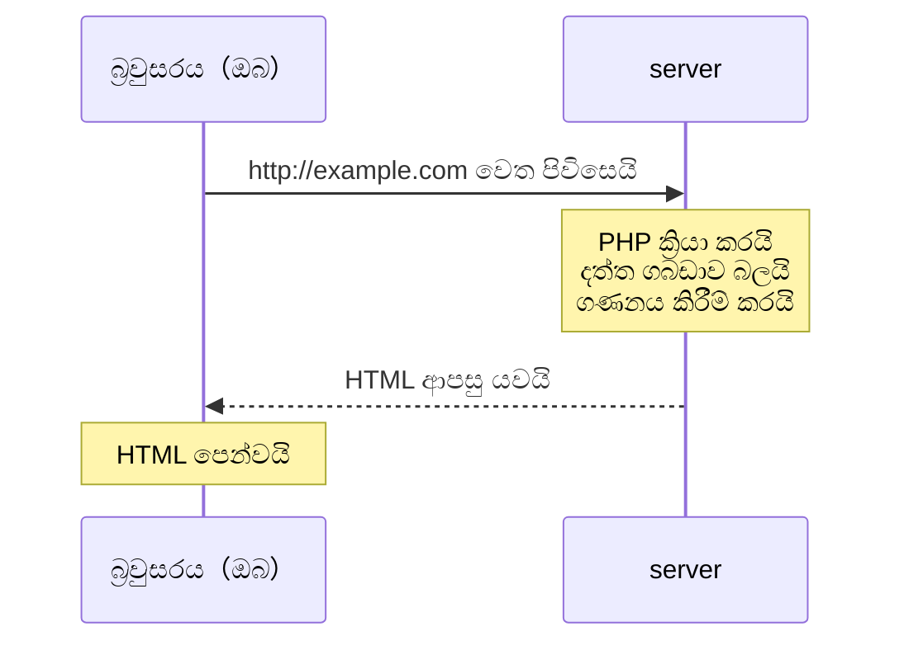

# 1 වසර｜දත්ත සැලසුම සහ යෙදුම් සංවර්ධනය — 2026/06/30

> 🇯🇵 මුල් පිටපත (ජපන් භාෂාවෙන්): [20260630_資料.md](<../../../1年生_データ設計とアプリ開発/前期/20260630/20260630_資料.md>) <!-- original-ja-link -->

---

## මෙම පාඨමාලාවේ ඇගයීම ගැන

| අයිතමය | ප්‍රතිශතය |
| --- | --- |
| පැමිණීමේ අනුපාතය | 30% |
| පන්තියේ හැසිරීම | 10% |
| භාරදීම් (assignments) | 60% |

> ⚠️ **වැදගත්: පැමිණීමේ අනුපාතය 60% ට වඩා අඩු වුවහොත්, භාරදීම් සහ පන්තියේ හැසිරීමේ ඇගයීම කුමක් වුවත් ඔබට බැර ඒකක (credits) ලබාගත නොහැක.**\
> ප්‍රමාද වී පැමිණීම හෝ කලින් පිටවීම, පාඨමාලාව භාර ගුරුවරයාගේ තීරණය අනුව නොපැමිණීමක් ලෙස සැලකිය හැක. අනිවාර්යයෙන්ම නියමිත වේලාවට පැමිණෙන්න.

---

## අද දින ඉලක්ක

- server-side සහ client-side අතර වෙනස පැහැදිලි කළ හැකි වීම
- PHP ක්‍රියා කරන පරිසරය සකසා ගත හැකි වීම
- පළමු PHP ගොනුව ක්‍රියාත්මක කළ හැකි වීම

---

## 1. client-side සහ server-side අතර වෙනස

```
client-side（පළමු අර්ධයේ ඉගෙන ගත් දේ）
  බ්‍රවුසරයේ ක්‍රියා කරයි → HTML / CSS / JavaScript
  පරිශීලකයාගේ උපාංගයේ ක්‍රියාත්මක වේ

server-side（මෙම වාරයේ සිට ඉගෙන ගන්නා දේ）
  server එකේ ක්‍රියා කරයි → PHP / Python / Ruby / Go ආදිය
  server එකේ ක්‍රියාත්මක වූ පසු ප්‍රතිඵලය බ්‍රවුසරයට යවයි
```

**server-side අවශ්‍ය වන්නේ ඇයි?**

| කිරීමට අවශ්‍ය දේ | client පමණක් | server අවශ්‍යයි |
| --- | --- | --- |
| පෙළ පෙන්වීම | ✅ කළ හැක | — |
| දත්ත ගබඩාව කියවීම | ❌ කළ නොහැක | ✅ අවශ්‍යයි |
| මුරපද ආරක්ෂිතව කළමනාකරණය | ❌ අනතුරුදායකයි | ✅ අවශ්‍යයි |
| පිවිසුම් (login) කාර්යය | ❌ කළ නොහැක | ✅ අවශ්‍යයි |

---

## 2. PHP යනු කුමක්ද

**PHP = server-side ක්‍රමලේඛන භාෂාවකි. Web යෙදුම් සංවර්ධනය සඳහාම විශේෂිත වූවකි.**

බ්‍රවුසරය සහ server එක අතර හුවමාරුව පහත ආකාරයට සිදු වේ.



**JavaScript සමඟ සසඳා බලමු:**

| අයිතමය | JavaScript | PHP |
| --- | --- | --- |
| ක්‍රියා කරන ස්ථානය | බ්‍රවුසරය | server |
| විචල්‍ය ලියන ආකාරය | `let x = 5;` | `$x = 5;` |
| string සම්බන්ධ කිරීම | `"Hello" + "World"` | `"Hello" . "World"` |
| array | `let arr = [1, 2, 3]` | `$arr = [1, 2, 3]` |
| ප්‍රතිදානය | `console.log()` | `echo` |

---

## 3. පරිසරය සැකසීම: PHP ස්ථාපනය

### Mac නම්（Homebrew භාවිතයෙන්）

Homebrew තවම ස්ථාපනය කර නැත්නම්, [brew.sh](https://brew.sh) හි උපදෙස් අනුව මුලින්ම එය ස්ථාපනය කරන්න.

```bash
brew install php
```

### Windows නම්

1. [windows.php.net/download](https://windows.php.net/download/) වෙත පිවිසෙන්න
2. 「VS16 x64 Non Thread Safe」 ZIP ගොනුව බාගන්න
3. `C:\php` වෙත extract කරන්න
4. PATH පරිසර විචල්‍යයට (environment variable) `C:\php` එකතු කරන්න

### ක්‍රියාකාරිත්වය පරීක්ෂා කිරීම

```bash
php --version
# → PHP 8.x.x ... ලෙස පෙන්වන්නේ නම් නිවැරදියි
```

---

## 4. පළමු PHP ගොනුව

### වැඩ කරන ෆෝල්ඩරයක් සාදන්න（ඕනෑම ස්ථානයක සෑදිය හැක）

```
Mac:     ~/study/
Windows: C:\Users\පරිශීලක නාමය\study\
```

### `index.php` සාදන්න

```php
<?php
// PHP කේතය <?php වලින් ආරම්භ වේ
// JS හි console.log ට සමාන වන්නේ echo

echo "こんにちは PHP！";

// විචල්‍ය $ වලින් ආරම්භ වේ（JavaScript සමඟ ඇති විශාල වෙනසකි）
$namae = "田中太郎";
$nenrei = 20;

// string එක ඇතුළට විචල්‍ය කාවද්දීම（double quote වල පමණි）
echo "名前: $namae";
echo "年齢: {$nenrei}歳";  // {} තුළ තැබීමෙන් විචල්‍යය නිවැරදිව හඳුනාගත හැක

// JS හි template literal ට සමානයි
// JS: `名前: ${namae}`
// PHP: "名前: {$namae}"
?>
```

**local server එක ආරම්භ කර බ්‍රවුසරයෙන් පරීක්ෂා කරන්න:**

```bash
# study ෆෝල්ඩරයට ගිය පසු ක්‍රියාත්මක කරන්න
cd ~/study
php -S localhost:8000
```

`http://localhost:8000/index.php` වෙත පිවිසෙන්න

---

## 5. PHP හි මූලික වාක්‍ය රීති（JS සමඟ සසඳමින්）

```php
<?php
// ========== විචල්‍ය ==========
$name = "Alice";      // JS හි let ට සමානයි（$ අවශ්‍යයි）
$age = 20;
$pi = 3.14;
$isStudent = true;

// ========== ප්‍රතිදානය ==========
echo "Hello";          // නව පේළියක් නොමැතිව ප්‍රතිදානය කරයි
echo "World\n";        // \n මගින් නව පේළියකට යයි
echo $name . "\n";     // . මගින් string සම්බන්ධ කරයි（JS හි + ට සමානයි）

// PHP ටැග් සහ HTML එකට මිශ්‍ර කළ හැක（PHP හි විශේෂත්වයකි）
?>
<h1>こんにちは、<?= $name ?>さん！</h1>
<!-- <?= යනු echo හි කෙටි ආකාරයයි -->
<?php

// ========== කොන්දේසි අනුව ශාඛාකරණය（JS හි මෙන්ම） ==========
if ($age >= 18) {
    echo "成人です\n";
} else {
    echo "未成年です\n";
}

// ========== loop ==========
for ($i = 1; $i <= 5; $i++) {   // $i යනු JS හි i හා සමානයි
    echo $i . "回目\n";
}

// ========== array ==========
$fruits = ["りんご", "みかん", "ぶどう"];
echo $fruits[0] . "\n";  // → りんご

// array එක loop කිරීම
foreach ($fruits as $fruit) {  // JS හි forEach ට සමානයි
    echo $fruit . "\n";
}
?>
```

---

## සාරාංශය

| සංකල්පය | JavaScript | PHP |
| --- | --- | --- |
| විචල්‍ය | `let x` | `$x` |
| ප්‍රතිදානය | `console.log()` | `echo` |
| string සම්බන්ධ කිරීම | `"a" + "b"` | `"a" . "b"` |
| array loop | `forEach` | `foreach` |
| ක්‍රියා කරන ස්ථානය | බ්‍රවුසරය | server |

---

## ඊළඟ පාඩමේ පෙරදසුන

PHP හි විචල්‍ය・දත්ත වර්ග (types)・ක්‍රියාකරු (operators)・array・associative array ගැන ගැඹුරින් ඉගෙන ගනිමු.\
「JavaScript හි ඇති එකම සංකල්ප වෙනස් ආකාරයකින් ලියා ඇත」 යන්න සිහියේ තබාගෙන ඉදිරියට යමු.

<!-- nav:start -->

---

📎 මේකත් කියවන්න → [PHP සංවර්ධන සේවාදායකයක් සකසන ආකාරය](../PHP開発サーバーの立て方.md)

| ⬅️ පෙර | 🗺️ සමස්ත සිතියම | ඊළඟ ➡️ |
|:--|:--:|--:|
| — | [පාඩම් ද්‍රව්‍යවල සමස්ත සිතියම](../../README.md) | [06/30 අභ්‍යාස](20260630_演習.md) |

<!-- nav:end -->
