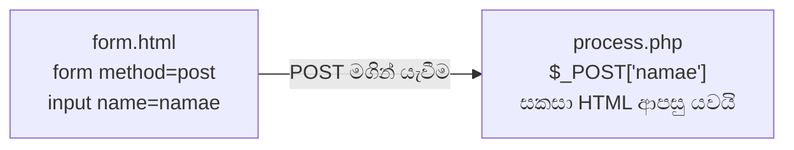
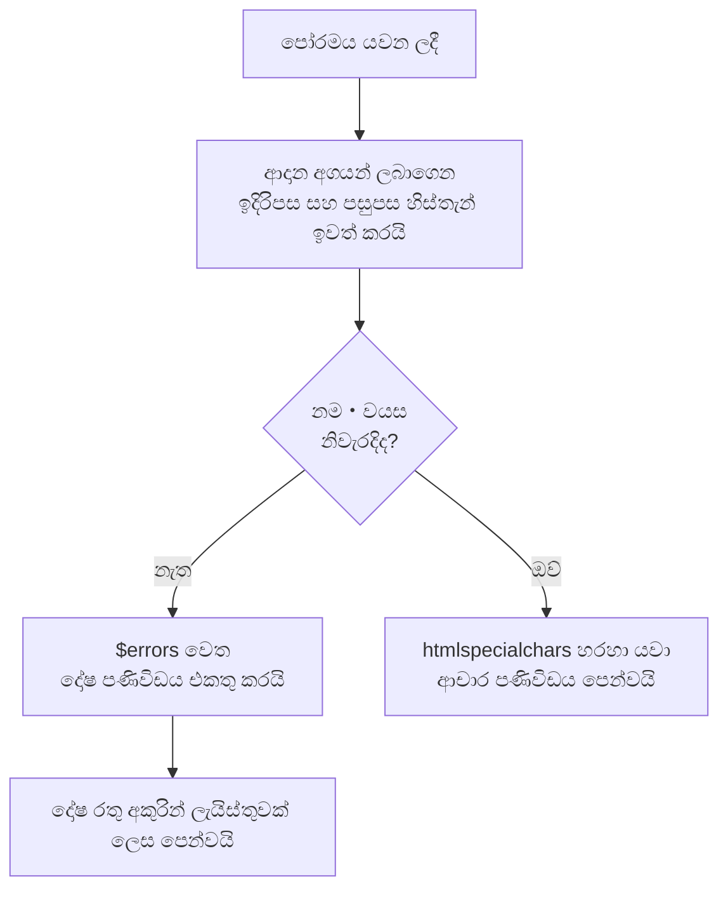

# 1 වසර｜දත්ත සැලසුම සහ යෙදුම් සංවර්ධනය — 2026/07/07

> 🇯🇵 මුල් පිටපත (ජපන් භාෂාවෙන්): [20260707_資料.md](<../../../1年生_データ設計とアプリ開発/前期/20260707/20260707_資料.md>) <!-- original-ja-link -->

---

## අද දින ඉලක්ක

- PHP හි විචල්‍ය・දත්ත වර්ග・array・associative array භාවිත කළ හැකි වීම
- කොන්දේසි අනුව ශාඛාකරණය සහ ශ්‍රිත (function) ලිවිය හැකි වීම
- HTML පෝරමයක (form) දත්ත PHP මගින් ලබාගෙන ආරක්ෂිතව සැකසිය හැකි වීම

---

## 1. විචල්‍ය සහ දත්ත වර්ග

```php
<?php
// විචල්‍ය අනිවාර්යයෙන්ම $ වලින් ආරම්භ වේ
$namae    = "田中太郎";   // පෙළ（string）
$nenrei   = 20;           // පූර්ණ සංඛ්‍යාව（int）
$身長     = 1.75;         // දශම සංඛ්‍යාව（float）
$isStudent = true;        // සත්‍ය/අසත්‍ය අගය（bool）

// gettype() මගින් දත්ත වර්ගය පරීක්ෂා කරන්න（JS හි typeof ට සමානයි）
echo gettype($namae);     // → string
echo gettype($nenrei);    // → integer

// දත්ත වර්ග පරිවර්තනය
$str = "42";
$num = (int)$str;         // string එක පූර්ණ සංඛ්‍යාවකට පරිවර්තනය කරයි
echo $num + 1;            // → 43
```

---

## 2. string හැසිරවීම

```php
<?php
$namae = "田中太郎";

echo mb_strlen($namae);   // → 4（අක්ෂර ගණන. mb_ ශ්‍රිත ජපන් වැනි බහු-බයිට් අක්ෂරවලට සහාය දක්වයි）

// විචල්‍ය කාවද්දීම
echo "名前: {$namae}さん";

// නිතර භාවිත වන string ශ්‍රිත
echo strtolower("HELLO");              // → hello
echo strtoupper("hello");              // → HELLO
echo trim("  hello  ");                // → hello（ඉදිරිපස සහ පසුපස හිස්තැන් ඉවත් කරයි）
echo str_replace("猫", "犬", "猫が好き"); // → 犬が好き
```

---

## 3. array

```php
<?php
$scores = [85, 72, 91, 68, 78];

echo $scores[0];          // → 85（0 සිට ආරම්භ වේ）
echo count($scores);      // → 5（JS හි .length ට සමානයි）

$scores[] = 95;           // අගට එකතු කරයි（JS හි push ට සමානයි）
sort($scores);            // ආරෝහණ පිළිවෙළට සකසයි
rsort($scores);           // අවරෝහණ පිළිවෙළට සකසයි

// නිතර භාවිත වන array ශ්‍රිත
$doubled  = array_map(fn($x) => $x * 2, $scores);       // JS හි map
$big      = array_filter($scores, fn($x) => $x >= 80);  // JS හි filter
$total    = array_sum($scores);                           // එකතුව
$average  = array_sum($scores) / count($scores);          // සාමාන්‍යය
```

---

## 4. associative array（JS හි object ට සමානයි）

```php
<?php
// associative array = key සහ value යුගල
$person = [
    "namae"  => "田中太郎",
    "nenrei" => 20,
    "email"  => "tanaka@example.com",
];

echo $person["namae"];   // → 田中太郎

$person["hobby"] = "プログラミング";  // key එකක් එකතු කරයි
$person["nenrei"] = 21;               // value එක වෙනස් කරයි

// foreach මගින් key සහ value ලබාගන්න
foreach ($person as $key => $value) {
    echo "{$key}: {$value}\n";
}

// ========== associative array වලින් සැදුණු array（JS හි object array） ==========
$students = [
    ["id" => 1, "name" => "田中太郎", "score" => 85],
    ["id" => 2, "name" => "鈴木花子", "score" => 72],
];

foreach ($students as $student) {
    echo "ID:{$student['id']} {$student['name']} {$student['score']}点\n";
}
```

---

## 5. කොන්දේසි අනුව ශාඛාකරණය

```php
<?php
$score = 72;

// if/elseif/else（PHP හි elseif ලෙස ලියයි）
if ($score >= 90) {
    echo "S評価";
} elseif ($score >= 80) {
    echo "A評価";
} elseif ($score >= 70) {
    echo "B評価";
} else {
    echo "D評価";
}

// ත්‍රිත්ව ක්‍රියාකරු (ternary operator)（JS හා සමානයි）
$result = ($score >= 60) ? "合格" : "不合格";

// match expression（PHP 8.0 සිට・switch හි වැඩිදියුණු කළ අනුවාදය）
$status = "active";
$label = match($status) {
    "active"   => "有効",
    "inactive" => "無効",
    default    => "不明",
};
echo $label;  // → 有効
```

---

## 6. ශ්‍රිත (function)

```php
<?php
// දත්ත වර්ග ප්‍රකාශ සහිත ශ්‍රිතය（arguments සහ return අගයට වර්ගය ලිවිය හැක）
function calcTax(float $price, float $taxRate = 0.1): float {
    return $price * (1 + $taxRate);
}

echo calcTax(1000);       // → 1100（පෙරනිමිය 10%）
echo calcTax(1000, 0.08); // → 1080（8%）

// අගයන් කිහිපයක් ආපසු දීම（associative array එකක් ලෙස ආපසු දෙයි）
function calcStats(array $numbers): array {
    return [
        "total"   => array_sum($numbers),
        "average" => array_sum($numbers) / count($numbers),
        "max"     => max($numbers),
        "min"     => min($numbers),
    ];
}

$stats = calcStats([85, 72, 91, 68]);
echo "平均: " . $stats["average"];  // → 平均: 79

// arrow function（PHP 7.4 සිට）
$double = fn($n) => $n * 2;
echo $double(5);  // → 10
```

---

## 7. පෝරම සහ දත්ත ලබාගැනීම（$_POST）

පෝරමයේ ඇතුළත් කළ දත්ත පහත ආකාරයට PHP වෙත ළඟා වේ.



### form.html

```html
<form action="process.php" method="post">
  <input type="text"  name="namae"   placeholder="名前">
  <input type="number" name="age"    placeholder="年齢">
  <textarea name="message"></textarea>
  <button type="submit">送信する</button>
</form>
```

### process.php

```php
<?php
$namae   = $_POST["namae"]   ?? "";
$age     = $_POST["age"]     ?? "";
$message = $_POST["message"] ?? "";

// !! වැදගත් !! XSS ආරක්ෂාව: htmlspecialchars මගින් HTML ටැග් අක්‍රිය කරන්න
$safeName    = htmlspecialchars($namae,   ENT_QUOTES, 'UTF-8');
$safeMessage = htmlspecialchars($message, ENT_QUOTES, 'UTF-8');

echo "<p>名前: {$safeName}</p>";
echo "<p>年齢: {$age}歳</p>";
echo "<p>メッセージ: {$safeMessage}</p>";
?>
```

---

## 8. XSS ආරක්ෂාව

```php
<?php
// ❌ අනතුරුදායක උදාහරණය（htmlspecialchars නොමැතිව）
$input = "<script>alert('ハッキング！')</script>";
echo $input;
// → බ්‍රවුසරය <script> ක්‍රියාත්මක කර දමයි!

// ✅ ආරක්ෂිත උදාහරණය
echo htmlspecialchars($input, ENT_QUOTES, 'UTF-8');
// → &lt;script&gt;... සාමාන්‍ය පෙළක් ලෙස පෙන්වයි
?>
```

> **රීතිය:** පරිශීලකයා ඇතුළත් කළ දේ අනිවාර්යයෙන්ම `htmlspecialchars()` හරහා යැවූ පසුව පමණක් පෙන්වන්න!

---

## 9. වලංගුකරණය (validation)（ආදාන පරීක්ෂාව）

පහත කේතය, මෙම පිළිවෙළට ආදාන පරීක්ෂා කරයි.



```php
<?php
$errors = [];
$namae  = "";
$age    = "";

if ($_SERVER["REQUEST_METHOD"] === "POST") {
    $namae = trim($_POST["namae"] ?? "");
    $age   = trim($_POST["age"]   ?? "");

    if (empty($namae)) {
        $errors[] = "名前は必須です";
    } elseif (mb_strlen($namae) > 50) {
        $errors[] = "名前は50文字以内にしてください";
    }

    if (empty($age)) {
        $errors[] = "年齢は必須です";
    } elseif (!is_numeric($age) || $age < 0 || $age > 150) {
        $errors[] = "年齢は0〜150の数値を入力してください";
    }

    if (empty($errors)) {
        $safeName = htmlspecialchars($namae, ENT_QUOTES, 'UTF-8');
        echo "<p>こんにちは、{$safeName}さん（{$age}歳）！</p>";
    }
}

if (!empty($errors)) {
    echo "<ul style='color:red;'>";
    foreach ($errors as $error) {
        echo "<li>" . htmlspecialchars($error) . "</li>";
    }
    echo "</ul>";
}
?>
```

---

## සාරාංශය

| කාර්යය | JavaScript | PHP |
| --- | --- | --- |
| විචල්‍ය | `let x = 1` | `$x = 1` |
| array එකේ දිග | `arr.length` | `count($arr)` |
| අගට එකතු කිරීම | `arr.push(v)` | `$arr[] = v` |
| forEach | `arr.forEach(fn)` | `foreach ($arr as $v)` |
| object | `{key: value}` | `["key" => value]` |
| else if | `else if` | `elseif` |
| arrow function | `(x) => x * 2` | `fn($x) => $x * 2` |
| පෝරම දත්ත ලබාගැනීම | `fetch` / `FormData` | `$_POST["name"]` |
| XSS ආරක්ෂාව | `textContent` භාවිත කරයි | `htmlspecialchars()` |

---

## ඊළඟ පාඩමේ පෙරදසුන

「දත්ත ගබඩාවක් අවශ්‍ය වන්නේ ඇයි」 යන්න අත්දැකීමෙන්ම ඉගෙන ගනිමු.  
PHP array පමණක් භාවිත කර දත්ත කළමනාකරණය කිරීමට උත්සාහ කළ විට ඇති වන සීමාවන් මොනවාද යන්න ඔබටම දැනෙනු ඇත.

<!-- nav:start -->

---

| ⬅️ පෙර | 🗺️ සමස්ත සිතියම | ඊළඟ ➡️ |
|:--|:--:|--:|
| [06/30 අභ්‍යාස](../20260630/20260630_演習.md) | [පාඩම් ද්‍රව්‍යවල සමස්ත සිතියම](../../README.md) | [07/07 අභ්‍යාස](20260707_演習.md) |

<!-- nav:end -->
