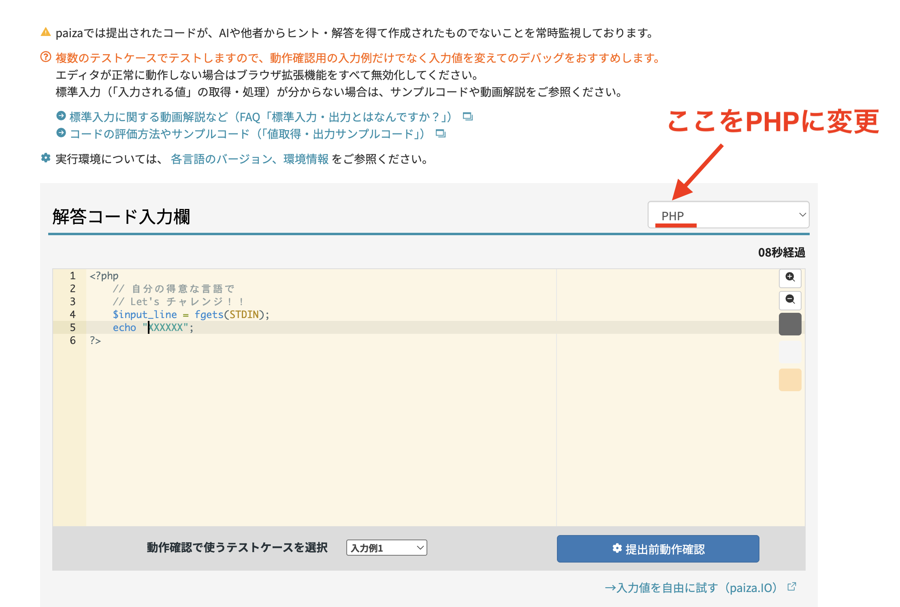

# අභ්‍යාස ගැටලු（2026 ජූලි 14）

> 🇯🇵 මුල් පිටපත (ජපන් භාෂාවෙන්): [20260714_資料_1.md](<../../../1年生_データ設計とアプリ開発/前期/20260714/20260714_資料_1.md>) <!-- original-ja-link -->

PHP server එක පිහිටුවීමට හැකි වූ නිසා, මුලින්ම මෙතෙක් කළ අභ්‍යාස ගැටලු කර බලන්න.

## සූදානම

- [PHP සංවර්ධන සේවාදායකයක් සකසන ආකාරය](../PHP開発サーバーの立て方.md)

## අභ්‍යාස

1. [20260630_演習](../20260630/20260630_演習.md)
2. [20260707_演習](../20260707/20260707_演習.md)


සියලු ගැටලු එකම `index.php` එකක එකට ලිවීමටද හැකියි, නමුත් [PHP සංවර්ධන සේවාදායකයක් සකසන ආකාරය](../PHP開発サーバーの立て方.md) හි 「පරිච්ඡේද අනුව ෆෝල්ඩර ව්‍යුහයක් හරහා පිවිසීම」 කොටසේ ආකාරයට, ගැටලුවෙන් ගැටලුවට ගොනු වෙන් කිරීමටද හැකියි（උදා: `1-1.php` / `1-2.php`）.

### ෆෝල්ඩර ව්‍යුහයේ උදාහරණය

```
study/
  index.php
  0630/
    1.php
    2.php
    3.php
    4.php
  0707/
    1-1.php
    1-2.php
    2-1.php
```

### server ආරම්භ කිරීමේ විධානය

「cd」 යනු ෆෝල්ඩරයක් (directory) වෙත යාම යන්නයි.

```bash
cd /Users/<ඔබේ පරිශීලක නාමය>/Desktop/study
php -S localhost:8000
```

### URL වෙත පිවිසෙන ආකාරය

server එක `study` ෆෝල්ඩරය තුළම ආරම්භ කරන නිසා（`php -S localhost:8000`）, URL එක `study/` සිට ඇති සාපේක්ෂ මාර්ගයට (relative path) අනුරූප වේ.

```
http://localhost:8000/0630/1.php
http://localhost:8000/0630/2.php
http://localhost:8000/0707/1-1.php
http://localhost:8000/0707/1-2.php
```

## AI භාවිත කිරීම ගැන

**Gemini වැනි AI භාවිත කිරීම කමක් නැත!**නමුත්, පහත කරුණු සිහියේ තබාගන්න.

- භාෂාව තේරුම් ගන්න
- සොයා බැලීමෙන් දැනගත හැකි දේ කටපාඩම් කරන්න එපා
- තේරෙන්නේ නැත්නම් 「කේතයට පැහැදිලි කිරීමේ comment එකතු කරන්න」 කියා AI ගෙන් ඉල්ලන්න


## අභ්‍යාස අවසන් කළ පසු කාලය ඉතිරිව ඇති අය Paiza හි ලියාපදිංචි වී PHP භාවිතයෙන් skill check එකට උත්සාහ කරන්න

https://paiza.jp/challenges

ඉදිරිපත් කිරීමේ භාෂාව පෙරනිමියෙන් වෙනත් භාෂාවකට සකසා ඇති නිසා, පහත රූපයේ පරිදි PHP වලට වෙනස් කරන්න.



**අවධානයට: Paiza විසින් skill check සඳහා ඉදිරිපත් කරන කේතය AI හෝ වෙනත් අයගෙන් ඉඟි හෝ පිළිතුරු ලබාගෙන ලියා ඇත්දැයි නිරන්තරයෙන් පරීක්ෂා කරයි.** මෙතෙක් කළ අභ්‍යාසවලට වෙනස්ව, AI භාවිත නොකර ඔබේම හැකියාවෙන් විසඳන්න.

<!-- nav:start -->

---

| ⬅️ පෙර | 🗺️ සමස්ත සිතියම | ඊළඟ ➡️ |
|:--|:--:|--:|
| [07/07 අභ්‍යාස](../20260707/20260707_演習.md) | [පාඩම් ද්‍රව්‍යවල සමස්ත සිතියම](../../README.md) | [07/21 DB අවශ්‍ය වන්නේ ඇයි](../20260721/20260721_資料.md) |

<!-- nav:end -->
