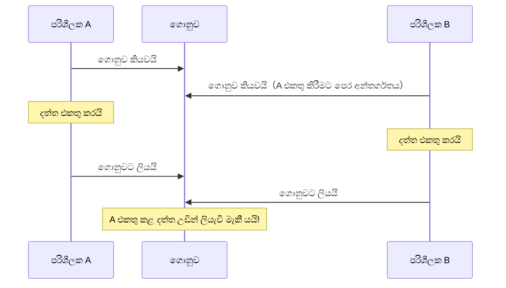
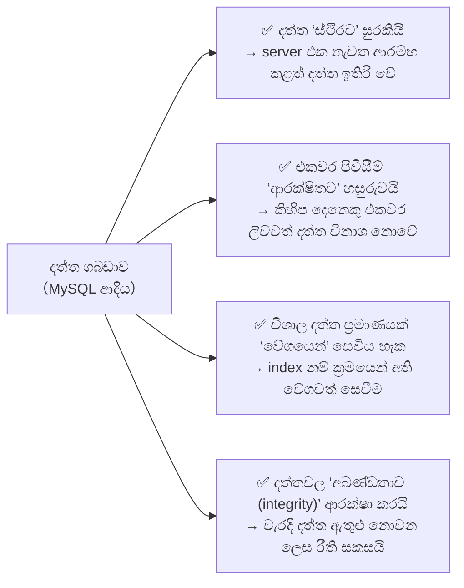
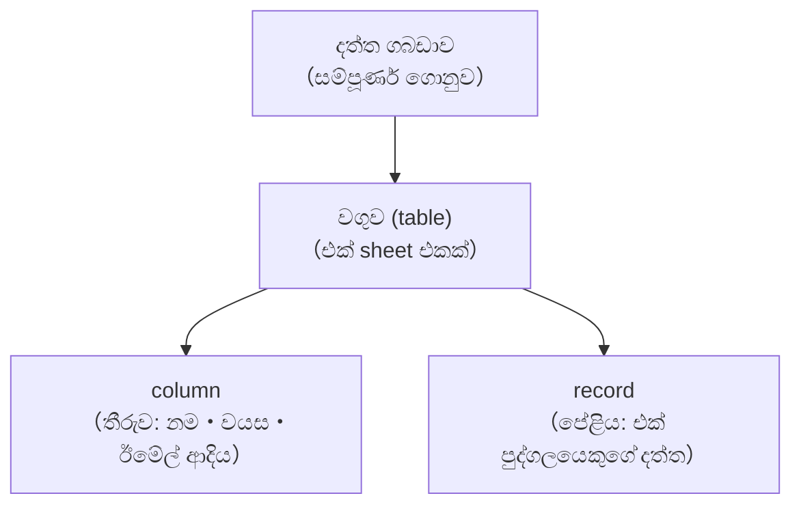
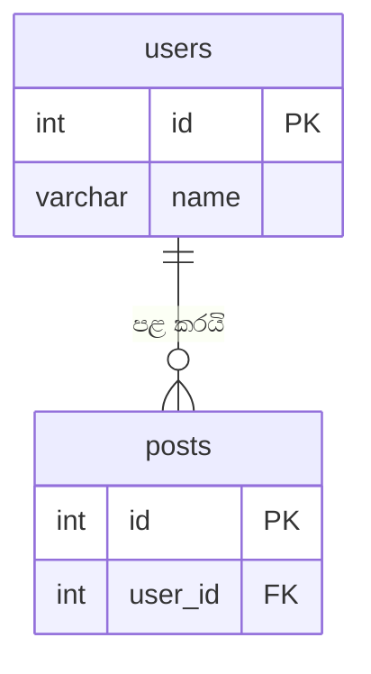

# පාඩම 06｜DB අවශ්‍ය වන්නේ ඇයි — PHP array පමණක් ප්‍රමාණවත් නොවේ

> 🇯🇵 මුල් පිටපත (ජපන් භාෂාවෙන්): [20260721_資料.md](<../../../1年生_データ設計とアプリ開発/前期/20260721/20260721_資料.md>) <!-- original-ja-link -->

## අද දින ඉලක්ක
- PHP array පමණක් භාවිත කර දත්ත කළමනාකරණය කළ විට ඇති වන ගැටලු පැහැදිලි කළ හැකි වීම
- දත්ත ගබඩාවක් (database) විසඳන්නේ මොනවාදැයි තේරුම් ගැනීම
- MySQL හි මූලික සංකල්ප（වගුව・පේළිය・column）පැහැදිලි කළ හැකි වීම

---

## 1. array පමණක් භාවිත කර දත්ත කළමනාකරණය කර බලමු

මුලින්ම, PHP array පමණක් භාවිත කර 「පරිශීලක කළමනාකරණ පද්ධතියක්」 සාදා බලමු.

```php
<?php
// තත්ත්වය ගොනුවක සුරැකීමට දරන උත්සාහයක්
// users.php
$users = [
    ["id" => 1, "name" => "田中太郎", "email" => "tanaka@example.com"],
    ["id" => 2, "name" => "鈴木花子", "email" => "suzuki@example.com"],
];

// නව පරිශීලකයෙකු එකතු කරන ශ්‍රිතය
function addUser(array &$users, string $name, string $email): void {
    $newId = count($users) + 1;
    $users[] = ["id" => $newId, "name" => $name, "email" => $email];
}

addUser($users, "山田次郎", "yamada@example.com");

// පෙන්වීම
foreach ($users as $user) {
    echo "{$user['id']}: {$user['name']}\n";
}
```

### ගැටලුව 1: server එක නැවත ආරම්භ කළ විට දත්ත මැකී යයි

```
PHP වැඩසටහන, request එකක් එන සෑම වරකම මුල සිටම ක්‍රියාත්මක වේ
 → සෑම වරකම $users = [] සිට ආරම්භ වේ
 → පෙර වරක එකතු කළ දත්ත මැකී යයි!
```

### ගැටලුව 2: කිහිප දෙනෙකු එකවර පිවිසුණු විට දත්ත විනාශ වේ

A සහ B දෙදෙනා බොහෝ දුරට එකවර ලිවීමට උත්සාහ කළොත්, පහත දේ සිදු වේ.



### ගැටලුව 3: දත්ත වැඩි වන විට සෙවීම මන්දගාමී වේ

```php
// පරිශීලකයින් මිලියනයක් අතරින් නිශ්චිත විද්‍යුත් තැපැල් ලිපිනයක් සොයයි
foreach ($users as $user) {
    if ($user["email"] === "target@example.com") {
        return $user;  // නරකම අවස්ථාවේදී මිලියන වාරයක් loop එක ක්‍රියාත්මක වේ...
    }
}
```

---

## 2. දත්ත ගබඩාව විසඳන දේ



---

## 3. දත්ත ගබඩාවේ මූලික සංකල්ප

දත්ත ගබඩාව **spreadsheet එකකට සමාන ව්‍යුහයක්** ලෙස සිතුවොත් තේරුම් ගැනීම පහසුයි.



```
උදාහරණය: users වගුව

 id │ name     │ email                │ created_at
────┼──────────┼──────────────────────┼─────────────────
  1 │ 田中太郎 │ tanaka@example.com   │ 2024-01-01 10:00
  2 │ 鈴木花子 │ suzuki@example.com   │ 2024-01-02 11:00
  3 │ 山田次郎 │ yamada@example.com   │ 2024-01-03 12:00
```

---

## 4. MySQL හි මූලික කරුණු

**MySQL = ලෝකයේ වැඩිපුරම භාවිත වන open source සම්බන්ධතා දත්ත ගබඩාව (relational database)**

[සම්බන්ධතා දත්ත ගබඩා ගැන](./リレーショナルデータベース入門.md)

Laravel හිදීද සම්මතයක් ලෙස භාවිත කරයි.

```
සම්බන්ධතා දත්ත ගබඩාව（RDB）යනු:
- දත්ත වගු（table）ලෙස කළමනාකරණය කරයි
- වගු එකිනෙක 「සම්බන්ධතා（relation）」 මගින් සම්බන්ධ කළ හැක
- SQL（Structured Query Language）නම් භාෂාවෙන් හසුරුවයි

උදාහරණය:
  users වගුව（පරිශීලක තොරතුරු）
  posts වගුව（පළ කිරීම් තොරතුරු）
  → posts.user_id මගින් එය කුමන පරිශීලකයාගේ පළ කිරීමක්දැයි කළමනාකරණය කළ හැක
```

users සහ posts අතර සම්බන්ධතාව රූපසටහනකින් පෙන්වුවොත්, පහත ආකාරයට වේ（එක් පරිශීලකයෙකුට පළ කිරීම් කිහිපයක් තිබිය හැක）.



---

## 5. MySQL සූදානම් කරමු（Windows: XAMPP / Mac: DBngin）

ඔබේ OS එකට ගැළපෙන පරිදි, දෙකෙන් එකක් භාවිත කරන්න.

### Windows නම්: XAMPP

**XAMPP = Apache / MySQL（MariaDB）/ PHP / phpMyAdmin එකවර ස්ථාපනය කළ හැකි නොමිලේ ලබාදෙන මෙවලමකි**

#### ස්ථාපනය

[apachefriends.org](https://www.apachefriends.org/) වෙතින් බාගෙන ස්ථාපනය කරන්න

#### MySQL server එක ආරම්භ කිරීම

1. XAMPP Control Panel විවෘත කරන්න
2. 「MySQL」 පේළියේ ඇති 「Start」 ක්ලික් කර ආරම්භ කරන්න

### Mac නම්: DBngin

**DBngin = MySQL / PostgreSQL / Redis එක් ක්ලික් එකකින් ආරම්භ කළ හැකි නොමිලේ ලබාදෙන මෙවලමකි**

#### ස්ථාපනය

[dbngin.com](https://dbngin.com/) වෙතින් බාගෙන ස්ථාපනය කරන්න

#### MySQL server එක සෑදීම・ආරම්භ කිරීම

1. DBngin විවෘත කරන්න
2. 「+」 බොත්තම →「MySQL」 තෝරන්න
3. අනුවාදය (version) තෝරා 「Create」（ඕනෑම අනුවාදයක් කමක් නැත, සැකයක් ඇත්නම් නවතම ස්ථායී අනුවාදය）
4. සෑදූ server එකේ 「Start」 ක්ලික් කර ආරම්භ කරන්න

### පොදු සම්බන්ධතා තොරතුරු

කුමන මෙවලම භාවිත කළත්, පෙරනිමියෙන් පහත සැකසුම් සමඟ MySQL ආරම්භ වේ.

```
Host:     127.0.0.1
Port:     3306
User:     root
Password: （හිස්ව තැබීම කමක් නැත）
```

※ දැනටමත් 3306 port එක වෙනත් MySQL එකක් භාවිත කරනවා නම්, මෙවලම තුළින් වෙනත් port අංකයකට වෙනස් කරන්න（එවිට GUI මෙවලමේ සම්බන්ධතා සැකසුම්ද එම port අංකයට ගැළපෙන ලෙස සකසන්න）.

---

## 6. GUI මෙවලමකින් MySQL හසුරුවමු（Windows: phpMyAdmin / Mac: TablePlus）

### Windows නම්: phpMyAdmin

**phpMyAdmin = XAMPP සමඟ සම්මතයෙන්ම ලැබෙන MySQL කළමනාකරණ තිරය（බ්‍රවුසරයෙන් හසුරුවයි）**

XAMPP Control Panel හි MySQL Start කළ තත්ත්වයේ, බ්‍රවුසරයෙන් පහත ලිපිනයට පිවිසෙන්න.

```
http://localhost/phpmyadmin/
```

සම්බන්ධතා තොරතුරු ඇතුළත් කිරීම අවශ්‍ය නැත（XAMPP ආරම්භ කළ විට root පරිශීලකයා ලෙස ස්වයංක්‍රීයව සම්බන්ධ වේ）.

### Mac නම්: TablePlus

**TablePlus = GUI එකක් මගින් MySQL හැසිරවිය හැකි මෙවලමකි（SQL අතින් ලියා පුහුණු විය හැක）**

#### ස්ථාපනය

[tableplus.com](https://tableplus.com/) වෙතින් බාගන්න

#### සම්බන්ධතා සැකසුම්（DBngin මගින් ආරම්භ කළ MySQL වෙත සම්බන්ධ වන විට）

```
Name:     local
Host:     127.0.0.1
Port:     3306
User:     root
Password: （හිස්ව තැබීම කමක් නැත）
Database: （පසුව සාදයි）
```

---

## 7. පළමු දත්ත ගබඩාව සාදමු

Windows නම් phpMyAdmin හි 「SQL」 tab එකේ, Mac නම් TablePlus හි SQL tab එකේ පහත දේ ක්‍රියාත්මක කරන්න:

```sql
-- දත්ත ගබඩාව සාදන්න
CREATE DATABASE school_db;

-- සෑදූ දත්ත ගබඩාව භාවිත කරන්න
USE school_db;

-- වගුව සාදන්න
CREATE TABLE users (
    id    INT AUTO_INCREMENT PRIMARY KEY,  -- අංකය ස්වයංක්‍රීයව ලැබේ
    name  VARCHAR(100) NOT NULL,           -- උපරිම අක්ෂර 100 ක string（අනිවාර්යයි）
    email VARCHAR(255) NOT NULL UNIQUE,    -- UNIQUE = අනුපිටපත් තහනම්
    age   INT,                             -- පූර්ණ සංඛ්‍යාව（විකල්ප）
    created_at TIMESTAMP DEFAULT CURRENT_TIMESTAMP  -- සෑදූ දිනය සහ වේලාව
);

-- දත්ත ඇතුළත් කර බලන්න
INSERT INTO users (name, email, age) VALUES ('田中太郎', 'tanaka@example.com', 20);
INSERT INTO users (name, email, age) VALUES ('鈴木花子', 'suzuki@example.com', 22);

-- දත්ත ලබාගන්න
SELECT * FROM users;
```

---

## අමතර කොටස: PHP වලින් SQL ක්‍රියාත්මක කරන උදාහරණයක්

PHP හි **PDO（PHP Data Objects）** නම්, DB සම්බන්ධතා සඳහා වූ සම්මත කාර්යයක් ඇත.

```php
<?php
$pdo = new PDO(
    'mysql:host=127.0.0.1;port=3306;dbname=school_db;charset=utf8mb4',
    'root',
    '' // XAMPP/DBngin හි පෙරනිමිය හිස් මුරපදයයි
);

// ක්‍රියාත්මක කරන SQL වාක්‍යය
$sql = "SELECT * FROM users";

$stmt = $pdo->query($sql);
$users = $stmt->fetchAll(PDO::FETCH_ASSOC);

foreach ($users as $user) {
    echo "{$user['id']}: {$user['name']}\n";
}
```

---

## සාරාංශය

| ගැටලුව | array පමණක් | දත්ත ගබඩාව |
|------|---------|------------|
| දත්ත ස්ථිරව සුරැකීම | ❌ මැකී යයි | ✅ ඉතිරි වේ |
| එකවර පිවිසීම | ❌ විනාශ වේ | ✅ ආරක්ෂිතයි |
| විශාල දත්ත සෙවීම | ❌ මන්දගාමී | ✅ වේගවත් |
| දත්තවල අඛණ්ඩතාව | ❌ පරීක්ෂාවක් නැත | ✅ රීති මගින් ආරක්ෂා කළ හැක |

---

## ඊළඟ පාඩමේ（පාඩම 07）පෙරදසුන

SQL හි මූලික කරුණු: `SELECT` / `WHERE` / `ORDER BY` භාවිතයෙන් දත්ත ලබාගන්නා ආකාරය ඉගෙන ගනිමු.  
TablePlus හි සැබවින්ම SQL ලියා ක්‍රියාත්මක කරමින් අත්දැකීමෙන් ඉගෙන ගනිමු.

<!-- nav:start -->

---

📎 මේකත් කියවන්න → [දත්ත ගබඩා සේවාදායකයක් සකසන ආකාරය (XAMPP සංස්කරණය)](../データベースサーバーの立て方/データベースサーバーの立て方.md)・[සම්බන්ධතා දත්ත ගබඩා හැඳින්වීම](リレーショナルデータベース入門.md)

| ⬅️ පෙර | 🗺️ සමස්ත සිතියම | ඊළඟ ➡️ |
|:--|:--:|--:|
| [07/14 අභ්‍යාස ගැටලු](../20260714/20260714_資料_1.md) | [පාඩම් ද්‍රව්‍යවල සමස්ත සිතියම](../../README.md) | [07/21 SQL මූලික කරුණු ①（SELECT）](20260721_資料_2.md) |

<!-- nav:end -->
