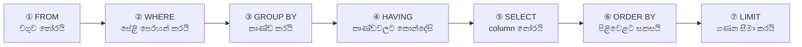

# පාඩම 07｜SQL මූලික කරුණු ① — SELECT / WHERE / ORDER BY

> 🇯🇵 මුල් පිටපත (ජපන් භාෂාවෙන්): [20260721_資料_2.md](<../../../1年生_データ設計とアプリ開発/前期/20260721/20260721_資料_2.md>) <!-- original-ja-link -->

## අද දින ඉලක්ක
- SELECT මගින් දත්ත ලබාගත හැකි වීම
- WHERE මගින් කොන්දේසි දක්වා පෙරහන් කළ හැකි වීම
- ORDER BY මගින් පිළිවෙළට සැකසිය හැකි වීම
- LIMIT මගින් ලබාගන්නා පේළි ගණන සීමා කළ හැකි වීම

---

## සූදානම: පුහුණුව සඳහා දත්ත ඇතුළත් කරන්න

TablePlus හි SQL tab එකේ ක්‍රියාත්මක කරන්න:

```sql
-- දත්ත ගබඩාව සහ වගුව සාදන්න
CREATE DATABASE IF NOT EXISTS school_db;
USE school_db;

-- සිසුන්ගේ වගුව
CREATE TABLE IF NOT EXISTS students (
    id         INT AUTO_INCREMENT PRIMARY KEY,
    name       VARCHAR(100) NOT NULL,
    age        INT NOT NULL,
    class      VARCHAR(10) NOT NULL,
    score      INT NOT NULL,
    enrolled_at DATE NOT NULL
);

-- පරීක්ෂණ දත්ත ඇතුළත් කරන්න
INSERT INTO students (name, age, class, score, enrolled_at) VALUES
('田中太郎', 18, 'A', 85, '2024-04-01'),
('鈴木花子', 19, 'A', 72, '2024-04-01'),
('山田次郎', 18, 'B', 91, '2024-04-01'),
('佐藤三郎', 20, 'B', 58, '2024-04-01'),
('伊藤美咲', 18, 'A', 78, '2024-04-01'),
('渡辺一郎', 19, 'C', 95, '2024-04-01'),
('加藤幸子', 18, 'C', 45, '2024-04-01'),
('吉田健太', 20, 'B', 88, '2024-04-01'),
('山本麻衣', 19, 'A', 67, '2024-04-01'),
('中村龍一', 18, 'C', 73, '2024-04-01');
```

---

## 1. SELECT — දත්ත ලබාගැනීම

```sql
-- සියලු column・සියලු පේළි ලබාගන්න（* = සියලු column）
SELECT * FROM students;

-- නිශ්චිත column පමණක් ලබාගන්න
SELECT name, score FROM students;

-- column වලට අන්වර්ථ නාම දෙන්න（AS）
SELECT name AS 名前, score AS 点数 FROM students;
```

---

## 2. WHERE — කොන්දේසි අනුව පෙරහන් කිරීම

```sql
-- score 80 හෝ ඊට වැඩි සිසුන්
SELECT * FROM students WHERE score >= 80;

-- class 'A' වන සිසුන්
SELECT * FROM students WHERE class = 'A';

-- age 18 සහ score 70 හෝ ඊට වැඩි
SELECT * FROM students WHERE age = 18 AND score >= 70;

-- class 'A' හෝ 'B'
SELECT * FROM students WHERE class = 'A' OR class = 'B';

-- class 'A' හෝ 'B'（IN භාවිත කළොත් කෙටියෙන් ලිවිය හැක）
SELECT * FROM students WHERE class IN ('A', 'B');

-- score 60 හෝ ඊට වැඩි 90 ට අඩු（BETWEEN）
SELECT * FROM students WHERE score BETWEEN 60 AND 89;

-- name තුළ "太" ඇතුළත්（LIKE = අර්ධ ගැළපීම）
SELECT * FROM students WHERE name LIKE '%太%';
-- % = අක්ෂර කීයක් වුවත් කමක් නැත（wildcard）

-- score NULL නොවේ（IS NOT NULL）
SELECT * FROM students WHERE score IS NOT NULL;
```

---

## 3. ORDER BY — පිළිවෙළට සැකසීම

```sql
-- score ආරෝහණ පිළිවෙළට（අඩු සිට）
SELECT * FROM students ORDER BY score ASC;   -- ASC = ascending（ආරෝහණ）

-- score අවරෝහණ පිළිවෙළට（ඉහළ සිට）
SELECT * FROM students ORDER BY score DESC;  -- DESC = descending（අවරෝහණ）

-- class ආරෝහණ පිළිවෙළට, එකම class තුළ score අවරෝහණ පිළිවෙළට
SELECT * FROM students ORDER BY class ASC, score DESC;
```

---

## 4. LIMIT — ලබාගන්නා පේළි ගණන සීමා කිරීම

```sql
-- ඉහළම 5 පමණක් ලබාගන්න
SELECT * FROM students ORDER BY score DESC LIMIT 5;

-- 6 වන පේළියේ සිට පේළි 5 ක් ලබාගන්න（pagination සඳහා භාවිත කරයි）
-- LIMIT පේළි ගණන OFFSET ආරම්භක ස්ථානය
SELECT * FROM students ORDER BY id ASC LIMIT 5 OFFSET 5;
```

---

## 5. සමූහ ශ්‍රිත (aggregate functions)

```sql
-- පේළි ගණන ගණන් කරන්න
SELECT COUNT(*) FROM students;
-- → 10

-- score හි එකතුව・සාමාන්‍යය・උපරිමය・අවමය
SELECT
    COUNT(*)    AS 人数,
    SUM(score)  AS 合計点,
    AVG(score)  AS 平均点,
    MAX(score)  AS 最高点,
    MIN(score)  AS 最低点
FROM students;

-- GROUP BY: පන්තිය අනුව සාමාන්‍ය ලකුණ
SELECT class, AVG(score) AS 平均点, COUNT(*) AS 人数
FROM students
GROUP BY class
ORDER BY 平均点 DESC;
```

---

## 6. SELECT ක්‍රියාත්මක වන පිළිවෙළ（වැදගත්!）

SQL ක්‍රියාත්මක වන්නේ ලියූ පිළිවෙළට නොව, පහත පිළිවෙළටය.



```sql
SELECT name, score       -- ⑤ ලබාගන්නා column තෝරයි
FROM students            -- ① වගුව තෝරයි
WHERE score >= 70        -- ② කොන්දේසි අනුව පෙරහන් කරයි
GROUP BY class           -- ③ කාණ්ඩ කරයි
HAVING AVG(score) >= 75  -- ④ කාණ්ඩවලට කොන්දේසි（WHERE ට පසුව）
ORDER BY score DESC      -- ⑥ පිළිවෙළට සකසයි
LIMIT 5;                 -- ⑦ ගණන සීමා කරයි
```

---

## සාරාංශය

| SQL | අර්ථය |
|-----|------|
| `SELECT * FROM වගුව` | සියලු දත්ත ලබාගනී |
| `WHERE කොන්දේසිය` | කොන්දේසි අනුව පෙරහන් කරයි |
| `AND` / `OR` | කොන්දේසි කිහිපයක් එකට භාවිත කිරීම |
| `IN (අගය1, අගය2)` | අගයන් කිහිපයකින් ඕනෑම එකකට ගැළපීම |
| `LIKE '%අක්ෂර%'` | අර්ධ ගැළපීම් සෙවීම |
| `ORDER BY column ASC/DESC` | පිළිවෙළට සැකසීම |
| `LIMIT සංඛ්‍යාව` | ලබාගන්නා පේළි ගණන සීමා කිරීම |
| `COUNT(*)` / `AVG()` / `SUM()` | සමූහ ශ්‍රිත |
| `GROUP BY column` | කාණ්ඩ කිරීම |

---

## ඊළඟ පාඩමේ（පාඩම 08）පෙරදසුන

INSERT / UPDATE / DELETE ඉගෙන ගනිමු.  
දත්ත එකතු කිරීම・යාවත්කාලීන කිරීම・මකා දැමීම කළ හැකි වනු ඇත.

<!-- nav:start -->

---

| ⬅️ පෙර | 🗺️ සමස්ත සිතියම | ඊළඟ ➡️ |
|:--|:--:|--:|
| [07/21 DB අවශ්‍ය වන්නේ ඇයි](20260721_資料.md) | [පාඩම් ද්‍රව්‍යවල සමස්ත සිතියම](../../README.md) | [07/21 අභ්‍යාස](20260721_演習.md) |

<!-- nav:end -->
