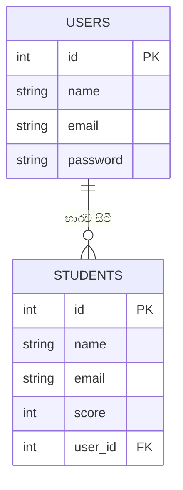

> 🇯🇵 මුල් පිටපත (ජපන් භාෂාවෙන්): [リレーショナルデータベース入門.md](<../../../1年生_データ設計とアプリ開発/前期/20260721/リレーショナルデータベース入門.md>) <!-- original-ja-link -->

## මෙම ලිපියෙන් ඔබ ඉගෙන ගන්නා දේ

- වගුව, පේළිය සහ තීරුව
- ප්‍රාථමික යතුර (Primary Key)
- බාහිර යතුර (Foreign Key) සහ වගු අතර සම්බන්ධය
- වගු වෙන් කරන්නේ ඇයි

## දත්ත ගබඩාව = පිළිවෙළට සකස් කළ වගු එකතුවක්

කඩදාසියක අවුල් සහගතව සටහන් කරනවා වෙනුවට, වගු ආකාරයෙන් පිළිවෙළට සකස් කර දත්ත සුරකින ක්‍රමය "දත්ත ගබඩාව" (Database) යි. RDB (සම්බන්ධතා දත්ත ගබඩාව - Relational Database) හි විශේෂත්වය නම්, මෙවැනි වගු (Table) කිහිපයක් එකිනෙක සම්බන්ධ කර (= relation කර) භාවිතා කළ හැකි වීමයි.

## වගුව, පේළිය සහ තීරුව

මෙම යෙදුමේ වෙනස් කාර්යයන් සහිත වගු 2ක් තිබේ. ඒ එක එකක් උදාහරණයට ගෙන, එක් එක් කොටසේ නම් බලමු.

### 🎓 students වගුව (සිසු දත්ත)

| id | name | email | score |
|----|------|-------|-------|
| 1  | 田中太郎 | tanaka@example.com | 80 |
| 2  | 佐藤花子 | sato@example.com | 95 |

- **වගුව (Table)**: මෙම වගුවම (අරමුණ අනුව වගු කිහිපයක් සාදයි)
- **තීරුව (Column)**: `id` `name` `email` `score` වැනි සිරස් අතට ඇති අයිතම
- **පේළිය (Record)**: එක් දත්ත වාර්තාවක් (මෙහිදී එක් සිසුවෙකුගේ තොරතුරු)

### 🔑 users වගුව (ගුරුවරුන්ගේ සහ පරිපාලකයින්ගේ ලොගින් තොරතුරු)

| id | name | email | password |
|----|------|-------|----------|
| 1  | 小山先生 | koyama@example.com | $2y$10$abcdefGhIjKlmn...(හැෂ් කර ඇත) |
| 2  | 田中先生 | tanaka-t@example.com | $2y$10$OpQrStUvWxYz...(හැෂ් කර ඇත) |

- **වගුව (Table)**: `users` (ලොගින් වීම සඳහා ගිණුම් තොරතුරු. students වගුවට වඩා වෙනස් කාර්යයක්)
- **තීරුව (Column)**: `id` `name` `email` `password`
- **පේළිය (Record)**: එක් දත්ත වාර්තාවක් (මෙහිදී එක් ගුරුවරයෙකුගේ හෝ පරිපාලකයෙකුගේ ලොගින් තොරතුරු)

> 💡 `password` ඇතුළත් කළ අකුරු එලෙසම (සාමාන්‍ය පෙළ - plaintext) සුරකින්නේ නැත. ඒ වෙනුවට hashing නම් ආපසු හැරවිය නොහැකි පරිවර්තනයක් කර සුරකියි. කිසියම් හේතුවකින් දත්ත ගබඩාවේ අන්තර්ගතය කාන්දු වුවද, මුල් මුරපදය දැනගත නොහැකි වීමටයි.

## ප්‍රාථමික යතුර: දත්ත අනන්‍යව හඳුනා ගැනීමේ ID එක

`name` (නම) පමණක් භාවිතා කර සෙවුවොත්, එකම නම ඇති අය සිටී නම් නිශ්චිත කෙනා හඳුනා ගත නොහැක. එම නිසා, වෙනත් කිසිම පේළියක් සමඟ කිසිදා අනුපිටපත් නොවන අංකයක් (**ප්‍රාථමික යතුර**) භාවිතා කරයි. ඉහත වගුවේ `id` එය වන අතර, "id = 1 දත්ත දෙන්න" කීවොත් 田中太郎 ගේ දත්ත එකක් පමණක් තෝරා ගත හැක. ප්‍රාථමික යතුර = ජාතික හැඳුනුම්පත් අංකය හෝ සාමාජික අංකය වැනි දෙයක් ලෙස සිතුවොත් තේරුම් ගැනීම පහසුය.

## බාහිර යතුර: වගු අතර සම්බන්ධය

වගු කිහිපයක් ID මගින් එකිනෙකට සම්බන්ධ කළ හැකි වීම RDB හි හරයයි (= "Relational" යන නමේ මූලාරම්භය).

මෙම යෙදුමේ ලොගින් සඳහා වන `users` වගුව (ගුරු සහ පරිපාලක ගිණුම්) සහ
සිසු දත්ත සඳහා වන `students` වගුව යන වගු 2ක් තිබේ. දැනට මේ දෙක
ID මගින් සම්බන්ධ කර නැති, ස්වාධීන වගු වේ.

"කුමන ගුරුවරයා (user) කුමන සිසුවා (student) ලියාපදිංචි කළේද / භාරව සිටින්නේද" යන්න
සටහන් කිරීමට අවශ්‍ය වුවහොත්, `students` වගුවට `user_id` නම් තීරුවක් එකතු කර ඒවා සම්බන්ධ කරයි.

`USERS.id` (ප්‍රාථමික යතුර) `STUDENTS.user_id` (බාහිර යතුර) මගින් යොමු කරන ආකාරයට සැකසුවොත්,
එක් ගුරුවරයෙකුට (user) සිසුන් (student) කිහිප දෙනෙකු භාරව කටයුතු කළ හැකි සම්බන්ධතාවය (එකට-බොහෝ - 1:N) නිරූපණය කළ හැක.

## වගු වෙන් කරන්නේ ඇයි

වගු වෙන් නොකර සියල්ල එක වගුවකට දැමුවොත්, එක් ගුරුවරයෙකුගේ නම සහ ඊමේල් ලිපිනය එම ගුරුවරයා භාරව සිටින සිසුන් ගණනට අනුව නැවත නැවත සටහන් වේ.

| student_id | student_name | staff_name | staff_email |
|-----------|-------|-------------|---------------|
| 101 | 田中花子 | 小山先生 | koyama@example.com |
| 103 | 田中次郎 | 小山先生 | koyama@example.com |

මෙසේ නම්, 小山 ගුරුතුමා ඊමේල් ලිපිනය වෙනස් කළ විට අදාළ සියලුම පේළි සොයා නිවැරදි කිරීමට සිදු වන අතර, සමහර පේළි නිවැරදි කිරීමට අමතක වීමේ ඉඩ වැඩිය. users වගුව සහ students වගුව ලෙස වෙන් කර ID මගින් සම්බන්ධ කළොත්, 小山 ගුරුතුමාගේ තොරතුරු එක තැනක පමණක් තිබෙන නිසා, නිවැරදි කිරීමද එක තැනකින්ම සිදු කළ හැක. මෙලෙස "අනුපිටපත් වළක්වා ගැනීමට වගු වෙන් කිරීමේ" සංකල්පය **සාමාන්‍යකරණය (Normalization)** ලෙස හැඳින්වේ.

## සාරාංශය

- දත්ත ගබඩාව යනු දත්ත පිළිවෙළට සකස් කර සුරැකීමේ ක්‍රමයකි
- RDB දත්ත "වගු (Table)" ආකාරයෙන් කළමනාකරණය කරන අතර, වගුවක් "තීරු (අයිතම)" සහ "පේළි (එක් දත්ත වාර්තාවක්)" වලින් සමන්විත වේ
- ප්‍රාථමික යතුර යනු එක් එක් දත්ත වාර්තාව අනුපිටපත් නොවන ලෙස හඳුනා ගැනීමේ සලකුණයි (ID)
- බාහිර යතුර යනු වෙනත් වගුවක ප්‍රාථමික යතුර යොමු කරමින්, වගු එකිනෙකට සම්බන්ධ කරන ක්‍රමයයි
- වගු වෙන් කර සම්බන්ධ කිරීමෙන්, එකම තොරතුරු අනුපිටපත් වීම වළක්වා, දත්ත පිළිවෙළට තබා ගැනීම පහසු වේ

ඉදිරියේදී "SQL", "Index", "Transaction" වැනි දේවල්ද හමු වනු ඇත. නමුත් දැනට මෙම මූලික කරුණු පිළිබඳ අවබෝධයක් ලබා ගැනීම ප්‍රමාණවත්ය.

<!-- nav:start -->

---

| ⬅️ ආපසු | 🗺️ සමස්ත සිතියම | ඊළඟ ➡️ |
|:--|:--:|--:|
| [07/21 DB අවශ්‍ය වන්නේ ඇයි](20260721_資料.md) | [පාඩම් ද්‍රව්‍යවල සමස්ත සිතියම](../../README.md) | [07/21 SQL මූලික කරුණු ①（SELECT）](20260721_資料_2.md) |

<!-- nav:end -->
