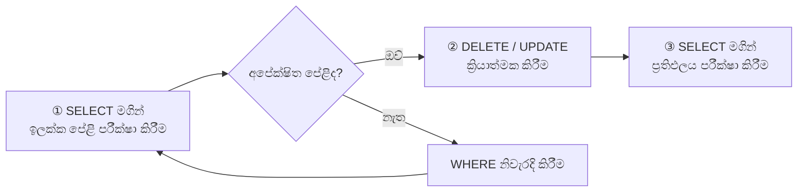
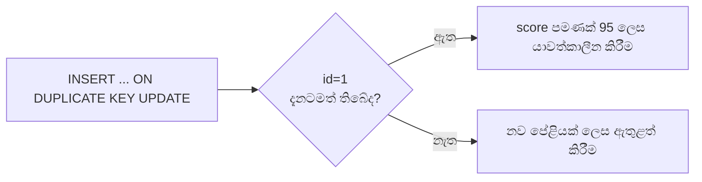

# පාඩම 08｜SQL මූලික කරුණු ② — INSERT / UPDATE / DELETE

> 🇯🇵 මුල් පිටපත (ජපන් භාෂාවෙන්): [20260723_資料.md](<../../../1年生_データ設計とアプリ開発/前期/20260723/20260723_資料.md>) <!-- original-ja-link -->

## අද දිනයේ ඉලක්කය
- INSERT මගින් දත්ත එකතු කිරීමට හැකි වීම
- UPDATE මගින් දත්ත යාවත්කාලීන කිරීමට හැකි වීම
- DELETE මගින් දත්ත මකා දැමීමට හැකි වීම
- WHERE හි වැදගත්කම (අමතක වුවහොත් සියලුම පේළි වෙනස් වන බව) තේරුම් ගැනීම

---

## 1. INSERT — දත්ත එකතු කිරීම

```sql
-- සියලුම තීරුවලට අගයන් දමන විට (තීරු නම් මඟ හැරිය හැක)
INSERT INTO students VALUES (NULL, '新入生A', 18, 'A', 80, '2024-04-01');
-- ↑ id AUTO_INCREMENT නිසා NULL දැමුවාට කමක් නැත

-- නිශ්චිත තීරු පමණක් සඳහන් කර දැමීම (නිර්දේශිතයි)
INSERT INTO students (name, age, class, score, enrolled_at)
VALUES ('新入生B', 19, 'B', 75, '2024-04-01');

-- පේළි කිහිපයක් එකවර දැමීම
INSERT INTO students (name, age, class, score, enrolled_at)
VALUES
    ('新入生C', 18, 'C', 88, '2024-04-01'),
    ('新入生D', 20, 'A', 62, '2024-04-01'),
    ('新入生E', 19, 'B', 71, '2024-04-01');
```

---

## 2. UPDATE — දත්ත යාවත්කාලීන කිරීම

```sql
-- !! ඉතා වැදගත් !!
-- WHERE දැමීමට අමතක වුවහොත් සියලුම පේළි යාවත්කාලීන වේ!
-- අනිවාර්යයෙන්ම WHERE පරීක්ෂා කර ක්‍රියාත්මක කරන්න!

-- id 1 වන සිසුවාගේ score 90 ලෙස යාවත්කාලීන කිරීම
UPDATE students SET score = 90 WHERE id = 1;

-- තීරු කිහිපයක් එකවර යාවත්කාලීන කිරීම (කොමා මගින් වෙන් කර)
UPDATE students SET score = 95, class = 'S' WHERE id = 1;

-- WHERE නැතිව (අනතුරුදායකයි! සියලුම පේළි යාවත්කාලීන වේ)
-- UPDATE students SET score = 0;  ← මෙය කළොත් සියලු දෙනාට ලකුණු 0 වේ!

-- වත්මන් අගය භාවිතා කර යාවත්කාලීන කිරීම (උදා: සියලු දෙනාට ලකුණු +5)
UPDATE students SET score = score + 5;  -- මෙය හිතාමතාම කරන්නේ නම් කමක් නැත
```

---

## 3. DELETE — දත්ත මකා දැමීම

```sql
-- !! ඉතා වැදගත් !!
-- WHERE දැමීමට අමතක වුවහොත් සියලුම පේළි මැකී යයි!
-- DELETE ආපසු හැරවිය නොහැක!

-- id 5 වන සිසුවා මකා දැමීම
DELETE FROM students WHERE id = 5;

-- score 50 ට අඩු සියලුම සිසුන් මකා දැමීම
DELETE FROM students WHERE score < 50;

-- WHERE නැතිව (කිසිසේත්ම නොකළ යුතුයි)
-- DELETE FROM students;  ← වගුව හිස් වේ!
```

> **ප්‍රායෝගික වැඩවලදී අනිවාර්යයෙන් පිළිපැදිය යුතු නීති:**  
> 1. UPDATE/DELETE ට පෙර SELECT මගින් අදාළ පේළි පරීක්ෂා කරන්න  
> 2. ක්‍රියාත්මක කිරීමට පෙර backup එකක් ගන්න  
> 3. WHERE අනිවාර්යයෙන්ම පරීක්ෂා කරන්න

---

## 4. ආරක්ෂිතව UPDATE/DELETE කරන ආකාරය

එකපාරටම ක්‍රියාත්මක නොකර, පහත අනුපිළිවෙළට කරන්න.



```sql
-- පියවර 1: මුලින්ම SELECT මගින් අදාළ පේළි පරීක්ෂා කිරීම
SELECT * FROM students WHERE score < 50;
-- → මකා දැමෙන පේළි ඇසින් පරීක්ෂා කරන්න

-- පියවර 2: ගැටලුවක් නැත්නම් DELETE ක්‍රියාත්මක කිරීම
DELETE FROM students WHERE score < 50;

-- පරීක්ෂා කිරීම
SELECT * FROM students;
```

---

## 5. නිතර භාවිතා වන රටාව: UPSERT

```sql
-- INSERT OR UPDATE (දැනටමත් දත්ත තිබේ නම් යාවත්කාලීන කරයි, නැත්නම් ඇතුළත් කරයි)
-- MySQL හි INSERT ... ON DUPLICATE KEY UPDATE භාවිතා කරයි
INSERT INTO students (id, name, score)
VALUES (1, '田中太郎', 95)
ON DUPLICATE KEY UPDATE score = 95;
-- id=1 දැනටමත් තිබේ → score පමණක් 95 ලෙස යාවත්කාලීන වේ
-- id=1 නොමැත → අලුතින් ඇතුළත් වේ
```

රූපසටහනකින් පෙන්වුවහොත්, පහත පරිදි මාර්ග දෙකකට බෙදේ.



---

## 6. CRUD සාරාංශය

| මෙහෙයුම | SQL | අර්ථය |
|------|-----|------|
| **C**reate (සෑදීම) | `INSERT INTO ... VALUES ...` | දත්ත එකතු කිරීම |
| **R**ead (කියවීම) | `SELECT ... FROM ...` | දත්ත ලබා ගැනීම |
| **U**pdate (යාවත්කාලීන කිරීම) | `UPDATE ... SET ... WHERE ...` | දත්ත යාවත්කාලීන කිරීම |
| **D**elete (මකා දැමීම) | `DELETE FROM ... WHERE ...` | දත්ත මකා දැමීම |

> **CRUD = Create / Read / Update / Delete** යනු වෙබ් යෙදුම්වල මූලික මෙහෙයුම් වේ.  
> Laravel අභ්‍යාසවලදීත් හරියටම එම සංකල්පයම හමු වේ.

---

## ඊළඟ පාඩම (පාඩම 09) පිළිබඳ පෙරදසුන

වගු අතර සම්බන්ධතා සහ JOIN ඉගෙන ගනිමු.  
"පරිශීලක වගුව සහ ඇණවුම් වගුව JOIN මගින් සම්බන්ධ කර, කවුරුන් කුමක් ඇණවුම් කළේද" යන්න එක් SQL ප්‍රකාශයකින් ලබා ගැනීමට හැකි වනු ඇත.

<!-- nav:start -->

---

| ⬅️ පෙර | 🗺️ සමස්ත සිතියම | ඊළඟ ➡️ |
|:--|:--:|--:|
| [07/21 අභ්‍යාස](../20260721/20260721_演習.md) | [පාඩම් ද්‍රව්‍යවල සමස්ත සිතියම](../../README.md) | [07/23 අභ්‍යාස](20260723_演習.md) |

<!-- nav:end -->
