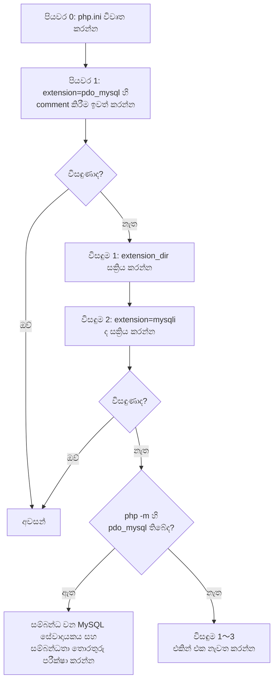

# PDO MySQL extension එක සක්‍රිය නොවන විට විසඳුම්

> 🇯🇵 මුල් පිටපත (ජපන් භාෂාවෙන්): [PDO_MySQL接続エラー対処法.md](<../../../1年生_データ設計とアプリ開発/前期/20260723/PDO_MySQL接続エラー対処法.md>) <!-- original-ja-link -->

## අදාළ දෝෂය

පහත ආකාරයේ දෝෂයක් පෙන්වන විට අනුගමනය කළ යුතු විසඳුම් මෙහි ඇත.

```
Fatal error: Uncaught PDOException: could not find driver in C:\Users\nishida\Desktop\apple\5.php:2
Stack trace:
#0 C:\Users\nishida\Desktop\apple\5.php(2): PDO->__construct('mysql:host=127....', 'root', Object(SensitiveParameterValue))
#1 {main}
  thrown in C:\Users\nishida\Desktop\apple\5.php on line 2
```

### මෙම දෝෂයේ අර්ථය

PHP සිට MySQL (දත්ත ගබඩාව) වෙත සම්බන්ධ වන විට `PDO` නම් ක්‍රමය භාවිතා කරයි. නමුත් ඇත්තටම MySQL සමඟ සන්නිවේදනය කිරීමට "ධාවකය (Driver)" නම් වෙනම කොටසක් අවශ්‍ය වේ.

`could not find driver` යනු "එම driver එක සොයාගත නොහැක" යන අර්ථය ඇති දෝෂයකි. එනම්, **PHP හට `pdo_mysql` නම් extension එක (driver) load කර ගැනීමට නොහැකි වී ඇති** නිසා මෙය සිදු වේ.

බොහෝ විට හේතුව php.ini (PHP හි සැකසුම් ගොනුව) හි සැකසුම්වල ඇත. පහත පියවර ඉහළ සිට පිළිවෙළින් උත්සාහ කරන්න. එක් පියවරක් උත්සාහ කරන සෑම විටම, අනිවාර්යයෙන්ම "සේවාදායකය නැවත ආරම්භ කිරීම" ([විසඳුම 3](#විසඳුම-3-සේවාදායකය-නිසැකවම-නැවත-ආරම්භ-කරන්න)) කර බ්‍රවුසරයෙන් පරීක්ෂා කරන්න. සැකසුම් වෙනස් කළ පමණින් එය PHP හි ක්‍රියාත්මක නොවේ.

සමස්ත ක්‍රියාවලිය පහත පරිදි වේ.



※ ඕනෑම පියවරකදී, වෙනස් කර සුරැකූ පසු අනිවාර්යයෙන්ම විසඳුම 3 (සේවාදායකය නැවත ආරම්භ කිරීම) කර පරීක්ෂා කරන්න.

---

## පියවර 0: php.ini විවෘත කරන්න

මෙතැන් සිට php.ini නම් ගොනුව කිහිප වතාවක් සංස්කරණය කරනවා. මුලින්ම එය විවෘත කරන ආකාරය බලමු.

1. Explorer (ෆෝල්ඩරය) හෝ VS Code මගින් `C:\php\php.ini` විවෘත කරන්න.
   - සොයාගත නොහැකි නම්, terminal එකේ `php --ini` ටයිප් කළ විට, භාවිතා වන php.ini ගොනුවේ ස්ථානය පෙන්වයි.
2. මෙතැන් සිට, මෙම php.ini ගොනුවේ අන්තර්ගතය සංස්කරණය කරමු.

---

## පියවර 1: extension=pdo_mysql හි comment කිරීම ඉවත් කරන්න

php.ini තුළ, බොහෝ කාර්යයන් (extensions) on/off කරන සැකසුම් පේළි ගණනාවක් ඇත. පේළියක මුලට `;` (semicolon) ඇත්නම් "එම පේළිය අක්‍රියයි (comment out කර ඇත)" යන්නයි අර්ථය.

1. php.ini විවෘත කර ඇති විට `Ctrl + F` (සෙවීම) ඔබා, `extension=pdo_mysql` ටයිප් කර සොයන්න.
2. පහත ආකාරයට මුලට `;` ඇති පේළියක් හමු විය යුතුය.

   ```ini
   ;extension=pdo_mysql
   ```

3. පේළියේ මුලේ ඇති `;` පමණක් මකා දමන්න.

   ```ini
   extension=pdo_mysql
   ```

4. `Ctrl + S` මගින් සුරකින්න.
5. [විසඳුම 3](#විසඳුම-3-සේවාදායකය-නිසැකවම-නැවත-ආරම්භ-කරන්න) හි පියවර අනුව සේවාදායකය නැවත ආරම්භ කර, බ්‍රවුසරයෙන් ක්‍රියාකාරිත්වය පරීක්ෂා කරන්න.

බොහෝ විට මෙයින් විසඳේ. නමුත් විසඳුණේ නැත්නම් ඊළඟ කොටසට යන්න.

---

## මෙතෙක් කළ දෙයින් විසඳුණේ නැත්නම්

`;extension=pdo_mysql` හි comment කිරීම ඉවත් කළත් ගැටලුව විසඳුණේ නැත්නම්, "extension එකේ සැබෑ ගොනුව (DLL ගොනුව) ඇති ෆෝල්ඩරයේ ස්ථානය" PHP හට හඳුනා ගැනීමට නොහැකි වී ඇති බව බොහෝ දුරට සිතිය හැක.

පහත විසඳුම් පිළිවෙළින් පරීක්ෂා කර බලන්න.

## විසඳුම 1: extension_dir සැකසුම සක්‍රිය කරන්න (★ බහුලවම ඇති හේතුව)

`extension=pdo_mysql` යනු "pdo_mysql නම් කාර්යය භාවිතා කරන්න" යන උපදෙසක් පමණි. එම කාර්යය සැබවින්ම ක්‍රියාත්මක කරන අන්තර්ගතය (DLL ගොනුව) කොහේ තිබේදැයි PHP හට කියන සැකසුම `extension_dir` වේ. මෙය නිවැරදිව සකසා නොමැති නම්, උපදෙස පමණක් ඇති නමුත් අන්තර්ගතය සොයාගත නොහැකි තත්ත්වයක් ඇති වේ.

1. `C:\php\php.ini` විවෘත කරන්න.
2. යතුරුපුවරුවේ `Ctrl + F` ඔබා, `extension_dir` සොයන්න.
3. පහත ආකාරයේ පේළියක් සොයන්න (මුලට `;` තිබිය යුතුය).

   ```ini
   ;extension_dir = "ext"
   ```

4. මුලේ ඇති `;` (semicolon) මකා සක්‍රිය කරන්න.

   ```ini
   extension_dir = "ext"
   ```

5. `Ctrl + S` මගින් සුරකින්න. [විසඳුම 3](#විසඳුම-3-සේවාදායකය-නිසැකවම-නැවත-ආරම්භ-කරන්න) අනුව සේවාදායකය නැවත ආරම්භ කර පරීක්ෂා කරන්න.

   ※ මෙයින්ද විසඳුණේ නැත්නම්, `"ext"` වැනි සාපේක්ෂ මාර්ගයක් (relative path) වෙනුවට, සම්පූර්ණ මාර්ගය (absolute path) ලබා දී බලන්න.

   ```ini
   extension_dir = "C:\php\ext"
   ```

   මෙය "`C:\php` ෆෝල්ඩරය තුළ ඇති `ext` ෆෝල්ඩරය බලන්න" යැයි PHP හට කිසිදු ව්‍යාකූලත්වයකින් තොරව පවසන ලිවීමේ ක්‍රමයකි. වෙනස් කළ පසු, නැවත සුරකින්න සහ සේවාදායකය නැවත ආරම්භ කරන්න.

## විසඳුම 2: extension=mysqli ද එක්වරම සක්‍රිය කර බලන්න

`mysqli` ද MySQL වෙත සම්බන්ධ වීමට භාවිතා වන තවත් extension එකකි. සමහර පරිසරවලදී, `pdo_mysql` නිසි ලෙස ක්‍රියා කිරීමට `mysqli` ද සක්‍රිය වී තිබිය යුතු අවස්ථා ඇත. අවශ්‍ය විය හැකි නිසා එයත් සක්‍රිය කර තබමු.

1. php.ini තුළ `extension=mysqli` සොයන්න.
2. මුලට `;` ඇත්නම් එය මකා දමන්න.

   ```ini
   extension=mysqli
   ```

3. `Ctrl + S` මගින් සුරකින්න, සේවාදායකය නැවත ආරම්භ කර පරීක්ෂා කරන්න.

## විසඳුම 3: සේවාදායකය "නිසැකවම" නැවත ආරම්භ කරන්න

php.ini වෙනස් කළත්, දැනට ක්‍රියාත්මක වන PHP සේවාදායකයට එය ස්වයංක්‍රීයව බලපාන්නේ නැත. සැකසුම් ගොනුව load වන්නේ "සේවාදායකය ආරම්භ කරන විට" එක් වරක් පමණක් නිසාය. එබැවින්, සැකසුම් වෙනස් කළ පසු අනිවාර්යයෙන්ම සේවාදායකය සම්පූර්ණයෙන්ම නවත්වා, නැවත ආරම්භ කළ යුතුය.

1. VS Code හි පහළ ඇති terminal එක (කළු තිරය) විවෘත කරන්න.
2. terminal එක මත ක්ලික් කර `Ctrl + C` කිහිප වතාවක් ඔබා, සේවාදායකය සම්පූර්ණයෙන්ම නවත්වන්න. terminal එකේ `^C` පෙන්වා, විධාන ඇතුළත් කළ හැකි තත්ත්වයට (prompt) ආපසු පැමිණියේ නම් නැවතී ඇත.
3. සේවාදායකය ආරම්භ කරන විධානය නැවත ඇතුළත් කරන්න.

   ```bash
   php -S localhost:8000
   ```

4. බ්‍රවුසරයේ අදාළ පිටුව (උදා: `http://localhost:8000/5.php`) නැවත load (refresh) කරන්න.

---

## එසේත් විසඳුණේ නැත්නම් පරීක්ෂා කරන ආකාරය

"ඇත්තටම දැන් pdo_mysql load වී තිබේද" යන්න සෘජුවම පරීක්ෂා කිරීමට ක්‍රමයක් ඇත.

1. terminal එකේ පහත විධානය ක්‍රියාත්මක කරන්න.

   ```bash
   php -m
   ```

   මෙය "දැනට PHP තුළ load වී ඇති extensions ලැයිස්තුව" පෙන්වන විධානයකි.

2. පෙන්වන ලැයිස්තුවේ `pdo_mysql` යන වචනය තිබේදැයි සොයන්න.
   - **තිබේ නම්** → extension එක load වී ඇත. දෝෂය දිගටම පවතී නම්, සම්බන්ධ වන MySQL සේවාදායකය ක්‍රියාත්මක වී තිබේද, සම්බන්ධතා තොරතුරු (host නාමය, පරිශීලක නාමය, මුරපදය ආදිය) නිවැරදිද යන්න පරීක්ෂා කරන්න.
   - **නැත්නම්** → extension එක තවමත් load වී නැත. ඉහත විසඳුම 1〜3, එකින් එක නිසැකවම (සුරැකීම සහ සේවාදායකය නැවත ආරම්භ කිරීම එකට) නැවත කර බලන්න.

<!-- nav:start -->

---

| ⬅️ ආපසු | 🗺️ සමස්ත සිතියම | ඊළඟ ➡️ |
|:--|:--:|--:|
| [Todo කළමනාකරණ යෙදුම ආරම්භ කිරීමේ ක්‍රියාවලිය](Todo管理アプリ起動する流れ.md) | [පාඩම් ද්‍රව්‍යවල සමස්ත සිතියම](../../README.md) | [07/28 වගු අතර සම්බන්ධතා・JOIN](../20260728/20260728_資料.md) |

<!-- nav:end -->
