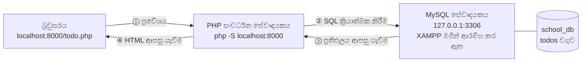
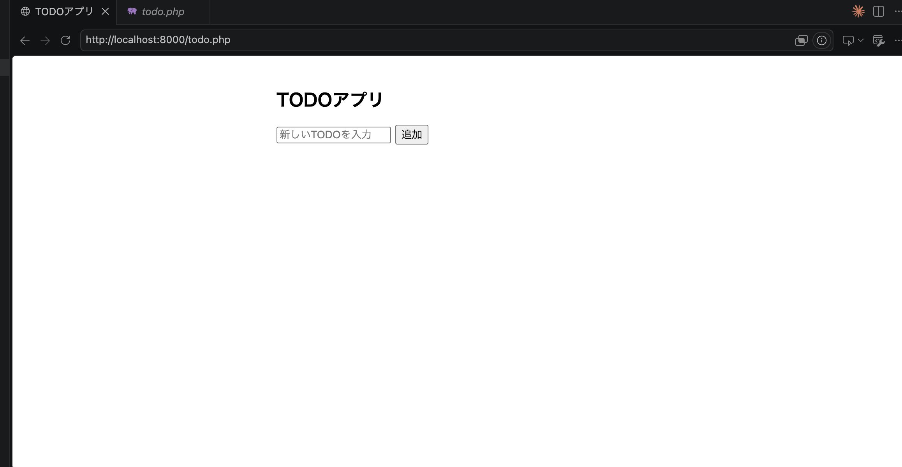
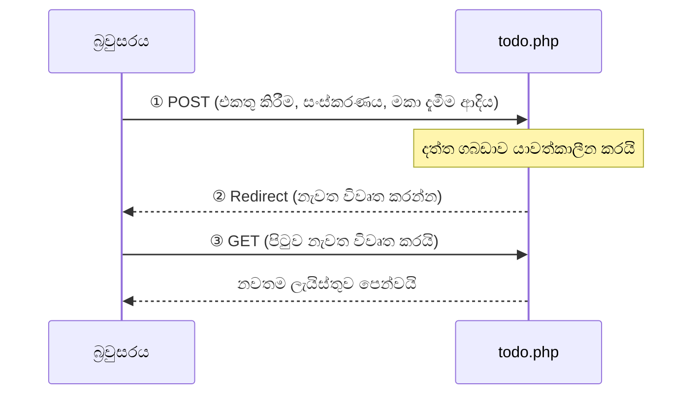

# Todo කළමනාකරණ යෙදුම ආරම්භ කිරීමේ ක්‍රියාවලිය

> 🇯🇵 මුල් පිටපත (ජපන් භාෂාවෙන්): [Todo管理アプリ起動する流れ.md](<../../../1年生_データ設計とアプリ開発/前期/20260723/Todo管理アプリ起動する流れ.md>) <!-- original-ja-link -->

`todo.php` යනු PHP＋PDO මගින් MySQL වෙත සම්බන්ධ වී, TODO එකතු කිරීම, සංස්කරණය, සම්පූර්ණ/අසම්පූර්ණ මාරු කිරීම සහ මකා දැමීම කළ හැකි යෙදුමකි. එය ක්‍රියාත්මක කිරීමට "දත්ත ගබඩා සේවාදායකය" සහ "PHP සංවර්ධන සේවාදායකය" යන **දෙකම** ආරම්භ කර තිබිය යුතුය.

## සමස්ත චිත්‍රය (ආරම්භ කර ඇති තත්ත්වය)



- **PHP සංවර්ධන සේවාදායකය**: `todo.php` (වැඩසටහන) ක්‍රියාත්මක කරන කොටස. බ්‍රවුසරයෙන් එන ඉල්ලීම් ලබාගෙන PHP ක්‍රියාත්මක කරයි.
- **MySQL සේවාදායකය (XAMPP)**: දත්ත (`school_db` හි `todos` වගුව) ගබඩා කර තබාගන්නා කොටස. PHP ඉල්ලන SQL ක්‍රියාත්මක කර දත්ත ආපසු ලබා දෙයි.
- මේ දෙක **වෙන වෙනම process** ලෙස, දෙකම දිගටම ක්‍රියාත්මකව තබා ගත යුතුය (එකක් හෝ නැවතී ඇත්නම් දෝෂයක් ඇති වේ).

## පූර්ව අවශ්‍යතා

- XAMPP ස්ථාපනය කර තිබීම
- PHP ස්ථාපනය කර තිබීම (`php -v` මගින් පරීක්ෂා කරන්න)
- පහත විධානවල ඇති `<පරිශීලක නාමය>` ඔබේ පරිගණකයේ පරිශීලක නාමයෙන් ප්‍රතිස්ථාපනය කරන්න

---

## 0. todo.php ඔබේ study ඩිරෙක්ටරිය තුළ තබන්න

බෙදා දුන් `todo.php` ගොනුව, ඔබේ පරිගණකයේ `study` ඩිරෙක්ටරිය යටතට (උදා: `study/20260723/`) පිටපත් කරන්න.

- ගොනුව drag & drop කර එලෙසම පිටපත් කිරීම, හෝ
- අන්තර්ගතය පිටපත් කර, ඔබේ පරිසරයේ අලුතින් සෑදූ `todo.php` වෙත paste කිරීම

ඕනෑම ක්‍රමයක් භාවිතා කළ හැක. `php -S` මගින් ආරම්භ කරන `study` ඩිරෙක්ටරිය තුළ `todo.php` ඇති බවට වග බලා ගන්න.

---

## 1. XAMPP මගින් MySQL ආරම්භ කරන්න

XAMPP Control Panel විවෘත කර, `MySQL` හි `Actions` තීරුවේ `Stop` පෙන්වයිද (＝ ක්‍රියාත්මක වෙමින් පවතී) යන්න පරීක්ෂා කරන්න. `Start` පෙන්වයි නම් එය ක්ලික් කර ආරම්භ කරන්න.

(විස්තරාත්මක පියවර සඳහා [දත්ත ගබඩා සේවාදායකයක් සකසන ආකාරය](../データベースサーバーの立て方/データベースサーバーの立て方.md) බලන්න)

`todo.php` පහත සම්බන්ධතා තොරතුරු මගින් MySQL වෙත සම්බන්ධ වන නිසා, ඔබේ සැකසුම් මෙයට ගැළපිය යුතුය.

```php
$pdo = new PDO(
    'mysql:host=127.0.0.1;port=3306;dbname=school_db;charset=utf8mb4',
    'root',
    '' // XAMPP/DBngin හි පෙරනිමි මුරපදය හිස්ය
);
```

- Host: `127.0.0.1` (ඔබේම පරිගණකය)
- Port: `3306` (MySQL හි සම්මත port එක)
- දත්ත ගබඩා නාමය: `school_db`
- පරිශීලක නාමය: `root`　මුරපදය: හිස්

`school_db` දත්ත ගබඩාව කලින්ම phpMyAdmin වැනි මෙවලමකින් සාදා තිබිය යුතුය (`todos` වගුව `todo.php` ආරම්භ වන විට ස්වයංක්‍රීයව සාදන නිසා, වගුව අතින් සෑදීම අවශ්‍ය නැත).

---

## 2. PHP සංවර්ධන සේවාදායකය ආරම්භ කරන්න

terminal එක විවෘත කර, `todo.php` ඇති `study` ඩිරෙක්ටරියට ගොස්, PHP සංවර්ධන සේවාදායකය ආරම්භ කරන්න.

```bash
cd /Users/<පරිශීලක නාමය>/Desktop/study
php -S localhost:8000
```

(විස්තරාත්මක පියවර සඳහා [PHP සංවර්ධන සේවාදායකයක් සකසන ආකාරය](../PHP開発サーバーの立て方.md) බලන්න)

---

## 3. බ්‍රවුසරයෙන් ප්‍රවේශ වන්න

සේවාදායකය ක්‍රියාත්මකව තබාගෙනම, `todo.php` තැබූ ස්ථානයට අදාළ URL එකට බ්‍රවුසරයෙන් ප්‍රවේශ වන්න.

```
http://localhost:8000/20260723/todo.php
```

ඉහත URL එක පිටපත් කර, බ්‍රවුසරයේ ලිපින තීරුවට paste කර ප්‍රවේශ වන්න.

※ මෙය `study/20260723/` තුළ තබා ඇති අවස්ථාවක උදාහරණයකි. සැබෑ URL එක "`php -S` ආරම්භ කළ ඩිරෙක්ටරියේ (`study/`) සිට ඇති සාපේක්ෂ මාර්ගයට" ගැළපෙන සේ සකසන්න.

TODO යෙදුමේ තිරය පෙන්වයි නම් ආරම්භ කිරීම සාර්ථකයි.

---

## 4. ක්‍රියාකාරිත්වය පරීක්ෂා කිරීම

### මෙම තිරය විවෘත වුණොත් හරි!




- ආදාන ක්ෂේත්‍රයට පෙළ ඇතුළත් කර 「追加」(එකතු කරන්න) → ලැයිස්තුවට එකතු වේද
- checkbox එක tick කිරීම → පෙළ මැදින් ඉරක් (strikethrough) ඇඳී එය සම්පූර්ණ කළ දෙයක් ලෙස සලකනවාද
- 「編集」(සංස්කරණය) → අන්තර්ගතය වෙනස් කර 「保存」(සුරකින්න) කළ හැකිද
- 「削除」(මකන්න) → තහවුරු කිරීමේ dialog එකෙන් පසු මැකී යයිද

සියල්ල පිළිබිඹු වී `index.php` (＝`todo.php`) වෙත ආපසු පැමිණේ නම් එය නිවැරදිව ක්‍රියා කරයි (PRG රටාව නිසා, මෙහෙයුමකින් පසු පිටුව ස්වයංක්‍රීයව නැවත load වේ).

PRG (Post → Redirect → Get) රටාවේ ක්‍රියාවලිය පහත පරිදි වේ.



---

## සේවාදායකය නැවැත්වීම

`php -S` ක්‍රියාත්මක කළ terminal එකේ `Ctrl + C` එබූ විට PHP සංවර්ධන සේවාදායකය නැවතේ. MySQL, XAMPP Control Panel හි `Stop` බොත්තමෙන් නැවැත්විය හැක.

---

## හරියට ක්‍රියා නොකරන විට

`could not find driver` වැනි PDO සම්බන්ධ දෝෂයක් පෙන්වයි නම්, [PDO_MySQL සම්බන්ධතා දෝෂ විසඳුම්](./PDO_MySQL接続エラー対処法.md) බලන්න.

<!-- nav:start -->

---

📎 මෙයද කියවන්න → [PDO_MySQL සම්බන්ධතා දෝෂ විසඳුම්](PDO_MySQL接続エラー対処法.md)

| ⬅️ පෙර | 🗺️ සමස්ත සිතියම | ඊළඟ ➡️ |
|:--|:--:|--:|
| [07/23 අභ්‍යාස](20260723_演習.md) | [පාඩම් ද්‍රව්‍යවල සමස්ත සිතියම](../../README.md) | [07/28 වගු අතර සම්බන්ධතා・JOIN](../20260728/20260728_資料.md) |

<!-- nav:end -->
