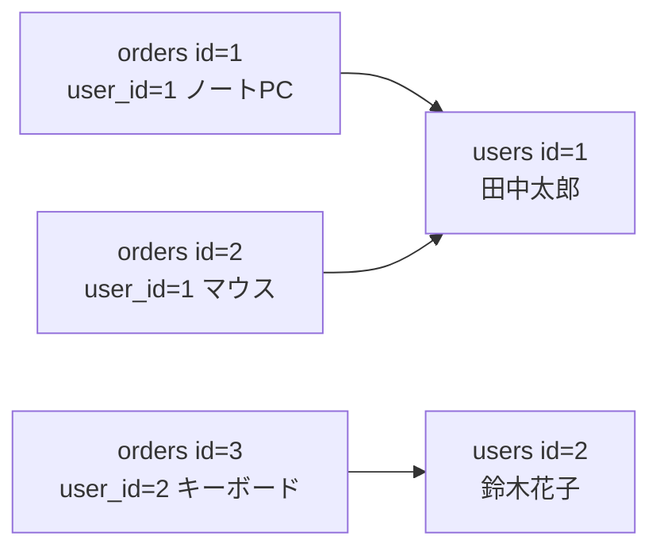
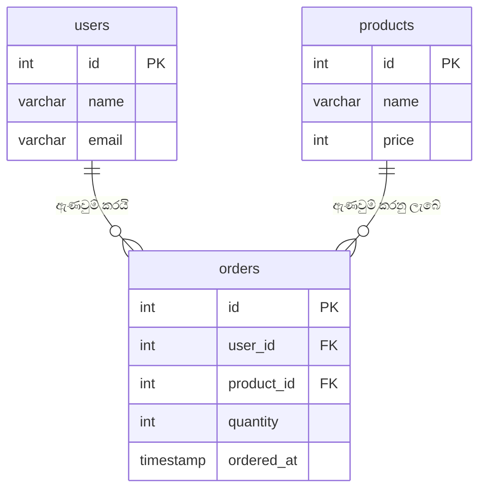
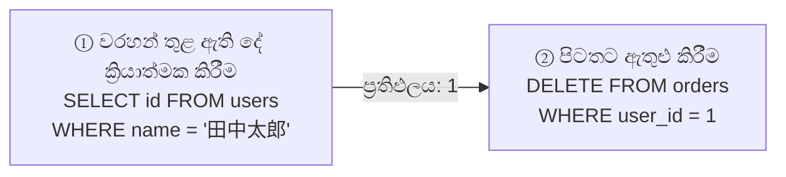

# පාඩම 09｜වගු අතර සම්බන්ධතා・JOIN — වගු කිහිපයක දත්ත එකට සංයෝජනය කිරීම

> 🇯🇵 මුල් පිටපත (ජපන් භාෂාවෙන්): [20260728_資料.md](<../../../1年生_データ設計とアプリ開発/前期/20260728/20260728_資料.md>) <!-- original-ja-link -->

## අද දිනයේ ඉලක්කය
- වගු වෙන් කරන්නේ ඇයි (සාමාන්‍යකරණය) යන්න පැහැදිලි කිරීමට හැකි වීම
- බාහිර යතුර (Foreign Key) පිළිබඳ සංකල්පය තේරුම් ගැනීම
- INNER JOIN / LEFT JOIN මගින් වගු එකතු කිරීමට හැකි වීම

---

[සම්බන්ධතා දත්ත ගබඩා ගැන](../20260721/リレーショナルデータベース入門.md)

## 1. වගු වෙන් කරන්නේ ඇයි

නරක උදාහරණය: සියල්ල එකම වගුවකට පුරවා දැමීම

```
orders වගුව (නරක උදාහරණය)
id │ user_name │ user_email         │ product_name │ price
───┼───────────┼────────────────────┼──────────────┼───────
 1 │ 田中太郎  │ tanaka@example.com │ ノートPC     │ 98000
 2 │ 田中太郎  │ tanaka@example.com │ マウス       │  3200
 3 │ 鈴木花子  │ suzuki@example.com │ キーボード   │  8500
```

**ගැටලු:**
- 田中太郎 ගේ තොරතුරු පේළි 2ක අනුපිටපත් වී ඇත (ඊමේල් වෙනස් වුවහොත් සියලුම පේළි යාවත්කාලීන කළ යුතුය)
- දත්ත අතර පරස්පරතා (inconsistency) ඇති වීමට පහසුය

**විසඳුම: වගු වෙන් කර බාහිර යතුර මගින් සම්බන්ධ කිරීම (සාමාන්‍යකරණය)**

---

## 2. බාහිර යතුර (Foreign Key)

**users වගුව**

| id | name | email |
|----|------|-------|
| 1 | 田中太郎 | tanaka@... |
| 2 | 鈴木花子 | suzuki@... |

**orders වගුව**

| id | user_id | product | price |
|----|---------|---------|-------|
| 1 | 1 | ノートPC | 98000 |
| 2 | 1 | マウス | 3200 |
| 3 | 2 | キーボード | 8500 |

`orders.user_id` මගින් `users.id` වෙත යොමු කරයි. මෙය "බාහිර යතුරක් (Foreign Key)" ලෙස හැඳින්වේ.



---

## 3. වගු සෑදීම සහ බාහිර යතුර සැකසීම

```sql
USE school_db;

-- users වගුව
CREATE TABLE users (
    id    INT AUTO_INCREMENT PRIMARY KEY,
    name  VARCHAR(100) NOT NULL,
    email VARCHAR(255) NOT NULL UNIQUE
);

-- products වගුව
CREATE TABLE products (
    id    INT AUTO_INCREMENT PRIMARY KEY,
    name  VARCHAR(100) NOT NULL,
    price INT NOT NULL
);

-- orders වගුව (බාහිර යතුර මගින් සම්බන්ධ කරයි)
CREATE TABLE orders (
    id         INT AUTO_INCREMENT PRIMARY KEY,
    user_id    INT NOT NULL,
    product_id INT NOT NULL,
    quantity   INT NOT NULL DEFAULT 1,
    ordered_at TIMESTAMP DEFAULT CURRENT_TIMESTAMP,
    
    -- බාහිර යතුරු සීමාව (යොමු අඛණ්ඩතාව - referential integrity රැක ගැනීමට)
    FOREIGN KEY (user_id)    REFERENCES users(id),
    FOREIGN KEY (product_id) REFERENCES products(id)
);

-- පරීක්ෂණ දත්ත
INSERT INTO users (name, email) VALUES
    ('田中太郎', 'tanaka@example.com'),
    ('鈴木花子', 'suzuki@example.com'),
    ('山田次郎', 'yamada@example.com');

INSERT INTO products (name, price) VALUES
    ('ノートPC', 98000),
    ('マウス', 3200),
    ('キーボード', 8500);

INSERT INTO orders (user_id, product_id, quantity) VALUES
    (1, 1, 1),  -- 田中 ノートPC 1ක්
    (1, 2, 2),  -- 田中 マウス 2ක්
    (2, 3, 1),  -- 鈴木 キーボード 1ක්
    (3, 1, 1),  -- 山田 ノートPC 1ක්
    (2, 1, 1);  -- 鈴木 ノートPC 1ක්
```

වගු 3 අතර සම්බන්ධය රූපසටහනකින් පෙන්වුවහොත් පහත පරිදි වේ. orders වගුව බාහිර යතුරු මගින් users සහ products යන වගු දෙකටම යොමු කරයි.



---

[INNER JOIN සහ LEFT JOIN අතර වෙනස පිළිබඳව](./JOIN入門.md)

## 4. INNER JOIN — වගු දෙකෙහිම ඇති දත්ත පමණක් එකතු කිරීම

```sql
-- orders වෙත users හි තොරතුරු එකතු කිරීම
SELECT
    orders.id,
    users.name    AS ユーザー名,
    users.email,
    orders.quantity
FROM orders
INNER JOIN users ON orders.user_id = users.id;

-- වගු 3ක් එකතු කිරීම (orders + users + products)
SELECT
    orders.id,
    users.name      AS ユーザー名,
    products.name   AS 商品名,
    products.price  AS 単価,
    orders.quantity AS 数量,
    products.price * orders.quantity AS 合計金額
FROM orders
INNER JOIN users    ON orders.user_id    = users.id
INNER JOIN products ON orders.product_id = products.id
ORDER BY orders.id;
```

---

## 5. LEFT JOIN — වම් වගුවේ සියලුම පේළි ඇතුළත් කිරීම

```sql
-- තවම ඇණවුම් නොකළ පරිශීලකයින්ද ඇතුළත්ව පෙන්වීමට අවශ්‍ය විට
SELECT
    users.name,
    COUNT(orders.id) AS 注文数
FROM users
LEFT JOIN orders ON users.id = orders.user_id
GROUP BY users.id, users.name;

-- ඇණවුම් 0ක් ඇති පරිශීලකයින්ද පෙන්වයි
-- INNER JOIN නම් ඇණවුම් ඇති පරිශීලකයින් පමණක් පෙන්වයි
```

### 5-1. ප්‍රායෝගික භාවිතය: තවම ඇණවුම් නොකළ පරිශීලකයින් "පමණක්" සොයා ගැනීම

LEFT JOIN මගින් එකතු කළ විට, දකුණු පැත්තේ (orders) ගැළපෙන පේළියක් නොමැති නම්, එම තීරු `NULL` බවට පත් වේ. මෙම ලක්ෂණය භාවිතා කළොත් "නොගැළපුණු පේළි පමණක්" පෙරා ගත හැක.

```sql
SELECT users.name, users.email
FROM users
LEFT JOIN orders ON users.id = orders.user_id
WHERE orders.id IS NULL;
```

**සිතන ආකාරය:**
1. `LEFT JOIN` මගින් සියලුම users ඉතිරි කර ගනී (orders නැති අයගේ එම තීරු `NULL` වේ)
2. `WHERE orders.id IS NULL` මගින් "orders සමඟ නොගැළපුණු පේළි" පමණක් පෙරා ගනී
   → එනම් "එක වරක්වත් ඇණවුම් නොකළ අය" පමණක් ඉතිරි වේ

`INNER JOIN` සමඟ මෙම රටාව භාවිතා කළ නොහැක (නොගැළපෙන පේළි කිසිසේත්ම ප්‍රතිඵලයේ නොපෙන්වන නිසා). "LEFT JOIN + `IS NULL`" එකට භාවිතා කරන සම්මත රටාවක් ලෙස මතක තබා ගැනීම ප්‍රයෝජනවත්ය.

---

## 6. සමුච්චය කිරීම (Aggregation) සමඟ සංයෝජනය

```sql
-- පරිශීලකයා අනුව මුළු මිලදී ගැනීමේ මුදල
SELECT
    users.name AS ユーザー名,
    COUNT(orders.id) AS 注文件数,
    SUM(products.price * orders.quantity) AS 合計金額
FROM users
INNER JOIN orders    ON users.id          = orders.user_id
INNER JOIN products  ON orders.product_id = products.id
GROUP BY users.id, users.name
ORDER BY 合計金額 DESC;
```

---

## 7. HAVING — සමුච්චය කළ "පසුව" පෙරීම

`WHERE` සමුච්චය කිරීමට **පෙර** පේළි පෙරයි, නමුත් `HAVING` `GROUP BY` මගින් සමුච්චය කළ **පසු** ප්‍රතිඵල පෙරයි.

```sql
-- මුළු මුදල යෙන් 100000 හෝ ඊට වැඩි පරිශීලකයින් පමණක් පෙන්වීම
SELECT
    users.name AS ユーザー名,
    SUM(products.price * orders.quantity) AS 合計金額
FROM users
INNER JOIN orders   ON users.id          = orders.user_id
INNER JOIN products ON orders.product_id = products.id
GROUP BY users.id, users.name
HAVING SUM(products.price * orders.quantity) >= 100000;
```

**WHERE සහ HAVING අතර වෙනස:**

| | පෙරන්නේ කවදාද | භාවිතා කළ හැකි දේ |
|---|---|---|
| `WHERE` | `GROUP BY` මගින් සමුච්චය කිරීමට **පෙර** | එක් එක් පේළියේ මුල් තීරු (`orders.quantity` වැනි) |
| `HAVING` | `GROUP BY` මගින් සමුච්චය කළ **පසු** | `SUM()` `COUNT()` වැනි සමුච්චය කිරීමේ ප්‍රතිඵල |

ලියන්නේ `SELECT ... FROM ... WHERE ... GROUP BY ... HAVING ... ORDER BY` පිළිවෙළට වුවද, ඇත්තටම ක්‍රියාත්මක වන්නේ `WHERE`→`GROUP BY`→`HAVING`→`ORDER BY` පිළිවෙළටයි. "`HAVING SUM(...) >= 100000` හරි, `WHERE SUM(...) >= 100000` වැරදියි (සමුච්චය කිරීමට පෙර නිසා SUM තවම නොපවතී)" ලෙස මතක තබා ගනිමු.

---

## 8. Subquery — SELECT එකක් තුළ SELECT එකක් ලිවීම

`INSERT` හෝ `DELETE` කරන විට, ඉලක්ක `id` එක නොදන්නා අවස්ථා ඇත. එවැනි විට `SELECT` හි ප්‍රතිඵලය එලෙසම කොන්දේසියක් ලෙස භාවිතා කරන **Subquery** ප්‍රයෝජනවත් වේ.

```sql
-- උදා: "田中太郎" ගේ id කොන්දේසියක් ලෙස භාවිතා කිරීමට අවශ්‍යයි, නමුත් id අංකය නොදනී

-- ① නරක උදාහරණයක් නොවේ, නමුත් පියවර 2කට බෙදේ
SELECT id FROM users WHERE name = '田中太郎';  -- ප්‍රතිඵලය: 1
DELETE FROM orders WHERE user_id = 1;          -- පරීක්ෂා කළ 1 අතින් ඇතුළත් කරයි

-- ② Subquery භාවිතා කළොත් එක් ප්‍රකාශයකින් ලිවිය හැක
DELETE FROM orders
WHERE user_id = (SELECT id FROM users WHERE name = '田中太郎');
```

`( )` තුළ ඇති `SELECT` මුලින්ම ක්‍රියාත්මක වී එක් අගයක් (මෙහිදී `id`) බවට පත් වී, පිටත ඇති `WHERE user_id = මෙතැනට` ඇතුළු කෙරෙන ආකාරයට සිතන්න. "වරහන් තුළ ඇති දේ මුලින්ම කියවන්න" ලෙස සිතුවොත් තේරුම් ගැනීම පහසුය.



```sql
-- INSERT හිදීද එලෙසම භාවිතා කළ හැකි උදාහරණය
INSERT INTO orders (user_id, product_id, quantity)
VALUES (
    (SELECT id FROM users WHERE name = '田中太郎'),
    (SELECT id FROM products WHERE name = 'USBハブ'),
    3
);
```

---

## සාරාංශය

| සංකල්පය | පැහැදිලි කිරීම |
|------|------|
| බාහිර යතුර | වෙනත් වගුවක ප්‍රාථමික යතුරට යොමු වන තීරුව |
| INNER JOIN | වගු දෙකෙහිම ඇති දත්ත පමණක් එකතු කරයි |
| LEFT JOIN | වම් වගුවේ සියලුම පේළි ＋ දකුණු වගුවේ ගැළපෙන පේළි එකතු කරයි |
| `ON වගුවA.col = වගුවB.col` | සම්බන්ධ කිරීමේ කොන්දේසිය |
| LEFT JOIN + `WHERE ... IS NULL` | දකුණු වගුවේ ගැළපෙන පේළියක් නොමැති පේළි පමණක් සොයන සම්මත රටාව |
| `WHERE` | සමුච්චය කිරීමට පෙර පේළි පෙරයි |
| `HAVING` | `GROUP BY` මගින් සමුච්චය කළ පසු ප්‍රතිඵල පෙරයි |
| Subquery `(SELECT ...)` | `SELECT` හි ප්‍රතිඵලය, වෙනත් SQL එකක කොන්දේසියක් හෝ අගයක් ලෙස ඇතුළත් කරයි |

---

## ඊළඟ පාඩම (පාඩම 10) පිළිබඳ පෙරදසුන

SQL අභ්‍යාසයක් ලෙස, ඇණවුම් කළමනාකරණ දත්ත ගබඩාව ඔබම මෙහෙයවනු ඇත.  
SELECT / INSERT / UPDATE / DELETE / JOIN එකට සංයෝජනය කළ ප්‍රායෝගික ප්‍රශ්න විසඳමු.

<!-- nav:start -->

---

📎 මෙයද කියවන්න → [JOIN හැඳින්වීම](JOIN入門.md)

| ⬅️ පෙර | 🗺️ සමස්ත සිතියම | ඊළඟ ➡️ |
|:--|:--:|--:|
| [Todo කළමනාකරණ යෙදුම ආරම්භ කිරීමේ ක්‍රියාවලිය](../20260723/Todo管理アプリ起動する流れ.md) | [පාඩම් ද්‍රව්‍යවල සමස්ත සිතියම](../../README.md) | [07/28 SQL අභ්‍යාසය](20260728_演習.md) |

<!-- nav:end -->
