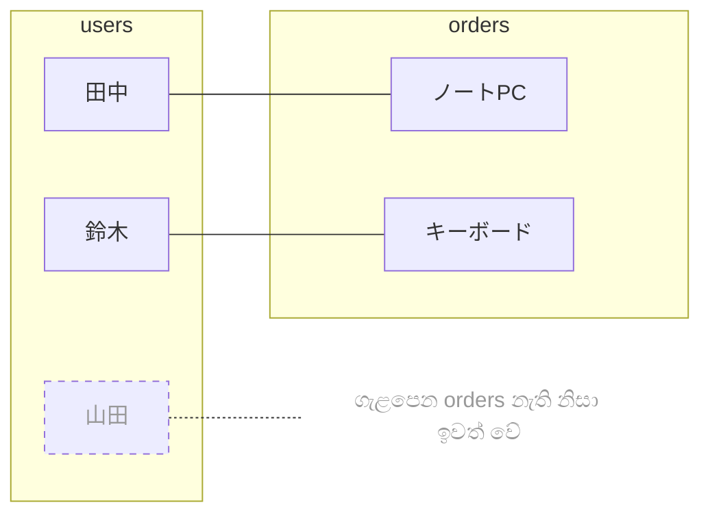
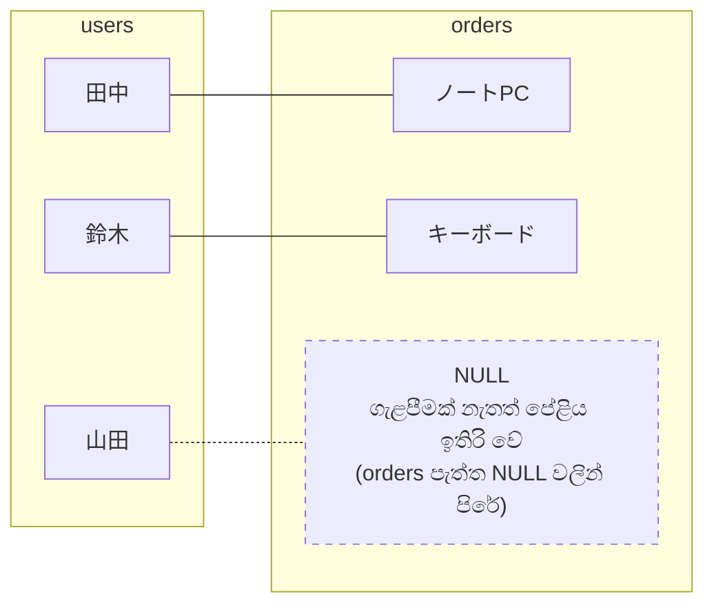

> 🇯🇵 මුල් පිටපත (ජපන් භාෂාවෙන්): [JOIN入門.md](<../../../1年生_データ設計とアプリ開発/前期/20260728/JOIN入門.md>) <!-- original-ja-link -->

## මෙම ලිපියෙන් ඔබ ඉගෙන ගන්නා දේ

- INNER JOIN මගින් "වගු දෙකෙහිම ඇති දත්ත පමණක්" එකතු කරන බව
- LEFT JOIN මගින් "වම් වගුවේ සියලුම පේළි ＋ දකුණු වගුවේ ගැළපෙන පේළි" එකතු කරන බව
- එකම වගු 2ක් සහ එකම එකතු කිරීමේ කොන්දේසිය වුවද, JOIN වර්ගය අනුව ප්‍රතිඵලයේ පේළි ගණන වෙනස් වන බව

## භාවිතා කරන වගු 2

`users` (පරිශීලකයින්) සහ `orders` (ඇණවුම්) භාවිතා කර පැහැදිලි කරමු. වැදගත් කරුණ නම්, **山田次郎 තවම එක වරක්වත් ඇණවුම් කර නැති** බවයි.

### 🧑 users වගුව

| id | name |
|----|------|
| 1  | 田中太郎 |
| 2  | 鈴木花子 |
| 3  | 山田次郎 |

### 🛒 orders වගුව

| id | user_id | product |
|----|---------|---------|
| 1  | 1       | ノートPC |
| 2  | 2       | キーボード |

`orders.user_id` මගින් `users.id` වෙත යොමු කරයි (බාහිර යතුර). 山田次郎 (id=3) වෙත යොමු කරන කිසිදු පේළියක් `orders` හි නැත.

## INNER JOIN: වගු දෙකෙහිම ඇති දත්ත පමණක් එකතු කිරීම

```sql
SELECT users.name, orders.product
FROM users
INNER JOIN orders ON users.id = orders.user_id;
```

**ප්‍රතිඵලය:**

| name | product |
|------|---------|
| 田中太郎 | ノートPC |
| 鈴木花子 | キーボード |

INNER JOIN හි අදහස (සම්බන්ධ වූ යුගල පමණක් ප්‍රතිඵලයට ඇතුළත් වේ)



山田次郎 ට `orders` හි ගැළපෙන එක පේළියක්වත් නැති නිසා, **ප්‍රතිඵලයෙන් ඉවත් වේ**. "වගු දෙකෙහිම ඇති දත්ත පමණක් එකතු කිරීම" යන්නෙහි අර්ථය මෙයයි.

## LEFT JOIN: වම් වගුවේ සියලුම පේළි ＋ දකුණු වගුවේ ගැළපෙන පේළි එකතු කිරීම

```sql
SELECT users.name, orders.product
FROM users
LEFT JOIN orders ON users.id = orders.user_id;
```

**ප්‍රතිඵලය:**

| name | product |
|------|---------|
| 田中太郎 | ノートPC |
| 鈴木花子 | キーボード |
| 山田次郎 | NULL    |

LEFT JOIN හි අදහස (වම් වගුවේ සියලු දෙනාම ඉතිරි වේ)



`FROM users LEFT JOIN orders` හි **FROM පැත්තේ (වම් පැත්තේ) ලියූ users වගුව පදනම** වේ. 山田次郎 ට ඇණවුම් නැතත් පේළියක් ලෙස ඉතිරි වන අතර, `orders` පැත්තේ තීරු `NULL` (අදාළ දත්ත නැත) වලින් පිරේ.

## වෙන්කර හඳුනා ගැනීමේ උපක්‍රම

- **`FROM A LEFT JOIN B`** → **A වම් පැත්ත**යි, A හි සියලුම පේළි අනිවාර්යයෙන්ම ඉතිරි වේ
- නොගැළපෙන පේළියක් ඇත්නම්, දකුණු පැත්තේ (B) තීරු ස්වයංක්‍රීයව `NULL` වේ
- `INNER JOIN` හි මෙම "සියල්ල ඉතිරි කිරීමේ" හැසිරීම නැත, ගැළපුණු පේළි පමණක් ඉතිරි වේ

## කුමක් භාවිතා කළ යුතුද

| කිරීමට අවශ්‍ය දේ | භාවිතා කරන JOIN |
|---|---|
| ඇණවුම් ඇති අයගේ දත්ත පමණක් බැලීමට අවශ්‍යයි | `INNER JOIN` |
| ඇණවුම් 0ක් ඇති අයද ඇතුළුව සියලු දෙනාගේ ලැයිස්තුවක් සෑදීමට අවශ්‍යයි (උදා: තවම ඇණවුම් නොකළ අයට දැනුම්දීමේ ඊමේල් යැවීමට අය සොයා ගැනීම) | `LEFT JOIN` |
| පරිශීලකයා අනුව ඇණවුම් ගණන ගණන් කිරීමට අවශ්‍යයි (0ක් ඇති අයද 0 ලෙස පෙන්වීමට) | `LEFT JOIN` + `COUNT` |

තුන්වන උදාහරණය `20260728_資料.md` හි "5. LEFT JOIN" කොටසේ සාකච්ඡා කළ, ඇණවුම් 0ක් ඇති පරිශීලකයින්ද පෙන්වන SQL එකයි. `INNER JOIN` මගින් එයම කළොත්, 山田次郎 වැනි ඇණවුම් නොකළ පරිශීලකයින් ප්‍රතිඵලයේ කිසිසේත්ම නොපෙන්වනු ඇත.

## සාරාංශය

- `INNER JOIN` "වගු දෙකෙහිම ඇති දත්ත පමණක්" එකතු කරයි → නොගැළපෙන පේළි ඉවත් වේ
- `LEFT JOIN` "`FROM` හි වම් වගුවේ සියලුම පේළි ＋ දකුණු වගුවේ ගැළපෙන පේළි" එකතු කරයි → නොගැළපුණත් වම් වගුවේ පේළි ඉතිරි වන අතර, දකුණු පැත්ත `NULL` වේ
- "කිසිවකු හෝ කිසිදු පේළියක් මඟ නොහැර සියල්ල බැලීමට අවශ්‍ය" විට LEFT JOIN ද, "වගු දෙකෙහිම ගැළපෙන දත්ත පමණක් ප්‍රමාණවත්" විට INNER JOIN ද භාවිතා කරන බව මතක තබා ගන්න

<!-- nav:start -->

---

| ⬅️ ආපසු | 🗺️ සමස්ත සිතියම | ඊළඟ ➡️ |
|:--|:--:|--:|
| [07/28 වගු අතර සම්බන්ධතා・JOIN](20260728_資料.md) | [පාඩම් ද්‍රව්‍යවල සමස්ත සිතියම](../../README.md) | [07/28 SQL අභ්‍යාසය](20260728_演習.md) |

<!-- nav:end -->
