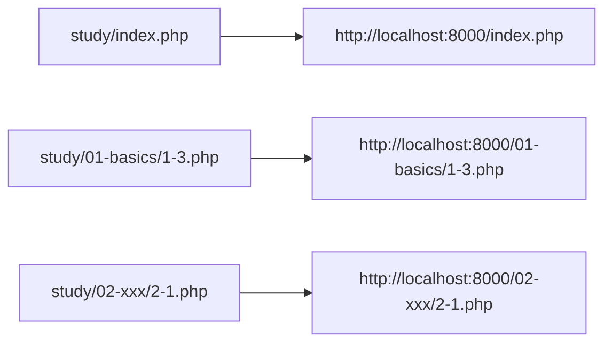

# PHP සංවර්ධන සේවාදායකයක් සකසන ආකාරය

> 🇯🇵 මුල් පිටපත (ජපන් භාෂාවෙන්): [PHP開発サーバーの立て方.md](<../../1年生_データ設計とアプリ開発/前期/PHP開発サーバーの立て方.md>) <!-- original-ja-link -->

PHP ගොනුවක් බ්‍රවුසරයෙන් සෘජුවම විවෘත කළත් එය ක්‍රියාත්මක නොවේ (source code එක එලෙසම පෙන්වයි / ගොනුව download වේ).
PHP යනු සේවාදායක පැත්තේ අර්ථකථනය වන භාෂාවක් නිසා, අනිවාර්යයෙන්ම `php -S` වැනි විධානයකින් ආරම්භ කළ සේවාදායකයක් හරහා ප්‍රවේශ විය යුතුය.

## පූර්ව අවශ්‍යතා

- PHP ස්ථාපනය කර තිබීම (`php -v` මගින් පරීක්ෂා කරන්න)
- මෙහිදී `php` තුළ ගොඩනගා ඇති සංවර්ධන සේවාදායකය භාවිතා කරයි (production භාවිතයට සුදුසු නැත)
- පහත විධානවල ඇති `<පරිශීලක නාමය>` ඔබේ පරිගණකයේ පරිශීලක නාමයෙන් ප්‍රතිස්ථාපනය කරන්න (උදා: `taro`, `hanako` වැනි. Mac නම් `whoami` විධානයෙන් පරීක්ෂා කළ හැක)

## ක්‍රමය 1: study ඩිරෙක්ටරිය තුළම ආරම්භ කිරීම

```bash
cd /Users/<පරිශීලක නාමය>/Desktop/study
php -S localhost:8000
```

`cd` (change directory) යනු terminal එකේ "දැනට සිටින ස්ථානය (current directory)" වෙනස් කරන විධානයයි.
`cd /Users/<පරිශීලක නාමය>/Desktop/study` මගින් `study` ඩිරෙක්ටරියට ගොස් `php -S` ක්‍රියාත්මක කිරීමෙන්,
`study` ආරම්භක ස්ථානය ＝ වෙබ් root එක බවට පත් වේ.

`php -S` ක්‍රියාත්මක කළ ඩිරෙක්ටරිය "වෙබ් root (`/`)" බවට පත් වේ.
`study/` තුළම `contact.php` ඇති නිසා, URL එක එලෙසම:

```
http://localhost:8000/contact.php
http://localhost:8000/1-3.php
http://localhost:8000/index.php
```

## පරිච්ඡේද අනුව ඩිරෙක්ටරි ව්‍යුහයකින් ප්‍රවේශ වීම

අභ්‍යාස වැඩි වන විට, පරිච්ඡේද අනුව sub-directory සාදා පිළිවෙළට තබා ගන්න (උදා: `01-basics/`).

```
study/
  index.php
  contact.php
  01-basics/
    1-1.php
    1-2.php
    1-3.php
  02-xxx/
    2-1.php
```

සේවාදායකය දිගටම **study ඩිරෙක්ටරිය තුළම** ආරම්භ කරන්න (ආරම්භක ස්ථානය වෙනස් නොකරන්න).

```bash
cd /Users/<පරිශීලක නාමය>/Desktop/study
php -S localhost:8000
```

ආරම්භ කළ ඩිරෙක්ටරිය වෙබ් root එක වන නිසා, sub-directory එකක තැබූ ගොනු සඳහා
**URL එකට එම ඩිරෙක්ටරියේ නම ඇතුළත් කළ** යුතුය:

```
http://localhost:8000/index.php
http://localhost:8000/01-basics/1-3.php
http://localhost:8000/02-xxx/2-1.php
```

එනම් "ගොනුව තැබූ මාර්ගය" ＝ "URL මාර්ගය" (`study/` සිට ඇති සාපේක්ෂ මාර්ගය) ලෙස සෘජුවම ගැළපේ.



## සේවාදායකය නැවැත්වීම

සේවාදායකය ආරම්භ කළ terminal එකේ `Ctrl + C` ඔබන්න.

## Port අංකය පිළිබඳව

`8000` කොටසට, භාවිතයේ නොමැති නම් ඕනෑම අංකයක් ලබා දිය හැක (උදා: `php -S localhost:8080`).

<!-- nav:start -->

---

| ⬅️ ආපසු | 🗺️ සමස්ත සිතියම | ඊළඟ ➡️ |
|:--|:--:|--:|
| [06/30 PHP හැඳින්වීම](20260630/20260630_資料.md) | [පාඩම් ද්‍රව්‍යවල සමස්ත සිතියම](../README.md) | [06/30 අභ්‍යාස](20260630/20260630_演習.md) |

<!-- nav:end -->
