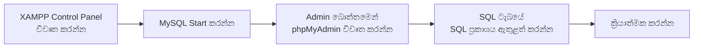
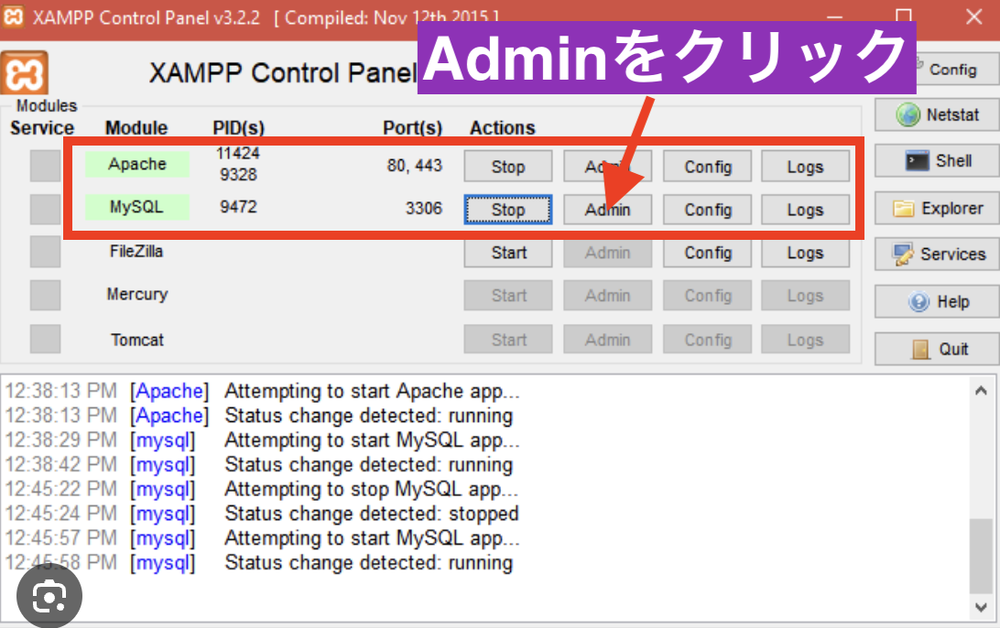
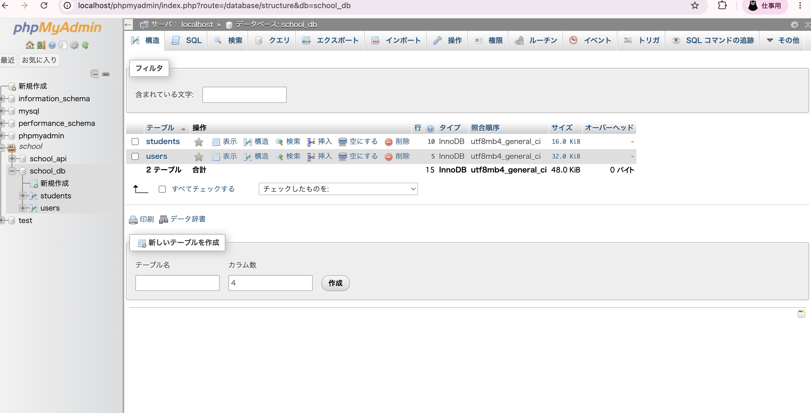
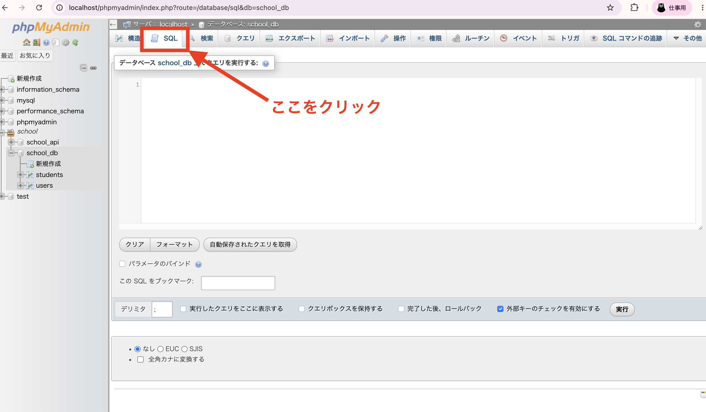

# දත්ත ගබඩා සේවාදායකයක් සකසන ආකාරය (XAMPP සංස්කරණය)

> 🇯🇵 මුල් පිටපත (ජපන් භාෂාවෙන්): [データベースサーバーの立て方.md](<../../../1年生_データ設計とアプリ開発/前期/データベースサーバーの立て方/データベースサーバーの立て方.md>) <!-- original-ja-link -->

## මෙම ලිපියෙන් ඔබ ඉගෙන ගන්නා දේ

- XAMPP මගින් ආරම්භ කරන්නේ කුමක්ද
- phpMyAdmin (දත්ත ගබඩා කළමනාකරණ තිරය) විවෘත කරන ආකාරය
- phpMyAdmin තුළ SQL ප්‍රකාශ ක්‍රියාත්මක කරන ආකාරය

සමස්ත ක්‍රියාවලිය පහත පරිදි වේ.

## 1. XAMPP යනු කුමක්ද

XAMPP (සැම්ප්) යනු වෙබ් යෙදුම් ක්‍රියාත්මක කිරීමට අවශ්‍ය පහත දෙක, පරිගණකයට පහසුවෙන් ස්ථාපනය කළ හැකි මෘදුකාංගයකි.

- **Apache**: වෙබ් පිටු පෙන්වීම සඳහා වන වෙබ් සේවාදායකය
- **MySQL**: දත්ත සුරැකීම සඳහා වන දත්ත ගබඩා සේවාදායකය

යෙදුම් සංවර්ධනයේදී "දත්ත සුරකින ස්ථානයක් (දත්ත ගබඩාවක්)" අවශ්‍ය වන නිසා, මුලින්ම මෙම MySQL ආරම්භ කර තිබිය යුතුය.

## 2. XAMPP ආරම්භ කර, ක්‍රියාකාරිත්වය පරීක්ෂා කරන්න

XAMPP යෙදුම (XAMPP Control Panel) විවෘත කරන්න.

`Apache` සහ `MySQL` පේළිවල `Actions` තීරුවේ `Stop` පෙන්වයි නම්, ඒවා දැනටමත් ක්‍රියාත්මක වෙමින් පවතී. `Start` පෙන්වයි නම් ක්‍රියාත්මක වී නැති නිසා, එම බොත්තම ක්ලික් කර ආරම්භ කරන්න.

## 3. phpMyAdmin (කළමනාකරණ තිරය) විවෘත කරන්න

MySQL පේළියේ ඇති `Admin` බොත්තම ක්ලික් කරන්න.

එවිට බ්‍රවුසරයේ **phpMyAdmin** නම් තිරයක් විවෘත වේ. phpMyAdmin යනු MySQL හි සුරැකී ඇති දත්ත තිරය මත බැලීමට සහ සංස්කරණය කිරීමට හැකි කළමනාකරණ මෙවලමකි. මෙහිදී, දැනටමත් සාදා ඇති දත්ත ගබඩාවක (උදා: `school_db`) ඇති වගු (`students`, `users` වැනි) ලැයිස්තුව බැලිය හැක.

## 4. SQL ප්‍රකාශ ක්‍රියාත්මක කිරීම

වගු සෑදීම හෝ දත්ත ලියාපදිංචි කිරීම/වෙනස් කිරීම SQL ප්‍රකාශ මගින් සෘජුවම කිරීමට අවශ්‍ය නම්, තිරයේ ඉහළ ඇති `SQL` ටැබය ක්ලික් කරන්න.

ටැබය විවෘත කළ විට SQL ප්‍රකාශ ඇතුළත් කළ හැකි ක්ෂේත්‍රයක් පෙන්වයි. එහි SQL ප්‍රකාශය ඇතුළත් කර 「実行」(ක්‍රියාත්මක කරන්න) බොත්තම එබූ විට, එම SQL ප්‍රකාශය ක්‍රියාත්මක වී එහි ප්‍රතිඵලය දත්ත ගබඩාවේ පිළිබිඹු වේ.

## සාරාංශය

- XAMPP යනු Apache (වෙබ් සේවාදායකය) සහ MySQL (දත්ත ගබඩාව) එකවර ක්‍රියාත්මක කිරීමට භාවිතා කරන මෙවලමකි
- MySQL හි `Admin` මගින්, phpMyAdmin නම් දත්ත ගබඩා කළමනාකරණ තිරය විවෘත කළ හැක
- phpMyAdmin හි `SQL` ටැබය මගින්, SQL ප්‍රකාශ සෘජුවම ක්‍රියාත්මක කළ හැක

<!-- nav:start -->

---

| ⬅️ ආපසු | 🗺️ සමස්ත සිතියම | ඊළඟ ➡️ |
|:--|:--:|--:|
| [07/21 DB අවශ්‍ය වන්නේ ඇයි](../20260721/20260721_資料.md) | [පාඩම් ද්‍රව්‍යවල සමස්ත සිතියම](../../README.md) | [07/21 SQL මූලික කරුණු ①（SELECT）](../20260721/20260721_資料_2.md) |

<!-- nav:end -->
