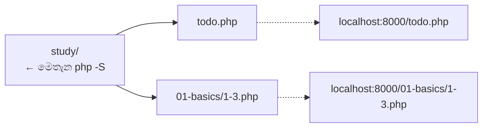
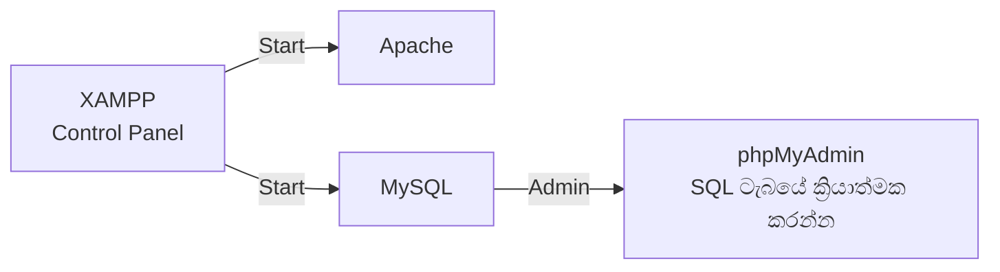
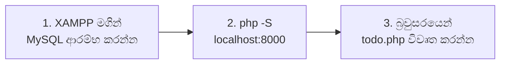

# පළමු අර්ධ වාරයේ පුනරීක්ෂණය (නැවත මතක් කිරීම)

> 🇯🇵 මුල් පිටපත (ජපන් භාෂාවෙන්): [20261001_復習.md](<../../../1年生_データ設計とアプリ開発/後期/20261001/20261001_復習.md>) <!-- original-ja-link -->

දෙවන අර්ධ වාරයට පෙර, පළමු අර්ධ වාරයේ කළ "යෙදුම ක්‍රියාත්මක කිරීමට අවශ්‍ය සූදානම" නැවත මතක් කර ගනිමු.
වෙබ් යෙදුමක් ක්‍රියාත්මක කිරීමට **සේවාදායක 2ක්** අවශ්‍ය විය.


- **PHP සංවර්ධන සේවාදායකය**: PHP වැඩසටහන් ක්‍රියාත්මක කරන කොටස
- **MySQL සේවාදායකය**: දත්ත සුරකින කොටස

**එකක් හෝ නැවතී ඇත්නම්, යෙදුම ක්‍රියා නොකරයි.**

---

## 1. PHP සංවර්ධන සේවාදායකය

PHP යනු සේවාදායක පැත්තේ ක්‍රියා කරන භාෂාවක් නිසා, `.php` ගොනුවක් බ්‍රවුසරයෙන් සෘජුවම විවෘත කළත් එය ක්‍රියාත්මක නොවේ.
එම නිසා, PHP තුළ ඇති සංවර්ධන සේවාදායකය අපි ආරම්භ කළෙමු.

Windows හි **PowerShell** (Start මෙනුවේ "PowerShell" ලෙස සොයන්න) මගින් ක්‍රියාත්මක කරන්න.

```powershell
cd C:\Users\<පරිශීලක නාමය>\Desktop\study
php -S localhost:8000
```

> **`php` සොයාගත නොහැකි බව පෙන්වන්නේ නම්**
> XAMPP තුළ ඇති PHP, එහි ස්ථානය සඳහන් කර ආරම්භ කරන්න.
>
> ```powershell
> C:\xampp\php\php.exe -S localhost:8000
> ```

`php -S` ක්‍රියාත්මක කළ ෆෝල්ඩරය, URL එකේ `/` (root) බවට පත් වේ.
ෆෝල්ඩරයක් තුළ ඇති ගොනුවලට, URL එකටද එම ෆෝල්ඩරයේ නම එකතු කර ප්‍රවේශ වන්න.



නැවැත්වීමට, ආරම්භ කළ PowerShell හි `Ctrl + C` ඔබන්න.

වැඩි විස්තර සඳහා → [PHP සංවර්ධන සේවාදායකයක් සකසන ආකාරය](../../前期/PHP開発サーバーの立て方.md)

---

## 2. XAMPP (MySQL)

දත්ත සුරකින ස්ථානය ලෙස, XAMPP මගින් MySQL අපි ආරම්භ කළෙමු.
XAMPP Control Panel හි `Start` බොත්තම ඔබන්න. එය `Stop` ලෙස වෙනස් වුවහොත් MySQL ක්‍රියාත්මක වේ.



MySQL පේළියේ `Admin` බොත්තම එබූ විට, දත්ත ගබඩා කළමනාකරණ තිරය (phpMyAdmin) විවෘත වේ.
`SQL` ටැබය මගින්, SQL ප්‍රකාශ සෘජුවම ක්‍රියාත්මක කිරීමට හැකි විය.

වැඩි විස්තර සඳහා → [දත්ත ගබඩා සේවාදායකයක් සකසන ආකාරය (XAMPP සංස්කරණය)](../../前期/データベースサーバーの立て方/データベースサーバーの立て方.md)

---

## 3. යෙදුම ක්‍රියාත්මක කරන පිළිවෙළ

PHP සිට PDO මගින් MySQL වෙත සම්බන්ධ වී, Todo කළමනාකරණ යෙදුම (`todo.php`) අපි ක්‍රියාත්මක කළෙමු.
පහත පිළිවෙළට ආරම්භ කරන්න.



වැඩි විස්තර සඳහා → [Todo කළමනාකරණ යෙදුම ආරම්භ කිරීමේ ක්‍රියාවලිය](../../前期/20260723/Todo管理アプリ起動する流れ.md)

<!-- nav:start -->

---

| ⬅️ පෙර | 🗺️ සමස්ත සිතියම | ඊළඟ ➡️ |
|:--|:--:|--:|
| [07/28 SQL අභ්‍යාසය](../../前期/20260728/20260728_演習.md) | [පාඩම් ද්‍රව්‍යවල සමස්ත සිතියම](../../README.md) | [10/01 Source Control හැඳින්වීම](20261001_資料_1.md) |

<!-- nav:end -->
