# Source Control හැඳින්වීම — SourceTree සහ GitHub මගින් code කළමනාකරණය කිරීම

> 🇯🇵 මුල් පිටපත (ජපන් භාෂාවෙන්): [20261001_資料_1.md](<../../../1年生_データ設計とアプリ開発/後期/20261001/20261001_資料_1.md>) <!-- original-ja-link -->

## අද දවසේ ඉලක්කය
- Source control අවශ්‍ය වන්නේ ඇයි කියා තේරුම් ගැනීම
- SourceTree භාවිතයෙන් commit, push, pull කිරීමට හැකි වීම

[පළමු අර්ධ වාරයේ පුනරීක්ෂණය](./20261001_復習.md)

---

## 1. Source control අවශ්‍ය වන්නේ ඇයි?

මෙවැනි අත්දැකීමක් ඔබට තිබේද?

```
study/
  todo.php
  todo_コピー.php
  todo_動いてたやつ.php
  todo_最新2.php   ← ඇත්තටම අලුත්ම එක කුමක්ද?
```

File copy කර තබා ගන්නා ක්‍රමයේදී, අලුත්ම එක කුමක්ද, කොතැනද වෙනස් කළේ කියා තේරුම් ගැනීමට අපහසු වෙනවා.
පරිගණකය කැඩුණොත්, සියල්ල මැකී යනවා.

Git භාවිත කළොත්, game එකක වගේ **save point** තබා ගත හැකියි.
යමක් කැඩුවත්, හොඳින් වැඩ කළ තත්ත්වයට ඕනෑම වෙලාවක ආපසු යා හැකියි.

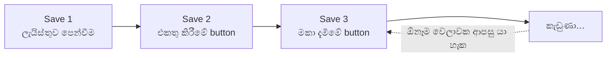

---

## 2. Git・GitHub・SourceTree

නම් සමාන වුවත්, එක් එක් එකේ කාර්යය වෙනස්.

| නම | මොකක්ද? | උපමාවක් ලෙස |
|------|-----------|-----------|
| **Git** | ඉතිහාසය (history) සටහන් කරන ක්‍රමය | Save කිරීමේ පහසුකම |
| **GitHub** | ඉතිහාසය අන්තර්ජාලයේ තබන සේවාව | Cloud එකේ save තබන තැන |
| **SourceTree** | Git තිරයෙන් (GUI) හසුරුවන app එක | Save තිරය |

Git සාමාන්‍යයෙන් PowerShell වැනි දෙයක command type කර භාවිත කළත්, අද අපි SourceTree භාවිතයෙන් **mouse එකෙන්** වැඩ කරනවා.

---

## 3. වචන රූප සටහනෙන් මතක තබා ගන්න

Git වලදී, file "වැඩ කරන folder එක → ඔබේ PC එක → GitHub" අතර එහා මෙහා යනවා.
ඊතලයේ නමම, එම ක්‍රියාවේ නමයි.

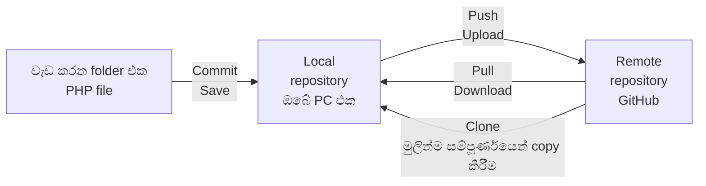

- **Repository**: ඉතිහාසය කළමනාකරණය කරන "පෙට්ටිය". ඔබේ PC එකේ ඇති එක **local** ලෙසත්, GitHub හි ඇති එක **remote** ලෙසත් හඳුන්වයි
- **Commit**: වෙනස්කම් save point එකක් ලෙස සටහන් කිරීම
- **Push**: ඔබේ PC එකේ save එක GitHub වෙත upload කිරීම
- **Pull**: GitHub හි අලුත්ම තත්ත්වය ඔබේ PC එකට download කිරීම
- **Clone**: GitHub හි repository එක මුලින්ම සම්පූර්ණයෙන් copy කර ගැනීම

---

## 4. SourceTree install කිරීම

නිල වෙබ් අඩවියෙන් installer එක download කර run කරන්න.

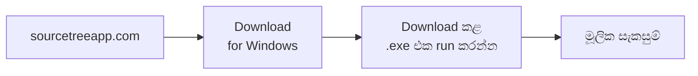

Installer එක අතරතුරදී, ප්‍රශ්න කිහිපයක් අසනවා.

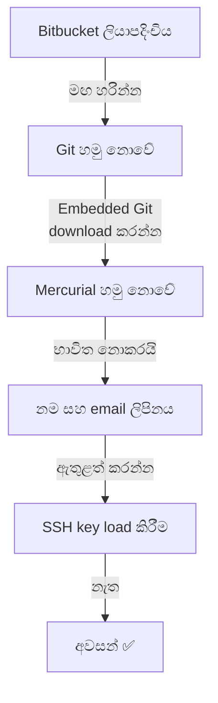

| අසන දේ | තෝරන දේ |
|------------|---------|
| Bitbucket (Atlassian) වෙත ලියාපදිංචිය | `スキップ` (Skip — අද භාවිත නොකරයි) |
| Git හමු නොවේ | **Embedded Git download කරන්න** (SourceTree සඳහාම වූ Git එකක් install වේ) |
| Mercurial හමු නොවේ | `Mercurialを使いたくない` (Mercurial භාවිත කිරීමට අවශ්‍ය නැත — අද භාවිත නොකරයි) |
| නම සහ email ලිපිනය | ඇතුළත් කරන්න. මෙම නම **commit එකේ කර්තෘ (author)** ලෙස සටහන් වේ |
| SSH key load කරනවාද | `いいえ` (නැත — අද token භාවිත කරන නිසා අවශ්‍ය නැත) |

> තිරයේ වචන version එක අනුව ටිකක් වෙනස් විය හැකියි. ව්‍යාකූල වුවහොත් ගුරුතුමාගෙන් අසන්න.

> **නම ඔබව හඳුනාගත හැකි එකක් කරන්න**
> අද හැමෝම එකම repository එක භාවිත කරන නිසා, `yamada-taro` වගේ **කාගේ commit එකද කියා දැනගත හැකි නමක්** දාන්න.

---

## 5. අද වැඩ කරන ආකාරය

අද, ගුරුතුමා GitHub හි සූදානම් කළ **පුහුණු repository එක**, පන්තියේ සියලු දෙනාම එකට භාවිත කරනවා.
ඔබේම GitHub account එක තවම භාවිත නොකර, ගුරුතුමා ලබා දෙන තොරතුරු 3 මගින් සම්බන්ධ වෙනවා.

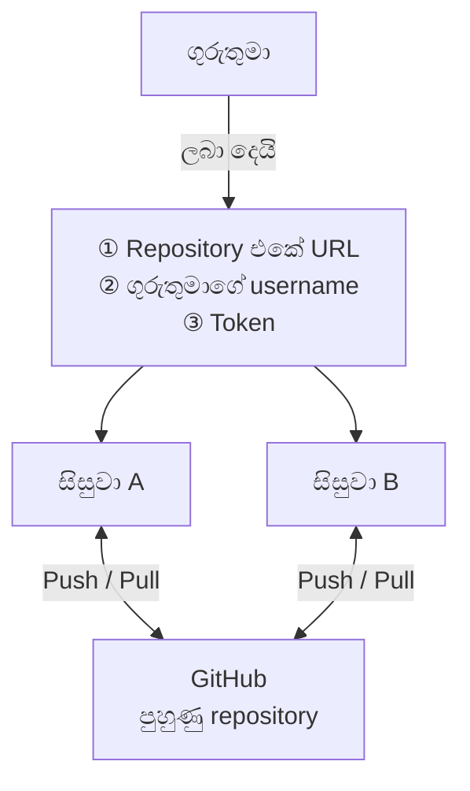

**Token** යනු, GitHub වෙත "මේ කෙනාට වැඩ කරන්න අවසර තියෙනවා" කියා දන්වන, password වෙනුවට භාවිත කරන රහස් වචනයකි (`github_pat_` වලින් ආරම්භ වන දිගු අකුරු පෙළක්).
අද token එක, පුහුණු repository එක පමණක් හැසිරවිය හැකි ලෙස සීමා කර ඇත.

> ⚠️ **Token එක අන් අයට පෙන්වන්න එපා・SNS හෝ chat වල paste කරන්න එපා**

---

## 6. Clone කිරීම

ගුරුතුමාගේ repository එක ඔබේ PC එකට copy කරගන්න.

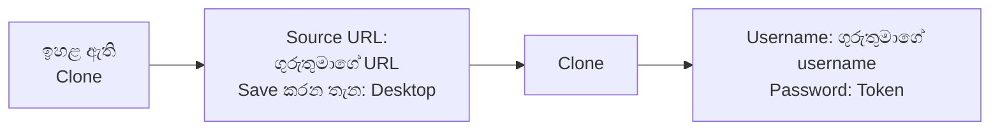

SourceTree හි ඉහළ ඇති `Clone` click කර, පහත පරිදි ඇතුළත් කරන්න.

| අයිතමය | ඇතුළත් කරන දේ |
|------|------------|
| මූලාශ්‍ර path / URL | ගුරුතුමාගෙන් ලැබුණු repository URL එක |
| Save කරන path එක | `C:\Users\<ඔබේ username>\Desktop\<repository නම>` |

අතරතුරදී username සහ password ඇසුවොත්, **password field එකට token එක paste කරන්න**.

✅ Desktop එකේ `<repository නම>` folder එකක් හැදී, ඒ ඇතුළේ `README.md` තිබේ නම් සාර්ථකයි.

ඇතුළත් කළ token එක Windows හි "資格情報マネージャー" (Credential Manager) හි save වන නිසා, ඊළඟ වතාවේ සිට අසන්නේ නැහැ.

> **Desktop එකේ folder එක සොයාගත නොහැකි විට**
> OneDrive භාවිත කරන PC වල, Desktop එකේ ස්ථානය `C:\Users\<ඔබේ username>\OneDrive\デスクトップ` විය හැකියි.
> Save කරන තැනේ `...` button එකෙන්, Explorer එකෙන් Desktop තෝරා ගැනීම නිවැරදිම ක්‍රමයයි.

---

## 7. Commit කිරීම

පෙර semester එකේ හැදූ PHP file එක, clone කළ folder එකට දමා commit කරන්න.
හැමෝම එකම repository එක භාවිත කරන නිසා, **ඔබේ නමින් folder එකක්** හදා, ඒ ඇතුළට දමන්න.
එසේ කළොත්, අන් අයගේ file සමඟ ගැටෙන්නේ නැහැ.

```
<repository නම>/
  README.md
  yamada-taro/     ← ඔබේ folder එක
    todo.php
  suzuki-hanako/   ← වෙනත් කෙනෙක්
    todo.php
```

Explorer එකෙන් file copy කළ පසු, SourceTree හි වම් පැත්තේ ඇති `ファイルステータス` (File Status) විවෘත කරන්න.
"ステージしていないファイル" (Unstaged files) හි පෙන්වන file එක "ステージ" (Staged) වෙත ගෙන, message එකක් ලියා commit කරන්න.

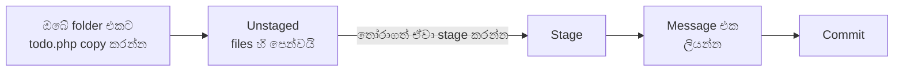

**Stage** යනු "මෙවර save එකට ඇතුළත් කරන file" තෝරන තැනයි.

Commit message එකේ, පසුව බැලූ විට තේරෙන ලෙස **කළේ මොකක්ද** කියා ලියන්න.

| ❌ නරක message | ⭕ හොඳ message |
|----------|----------|
| නිවැරදි කිරීම | Todo මකා දැමීමේ button එක වැඩ නොකරන දෝෂය නිවැරදි කළා |
| යාවත්කාලීන කිරීම | Todo ලැයිස්තුවට අවසාන දිනය (deadline) column එක එකතු කළා |

---

## 8. Push කිරීම

Commit කළා පමණින්, තවම ඔබේ PC එක ඇතුළේ පමණයි සටහන් වී ඇත්තේ.
Push කර, GitHub වෙත upload කරන්න.

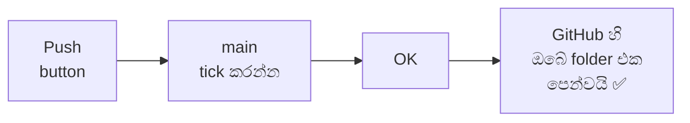

ගුරුතුමා තිරයේ පෙන්වන GitHub පිටුවේ, ඔබේ folder එක පෙනේ නම් සාර්ථකයි.

### Error (rejected) එකක් ආවොත්

වෙනත් කෙනෙක් ඔබට කලින් push කර ඇත්නම්, GitHub එකේ තත්ත්වය වඩා අලුත් වෙනවා.
එලෙසම push කළොත්, GitHub එය ප්‍රතික්ෂේප කරනවා (rejected).
**මුලින්ම pull කර අලුත්ම දේ ලබාගෙන**, නැවත push කරන්න.

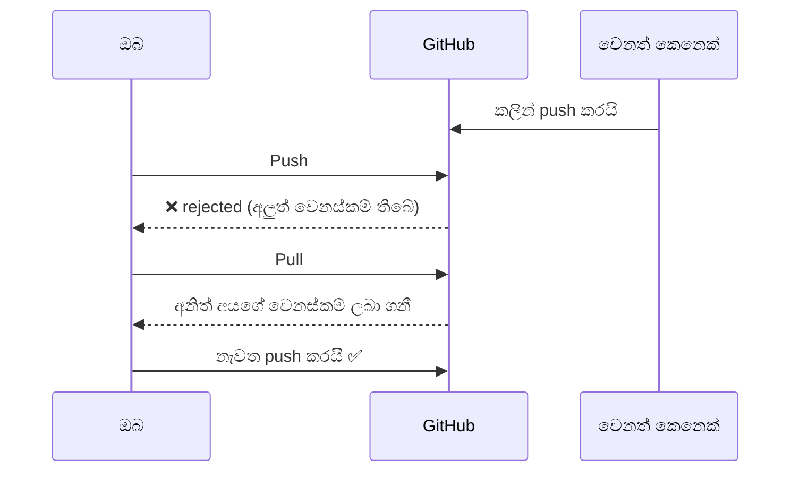

---

## 9. Pull කිරීම

වෙනත් අය push කළ වෙනස්කම්, ඔබේ PC එකට ලබා ගන්න.

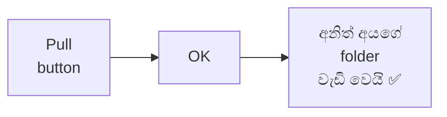

Explorer එකෙන් Desktop එකේ `<repository නම>` folder එක විවෘත කර, අනිත් අයගේ folder වැඩි වී ඇත්නම් සාර්ථකයි.
මේ විදියට, GitHub හරහා **හැමෝගේම වෙනස්කම් බෙදා ගත හැකි වීම** GitHub හි ඇති පහසුවයි.

---

## 10. වැඩ කරන පිළිවෙළ

Git භාවිත කරන development වලදී, පහත පිළිවෙළ නැවත නැවත කරනවා.

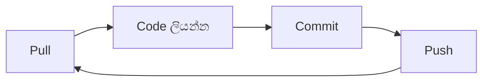

- **වැඩ පටන් ගැනීමට පෙර pull කරන්න**: අනිත් අයගේ වෙනස්කම් මුලින්ම ලබා ගන්න
- **නිතර commit කරන්න**: "මේ දක්වා හරියට වැඩ කරනවා" කියා හිතුණු විට save කරන්න
- **වැඩ අවසානයේ push කරන්න**: GitHub හි save කර බෙදා ගන්න

> අද repository එක සහ token එක **පුහුණුව සඳහා පමණි** (පන්තියෙන් පසු භාවිත කළ නොහැක).
> ඔබේම repository එකක් හදන්න → [GitHub account එකක් සහ repository එකක් හදන ආකාරය](../20261008/20261008_資料_1.md)

<!-- nav:start -->

---

| ⬅️ පෙර | 🗺️ සමස්ත සිතියම | ඊළඟ ➡️ |
|:--|:--:|--:|
| [10/01 පළමු අර්ධ වාරයේ පුනරීක්ෂණය](20261001_復習.md) | [පාඩම් ද්‍රව්‍යවල සමස්ත සිතියම](../../README.md) | [10/08 GitHub account සහ repository](../20261008/20261008_資料_1.md) |

<!-- nav:end -->
