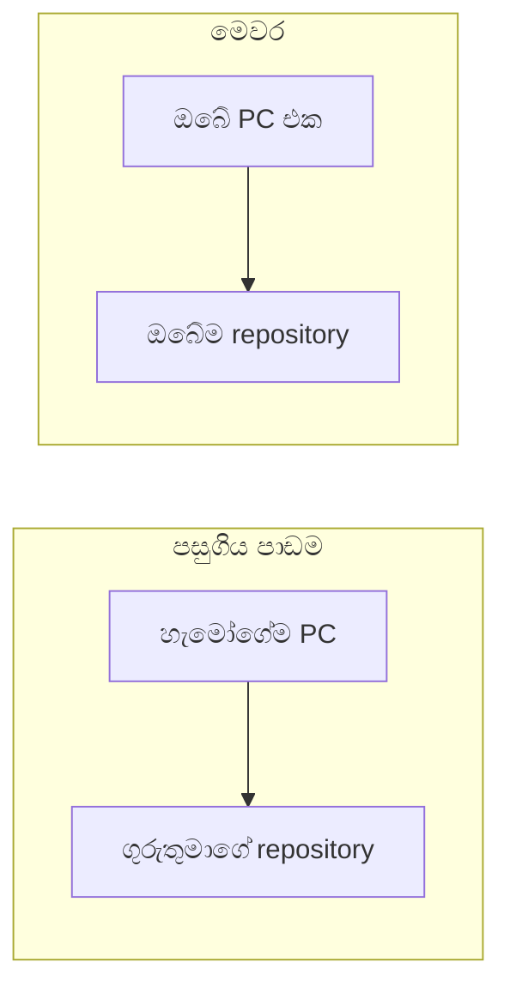
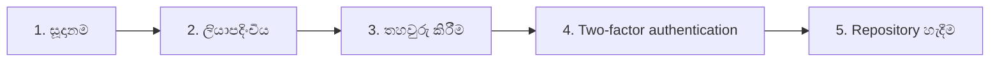
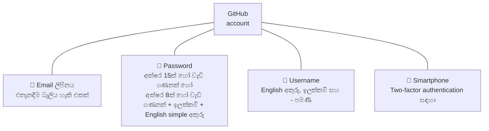
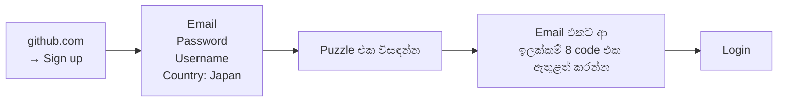
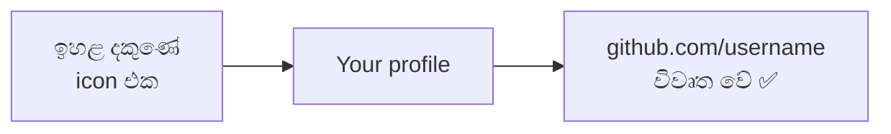
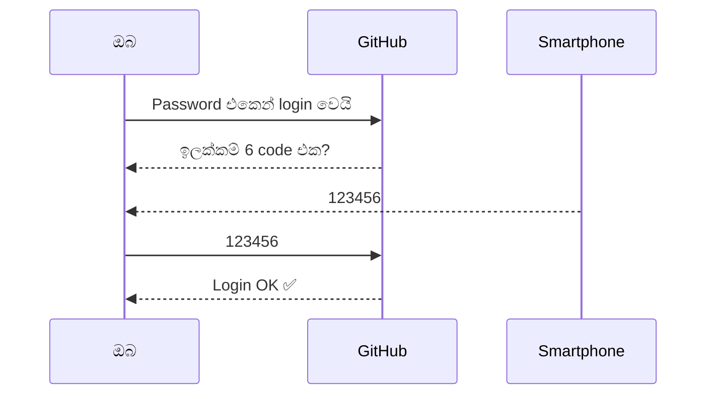
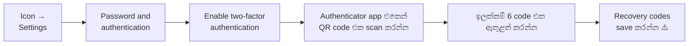
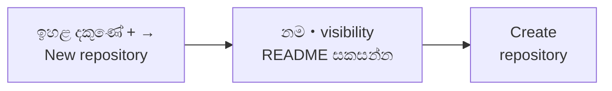
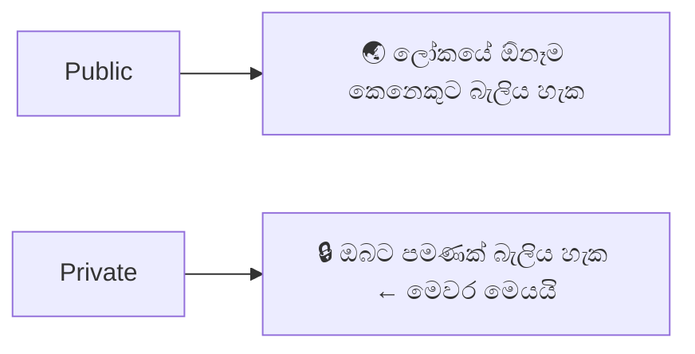

> 🇯🇵 මුල් පිටපත (ජපන් භාෂාවෙන්): [20261008_資料_1.md](<../../../1年生_データ設計とアプリ開発/後期/20261008/20261008_資料_1.md>) <!-- original-ja-link -->

# GitHub account එකක් සහ repository එකක් හදන ආකාරය

## අද දවසේ ඉලක්කය
- GitHub account එකක් හදන්න හැකි වීම
- ඔබේම repository එකක් හදන්න හැකි වීම

[Source Control හැඳින්වීම වෙත ආපසු](../20261001/20261001_資料_1.md)

---

## පසුගිය පාඩමේ පුනරීක්ෂණය

පසුගිය පාඩමේදී, **ගුරුතුමාගේ GitHub account එකේ ඇති repository එකට**, හැමෝම එකට push කළා.

මෙවර, **ඔබේම GitHub account එකක් හදා, ඔබේම repository එකක්** සූදානම් කරනවා.
මෙයින්, ඔබේ code ඔබේම තැනක කළමනාකරණය කිරීමට හැකි වෙනවා.

---

## සමස්ත පිළිවෙළ

අද පහත පියවර 5 මගින්, ඔබටම වෙන් වූ code තබන තැනක් GitHub හි සූදානම් කරනවා.

---

## 1. සූදානම් කළ යුතු දේ

ලියාපදිංචිය ආරම්භ කිරීමට පෙර, පහත දේවල් 4 සූදානම් කර ගන්න.

- **Email ලිපිනය**: තහවුරු කිරීමේ code එකක් එන නිසා, පන්තිය අතරතුරදී එතැනදීම බැලිය හැකි එකක් භාවිත කරන්න
- **Smartphone**: පසුව සකසන two-factor authentication සඳහා භාවිත කරනවා

### Username තීරණය කරන ආකාරය

Username එක `https://github.com/<username>` ලෙස **URL එකක් වන, අන් අයට පෙන්වන නමකි**.
අනාගතයේදී portfolio එකක් ලෙස පෙන්වීමටද ඉඩ ඇති නිසා, විහිළු නම් වලින් වළකින්න.
ඔබේ සැබෑ නම පෙන්වීමට අකමැති නම්, සැබෑ නම නොවූවත් කමක් නැහැ.

| ❌ වළකින්න | ⭕ හොඳයි |
|-------------|----------|
| `unko-man`、`aaaa1234` | `taro-yamada`、`tyamada-dev` |

---

## 2. ලියාපදිංචි වීම

https://github.com විවෘත කර, ඉහළ දකුණේ ඇති `Sign up` මගින් ලියාපදිංචි වන්න.

- Username එක දැනටමත් භාවිත වී ඇත්නම් රතු අකුරෙන් පෙන්වන නිසා, වෙනත් නමක් දාන්න
- **Puzzle එක** යනු "ඔබ මිනිසෙක් බව තහවුරු කිරීම"යි. තිරයේ උපදෙස් අනුව පිළිතුරු දෙන්න
- ලියාපදිංචි වූ email එකට එන **ඉලක්කම් 8 code එක** ඇතුළත් කළ විට, ලියාපදිංචිය අවසන් වෙනවා

අතරතුරදී ප්‍රශ්න හෝ plan තේරීමක් පෙන්වුවොත්, පහත පරිදි ඉදිරියට යන්න.

| තිරය | තෝරන දේ |
|------|---------|
| භාවිත කරන අරමුණ ගැන ප්‍රශ්නය | `Skip personalization` (මඟ හරින්න) |
| Plan එක | **Free (නොමිලේ)** |

> **Email එක නොලැබෙන විට**
> Spam folder එක බලන්න → මිනිත්තු කිහිපයක් ඉඳලා `Resend the code` මගින් නැවත යවන්න → එසේත් නැත්නම් ලිපිනය වැරදියට type කළාදැයි බලන්න

---

## 3. තහවුරු කිරීම

Account එක හැදුණාද කියා, ඔබේ profile තිරය විවෘත කර බලන්න.

**ඔබේ username එක ලියා තබා ගන්න.** පසුව භාවිත කරනවා.

---

## 4. Two-factor authentication

**Two-factor authentication (2FA)** යනු, password එකට අමතරව **smartphone එකේ පෙන්වන ඉලක්කම් 6 code එකෙන්**ද login එක තහවුරු කරන ක්‍රමයකි.
Password එක කවුරුහරි දැනගත්තත්, smartphone එක නැත්නම් login වෙන්න බැහැ.

GitHub හි two-factor authentication සැකසීම අවශ්‍ය කර ඇති අතර, login වී ටික වෙලාවකින් සැකසීමේ උපදෙස් පෙන්වනවා.

### සැකසීමේ පියවර

Smartphone එකට authenticator app එකක් (Google Authenticator වැනි) දාගෙන පටන් ගන්න.

> ⚠️ **Recovery codes අනිවාර්යයෙන්ම save කරන්න!**
> Smartphone එක නැති වූ විට, login වීමට ඇති අවසාන ක්‍රමය මෙයයි.
> මේවා නැති වුණොත්, account එකට ඇතුළු වීමට නොහැකි විය හැකියි.

---

## 5. Repository එකක් හැදීම

Account එක හැදුණු පසු, ඔබේ code save කරන **repository එකක්** (ඉතිහාසය කළමනාකරණය කරන පෙට්ටිය) හදන්න.

පහත පරිදි සකසන්න.

| අයිතමය | සැකසුම |
|------|------------|
| Repository name | `php-study` |
| Visibility (කාටද පෙනෙන්නේ) | **`Private`** |
| Add README | **On** |

**Visibility** යනු, මෙම repository එක බැලිය හැක්කේ කාටද යන්න පිළිබඳ සැකසුමයි.
පුහුණු code `Private` ලෙස තබන්න.

**README** යනු repository එක ගැන විස්තර ලියන file එකයි.
මුල සිටම එක file එකක් තිබුණොත්, පසුව clone කළ විට අන්තර්ගතය ඇතුළත් වී ඇත්දැයි තහවුරු කළ හැකියි.

### තහවුරු කිරීම ✅

පහත කරුණු 3ම සම්පූර්ණ නම් අවසන්.

- URL එක `github.com/<username>/php-study` ලෙස ඇත
- `README.md` පෙන්වයි
- Repository නම අසල `Private` ලෙස පෙන්වයි

---

ඊළඟට, හැදූ `php-study` වෙත පුහුණු පරිසරය push කරනවා → [පුහුණු පරිසරය ඔබේ repository එකට push කිරීම](./20261008_資料_2.md)

<!-- nav:start -->

---

| ⬅️ පෙර | 🗺️ සමස්ත සිතියම | ඊළඟ ➡️ |
|:--|:--:|--:|
| [10/01 Source Control හැඳින්වීම](../20261001/20261001_資料_1.md) | [පාඩම් ද්‍රව්‍යවල සමස්ත සිතියම](../../README.md) | [10/08 පුහුණු පරිසරය push කිරීම](20261008_資料_2.md) |

<!-- nav:end -->
