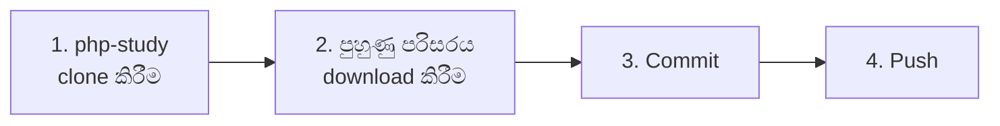
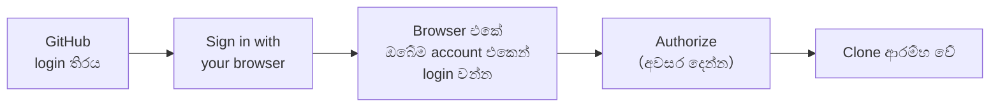
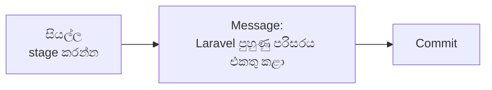

# පුහුණු පරිසරය ඔබේ repository එකට push කිරීම

> 🇯🇵 මුල් පිටපත (ජපන් භාෂාවෙන්): [20261008_資料_2.md](<../../../1年生_データ設計とアプリ開発/後期/20261008/20261008_資料_2.md>) <!-- original-ja-link -->

## අද දවසේ ඉලක්කය
- ඔබේම GitHub account එකෙන් login වී, clone සහ push කිරීමට හැකි වීම
- පුහුණු පරිසරය ඔබේ repository එකට push කිරීමට හැකි වීම

[GitHub account එකක් සහ repository එකක් හදන ආකාරය වෙත ආපසු](./20261008_資料_1.md)

---

## සමස්ත පිළිවෙළ

[පාඩම් ද්‍රව්‍ය 1](./20261008_資料_1.md) හි සෑදූ `php-study` වෙත, ගුරුතුමා සූදානම් කළ **පුහුණු පරිසරය** ඇතුළත් කර push කරන්න.



---

## 1. php-study clone කිරීම

පසුගිය පාඩමේ මෙන්ම, SourceTree හි `Clone` මගින් ඔබේ PC එකට copy කරගන්න.
පසුගිය වතාවේ token සහිත URL එකකින් clone කළත්, මෙවර **ඔබේම GitHub account එකෙන් login වී** සම්බන්ධ වෙනවා.

| අයිතමය | ඇතුළත් කරන දේ |
|------|------------|
| මූලාශ්‍ර path / URL | `https://github.com/<ඔබේ username>/php-study.git` |
| Save කරන path එක | `C:\Users\<ඔබේ username>\Desktop\php-study` |

`クローン` (Clone) එබූ විට, GitHub login තිරය පෙන්වනවා.
`Sign in with your browser` (browser එකෙන් sign in වන්න) තෝරා, **ඔබේම account එකෙන්** login වන්න.



- Browser එකේ login වීමට ඉල්ලුවොත්, පාඩම් ද්‍රව්‍ය 1 හි සෑදූ account එකෙන් login වන්න (two-factor authentication සඳහා ඉලක්කම් 6ක code එකත් ඇතුළත් කරන්න)
- `Authorize` (අවසර දෙන්න) එබූ විට, SourceTree වෙත ආපසු ගොස් clone එක ආරම්භ වෙනවා
- Login තොරතුරු Windows හි save වන නිසා, ඊළඟ වතාවේ සිට අසන්නේ නැහැ

✅ Desktop එකේ `php-study` folder එකක් හැදී, ඒ ඇතුළේ `README.md` තිබේ නම් සාර්ථකයි.

---

## 2. පුහුණු පරිසරය download කිරීම

ගුරුතුමාගේ repository එක ZIP ලෙස download කර, එහි ඇති `practice` folder එකේ **අන්තර්ගතය** එළියට ගන්න.


**ගුරුතුමාගේ repository:** https://github.com/hakobunet/iica-koyama

Extract කළ folder එක ඇතුළේ, පහත ස්ථානයේ `practice` තිබේ.

```
iica-koyama-main/
  docs/
    1年生_データ設計とアプリ開発/
      practice/   ← මෙහි අන්තර්ගතය copy කරන්න
```

`practice` folder එක විවෘත කර, **අන්තර්ගතය සියල්ලම** `php-study` හි **මුල් මට්ටමට (root)** copy කරන්න (`practice` folder එකම හදන්නේ නැහැ).

```
php-study/
  README.md          ← practice හි README.md එකෙන් replace කළාට කමක් නැහැ
  .gitattributes
  mysql/
    compose.yaml
  laravel/
    .gitignore
    compose.yaml
    Dockerfile
    entrypoint.sh
```

> **`README.md` එකම නමින් ගැටුණොත්**
> "ファイルを置き換える" (File එක replace කරන්න) තේරුවාට කමක් නැහැ. පුහුණු පරිසරය run කරන ආකාරය ලියා ඇති README එක ලැබෙනවා.

> **ඇතුළේ ඇති file එකින් එක තෝරන්න එපා**
> `.gitattributes` හෝ `.gitignore` වැනි, නම `.` වලින් ආරම්භ වන file වැදගත් settings file වේ.
> ඒවා නොපෙනී යාමටද ඉඩ ඇති නිසා, `practice` folder එක විවෘත කළ පසු `Ctrl + A` (සියල්ල තෝරන්න) මගින් එකවර copy කරන්න.

---

## 3. Commit කිරීම

SourceTree හි `ファイルステータス` (File Status) විවෘත කළ විට, `mysql` සහ `laravel` ඇතුළේ ඇති file "ステージしていないファイル" (Unstaged files) හි පෙන්වනවා.



---

## 4. Push කිරීම

`プッシュ` (Push) button එක → `main` tick කරන්න → `OK` මගින් GitHub වෙත upload කරන්න.

### තහවුරු කිරීම ✅

Browser එකේ `github.com/<ඔබේ username>/php-study` විවෘත කර, පහත පරිදි ඇත්නම් අවසන්.

- `mysql` සහ `laravel` folder, ඉහළම මට්ටමේ (root) පෙන්වයි

> **Clone හෝ push කරන විට `403` හෝ `Repository not found` ආවොත්**
> URL එකේ `<ඔබේ username>` නිවැරදිද, browser එකේ **ඔබේම account එකෙන්** login වුණාද කියා බලන්න.

පුහුණු පරිසරය run කරන ආකාරය, `php-study` folder එකේ `README.md` හි ලියා ඇත.
Folder එකේ ස්ථානය `C:\Users\<ඔබේ username>\Desktop\php-study` වන නිසා, README එකේ ඇති `Desktop\practice` යන්න `Desktop\php-study` ලෙස සලකා කියවන්න.

<!-- nav:start -->

---

| ⬅️ පෙර | 🗺️ සමස්ත සිතියම | ඊළඟ ➡️ |
|:--|:--:|--:|
| [10/08 GitHub account සහ repository](20261008_資料_1.md) | [පාඩම් ද්‍රව්‍යවල සමස්ත සිතියම](../../README.md) | [10/08 Docker හැඳින්වීම](20261008_資料_3.md) |

<!-- nav:end -->
