# Docker හැඳින්වීම — Docker Desktop install කිරීම

> 🇯🇵 මුල් පිටපත (ජපන් භාෂාවෙන්): [20261008_資料_3.md](<../../../1年生_データ設計とアプリ開発/後期/20261008/20261008_資料_3.md>) <!-- original-ja-link -->

## අද දවසේ ඉලක්කය
- Docker මගින් කරන්නේ මොකක්ද කියා තේරුම් ගැනීම
- Docker Desktop install කර, `hello-world` run කිරීමට හැකි වීම
- පුහුණු පරිසරය ආරම්භ කර, browser එකේ Laravel හි මුල් පිටුව (top page) පෙන්වීමට හැකි වීම

---

## මුලින්ම: Container යනු මොකක්ද?

**Container** යනු, PC එක ඇතුළේ හදන **කුඩා, විශේෂිත කාමරයක්** වැනි දෙයකි.
කාමරය ඇතුළේ, app එක run කිරීමට අවශ්‍ය දේ (PHP, MySQL වැනි) පමණක් තිබෙනවා.

පෙර semester එකේ XAMPP, PC එකට කෙලින්ම install කළා.
Container භාවිත කළොත්, PC එකට install නොකර, කාමරය ඇතුළේ පමණක් run කළ හැකියි.

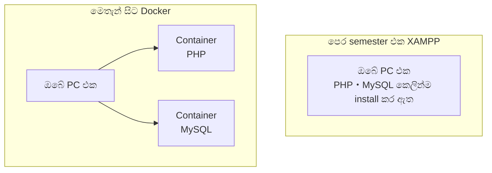

Container වලට පහත ලක්ෂණ තිබෙනවා.

| ලක්ෂණය | ඒ කියන්නේ? |
|------|--------------|
| **කාමරයෙන් කාමරයට වෙන් වී ඇත** | Container එකිනෙකට බලපාන්නේ නැහැ. PHP හි පැරණි version එක සහ අලුත් version එක එකවර run කළ හැකියි |
| **PC එක අපිරිසිදු කරන්නේ නැහැ** | PC එකට කිසිවක් install වෙන්නේ නැහැ |
| **ඉක්මනින් හදන්නත්, ඉක්මනින් මකන්නත් පුළුවන්** | තත්පර කිහිපයකින් ආරම්භ කළ හැකියි. අවශ්‍ය නැති වූ විට මකා, නැවත හැදුවාම ඇති |
| **ඕනෑම කෙනෙකුගේ PC එකේ එකම අන්තර්ගතය** | එකම සැලැස්මෙන් හැදුවොත්, හැමෝගේම PC වල එකම පරිසරය ලැබෙනවා |

මෙම container හදන සහ run කරන software එක **Docker** වේ.

---

## 1. Docker භාවිත කරන්නේ ඇයි?

පෙර semester එකේ, app එක run කිරීමට XAMPP දමා, PHP සහ MySQL සූදානම් කළා.
නමුත්, මෙවැනි දේ නිතර සිදු වෙනවා.

```
A：「මගේ PC එකේ නම් වැඩ කරනවා, ඒත්…」
B：「PHP version එක වෙනස් වගේ」
C：「XAMPP settings වෙනස් කළාම වැඩ කරන්නේ නැති වුණා」
```

**Docker** භාවිත කළොත්, app එක run කිරීමට අවශ්‍ය පරිසරය (PHP・MySQL වැනි) **container** (විශේෂිත කාමරයක්) එකකට දමා, ඕනෑම PC එකක එකම ආකාරයෙන් run කළ හැකියි.

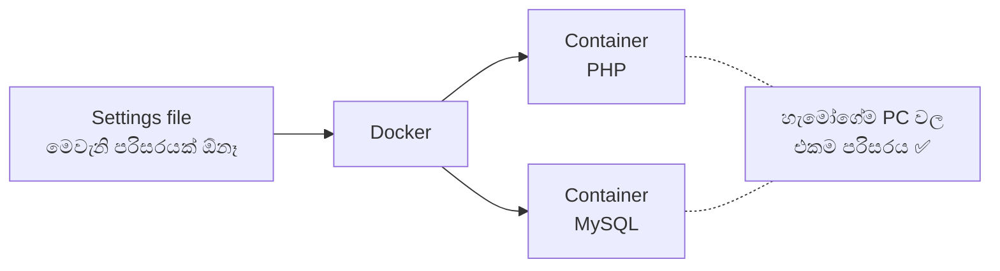

- පරිසරය කැඩුවත්, container එක නැවත හැදුවොත් ඉක්මනින් පෙර තත්ත්වයට එනවා
- Settings file එක බෙදා ගත්තොත්, team එකේ හැමෝටම එකම පරිසරය සූදානම් කළ හැකියි

---

## 2. Docker・Image・Container

මුලින්ම හමුවන වචන, ඉවුම් පිහුම්වලට උපමා කර මතක තබා ගනිමු.

| නම | මොකක්ද? | උපමාවක් ලෙස |
|------|-----------|-----------|
| **Image** | පරිසරයේ සැලැස්ම (design) | Recipe එක |
| **Container** | Image එකෙන් හදපු, ඇත්තටම run වන පරිසරය | Recipe එකෙන් හදපු කෑම |
| **Docker Desktop** | Windows හි Docker භාවිත කිරීමට ඇති app එක | කුස්සිය |
| **Docker Hub** | Image ලබාගැනීමට ප්‍රසිද්ධියේ තබා ඇති වෙබ් අඩවිය | Recipe පොත |

එක image (recipe) එකකින්, container (කෑම) ඕනෑ තරම් හදන්න පුළුවන්.

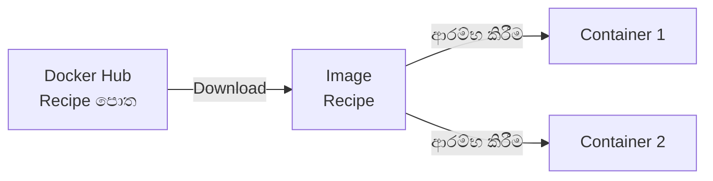

> **Container මැකුවත් කමක් නැද්ද?**
> Container එකක් image (recipe) එකෙන් ඕනෑම වෙලාවක නැවත හදන්න පුළුවන් නිසා, කැඩුණොත් මකා නැවත හැදුවාම හරි.
> නමුත්, **container එක ඇතුළේ හදපු data, container එක මැකූ විට එයත් සමඟම මැකී යනවා.** Data තබා ගන්නා ක්‍රමය, ඊළඟ පාඩම් වලදී ඉගෙන ගන්නවා.

---

## 3. Install කිරීමේ පිළිවෙළ

අද පහත පිළිවෙළට ඉදිරියට යනවා.

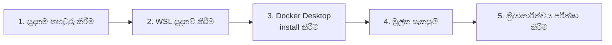

---

## 4. සූදානම තහවුරු කිරීම

Docker Desktop දැමීමට පෙර, PC එක පහත කොන්දේසි සපුරනවාද කියා බලන්න.

| බැලිය යුතු දේ | කොන්දේසිය |
|------------|------|
| Windows version එක | Windows 10 (22H2) හෝ Windows 11 |
| Virtualization | **Enabled** (සක්‍රිය) කර තිබිය යුතුයි |
| Account එක | **Administrator අයිතිය** ඇති user කෙනෙක් |

### Virtualization සක්‍රිය දැයි බැලීම

Docker, PC එක ඇතුළේ තවත් කුඩා PC එකක් run කරන **virtualization** නම් පහසුකම භාවිත කරනවා.

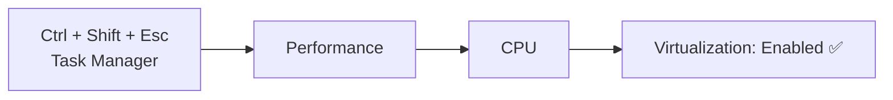

පහළ දකුණේ ලැයිස්තුවේ **「仮想化：有効」** (Virtualization: Enabled) ලෙස පෙන්වයි නම් OK.

> **「無効」 (Disabled) ලෙස තිබුණොත්**
> BIOS (PC එක ආරම්භ වන විට ඇති settings තිරය) හි සක්‍රිය කළ යුතුයි. PC නිෂ්පාදක සමාගම අනුව ක්‍රමය වෙනස් නිසා, ගුරුතුමාට කතා කරන්න.

---

## 5. WSL සූදානම් කිරීම

**WSL** (Windows Subsystem for Linux) යනු, Windows ඇතුළේ Linux run කරන ක්‍රමයකි.
Docker Desktop, මෙම WSL මත run වෙනවා.

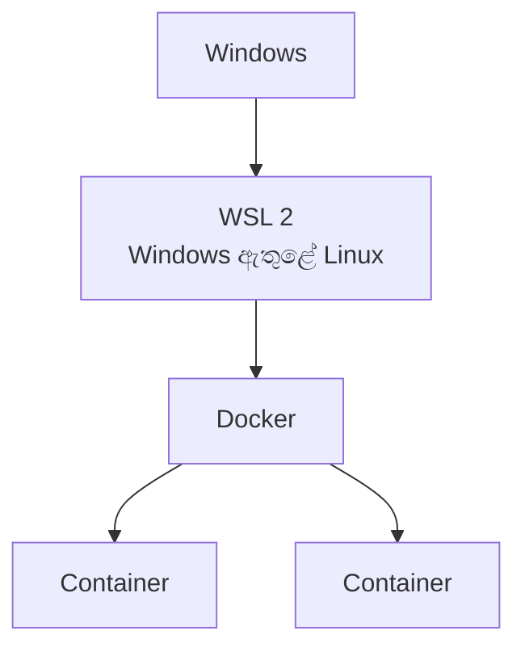

Start menu එකේ "PowerShell" කියා search කර, **right click →「管理者として実行」 (Run as administrator)** මගින් විවෘත කරන්න.

```powershell
wsl --install
```

දැනටමත් install කර ඇත්නම්, අලුත්ම version එකට update කරන්න.

```powershell
wsl --update
```

අවසන් වූ පසු, **PC එක restart කරන්න**.

✅ Restart කළ පසු, PowerShell හි පහත command එක run කර `既定のバージョン: 2` (Default Version: 2) ලෙස පෙන්වයි නම් OK.

```powershell
wsl --status
```

> **`wsl --install` හිදී Ubuntu username එක ඇසුවොත්**
> මෙය Ubuntu (Linux වර්ගයක්) හි මූලික සැකසුමයි. English simple අකුරු වලින් username එකක් සහ password එකක් තීරණය කර ඇතුළත් කරන්න.
> Password එක type කරන විට තිරයේ කිසිවක් නොපෙන්වුවත්, එය හරියටම ඇතුළත් වෙනවා.

---

## 6. Docker Desktop install කිරීම

නිල වෙබ් අඩවියෙන් installer එක download කර run කරන්න.

**Download පිටුව:** https://www.docker.com/products/docker-desktop/

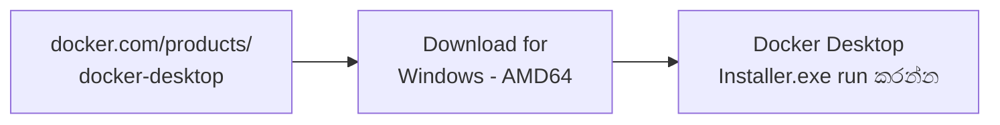

> **ARM64 සහ AMD64 අතර වෙනස**
> මේවා PC එකේ CPU වර්ගයයි. බොහෝ Windows PC **AMD64** (x86_64) වේ.
> Snapdragon වැනි smartphone වර්ගයේ CPU ඇති PC සඳහා පමණක් ARM64 තෝරන්න.

Installer එක අතරතුරදී, settings ගැන අසනවා.

| අසන දේ | තෝරන දේ |
|------------|---------|
| Use WSL 2 instead of Hyper-V | **On** (WSL මත run කරයි) |
| Add shortcut to desktop | On (Desktop එකේ icon එකක් හැදේ) |

`OK` එබූ විට install කිරීම ආරම්භ වෙනවා.
`Close and restart` (හෝ `Close`) පෙන්වූ විට, **PC එක restart කරන්න**.

---

## 7. මූලික සැකසුම්

Restart කළ පසු, Desktop එකේ **Docker Desktop** icon එක double click කර ආරම්භ කරන්න.

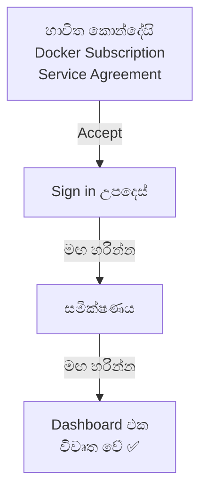

| තිරය | තෝරන දේ |
|------|---------|
| භාවිත කොන්දේසි (Subscription Service Agreement) | `Accept` |
| Sign in (Sign in / Sign up) | `Skip` (අද account එකක් නැතිව භාවිත කරයි) |
| සමීක්ෂණය (Welcome Survey) | `Skip` |

> ඉගෙනීමේ අරමුණු සහ පුද්ගලික භාවිතය සඳහා නොමිලේ.

> තිරයේ වචන version එක අනුව ටිකක් වෙනස් විය හැකියි. ව්‍යාකූල වුවහොත් ගුරුතුමාගෙන් අසන්න.

### ආරම්භ වී ඇත්දැයි බැලීම

තිරයේ පහළ වම් පැත්තේ **Engine running** (කොළ පාටින්) පෙන්වයි නම්, Docker run වෙනවා.
තිරයේ පහළ දකුණේ taskbar එකේ (`^` ඇතුළේ) ඇති **තල්මසා icon එකෙන්** 🐳 ද බැලිය හැකියි.

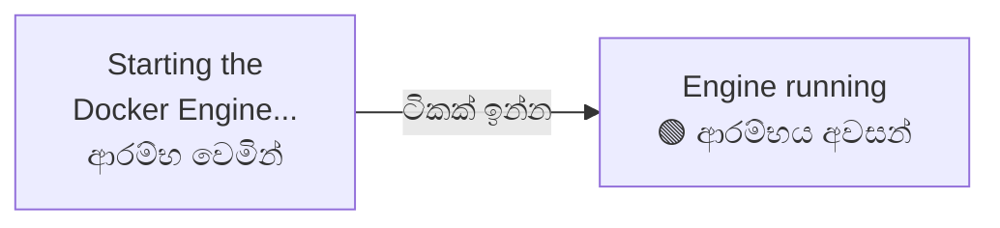

**Docker Desktop ආරම්භ කර නැත්නම් Docker භාවිත කළ නොහැක.**
PC එක restart කළ පසු, මුලින්ම Docker Desktop ආරම්භ කරන්න.

---

## 8. ක්‍රියාකාරිත්වය පරීක්ෂා කිරීම

PowerShell (administrator නොවුණත් OK) විවෘත කර, Docker version එක බලන්න.

```powershell
docker --version
```

```
Docker version 28.x.x, build xxxxxxx
```

මෙවැනි දෙයක් පෙන්වයි නම් OK (ඉලක්කම් කෙනාගෙන් කෙනාට වෙනස්).

ඊළඟට, පුහුණුව සඳහා වූ **hello-world** image එක run කර බලමු.

```powershell
docker run hello-world
```

මෙම එක command එකෙන්, Docker පහත දේ කරනවා.

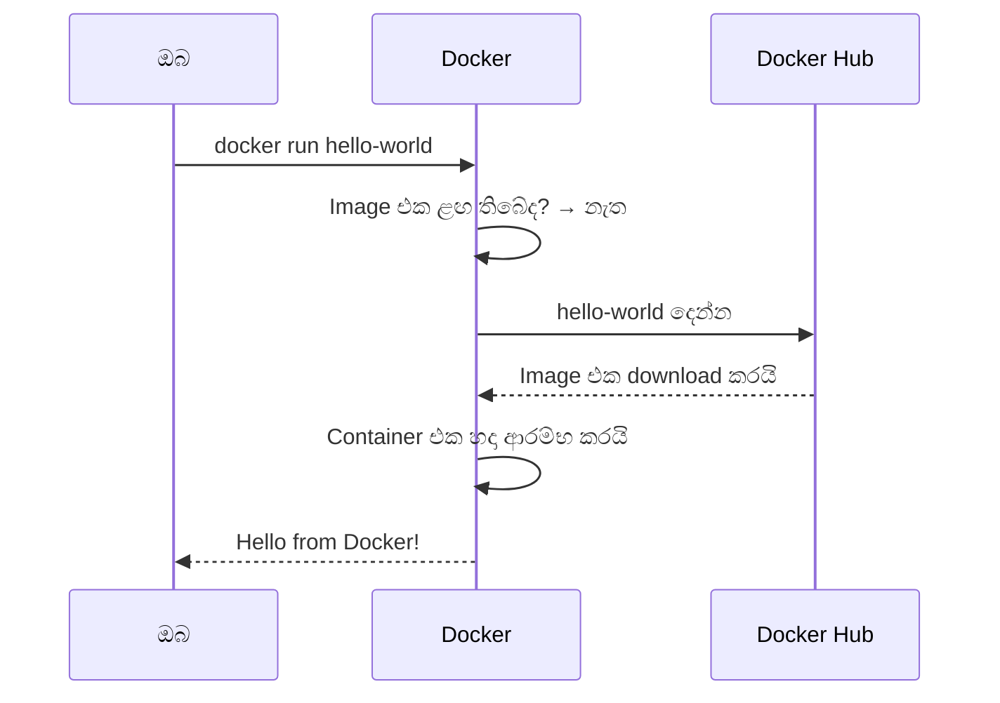

✅ පහත message එක පෙන්වයි නම්, install කිරීම සාර්ථකයි.

```
Hello from Docker!
This message shows that your installation appears to be working correctly.
```

නැවත `docker run hello-world` run කළොත්, මෙවර download නොකර ඉක්මනින්ම run වෙනවා.
Image එක (recipe) දැනටමත් ළඟ තිබෙන නිසයි.

Docker Desktop හි වම් පැත්තේ `Containers` විවෘත කළ විට, දැන් run කළ container එක පෙන්වනවා.

---

## 9. පුහුණු පරිසරය ආරම්භ කිරීම

[පාඩම් ද්‍රව්‍ය 2](./20261008_資料_2.md) හි push කළ පුහුණු පරිසරය, Docker මගින් run කර බලමු.
**අනිවාර්යයෙන්ම mysql → laravel පිළිවෙළට** ආරම්භ කරන්න.

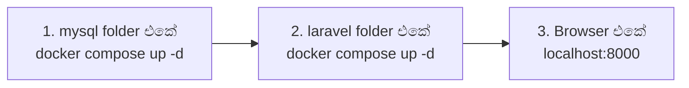

ආරම්භ කළ විට, container 2 පහත පරිදි සම්බන්ධ වී වැඩ කරනවා.
laravel container එක mysql container එක භාවිත කරන නිසා, mysql මුලින්ම ආරම්භ කර තබන්න.

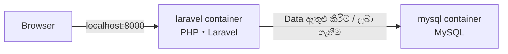

```powershell
cd C:\Users\<ඔබේ username>\Desktop\php-study\mysql
docker compose up -d
```

```powershell
cd C:\Users\<ඔබේ username>\Desktop\php-study\laravel
docker compose up -d
```

**පළමු වතාවේ පමණක්**, Laravel install වීමට මිනිත්තු කිහිපයක් ගත වෙනවා.
`docker compose logs -f` මගින් ප්‍රගතිය බැලිය හැකියි (`Ctrl + C` මගින් බැලීම නවත්වන්න).
`Server running on [http://0.0.0.0:8000]` පෙන්වූ විට සූදානම් වී ඇත.

✅ Browser එකේ http://localhost:8000 විවෘත කර, පහත තිරය පෙනේ නම් OK.


---

## 10. හරියට වැඩ නොකරන විට

| ගැටලුව | විසඳුම |
|------|------|
| `docker` හමු නොවන බව කියයි | Docker Desktop ආරම්භ කර ඇත්දැයි බලන්න → PowerShell නැවත විවෘත කරන්න |
| `Engine stopped` ලෙසම තිබී වැඩ නොකරයි | Docker Desktop වසා නැවත ආරම්භ කරන්න → එසේත් නැත්නම් PC එක restart කරන්න |
| WSL පැරණි බව කියයි (WSL update failed වැනි) | Administrator PowerShell එකේ `wsl --update` → PC එක restart කරන්න |
| Virtualization අක්‍රිය බව කියයි (Virtualization support not detected) | [4. සූදානම තහවුරු කිරීම](#4-සූදානම-තහවුරු-කිරීම) බලන්න → ගුරුතුමාට කතා කරන්න |
| `error during connect` පෙන්වයි | Docker Engine තවම ආරම්භ වෙමින් පවතී. පහළ වම් පැත්ත `Engine running` වන තුරු ඉන්න |

---

## 11. සාරාංශය

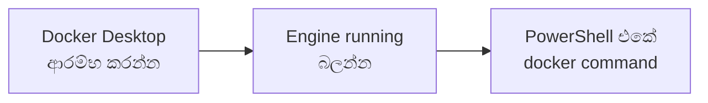

- **Image** යනු සැලැස්ම, **container** යනු එයින් හදපු ඇත්තටම run වන පරිසරය
- Docker භාවිත කිරීමට පෙර, **Docker Desktop ආරම්භ කර** තබන්න
- `docker run <image නම>` මගින්, image එක download කිරීමේ සිට container එක ආරම්භ කිරීම දක්වා සියල්ල එකවර කළ හැකියි

ඊළඟ පාඩමේදී, Docker භාවිතයෙන් PHP සහ MySQL පරිසරය හදනවා.

<!-- nav:start -->

---

| ⬅️ පෙර | 🗺️ සමස්ත සිතියම | ඊළඟ ➡️ |
|:--|:--:|--:|
| [10/08 පුහුණු පරිසරය push කිරීම](20261008_資料_2.md) | [පාඩම් ද්‍රව්‍යවල සමස්ත සිතියම](../../README.md) | [10/15 MVC ක්‍රියා කරන ආකාරය](../20261015/20261015_資料_1.md) |

<!-- nav:end -->
