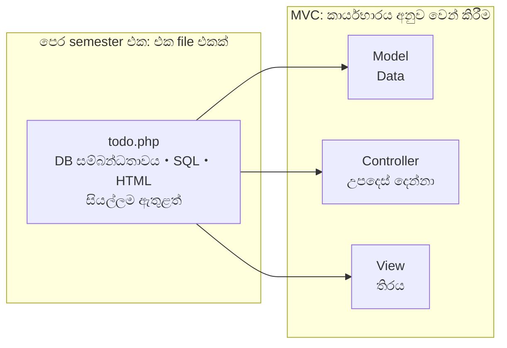
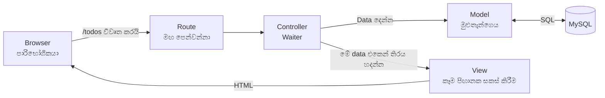
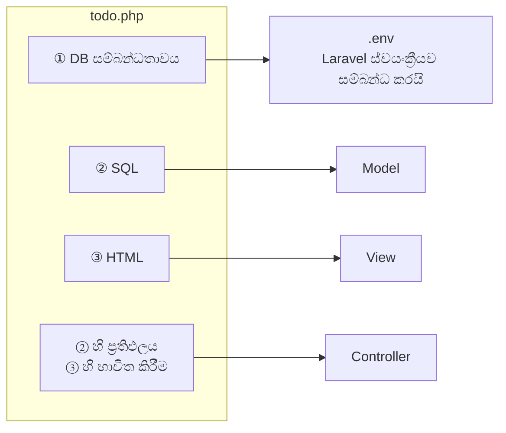
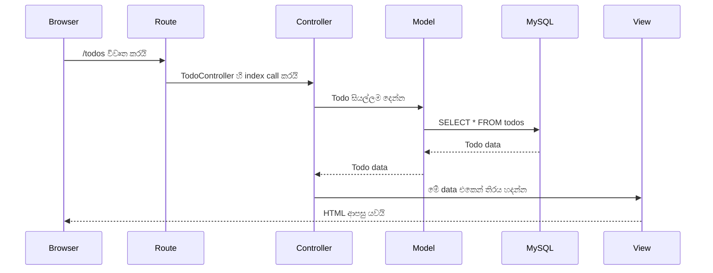
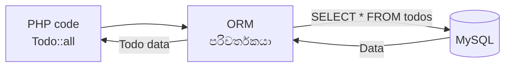
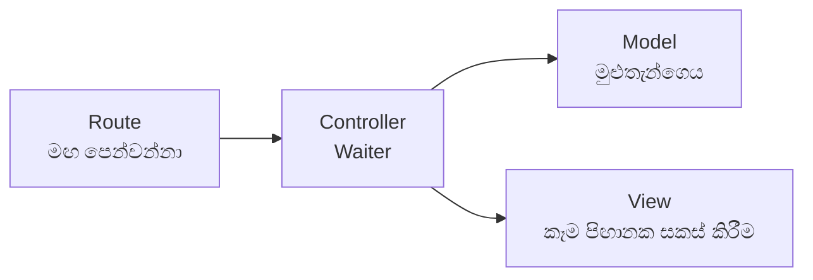

# Laravel හැඳින්වීම — MVC ක්‍රියා කරන ආකාරය

> 🇯🇵 මුල් පිටපත (ජපන් භාෂාවෙන්): [20261015_資料_1.md](<../../../1年生_データ設計とアプリ開発/後期/20261015/20261015_資料_1.md>) <!-- original-ja-link -->

## අද දවසේ ඉලක්කය
- MVC (Model・View・Controller) හි කාර්යභාරය තේරුම් ගැනීම
- Laravel හි, request එකක් "Route → Controller → Model → View" ලෙස ගලා යන බව තේරුම් ගැනීම
- ORM භාවිත කළොත්, SQL නොලියාම data ඇතුළු කිරීමට සහ ලබා ගැනීමට හැකි බව තේරුම් ගැනීම

---

## 1. පෙර semester එකේ todo.php නැවත බලමු

පෙර semester එකේ හැදූ `todo.php`, **එක file එකක සියල්ලම** ලියා තිබුණා.
ලැයිස්තුව පෙන්වන කොටස පමණක් වෙන් කර බැලුවොත්, මෙහෙමයි.

```php
<?php
// ① Database එකට සම්බන්ධ වීම
$pdo = new PDO('mysql:host=127.0.0.1;dbname=school_db;charset=utf8mb4', 'root', '');

// ② SQL මගින් Todo ලබා ගැනීම
$stmt = $pdo->query("SELECT * FROM todos ORDER BY created_at DESC");
$todos = $stmt->fetchAll(PDO::FETCH_ASSOC);
?>
<!-- ③ HTML මගින් තිරය හැදීම -->
<ul>
<?php foreach ($todos as $todo): ?>
    <li><?= htmlspecialchars($todo['title']) ?></li>
<?php endforeach; ?>
</ul>
```

කුඩා app එකක් නම් මෙයින් වැඩ කරනවා.
නමුත්, app එක විශාල වන විට, මෙවැනි දේ සිදු වෙනවා.

```
A：「තිරයේ පෙනුම පමණක් වෙනස් කරන්න ඕනෑ වුණත්, SQL මිශ්‍ර වෙලා තියෙන නිසා කියවන්න අමාරුයි…」
B：「එකම SELECT එක, file ගොඩකට copy කරලා තියෙනවා」
C：「කොතැනද හදන්න ඕනෑ කියලා තේරෙන්නේ නැහැ」
```

ඒ නිසා, **කාර්යභාරය අනුව file වෙන් කරන** අදහස **MVC** වේ.



---

## 2. MVC යනු

MVC යනු, app එක කාර්යභාර 3කට වෙන් කරන අදහසකි. අවන්හලකට (restaurant) සමාන කර මතක තබා ගනිමු.

| නම | කාර්යභාරය | අවන්හලක නම් |
|------|------|------------------|
| **M**odel (Model) | Database එකේ data ඇතුළු කිරීම සහ ලබා ගැනීම | මුළුතැන්ගෙය (අමුද්‍රව්‍ය ගෙන එයි) |
| **V**iew (View) | තිරය (HTML) හැදීම | කෑම පිඟානක සකස් කිරීම (පිඟානට දමා පෙන්වයි) |
| **C**ontroller (Controller) | Order එක ලබාගෙන, model සහ view වෙත උපදෙස් දීම | Waiter (මුළුතැන්ගෙය සහ කෑම පිඟානක සකස් කරන අය සම්බන්ධ කරයි) |

Laravel හි, මීට අමතරව **Route** (කුමන URL එක, කුමන controller එක භාර ගන්නවාද) එකතු වෙනවා.
Route යනු, අවන්හලේ **දොරටුවේ සිටින මඟ පෙන්වන්නා** වේ.



වැදගත්ම කරුණ නම්, **controller එක මැද සිට, හැමෝටම උපදෙස් දෙන** බවයි.
View එක, තනියම model එකට ගොස් data ගන්නේ නැහැ. Data, controller එකෙන් ලබා දෙනවා.

### පෙර semester එකේ todo.php, කොහේට යනවාද?

ඉහත `todo.php` හි ①〜③, MVC හි පහත පරිදි වෙන් වෙනවා.



| todo.php හි කොටස | යන තැන | තබන ස්ථානය |
|---------------|-------|---------|
| ① Database එකට සම්බන්ධ වීම | Laravel ස්වයංක්‍රීයව කරයි | `.env` (settings file) |
| ② SQL මගින් Todo ලබා ගැනීම | **Model** | `app/Models/Todo.php` |
| ③ HTML මගින් තිරය හැදීම | **View** | `resources/views/todos/index.blade.php` |
| ② හි ප්‍රතිඵලය ③ වෙත ලබා දීම | **Controller** | `app/Http/Controllers/TodoController.php` |
| කුමන URL එකෙන් මෙම ක්‍රියාවලිය run කරනවාද | **Route** | `routes/web.php` |

---

## 3. Request එක ගලා යන ආකාරය

Browser එකේ `http://localhost:8000/todos` විවෘත කළ විට, Laravel ඇතුළේ පහත පිළිවෙළට ක්‍රියාවලිය සිදු වෙනවා.



අවන්හලක නම්, මෙවැනි පිළිවෙළකි.

1. පාරිභෝගිකයා අවන්හලට එනවා (browser එකේ `/todos` විවෘත කරනවා)
2. මඟ පෙන්වන්නා, අදාළ waiter වෙත යොමු කරනවා (Route → Controller)
3. Waiter මුළුතැන්ගෙයින් අමුද්‍රව්‍ය ඉල්ලනවා (Controller → Model)
4. මුළුතැන්ගෙය ගබඩාවෙන් අමුද්‍රව්‍ය ගෙන එනවා (Model → MySQL)
5. Waiter අමුද්‍රව්‍ය කෑම පිඟානක සකස් කරන කෙනාට දෙනවා (Controller → View)
6. කෑම පාරිභෝගිකයාට පිළිගන්වනවා (HTML browser එකට ආපසු එනවා)

---

## 4. ORM වැඩ කරන ආකාරය

### ORM යනු

පෙර semester එකේ, `SELECT * FROM todos` වගේ **SQL statement ඔබම ලියුවා**.
Laravel හි, model එක භාවිත කර `Todo::all()` කියා ලිවීමෙන් පමණක් data ලබා ගත හැකියි.

මෙය **ORM** (Object-Relational Mapping) නම් ක්‍රමය නිසයි.
ORM, **PHP code එක ස්වයංක්‍රීයව SQL වලට පරිවර්තනය කර**, MySQL වෙත යවනවා.
Laravel හි ORM එකේ නම **Eloquent** (එලොක්වන්ට්) වේ.



අවන්හලක නම්, මුළුතැන්ගෙයි (model) **පරිවර්තකයෙක් (ORM)** ඉන්නවා, ඔහු waiter ගේ "Todo සියල්ලම දෙන්න" කියන order එක, ගබඩාවට (MySQL) තේරෙන භාෂාවට (SQL) හරවනවා කියා සිතන්න.

### පෙර semester එකේ SQL සමඟ සසඳමු

| කරන්න ඕනෑ දේ | පෙර semester එක (SQL ලියයි) | Laravel (Eloquent) |
|------------|-----------------|-------------------|
| සියල්ලම ලබා ගැනීම | `SELECT * FROM todos` | `Todo::all()` |
| id එක 1 වන එක ලබා ගැනීම | `SELECT * FROM todos WHERE id = 1` | `Todo::find(1)` |
| අවසන් නොකළ ඒවා පමණක් ලබා ගැනීම | `SELECT * FROM todos WHERE is_done = 0` | `Todo::where('is_done', 0)->get()` |

අද "SQL නොලියාම, මෙහෙම ලියන්න පුළුවන් නේද" කියා තේරුණාම ඇති.

### එහෙනම් SQL ඉගෙන ගත් එකෙන් වැඩක් නැද්ද?

**නැහැ.** ORM, පිටුපසින් SQL හදා MySQL වෙත යවනවා.
හරියට වැඩ නොකරන විට, හෝ සංකීර්ණ data ලබා ගැනීමට අවශ්‍ය විට, පෙර semester එකේ ඉගෙන ගත් SQL දැනුම ප්‍රයෝජනවත් වෙනවා.

---

## 5. සාරාංශය



| කාර්යභාරය | කෙටියෙන් |
|------|-----------|
| **Route** | කුමන URL එක, කුමන controller එක භාර ගන්නවාද කියා තීරණය කරයි |
| **Controller** | Model එකෙන් data ලබාගෙන, view එකට ලබා දෙයි |
| **Model** | Database එකේ data ඇතුළු කරයි සහ ලබා ගනී (ORM විසින් SQL වලට පරිවර්තනය කරයි) |
| **View** | තිරය (HTML) හදයි |

කාර්යභාරය අනුව file වෙන් කර ඇති නිසා, "තිරය වෙනස් කරන්න නම් view", "data ලබා ගන්නා ආකාරය වෙනස් කරන්න නම් model" ලෙස, **වෙනස් කළ යුතු තැන ඉක්මනින් තේරෙනවා**.

ඊළඟට, ඇත්තටම MVC ලෙස වෙන් කර Todo ලැයිස්තු පිටුවක් හදමු → [Todo ලැයිස්තුවක් හදමු](./20261015_資料_2.md)

<!-- nav:start -->

---

| ⬅️ පෙර | 🗺️ සමස්ත සිතියම | ඊළඟ ➡️ |
|:--|:--:|--:|
| [10/08 Docker හැඳින්වීම](../20261008/20261008_資料_3.md) | [පාඩම් ද්‍රව්‍යවල සමස්ත සිතියම](../../README.md) | [10/15 Todo ලැයිස්තුව](20261015_資料_2.md) |

<!-- nav:end -->
