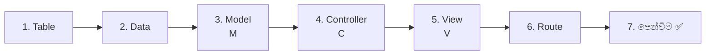
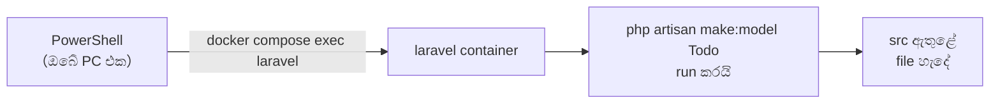
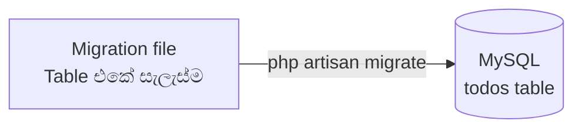
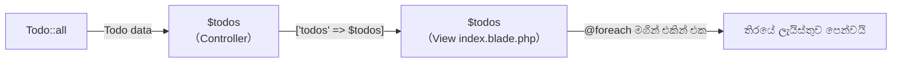
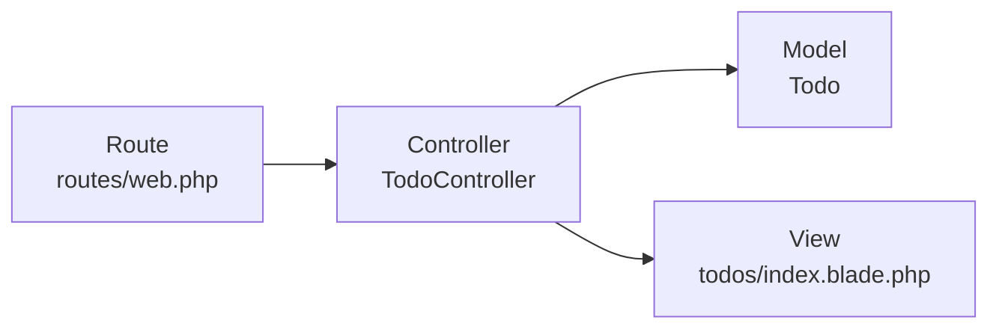

# Laravel හැඳින්වීම — Todo ලැයිස්තුවක් හදමු

> 🇯🇵 මුල් පිටපත (ජපන් භාෂාවෙන්): [20261015_資料_2.md](<../../../1年生_データ設計とアプリ開発/後期/20261015/20261015_資料_2.md>) <!-- original-ja-link -->

[MVC ක්‍රියා කරන ආකාරය](./20261015_資料_1.md) හි ඉගෙන ගත් දේ භාවිත කර, Todo ලැයිස්තු පිටුවක් හදනවා.

## අද දවසේ ඉලක්කය
- Todo ලැයිස්තු පිටුව, MVC ලෙස වෙන් කර හදන්න හැකි වීම
- Migration・Model・Controller・View・Route යන එක් එක් කොටස ලිවිය යුත්තේ කොතැනදැයි තේරුම් ගැනීම

> පුහුණු පරිසරයේ (`php-study`) mysql සහ laravel ආරම්භ කළ පසු පටන් ගන්න.
> ආරම්භ කරන ආකාරය `php-study` folder එකේ `README.md` හි බලන්න.

පෙර semester එකේ භාවිත කළ එකම `todos` table එක භාවිත කර, Todo ලැයිස්තු පිටුව හදනවා.
File හැදෙන්නේ `php-study\laravel\src` ඇතුළේයි.

---

## 1. හදන පිළිවෙළ

**ක්‍රියාත්මක වන පිළිවෙළට** (Route → Controller → Model → View) ප්‍රතිවිරුද්ධව, **data පැත්තේ සිට** හදාගෙන යනවා.
අමුද්‍රව්‍ය (table සහ data) නැත්නම්, කෑම (තිරය) හදන්න බැරි නිසයි.



---

## 2. Command කියවන ආකාරය

අද, පහත වැනි command කිහිප වතාවක් භාවිත කරනවා.
Command, PowerShell එකේ **laravel folder එකට** ගිය පසු run කරන්න.

```powershell
cd C:\Users\<ඔබේ username>\Desktop\php-study\laravel
```

```powershell
docker compose exec laravel php artisan make:model Todo
```

දිගු ලෙස පෙනුනත්, කොටස් 2කට බෙදී ඇත.

| කොටස | තේරුම |
|------|------|
| `docker compose exec laravel` | "laravel container එක ඇතුළේ, ඊළඟ command එක run කරන්න" |
| `php artisan make:model Todo` | "Todo නමින් model එකක් හදන්න" |

ඔබේ PC එකේ PowerShell එකෙන්, container එක ඇතුළට command යවා run කරනවා කියා සිතන්න.
Container එක ඇතුළේ හැදෙන file, ඔබේ PC එකේ `src` folder එකේ දිස් වෙනවා.



**artisan** (ආටිසන්) යනු, Laravel සමඟ එන **උදව් command** එකකි.
`make:〇〇` මගින්, file වල මූලික ආකෘතිය (template) ස්වයංක්‍රීයව හදා දෙනවා.

---

## 3. හදලා බලමු

අද හදන・වෙනස් කරන file 5 මෙන්න (`src` ඇතුළේ).

```
src/
├─ routes/
│   └─ web.php ······························ 6. Route (එකතු කර ලියන්න)
├─ app/
│   ├─ Http/Controllers/
│   │   └─ TodoController.php ··············· 4. Controller
│   └─ Models/
│       └─ Todo.php ························· 3. Model
├─ resources/views/
│   └─ todos/
│       └─ index.blade.php ·················· 5. View
└─ database/migrations/
    └─ 2026_10_15_xxxxxx_create_todos_table.php ··· 1. Table
```

### 1. Table එක හැදීම (Migration)

> දැන් සිටින තැන: **🟢 1. Table** → 2. Data → 3. Model → 4. Controller → 5. View → 6. Route → 7. පෙන්වීම

**Migration** යනු, table එකේ සැලැස්ම PHP වලින් ලියූ file එකකි.
පෙර semester එකේ SQL හි `CREATE TABLE` මගින් table හැදුවත්, Laravel හි මෙම file එකෙන් හදනවා.

පහත command එකෙන්, migration file එක හදන්න.

```powershell
docker compose exec laravel php artisan make:migration create_todos_table
```

නම `create_〇〇_table` ලෙස දුන්නොත්, Laravel table නම `todos` කියවාගෙන, template එක හදා දෙනවා.

`database/migrations/` හි, `2026_10_15_123456_create_todos_table.php` වැනි **දිනය සහිත file එකක්** හැදෙනවා.
එය විවෘත කර, `up()` ඇතුළත පහත පරිදි වෙනස් කරන්න.

```php
public function up(): void
{
    Schema::create('todos', function (Blueprint $table) {
        $table->id();
        $table->string('title');
        $table->boolean('is_done')->default(false);
        $table->timestamps();
    });
}
```

පෙර semester එකේ `CREATE TABLE` සමඟ සසඳා බලමු. එකම දේ, PHP වලින් ලියා ඇත.

| පෙර semester එකේ SQL | Migration |
|----------|----------------|
| `id INT AUTO_INCREMENT PRIMARY KEY` | `$table->id();` (නිවැරදිව කිව්වොත්, INT වලට වඩා විශාල සංඛ්‍යා දක්වා දැමිය හැකි `BIGINT UNSIGNED` වේ) |
| `title VARCHAR(255) NOT NULL` | `$table->string('title');` |
| `is_done TINYINT(1) NOT NULL DEFAULT 0` | `$table->boolean('is_done')->default(false);` |
| `created_at TIMESTAMP ...` | `$table->timestamps();` (`created_at` සහ `updated_at` යන 2ම හැදේ. අගයන් Laravel ස්වයංක්‍රීයව දමයි) |

Save කළ පසු, migration එක run කර table එක හදන්න.

ඊට පෙර, **තවම `todos` table එක නැති බව** තහවුරු කර ගනිමු.
File එක ලිව්වා පමණින්, table එක තවම හැදිලා නැහැ.

👀 **Run කිරීමට පෙර බලන්න**: phpMyAdmin (http://localhost:8080) හි, වම් පැත්තේ ලැයිස්තුවෙන් `laravel` database එක විවෘත කරන්න.
Table ලැයිස්තුවේ, `todos` **තවම නැති** බව බලන්න.



```powershell
docker compose exec laravel php artisan migrate
```

✅ **තහවුරු කිරීම**: phpMyAdmin (http://localhost:8080) හි `laravel` database එකේ, `todos` table එක හැදී ඇත්නම් OK.

---

### 2. Data ඇතුළත් කිරීම

> දැන් සිටින තැන: 1. Table → **🟢 2. Data** → 3. Model → 4. Controller → 5. View → 6. Route → 7. පෙන්වීම

phpMyAdmin හි `todos` table එක විවෘත කර, `挿入` (Insert) මගින් Todo 2〜3ක් ඇතුළත් කරන්න.
`id`・`created_at`・`updated_at` හිස්ව තැබුවාට කමක් නැහැ.

| title | is_done |
|-------|---------|
| 牛乳を買う | 0 |
| レポートを出す | 1 |

✅ **තහවුරු කිරීම**: `表示` (Browse) tab එකේ, ඇතුළත් කළ data පෙනේ නම් OK.

---

### 3. Model එක හැදීම (M)

> දැන් සිටින තැන: 1. Table → 2. Data → **🟢 3. Model** → 4. Controller → 5. View → 6. Route → 7. පෙන්වීම

Table එක හැදුණු නිසා, එම table එකේ data ඇතුළු කරන සහ ලබා ගන්නා **model** (මුළුතැන්ගෙය) එක හදන්න.

```powershell
docker compose exec laravel php artisan make:model Todo
```

`app/Models/Todo.php` හැදෙනවා. විවෘත කර බැලුවොත්, කිසිවක්ම වගේ ලියා නැහැ.

```php
class Todo extends Model
{
    //
}
```

**මෙයින් අවසන්. කිසිවක් එකතු කර ලියන්න අවශ්‍ය නැහැ.**
Laravel, model නම `Todo` එකෙන් **table නම `todos`** ස්වයංක්‍රීයව තීරණය කරන නිසා, මෙපමණකින්ම data ඇතුළු කිරීමට සහ ලබා ගැනීමට හැකියි.

| Model නම (ඒකවචන・මුල් අකුර capital) | Table නම (බහුවචන・simple අකුරු) |
|------------------|------------------|
| `Todo` | `todos` |
| `User` | `users` |

Model භාවිත කළොත්, **SQL statement ඔබම නොලියාම** data ඇතුළු කිරීමට සහ ලබා ගැනීමට හැකියි.
මෙය **ORM** නම් ක්‍රමය නිසයි → [ORM වැඩ කරන ආකාරය](./20261015_資料_1.md#4-orm-වැඩ-කරන-ආකාරය)

> **`-m` එකතු කළොත්, එකවර හදන්න පුළුවන්**
> `php artisan make:model Todo -m` ලෙස දුන්නොත්, model සහ migration එක වතාවකින් හදන්න පුළුවන්.
> අද කාර්යභාරය වෙන් කර තේරුම් ගැනීම සඳහා, වෙන වෙනම හැදුවා.

---

### 4. Controller එක හැදීම (C)

> දැන් සිටින තැන: 1. Table → 2. Data → 3. Model → **🟢 4. Controller** → 5. View → 6. Route → 7. පෙන්වීම

Model (මුළුතැන්ගෙය) සහ view (කෑම පිළිගැන්වීමට සකස් කිරීම) සම්බන්ධ කරන **controller** (waiter) එක හදන්න.

```powershell
docker compose exec laravel php artisan make:controller TodoController
```

`app/Http/Controllers/TodoController.php` හැදෙන නිසා, එහි අන්තර්ගතය පහත පරිදි වෙනස් කරන්න.

```php
<?php

namespace App\Http\Controllers;

use App\Models\Todo;  // ← Todo model එක භාවිත කිරීමට අවශ්‍ය පේළිය

class TodoController extends Controller
{
    public function index()
    {
        // ① Model එකෙන් "Todo සියල්ලම දෙන්න" කියා ඉල්ලයි
        $todos = Todo::all();

        // ② View එකෙන් "මේ data එකෙන් තිරය හදන්න" කියා ඉල්ලයි
        return view('todos.index', ['todos' => $todos]);
    }
}
```

| Code | තේරුම |
|--------|------|
| `Todo::all()` | `SELECT * FROM todos` ට සමානයි. SQL ලියන්න අවශ්‍ය නැහැ |
| `view('todos.index', ...)` | `resources/views/todos/index.blade.php` භාවිත කර තිරය හදයි (`.` යනු folder වෙන් කරන ලකුණයි) |
| `['todos' => $todos]` | View එක ඇතුළේ `$todos` යන නමින් භාවිත කළ හැකි කරයි |

Data, පහත පරිදි controller එකෙන් view එකට ලබා දෙනවා.



පෙර semester එකේ `todo.php` සමඟ සසඳා බැලුවොත්, ② හි පේළි 2, `Todo::all()` යන එක පේළියක් වී ඇත.

```php
// පෙර semester එක
$stmt = $pdo->query("SELECT * FROM todos");
$todos = $stmt->fetchAll(PDO::FETCH_ASSOC);

// Laravel
$todos = Todo::all();
```

---

### 5. View එක හැදීම (V)

> දැන් සිටින තැන: 1. Table → 2. Data → 3. Model → 4. Controller → **🟢 5. View** → 6. Route → 7. පෙන්වීම

තිරය හදන **view** (කෑම පිළිගැන්වීමට සකස් කිරීම) එක හදන්න. View එක command එකකින් නොව, ඔබම file එක හදනවා.

1. `resources/views` ඇතුළේ `todos` folder එකක් හදන්න
2. `todos` folder එක ඇතුළේ `index.blade.php` නමින් file එකක් හදන්න

```
resources/views/
  └─ todos/
       └─ index.blade.php   ← මෙහි ලියන්න
```

```html
<!DOCTYPE html>
<html lang="ja">
<head>
    <meta charset="UTF-8">
    <title>TODOアプリ</title>
</head>
<body>
    <h1>TODOアプリ</h1>

    <ul>
        @foreach ($todos as $todo)
            <li>
                <input type="checkbox" @checked($todo->is_done)>
                {{ $todo->title }}
            </li>
        @endforeach
    </ul>
</body>
</html>
```

**Blade** (බ්ලේඩ්) යනු, Laravel හි HTML ලියන ක්‍රමයයි. පෙර semester එකේ PHP වලට වඩා කෙටියෙන් ලියන්න පුළුවන්.

| Blade | පෙර semester එකේ PHP වලින් ලිව්වොත් |
|-------|-----------------|
| `{{ $todo->title }}` | `<?= htmlspecialchars($todo['title']) ?>` |
| `@foreach (...)` 〜 `@endforeach` | `<?php foreach (...): ?>` 〜 `<?php endforeach; ?>` |
| `@checked($todo->is_done)` | `<?= $todo['is_done'] ? 'checked' : '' ?>` |

- `{{ }}` ස්වයංක්‍රීයව `htmlspecialchars` කරන නිසා ආරක්ෂිතයි
- පෙර semester එකේ `$todo['title']` වුවත්, model එකේ data **`$todo->title`** (ඊතලය) මගින් ලබා ගන්නවා
- `@checked(...)` මගින්, `( )` ඇතුළත අගය සම්පූර්ණ කළ තත්ත්වය (`1`) දක්වන විට පමණක් checkbox එකට `checked` එකතු කරයි
- Checkbox එක ඔබන්න පුළුවන් වුණත්, අද තවම **database එකේ save වෙන්නේ නැහැ** (පිටුව reload කළොත් පෙර තත්ත්වයට එනවා). එබූ විට save වන ලෙස හදන්නේ 10/29 දිනයි

---

### 6. Route එක ලිවීම

> දැන් සිටින තැන: 1. Table → 2. Data → 3. Model → 4. Controller → 5. View → **🟢 6. Route** → 7. පෙන්වීම

අවසාන වශයෙන්, "`/todos` විවෘත කළ විට, කුමන controller එක run කළ යුතුද" කියා **route** (මඟ පෙන්වන්නා) එකට කියා දෙන්න.

`routes/web.php` විවෘත කර, ★ සලකුණු කළ පේළි 2 එකතු කර ලියන්න.

```php
<?php

use Illuminate\Support\Facades\Route;
use App\Http\Controllers\TodoController;  // ★ එකතු කරන්න (ඉහළ පැත්තේ ලියන්න)

Route::get('/', function () {
    return view('welcome');
});

Route::get('/todos', [TodoController::class, 'index']);  // ★ එකතු කරන්න (පහළින්ම ලියන්න)
```

`Route::get('/todos', [TodoController::class, 'index']);` හි තේරුම මෙයයි.

```
Route::get( '/todos' ,  [TodoController::class, 'index'] );
             ~~~~~~~     ~~~~~~~~~~~~~~~~~~~~~  ~~~~~~~
             මෙම URL එක  TodoController හි      index මගින් භාර ගන්න
             විවෘත කළ විට
```

---

### 7. පෙන්වීම ✅

> දැන් සිටින තැන: 1. Table → 2. Data → 3. Model → 4. Controller → 5. View → 6. Route → **🟢 7. පෙන්වීම**

Browser එකේ http://localhost:8000/todos විවෘත කරන්න.
phpMyAdmin හි ඇතුළත් කළ Todo ලැයිස්තුවක් ලෙස පෙන්වයි නම් සාර්ථකයි.

```
TODOアプリ

☐ 牛乳を買う
☑ レポートを出す
```

අවසන් කළ Todo (`is_done` අගය `1`) වල, tick එකක් වැටී ඇත.

✅ **තහවුරු කිරීම**: phpMyAdmin හි Todo එකක් එකතු කර, browser එක reload කර බලන්න. එකතු කළ Todo එක පෙනේ නම්, database එකෙන් හරියටම data ලබා ගන්නවා.

---

## 4. හරියට වැඩ නොකරන විට

Error තිරයේ ඉහළින්ම පෙන්වන English වාක්‍යය කියෙව්වොත්, වැරැද්ද කොතැනද කියා තේරෙනවා.

| රෝග ලක්ෂණය | හේතුව ඇති තැන | විසඳුම |
|------|----------|------|
| `404 Not Found` | Route | `routes/web.php` හි route එක ලිව්වාද, URL එක `/todos` ද කියා බලන්න |
| `Target class [TodoController] does not exist` | Route | `web.php` හි ඉහළ `use App\Http\Controllers\TodoController;` තිබේදැයි බලන්න |
| `Class "App\Http\Controllers\Todo" not found` | Controller | `TodoController.php` හි ඉහළ `use App\Models\Todo;` තිබේදැයි බලන්න |
| `View [todos.index] not found` | View | File එකේ ස්ථානය `resources/views/todos/index.blade.php` දැයි බලන්න (`.blade.php` දක්වා අවශ්‍යයි) |
| `Table 'laravel.todos' doesn't exist` | Table | `php artisan migrate` run කළාදැයි බලන්න |
| ලැයිස්තුවේ කිසිවක් නොපෙන්වයි | Data | phpMyAdmin හි `todos` table එකේ data තිබේදැයි බලන්න |

---

## 5. සාරාංශය



| කාර්යභාරය | අද ලියූ දේ | කෙටියෙන් |
|------|--------------|-----------|
| **Route** | `Route::get('/todos', ...)` | කුමන URL එක, කුමන controller එක භාර ගන්නවාද කියා තීරණය කරයි |
| **Controller** | `TodoController` හි `index()` | Model එකෙන් data ලබාගෙන, view එකට ලබා දෙයි |
| **Model** | `Todo` (`Todo::all()`) | Database එකේ data ඇතුළු කරයි සහ ලබා ගනී |
| **View** | `todos/index.blade.php` | තිරය හදයි (Blade වලින් ලියයි) |

කාර්යභාරය අනුව file වෙන් කර ඇති නිසා, **වෙනස් කළ යුතු තැන ඉක්මනින් තේරෙනවා**.

<!-- nav:start -->

---

| ⬅️ පෙර | 🗺️ සමස්ත සිතියම | ඊළඟ ➡️ |
|:--|:--:|--:|
| [10/15 MVC ක්‍රියා කරන ආකාරය](20261015_資料_1.md) | [පාඩම් ද්‍රව්‍යවල සමස්ත සිතියම](../../README.md) | [10/22 Todo එකතු කිරීම (CREATE)](../20261022/20261022_資料_1.md) |

<!-- nav:end -->
