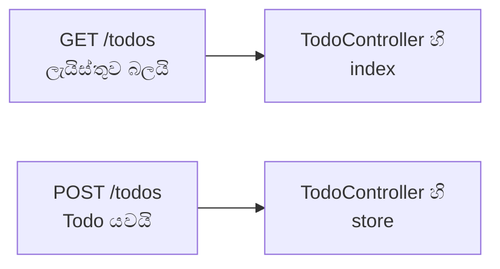
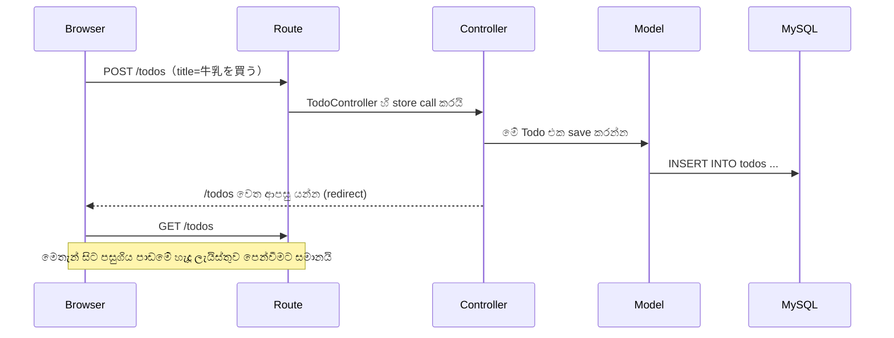
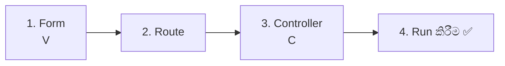
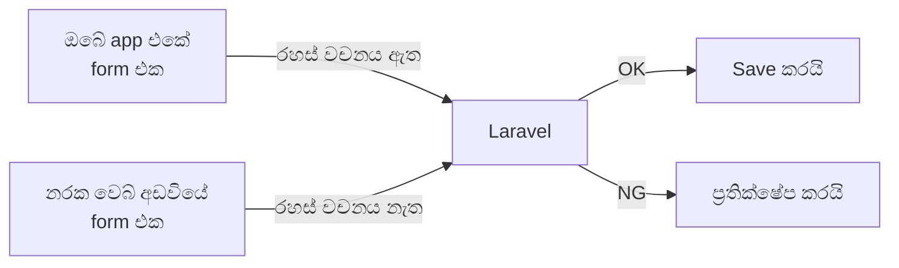
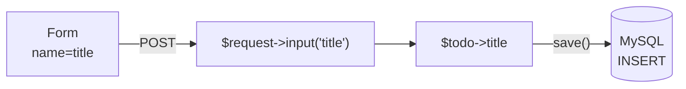
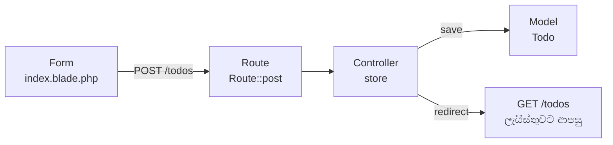

# Laravel හැඳින්වීම — Todo එකතු කරමු (CREATE)

> 🇯🇵 මුල් පිටපත (ජපන් භාෂාවෙන්): [20261022_資料_1.md](<../../../1年生_データ設計とアプリ開発/後期/20261022/20261022_資料_1.md>) <!-- original-ja-link -->

[පසුගිය පාඩමේ](../20261015/20261015_資料_2.md) හැදූ Todo ලැයිස්තුවට, **form එකකින් Todo එකතු කිරීමේ පහසුකම** එකතු කරනවා.

## අද දවසේ ඉලක්කය
- GET සහ POST අතර වෙනස තේරුම් ගැනීම
- Form එකෙන් යැවූ data, controller එකෙන් ලබාගෙන database එකේ save කිරීමට හැකි වීම
- Save කළ පසු, ලැයිස්තු පිටුවට ආපසු යැවීමට (redirect කිරීමට) හැකි වීම

> පුහුණු පරිසරයේ (`php-study`) mysql සහ laravel ආරම්භ කළ පසු පටන් ගන්න.
> පසුගිය පාඩමේ හැදූ `/todos` ලැයිස්තු පිටුව පෙන්විය හැකි තත්ත්වයේ සිට පටන් ගන්නවා.

---

## 1. GET සහ POST

Browser එකෙන් server එකට කරන ඉල්ලීම් (request) වල, වර්ග තිබෙනවා. අද භාවිත කරන්නේ පහත 2යි.

| වර්ගය | භාවිත කරන අවස්ථාව | උපමාවක් ලෙස |
|------|---------|-----------|
| **GET** | පිටුවක් **බලන** විට (URL එකක් විවෘත කිරීම・link එකක් click කිරීම) | Menu එක පෙන්වන්න කියා ඉල්ලීම |
| **POST** | Data **යවන** විට (form එකේ submit button එක) | Order පත්‍රය භාර දීම |

පසුගිය පාඩමේ හැදුවේ "Todo බලන" පිටුවක් නිසා එය **GET** වුණා.
අද හදන්නේ "Todo යවා save කරන" පහසුකමක් නිසා **POST** භාවිත කරනවා.

Laravel හි, **එකම URL එක වුණත්, GET සහ POST සඳහා වෙනස් ක්‍රියාවලි** භාර දිය හැකියි.



> **පෙර semester එකේ todo.php හිදී?**
> පෙර semester එකේ එක file එකක, `<input type="hidden" name="action" value="create">` භාවිත කර "කුමන ක්‍රියාවද" කියා වෙන් කර හඳුනා ගත්තා.
> Laravel හි, **URL එක සහ GET/POST එකතුවෙන්**, කුමන method එක run වෙනවාද කියා තීරණය කරනවා.

---

## 2. අද පිළිවෙළ

Form එකේ submit button එක එබූ විට, පහත පිළිවෙළට ක්‍රියාවලිය සිදු වෙනවා.



වැදගත්ම කරුණ අවසානයේ ඇති **redirect** එකයි.
Save කිරීම අවසන් වූ පසු, controller එක තිරයක් නොහදා "ලැයිස්තු පිටුව (`/todos`) නැවත විවෘත කරන්න" කියා browser එකට ආපසු කියනවා.
Browser එක ලැයිස්තුව නැවත විවෘත කරන නිසා, එකතු කළ Todo එක ලැයිස්තුවේ පෙන්වනවා.

> **පෙර semester එකේ todo.php හිදීත් මෙය කළා**
> පෙර semester එකේ `header('Location: index.php');` මගින් එකම දේ කළා (PRG pattern).
> Reload කළත්, එකම Todo එක දෙපාරක් ලියාපදිංචි නොවීම සඳහායි.

---

## 3. හදලා බලමු

මෙවර table එකත් model එකත් දැනටමත් හැදී ඇති නිසා, **ක්‍රියාත්මක වන පිළිවෙළට** (View → Route → Controller) හදාගෙන යනවා.



වෙනස් කරන file 3 මෙන්න (`src` ඇතුළේ). Model `Todo.php`, අද වෙනස් කරන්නේ නැහැ.

```
src/
├─ resources/views/todos/
│   └─ index.blade.php ················ 1. Form එක එකතු කර ලියන්න
├─ routes/
│   └─ web.php ························ 2. POST route එක එකතු කර ලියන්න
└─ app/Http/Controllers/
    └─ TodoController.php ············· 3. store method එක එකතු කර ලියන්න
```

---

### 1. Form එක හැදීම (V)

> දැන් සිටින තැන: **🟢 1. Form** → 2. Route → 3. Controller → 4. Run කිරීම

`resources/views/todos/index.blade.php` විවෘත කර, `<h1>` ට යටින්ම ★ සලකුණු කළ form එක එකතු කර ලියන්න.

```html
<!DOCTYPE html>
<html lang="ja">
<head>
    <meta charset="UTF-8">
    <title>TODOアプリ</title>
</head>
<body>
    <h1>TODOアプリ</h1>

    {{-- ★ මෙතැන් සිට එකතු කරන්න --}}
    <form method="POST" action="/todos">
        @csrf
        <input type="text" name="title" placeholder="新しいTODOを入力" required>
        <button type="submit">追加</button>
    </form>
    {{-- ★ මෙතැන දක්වා --}}

    <ul>
        @foreach ($todos as $todo)
            <li>
                <input type="checkbox" @checked($todo->is_done)>
                {{ $todo->title }}
            </li>
        @endforeach
    </ul>
</body>
</html>
```

| Code | තේරුම |
|--------|------|
| `method="POST"` | POST මගින් යවයි |
| `action="/todos"` | `/todos` වෙත යවයි |
| `name="title"` | `title` යන නමින් යවයි. Controller එකේදී මෙම නම භාවිත කර ලබා ගනී |
| `required` | හිස්ව තිබේ නම් යැවිය නොහැකි කරයි |
| `@csrf` | පහත පැහැදිලි කරන "රහස් වචනය" ඇතුළත් කරයි |
| `{{-- --}}` | Blade comment එකකි. තිරයේ පෙන්වන්නේ නැහැ |

#### `@csrf` යනු මොකක්ද?

`@csrf` යනු, form එකට **රහස් වචනයක් (CSRF token)** රහසිගතව ඇතුළත් කරන ලිවීමේ ක්‍රමයකි.
Browser එකේ "View page source" (පිටුවේ source එක බලන්න) කළ විට, පහත වැනි එක පේළියකට වෙනස් වී ඇති බව පෙනෙනවා.

```html
<input type="hidden" name="_token" value="අහඹු අකුරු පෙළක්">
```

Laravel, POST එකක් ලැබුණු විට රහස් වචනය පරීක්ෂා කරනවා.
මෙයින්, **නරක වෙබ් අඩවියක් ඔබේ app එකට අවසරයකින් තොරව form යවන ප්‍රහාරය (CSRF)** වළක්වා ගත හැකියි.



**POST form එකක, අනිවාර්යයෙන්ම `@csrf` ලියන්න** කියා මතක තබා ගන්න.

> **`@csrf` අමතක වුණත් වැඩ කරන අවස්ථා තිබේ**
> Laravel 13, රහස් වචනයට අමතරව "එකම වෙබ් අඩවියෙන් යැව්වාද" කියාද browser එකෙන් තහවුරු කරගන්නවා.
> ඒ නිසා, පුහුණු පරිසරයේ (`localhost`) `@csrf` අමතක වුණත් වැඩ කරන්න පුළුවන්.
> නමුත්, ප්‍රසිද්ධ කරන server එකේ පරිසරය අනුව රහස් වචනයෙන් පමණක් තීරණය කරන නිසා, **වැඩ කළත් අනිවාර්යයෙන්ම ලියන්න**.

---

### 2. Route එක ලිවීම

> දැන් සිටින තැන: 1. Form → **🟢 2. Route** → 3. Controller → 4. Run කිරීම

`routes/web.php` විවෘත කර, ★ සලකුණු කළ පේළිය එකතු කර ලියන්න.

```php
<?php

use Illuminate\Support\Facades\Route;
use App\Http\Controllers\TodoController;

Route::get('/', function () {
    return view('welcome');
});

Route::get('/todos', [TodoController::class, 'index']);
Route::post('/todos', [TodoController::class, 'store']);  // ★ එකතු කරන්න
```

```
Route::post( '/todos' ,  [TodoController::class, 'store'] );
~~~~~~~~~~~   ~~~~~~~     ~~~~~~~~~~~~~~~~~~~~~  ~~~~~~~
POST මගින්    මෙම URL එකට  TodoController හි      store මගින් භාර ගන්න
              යැවූ විට
```

`get` සහ `post` අනුව, එකම `/todos` වුණත් භාර ගන්නා method එක වෙනස් වෙනවා.

| Route | භාර ගන්නේ | කරන දේ |
|--------|------|---------|
| `Route::get('/todos', ...)` | `index` | ලැයිස්තුව පෙන්වයි (පසුගිය පාඩම) |
| `Route::post('/todos', ...)` | `store` | Todo save කරයි (අද) |

`store` (ස්ටෝර්) යනු "ගබඩා කරනවා・save කරනවා" යන අර්ථයයි. Laravel හි, save කරන method එකට `store` යන නම නිතර භාවිත කරනවා.

---

### 3. Controller එක ලිවීම (C)

> දැන් සිටින තැන: 1. Form → 2. Route → **🟢 3. Controller** → 4. Run කිරීම

`app/Http/Controllers/TodoController.php` විවෘත කර, ★ සලකුණු කළ කොටස එකතු කර ලියන්න.

```php
<?php

namespace App\Http\Controllers;

use App\Models\Todo;
use Illuminate\Http\Request;  // ★ එකතු කරන්න (form එකේ data ලබා ගැනීම සඳහා)

class TodoController extends Controller
{
    public function index()
    {
        $todos = Todo::all();

        return view('todos.index', ['todos' => $todos]);
    }

    // ★ මෙතැන් සිට එකතු කරන්න
    public function store(Request $request)
    {
        // ① අලුත් Todo එකක් සූදානම් කරයි
        $todo = new Todo();

        // ② Form එකේ ඇතුළත් කළ title එක දමයි
        $todo->title = $request->input('title');

        // ③ Database එකේ save කරයි
        $todo->save();

        // ④ ලැයිස්තු පිටුවට ආපසු යයි
        return redirect('/todos');
    }
    // ★ මෙතැන දක්වා
}
```

| Code | තේරුම |
|--------|------|
| `Request $request` | Form එකෙන් යැවූ data ඇතුළත් පෙට්ටිය. Laravel ස්වයංක්‍රීයව ලබා දෙයි |
| `$request->input('title')` | Form එකේ `name="title"` හි අගය ලබා ගනී. පෙර semester එකේ `$_POST['title']` ට සමානයි |
| `new Todo()` | අලුත් Todo එකක් සූදානම් කරයි (තවම save වී නැත) |
| `$todo->save()` | Database එකේ save කරයි. `INSERT INTO todos ...` ට සමානයි |
| `redirect('/todos')` | "`/todos` නැවත විවෘත කරන්න" කියා browser එකට ආපසු කියයි |

පෙර semester එකේ `todo.php` සමඟ සසඳා බලමු.

```php
// පෙර semester එක
$title = trim($_POST['title'] ?? '');
$stmt = $pdo->prepare("INSERT INTO todos (title) VALUES (:title)");
$stmt->execute(['title' => $title]);
header('Location: index.php');
exit;

// Laravel
$todo = new Todo();
$todo->title = $request->input('title');
$todo->save();
return redirect('/todos');
```

SQL නොලිව්වත්, model එකේ `save()` මගින් `INSERT` statement එක හදා දෙනවා (ORM).
Prepared statement ද, Laravel ඇතුළතින්ම කරන නිසා ආරක්ෂිතයි.
තවද, පෙර semester එකේ `trim()` (ඉදිරිපස සහ පසුපස හිස්තැන් ඉවත් කිරීම) ද, Laravel ස්වයංක්‍රීයව කරනවා.



---

### 4. Run කිරීම ✅

> දැන් සිටින තැන: 1. Form → 2. Route → 3. Controller → **🟢 4. Run කිරීම**

1. Browser එකේ http://localhost:8000/todos විවෘත කරන්න
2. ඇතුළත් කරන කොටුවේ 「宿題をする」 (ගෙදර වැඩ කරන්න) කියා type කර, `追加` (එකතු කරන්න) ඔබන්න
3. ලැයිස්තුවේ පහළින්ම 「宿題をする」 පෙන්වයි නම් සාර්ථකයි

```
TODOアプリ

[ 新しいTODOを入力 ] [追加]

☐ 牛乳を買う
☑ レポートを出す
☐ 宿題をする        ← එකතු වුණා!
```

✅ **තහවුරු කිරීම 1**: phpMyAdmin (http://localhost:8080) හි `todos` table එක විවෘත කර බලමු.
එකතු කළ Todo එකේ `created_at` සහ `updated_at` වල, දිනය සහ වේලාව ඇතුළත් වී තිබිය යුතුයි. `save()` කරන විට, Laravel ස්වයංක්‍රීයව දැම්මා.
වේලාව පැය 9කට කලින් ලෙස පෙන්වන්නේ, Laravel UTC (ලෝක සම්මත වේලාව) අනුව සටහන් කරන නිසයි.
(පසුගිය පාඩමේ phpMyAdmin හි අතින් ඇතුළත් කළ Todo, හිස් (NULL) ලෙසම පවතී)

✅ **තහවුරු කිරීම 2**: එකතු කළ පසු browser එක reload (F5) කර බලමු.
Redirect කරන නිසා, එකම Todo එක දෙපාරක් එකතු වෙන්නේ නැහැ.

---

## 4. හරියට වැඩ නොකරන විට

> **🔥 වැඩ කරන්නේ නැත්නම්, log පෙන්වන්න!**
> Error එකේ හේතුව තේරෙන්නේ නැති විට, log පෙන්වා "කොතෙක් දුරට වැඩ කළාද" කියා තහවුරු කර ගන්න → [[වැදගත්] Log පෙන්වන ආකාරය](./【重要】ログの出し方.md)

| රෝග ලක්ෂණය | හේතුව ඇති තැන | විසඳුම |
|------|----------|------|
| `The POST method is not supported for route todos.` | Route | `routes/web.php` හි `Route::post('/todos', ...)` ලිව්වාදැයි බලන්න |
| `Call to undefined method App\Http\Controllers\TodoController::store()` | Controller | `TodoController.php` හි `store` method එක ලිව්වාද, නමේ අක්ෂර වින්‍යාසය නිවැරදිද කියා බලන්න |
| `Class "App\Http\Controllers\Request" does not exist` | Controller | `TodoController.php` හි ඉහළ `use Illuminate\Http\Request;` තිබේදැයි බලන්න |
| `Column 'title' cannot be null` | Form | `<input>` හි `name="title"` අක්ෂර වින්‍යාසය බලන්න (controller එකේ `input('title')` හි නමම විය යුතුයි) |
| `419 Page Expired` | Form | Form එක ඇතුළේ `@csrf` තිබේදැයි බලන්න (පුහුණු පරිසරයේ, `@csrf` නැතිවුණත් මෙය නොපෙන්විය හැකියි) |
| එකතු කළත් ලැයිස්තුවේ නොපෙන්වයි | Controller | `$todo->save();` ලිව්වාදැයි බලන්න. phpMyAdmin හි data ඇතුළත් වී ඇත්දැයිත් බලන්න |

---

## 5. සාරාංශය



| අද ලියූ දේ | කෙටියෙන් |
|--------------|-----------|
| `<form method="POST">` සහ `@csrf` | Todo යවන form එක. POST form එකක අනිවාර්යයෙන්ම `@csrf` |
| `Route::post('/todos', ...)` | POST මගින් යැවූ විට `store` භාර ගනී |
| `$request->input('title')` | Form එකෙන් යැවූ අගය ලබා ගනී |
| `new Todo()` → `save()` | අලුත් Todo එකක් හදා save කරයි (INSERT) |
| `redirect('/todos')` | Save කළ පසු ලැයිස්තුවට ආපසු යයි |

---

## 6. තවත් උත්සාහ කරමු (කාලය ඉතිරි වූ අයට)

අලුතින් එකතු කළ Todo එක **ඉහළින්ම** පෙන්වන ලෙස හදා බලමු.
`index` method එකේ `Todo::all()`, පහත පරිදි වෙනස් කරන්න.

```php
$todos = Todo::orderBy('id', 'desc')->get();
```

`ORDER BY id DESC` (id අගය විශාලම එකේ සිට කුඩාම එක දක්වා ＝ අලුත්ම ඒවා මුලින්) යන්නට සමාන අර්ථයයි.

> **`Todo::create()` යන ලිවීමේ ක්‍රමයත් තිබේ**
> අන්තර්ජාලයේ සෙව්වොත්, `new Todo()` → `save()` වෙනුවට, පහත ලිවීමේ ක්‍රමයත් නිතර හමු වෙනවා.
> ```php
> Todo::create(['title' => $request->input('title')]);
> ```
> එක පේළියකින් ලිවිය හැකි නිසා පහසු වුණත්, මෙය භාවිත කිරීමට model එකේ "කුමන column වලට දැමිය හැකිද" කියා ලියන සැකසුම (`Fillable`) අවශ්‍යයි.
> නොලිව්වොත් `Add [title] to fillable property ...` යන error එක එනවා.
> අද, ක්‍රියා කරන ආකාරය පහසුවෙන් තේරෙන `new Todo()` → `save()` භාවිත කළා.

<!-- nav:start -->

---

📎 මෙයත් කියවන්න → [[වැදගත්] Log පෙන්වන ආකාරය](【重要】ログの出し方.md)

| ⬅️ පෙර | 🗺️ සමස්ත සිතියම | ඊළඟ ➡️ |
|:--|:--:|--:|
| [10/15 Todo ලැයිස්තුව](../20261015/20261015_資料_2.md) | [පාඩම් ද්‍රව්‍යවල සමස්ත සිතියම](../../README.md) | [10/22 Todo විස්තර (SHOW)](20261022_資料_2.md) |

<!-- nav:end -->
