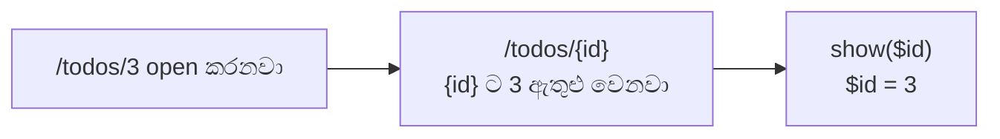
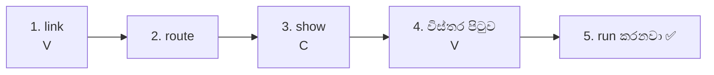
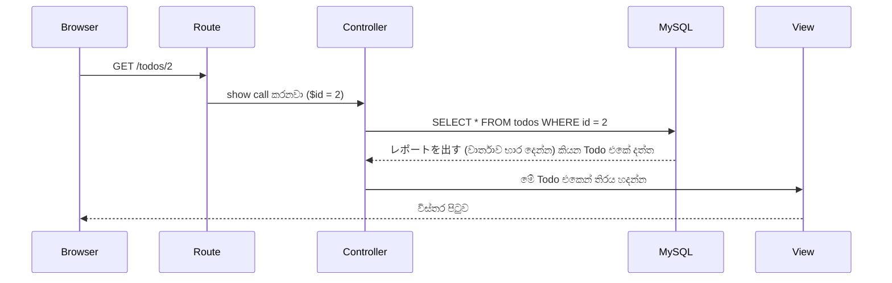
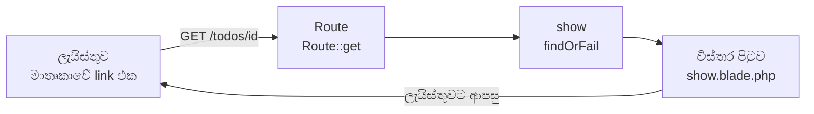

# Laravel හැඳින්වීම — Todo එකක විස්තර පිටුව හදමු (SHOW)

> 🇯🇵 මුල් පිටපත (ජපන් භාෂාවෙන්): [20261022_資料_2.md](<../../../1年生_データ設計とアプリ開発/後期/20261022/20261022_資料_2.md>) <!-- original-ja-link -->

[පාඩම් ද්‍රව්‍ය 1](./20261022_資料_1.md) මඟින් Todo එකතු කරන්න පුළුවන් වුණා. ඊළඟට, **එක් Todo එකක් විස්තරාත්මකව බලන්න පුළුවන් පිටුවක් (විස්තර පිටුව)** හදමු.

## අද ඉලක්කය
- URL එක ඇතුළට `id` එක දාලා, බලන්න ඕන කුමන Todo එකද කියලා තීරණය කරන්න පුළුවන් වීම (route parameter)
- `id` එක පාවිච්චි කරලා, Todo එකක් විතරක් ගේන්න පුළුවන් වීම
- එක Todo එකක තොරතුරු විස්තර පිටුවේ පෙන්වන්න පුළුවන් වීම

> පාඩම් ද්‍රව්‍ය 1 හි "Todo එකතු කිරීම" කළ හැකි තත්ත්වයේ ඉඳන් පටන් ගන්නවා.

---

## 1. ලැයිස්තු පිටුව සහ විස්තර පිටුව

ලැයිස්තු පිටුව කියන්නේ "Todo ඔක්කොම පේළියට පෙන්වන" පිටුවයි.
විස්තර පිටුව කියන්නේ "**එක Todo එකක් විතරක්** විස්තරාත්මකව පෙන්වන" පිටුවයි.

```mermaid
graph LR
    L[ලැයිස්තු පිටුව<br>/todos<br>ඔක්කොම පෙන්වයි] -->|මාතෘකාව ක්ලික් කරන්න| S1[විස්තර පිටුව<br>/todos/1<br>牛乳を買う (කිරි ගන්න)]
    L -->|මාතෘකාව ක්ලික් කරන්න| S2[විස්තර පිටුව<br>/todos/2<br>レポートを出す (වාර්තාව භාර දෙන්න)]
    S1 -->|ලැයිස්තුවට ආපසු| L
    S2 -->|ලැයිස්තුවට ආපසු| L
```

| | URL | භාර method එක | පෙන්වන දේ |
|---|---|---|---|
| ලැයිස්තු පිටුව | `/todos` | `index` | සියලුම Todo |
| විස්තර පිටුව | `/todos/1`, `/todos/2` … | `show` | **URL එකේ අංකයට සමාන `id` එක තියෙන** Todo එකක් |

URL එකේ අන්තිම අංකය තමයි **බලන්න ඕන Todo එකේ `id` එක**.
`/todos/1` නම් `id` එක 1 වන Todo එකේ, `/todos/2` නම් `id` එක 2 වන Todo එකේ විස්තර පිටුව වෙනවා.

> **online කඩවලත් ඒ වගේමයි**
> online shopping සයිට් වලත්, භාණ්ඩ ලැයිස්තුවෙන් එකක් ක්ලික් කළාම, ඒ භාණ්ඩය ගැන විතරක් විස්තර තියෙන පිටුවක් open වෙනවා.
> URL එක බැලුවොත්, `/items/12345` වගේ **අංකයක් ඇතුළත් වෙලා** තියෙන එක බොහෝ වෙලාවට දකින්න පුළුවන්.

---

## 2. අලුතින් එන දේවල්

### Route parameter `{id}`

`/todos/1`・`/todos/2`・`/todos/3`… කියලා Todo ගණනට route ලියන එක හරිම අමාරුයි.
ඒ නිසා route එකේ `{id}` කියලා ලිව්වොත්, **URL එකේ ඒ කොටසට මොනවා ආවත් කමක් නැහැ**, ඒ අගය controller එකෙන් ලබාගන්නත් පුළුවන්.

```php
Route::get('/todos/{id}', [TodoController::class, 'show']);
```



### `findOrFail()` වලින් එකක් විතරක් ගේනවා

ලැයිස්තුවේදී `Todo::all()` වලින් **ඔක්කොම** ගෙනාවා.
විස්තර පිටුවේදී, `id` එක පාවිච්චි කරලා **එකක් විතරක්** ගේනවා.

| ලියන විදිය | ගේන දේ | SQL වලින් කිව්වොත් |
|--------|--------------|------------|
| `Todo::all()` | ඔක්කොම | `SELECT * FROM todos` |
| `Todo::findOrFail($id)` | `id` එක ගැළපෙන එකක් | `SELECT * FROM todos WHERE id = ?` |

---

## 3. හදලා බලමු



වෙනස් කරන file හතර මේවායි (`src` ඇතුළේ).

```
src/
├─ resources/views/todos/
│   ├─ index.blade.php ················ 1. මාතෘකාව link එකක් කරනවා
│   └─ show.blade.php ················· 4. විස්තර පිටුව (අලුතින් හදනවා)
├─ routes/
│   └─ web.php ························ 2. route එකක් එකතු කරනවා
└─ app/Http/Controllers/
    └─ TodoController.php ············· 3. show method එක එකතු කරනවා
```

---

### 1. ලැයිස්තුවේ මාතෘකාව link එකක් කරමු (V)

> දැන් ඉන්නේ මෙතන: **🟢 1. link** → 2. route → 3. show → 4. විස්තර පිටුව → 5. run කරනවා

`resources/views/todos/index.blade.php` open කරලා, `{{ $todo->title }}` එක ★ තියෙන විදියට link එකකින් වට කරන්න.

```html
    <ul>
        @foreach ($todos as $todo)
            <li>
                <input type="checkbox" @checked($todo->is_done)>
                <a href="/todos/{{ $todo->id }}">{{ $todo->title }}</a>  {{-- ★ link එකක් කරනවා --}}
            </li>
        @endforeach
    </ul>
```

`{{ $todo->id }}` එකට ඒ Todo එකේ `id` එක ඇතුළු වෙනවා.
browser එකේ ලැයිස්තුව open කරලා, මාතෘකාවක් උඩට mouse එක ගෙනාවොත්, වම් පැත්තේ පහළ `…/todos/1`・`…/todos/2` වගේ, පේළියෙන් පේළියට වෙනස් URL පෙන්වනවා.

(මේ වෙලාවේ මාතෘකාව click කළොත් `404 Not Found` එනවා. තාම route එක නැති නිසා.)

---

### 2. route එක ලියමු

> දැන් ඉන්නේ මෙතන: 1. link → **🟢 2. route** → 3. show → 4. විස්තර පිටුව → 5. run කරනවා

`routes/web.php` එකට ★ තියෙන පේළිය එකතු කරන්න.

```php
Route::get('/todos', [TodoController::class, 'index']);
Route::post('/todos', [TodoController::class, 'store']);
Route::get('/todos/{id}', [TodoController::class, 'show']);  // ★ එකතු කළා
```

```
Route::get( '/todos/{id}' ,  [TodoController::class, 'show'] );
~~~~~~~~~~   ~~~~~~~~~~~     ~~~~~~~~~~~~~~~~~~~~~  ~~~~~~
GET එකෙන්     මේ URL එක       TodoController එකේ      show එකට භාර දෙන්න
             open කළොත්
             ({id} මොකක් වුණත් OK)
```

මෙතෙක් route තුනක් හැදුණා.

| Route | භාර method එක | කරන දේ |
|--------|------|---------|
| `GET /todos` | `index` | ලැයිස්තුව පෙන්වනවා |
| `POST /todos` | `store` | අලුතින් එකතු කරනවා |
| `GET /todos/{id}` | `show` | එක Todo එකක් විස්තරාත්මකව පෙන්වනවා |

`show` කියන්නේ "පෙන්වනවා" කියන තේරුමයි. Laravel වල, එක data එකක් පෙන්වන method එකට `show` කියන නම ගොඩක් පාවිච්චි කරනවා.

---

### 3. show method එක ලියමු (C)

> දැන් ඉන්නේ මෙතන: 1. link → 2. route → **🟢 3. show** → 4. විස්තර පිටුව → 5. run කරනවා

`app/Http/Controllers/TodoController.php` එකට ★ තියෙන `show` method එක එකතු කරන්න.

```php
    // (index සහ store මෙතන පෙන්වලා නැහැ)

    // ★ මෙතන ඉඳන් එකතු කරන්න
    public function show($id)
    {
        // ① id එකෙන් බලන්න ඕන Todo එක ගේනවා
        $todo = Todo::findOrFail($id);

        // ② විස්තර පිටුව පෙන්වනවා
        return view('todos.show', ['todo' => $todo]);
    }
    // ★ මෙතනට වෙනකම්
```

| Code | තේරුම |
|--------|------|
| `show($id)` | URL එකේ `{id}` කොටස `$id` එකට ඇතුළු වෙනවා |
| `Todo::findOrFail($id)` | `id` එක ගැළපෙන Todo එකක් ගේනවා |
| `view('todos.show', ...)` | `resources/views/todos/show.blade.php` පාවිච්චි කරලා තිරය හදනවා |
| `['todo' => $todo]` | view එක ඇතුළේ `$todo` කියන නමින් පාවිච්චි කරන්න පුළුවන් කරනවා |

`index` එකත් එක්ක සසඳලා බලමු. හැඩය බොහෝ දුරට එකයි.

| | `index` (ලැයිස්තුව) | `show` (විස්තර) |
|---|---|---|
| ගේන දේ | `Todo::all()` (ඔක්කොම) | `Todo::findOrFail($id)` (එකක්) |
| Variable එක | `$todos` (බහුවචන) | `$todo` (ඒකවචන) |
| View එක | `todos.index` | `todos.show` |

> **`findOrFail` වල "OrFail" කියන්නේ මොකක්ද?**
> "හම්බ වුණේ නැත්නම් අසාර්ථක (Fail) කරනවා" කියන තේරුමයි.
> `/todos/999` වගේ, නැති Todo එකක් open කරන්න හැදුවොත්, ස්වයංක්‍රීයව `404 Not Found` පිටුව පෙන්වනවා.
> ඒ වගේම පේන `Todo::find($id)` නම්, හම්බ වුණේ නැත්නම් `null` (හිස්) වෙනවා, ඊට පස්සේ view එකේදී error එකක් එනවා.

---

### 4. විස්තර පිටුව හදමු (V)

> දැන් ඉන්නේ මෙතන: 1. link → 2. route → 3. show → **🟢 4. විස්තර පිටුව** → 5. run කරනවා

`resources/views/todos` ඇතුළේ `show.blade.php` කියලා අලුත් file එකක් හදන්න.

```
resources/views/todos/
  ├─ index.blade.php
  └─ show.blade.php   ← අලුතින් හදනවා
```

```html
<!DOCTYPE html>
<html lang="ja">
<head>
    <meta charset="UTF-8">
    <title>TODOの詳細</title>
</head>
<body>
    <h1>{{ $todo->title }}</h1>

    <p>番号：{{ $todo->id }}</p>

    <p>
        状態：
        @if ($todo->is_done)
            完了 ✅
        @else
            未完了
        @endif
    </p>

    <a href="/todos">一覧にもどる</a>
</body>
</html>
```

| Code | තේරුම |
|--------|------|
| `{{ $todo->title }}` | Todo එකේ මාතෘකාව |
| `{{ $todo->id }}` | Todo එකේ අංකය (`id`) |
| `@if` 〜 `@else` 〜 `@endif` | සම්පූර්ණ නම් "完了 ✅" (සම්පූර්ණයි), නැත්නම් "未完了" (සම්පූර්ණ නැහැ) කියලා පෙන්වනවා |

ලැයිස්තුවේ view එකේදී `@foreach` වලින් එකින් එක ගත්තා, නමුත් විස්තර පිටුවේ `$todo` එක **මුල ඉඳන්ම එකක් විතරයි**, ඒ නිසා `@foreach` ඕන නැහැ.

---

### 5. run කරලා බලමු ✅

> දැන් ඉන්නේ මෙතන: 1. link → 2. route → 3. show → 4. විස්තර පිටුව → **🟢 5. run කරනවා**

1. http://localhost:8000/todos open කරන්න
2. "レポートを出す" (වාර්තාව භාර දෙන්න) click කරන්න
3. මේ වගේ විස්තර පිටුවක් ආවොත් සාර්ථකයි

```
レポートを出す

番号：2

状態：完了 ✅

一覧にもどる
```



✅ **පරීක්ෂාව 1**: අනිත් Todo වලත් click කරලා, ඒ ඒ එකේ මාතෘකාව සහ තත්ත්වය පෙන්වනවද බලන්න.

✅ **පරීක්ෂාව 2**: browser එකේ URL එක කෙලින්ම http://localhost:8000/todos/999 කියලා වෙනස් කරලා open කරලා බලන්න.
`id` එක 999 වන Todo එකක් නැති නිසා, `404 Not Found` පිටුව එනවා. ඒක `findOrFail` වැඩ කරන බවට ලකුණක්.

---

## 4. හරියට වැඩ නොකරන විට

> **🔥 වැඩ කරන්නේ නැත්නම්, log එකක් දාන්න!**
> error එකේ හේතුව තේරෙන්නේ නැත්නම්, `show` ඇතුළේ `Log::info()` පාවිච්චි කරලා `$id` එකේ අගය පරීක්ෂා කරන්න → [【වැදගත්】ලොග් (log) පෙන්වන ආකාරය](./【重要】ログの出し方.md)

| රෝග ලක්ෂණය | හේතුව තියෙන තැන | විසඳුම |
|------|----------|------|
| මාතෘකාව click කළාම `404 Not Found` | Route | `routes/web.php` එකේ `Route::get('/todos/{id}', ...)` ලිව්වද බලන්න |
| `Call to undefined method App\Http\Controllers\TodoController::show()` | Controller | `TodoController.php` එකේ `show` method එක ලිව්වද, නමේ අකුරු හරිද බලන්න |
| `View [todos.show] not found.` | View | `resources/views/todos/show.blade.php` හැදුවද, file නම හරිද බලන්න |
| `Undefined variable $todo` | Controller | `view('todos.show', ['todo' => $todo])` වල `'todo'` අකුරු හරිද බලන්න (`'todos'` වෙලා නැද්ද) |
| ඕනම Todo එකක් click කළත්, එකම Todo එක එනවා | View | ලැයිස්තුවේ link එක `href="/todos/{{ $todo->id }}"` විදියට තියෙනවද බලන්න |

---

## 5. සාරාංශය



| අද ලියපු දේ | කෙටියෙන් කිව්වොත් |
|--------------|-----------|
| `href="/todos/{{ $todo->id }}"` | එක් එක් Todo එක සඳහා `id` එක ඇතුළත් link එකක් හදනවා |
| `Route::get('/todos/{id}', ...)` | URL එකේ තියෙන `id` එක, controller එකේ `$id` විදියට ලබාගන්නවා |
| `Todo::findOrFail($id)` | `id` එකෙන් Todo එකක් ගේනවා. නැත්නම් 404 |
| `show.blade.php` | එක Todo එකක් විස්තරාත්මකව පෙන්වන පිටුව |

මෙතනදී ඉගෙනගත්ත **`{id}` සහ `findOrFail()`**, ඊළඟට හදන "සංස්කරණය" සහ "මකා දැමීම" වලදීත් පාවිච්චි කරනවා.

---

## 6. තව උත්සාහ කරලා බලමු (වෙලාව ඉතුරු වුණ අයට)

විස්තර පිටුවේ **හදපු දිනය සහ වේලාව** (`created_at`) එකත් පෙන්වලා බලන්න.

<details>
<summary>ඉඟිය</summary>

`show.blade.php` එකට මේ පේළිය එකතු කරන්න.

```html
<p>作った日時：{{ $todo->created_at }}</p>
```

- පාඩම් ද්‍රව්‍ය 1 හි form එකෙන් එකතු කරපු Todo වලට දිනය සහ වේලාව පෙන්වනවා (UTC නිසා, ජපාන වේලාවට වඩා පැය 9ක් කලින්)
- කලින් පාරේ phpMyAdmin එකේ අතින් ඇතුළත් කරපු Todo වල `created_at` හිස් (NULL) නිසා, මුකුත් පෙන්වන්නේ නැහැ

</details>

<!-- nav:start -->

---

| ⬅️ පෙර | 🗺️ සමස්ත සිතියම | ඊළඟ ➡️ |
|:--|:--:|--:|
| [10/22 Todo එකතු කිරීම (CREATE)](20261022_資料_1.md) | [පාඩම් ද්‍රව්‍යවල සමස්ත සිතියම](../../README.md) | [10/29 Todo සංස්කරණය (UPDATE)](../20261029/20261029_資料_1.md) |

<!-- nav:end -->
