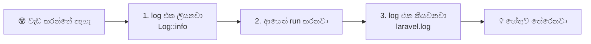
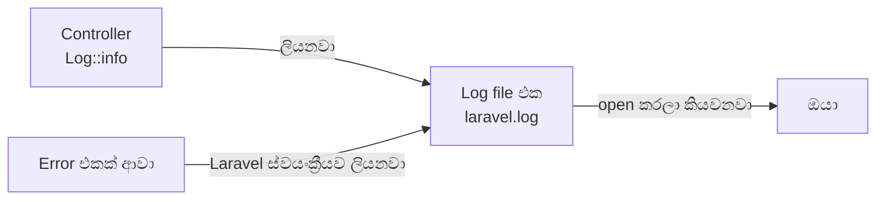
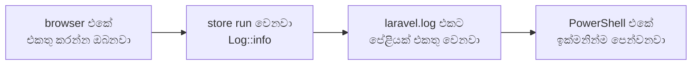
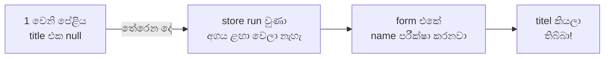
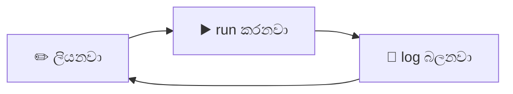

# 【වැදගත්】වැඩ කරන්නේ නැත්නම්, log එකක් දාන්න!

> 🇯🇵 මුල් පිටපත (ජපන් භාෂාවෙන්): [【重要】ログの出し方.md](<../../../1年生_データ設計とアプリ開発/後期/20261022/【重要】ログの出し方.md>) <!-- original-ja-link -->

[Todo එකතු කරමු (CREATE) පිටුවට ආපසු යන්න](./20261022_資料_1.md)

> ## 🔥 වැඩ කරන්නේ නැත්නම්, log එකක් දාන්න!
> program එක හරියට වැඩ කරන්නේ නැති වෙලාවට, **හිතෙන හිතෙන විදියට code එක වෙනස් කළාට, සාමාන්‍යයෙන් හරි යන්නේ නැහැ.**
> මුලින්ම **log එකක් දාලා, ඇතුළේ මොකද වෙන්නේ කියලා බලන්න**. හේතුව හොයාගන්න තියෙන කෙටිම පාර ඒකයි.
> මේ පිටුව ඉදිරි පාඩම් වලදීත්, ඔයාගේම project වලදීත් දිගටම පාවිච්චි කරනවා. ප්‍රශ්නයක් ආවොත් ඕන තරම් පාරක් ආයෙ බලන්න එන්න.
>
> ## 👀 log බලන පුරුද්දක් හදාගමු!
> වැඩ නොකරන වෙලාවට විතරක් නෙවෙයි, **හැමදාම log බලන්න** පුරුදු වෙන්න.
> "වැඩ කළා කියලා හිතුවට" තියෙන වැරදිත් ඉක්මනින් අල්ලගන්න පුළුවන් වෙනවා.



## මේ පිටුවේ ඉලක්කය
- log තියෙන්නේ මොකටද කියලා තේරුම් ගැනීම
- `Log::info()` වලින් තමන්ම log ලියන්න පුළුවන් වීම
- log file එක open කරලා, ඇතුළේ තියෙන දේ කියවන්න පුළුවන් වීම
- හැමදාම log බලන පුරුද්දක් හදාගැනීම

---

## 1. log කියන්නේ මොකක්ද

form එකේ `追加` (එකතු කරන්න) button එක එබුවත්, හරියට save නොවෙන වෙලාවල් තියෙනවා.
නමුත් controller එක ඇතුළේ මොකද වෙන්නේ කියලා තිරයෙන් පේන්නේ නැහැ.

- form එකේ අගය controller එකට හරියට ළඟා වෙලාද?
- `store` method එක ඇත්තටම run වෙනවද?

ඒ වෙලාවට පාවිච්චි කරන්නේ **log** එකයි.
log කියන්නේ app එක "කවදා・මොකක්ද කළේ" කියලා ලියාගෙන යන **දිනපොතක්** වගේ දෙයක්.



log file එක තියෙන්නේ `src` ඇතුළේ මෙතනයි.

```
src/
└─ storage/
    └─ logs/
        └─ laravel.log   ← මෙතනට ලියවෙනවා
```

> **error ත් ස්වයංක්‍රීයව ලියවෙනවා**
> ඔයා මුකුත් නොකළත්, program එකේ error එකක් ආවොත් Laravel ඒක `laravel.log` එකට ලියනවා.
> error තිරය වහලා දැම්මත්, පස්සේ log එකෙන් බලාගන්න පුළුවන්.
>
> හැබැයි, `404 Not Found` (පිටුව හම්බ වුණේ නැහැ)・`405` (`The POST method is not supported ...`)・`419 Page Expired` වගේ
> **"URL එක හරි යවන විදිය හරි වැරදියි" කියන error log එකට ලියවෙන්නේ නැහැ**. මේවා ආවොත් route එක හරි form එක හරි පරීක්ෂා කරන්න.

---

## 2. log එකක් ලියලා බලමු

කලින් පාරේ `store` method එකට log ලියන පේළි එකතු කරලා බලමු.
`app/Http/Controllers/TodoController.php` open කරලා, ★ තියෙන කොටස් එකතු කරන්න.

```php
<?php

namespace App\Http\Controllers;

use App\Models\Todo;
use Illuminate\Http\Request;
use Illuminate\Support\Facades\Log;  // ★ එකතු කළා (log පාවිච්චි කරන්න)

class TodoController extends Controller
{
    // (index මෙතන පෙන්වලා නැහැ)

    public function store(Request $request)
    {
        // ★ form එකෙන් ආපු අගය log එකට ලියනවා
        Log::info('Todoを追加します', ['title' => $request->input('title')]);

        $todo = new Todo();
        $todo->title = $request->input('title');
        $todo->save();

        // ★ save වුණා කියලා log එකට ලියනවා
        Log::info('Todoを保存しました', ['id' => $todo->id]);

        return redirect('/todos');
    }
}
```

| Code | තේරුම |
|--------|------|
| `use Illuminate\Support\Facades\Log;` | log පාවිච්චි කරන්න ඕන කරන පේළිය |
| `Log::info('පණිවිඩය')` | log එකට "දැනුම්දීමක්" විදියට ලියනවා |
| `['title' => ...]` | පණිවිඩයත් එක්කම අගයකුත් ලියනවා (නැතත් OK) |
| `$todo->id` | `save()` කළාට පස්සේ, ස්වයංක්‍රීයව ලැබුණු `id` එක දැනගන්න පුළුවන් |

---

## 3. log එක බලමු

browser එකේ http://localhost:8000/todos open කරලා, "宿題をする" (ගෙදර වැඩ කරන්න) කියලා type කරලා `追加` (එකතු කරන්න) ඔබන්න.
ඊට පස්සේ log එක බලමු. බලන්න ක්‍රම දෙකක් තියෙනවා.

### ක්‍රමය 1: editor එකෙන් open කරනවා

`src/storage/logs/laravel.log` එක VS Code වගේ editor එකකින් open කරන්න.
පල්ලෙහාටම scroll කළාම, මේ වගේ පේළි අලුතින් එකතු වෙලා තියෙනවා.

```
[2026-10-22 01:15:30] local.INFO: Todoを追加します {"title":"宿題をする"}
[2026-10-22 01:15:30] local.INFO: Todoを保存しました {"id":3}
```

| කොටස | තේරුම |
|------|------|
| `[2026-10-22 01:15:30]` | ලියවුණු දිනය සහ වේලාව |
| `local` | run වෙන පරිසරය (පුහුණු පරිසරය `local`) |
| `INFO` | log එකේ වර්ගය (දැනුම්දීම) |
| `Todoを追加します` | ඔයා ලියපු පණිවිඩය (Todo එකතු කරනවා) |
| `{"title":"宿題をする"}` | ඒ එක්කම ලියපු අගය |

> **වේලාව පැය 9කින් වෙනස්ද?**
> Laravel වේලාව සටහන් කරන්නේ **UTC (ලෝක සම්මත වේලාව)** වලින්. ජපාන වේලාව කියන්නේ UTC එකට පැය 9ක් එකතු කරපු වේලාවයි.
> උඩ උදාහරණයේ `01:15:30` කියන්නේ ජපාන වේලාවෙන් `10:15:30`.

### ක්‍රමය 2: PowerShell එකෙන්, real-time බලනවා

laravel folder එකේ ඉඳන් මේ command එක run කරන්න.

```powershell
docker compose exec laravel tail -f storage/logs/laravel.log
```

log එකක් ලියවෙන හැම පාරම, එතනම පෙන්වනවා.
browser එකේ `追加` (එකතු කරන්න) එබුවාම, අලුත් පේළියක් එකතු වෙනවා පේනවා.
බලන එක නවත්වන්න ඕන නම් `Ctrl + C` ඔබන්න.

> `tail: cannot open ... No such file or directory` කියලා ආවොත්, තාම log file එක හැදිලා නැහැ.
> log file එක හැදෙන්නේ මුල්ම පේළිය ලියවෙන වෙලාවේ. එක පාරක් browser එකේ `追加` ඔබලා, ආයෙත් run කරන්න.



> **`php artisan pail` පාවිච්චි කරන්න බැහැ**
> internet එකේ හෙව්වොත්, log බලන command එකක් විදියට `php artisan pail` හම්බ වෙනවා.
> පුහුණු පරිසරයේ pail run වෙන්න ඕන කරන PHP feature එක (pcntl) install කරලා නැති නිසා ඒක පාවිච්චි කරන්න බැහැ.
> ඒ වෙනුවට `tail -f` පාවිච්චි කරනවා.

---

## 4. log වර්ග

log වල, වැදගත්කම අනුව වර්ග තියෙනවා. ගොඩක් පාවිච්චි වෙන්නේ මේ හතරයි.

| ලියන විදිය | වර්ගය | පාවිච්චි කරන අවස්ථාව |
|--------|------|---------|
| `Log::debug('...')` | Debug | develop කරන අතරතුර, අගයක් පරීක්ෂා කරන්න ඕන වෙලාවට |
| `Log::info('...')` | දැනුම්දීම | "Todo එක save කළා" වගේ සාමාන්‍ය සිදුවීම් |
| `Log::warning('...')` | අනතුරු ඇඟවීම | error එකක් නොවුණත්, අවධානය යොමු කළ යුතු දෙයක් |
| `Log::error('...')` | Error | අසාර්ථක වුණ වෙලාවට |

log file එකේ `local.DEBUG`・`local.INFO`・`local.WARNING`・`local.ERROR` වගේ වර්ගය ලියවෙනවා.
error හොයනකොට, file එක ඇතුළේ `ERROR` කියලා search කළොත් ලේසියෙන් හොයාගන්න පුළුවන්.

---

## 5. වැඩ නොකරන විට, log එකෙන් හේතුව හොයමු

### log දාන්නේ නැත්නම්…

```
"මෙතන වෙන්න ඇති වැරැද්ද…" → වෙනස් කරනවා → තාමත් වැඩ නැහැ
"එහෙනම් අර තැනද…"        → වෙනස් කරනවා → තාමත් වැඩ නැහැ
"මුලින් තිබ්බේ කොහොමද…"  → ආපහු හරවන්න බැහැ 😱
```

අනුමානයෙන් වෙනස් කළොත්, වෙලාව ගොඩක් යනවා විතරක් නෙවෙයි, **හරියට වැඩ කරපු කොටසුත් කඩාගන්න** පුළුවන්.

| | හිතෙන විදියට හදනවා | log දානවා |
|---|---|---|
| කරන දේ | මතක් වෙන තැන් වෙනස් කරනවා | වෙනස් කරන්න කලින්, මුලින්ම log එකෙන් ඇතුළ බලනවා |
| දැනගන්න පුළුවන් දේ | මුකුත් දැනගන්න බැහැ | කොතෙක් දුරට run වුණාද・අගය මොකක්ද කියලා |
| ප්‍රතිඵලය | හරි යනවද නැද්ද කියන්නේ වාසනාව අනුව | හේතුව තිබිය හැකි තැන් සීමා කරගන්න පුළුවන් |

### log එකෙන් හේතුව තිබිය හැකි තැන් සීමා කරගමු

log එක "කොතෙක් දුරට run වුණාද" කියලා පරීක්ෂා කරන්න පාවිච්චි කරන්න පුළුවන්.

උදාහරණයක් විදියට, form එකේ `name` එක `name="titel"` (අකුරු වැරැද්දක්) විදියට ලිව්වා කියලා හිතමු.
`追加` (එකතු කරන්න) එබුවාම error එකක් ආවා. log එක බැලුවාම මෙහෙම ලියලා තියෙනවා.

```
[2026-10-22 01:20:05] local.INFO: Todoを追加します {"title":null}
[2026-10-22 01:20:05] local.ERROR: SQLSTATE[23000]: Integrity constraint violation: 1048 Column 'title' cannot be null ...
```



1 වෙනි පේළියෙන්, **`store` වෙනකම් run වුණත්, `title` එකේ අගය ළඟා වෙලා නැහැ** කියලා තේරෙනවා.
ඒ නිසා, අගය යවන පැත්ත (form එකේ `name`) සැක කරන්න පුළුවන්.

මේ විදියට, **සැක හිතෙන තැනට කලින් සහ පස්සේ log ලියලා, කොතෙක් දුරට හරියට run වෙනවද කියලා පරීක්ෂා කරන එක** තමයි හේතුව හොයන උපක්‍රමය.

> **ගුරුවරයාගෙන් හරි යාළුවෙක්ගෙන් හරි අහනකොටත්, log එක පෙන්වන්න**
> "වැඩ කරන්නේ නැහැ" කියලා විතරක් කිව්වොත්, උදව් ඉල්ලන කෙනාටත් හේතුව තේරෙන්නේ නැහැ.
> "`store` එකේ මුලින්ම දාපු log එකේ `title` එක `null` කියලා තිබ්බා" වගේ, **log එකත් එක්කම ප්‍රශ්නය අහන්න**, එතකොට ඉක්මනින් විසඳගන්න පුළුවන්.

---

## 6. log සහ `dd()` අතර වෙනස

අගයක් පරීක්ෂා කරන්න තව ක්‍රමයක් විදියට `dd()` තියෙනවා.

```php
dd($request->input('title'));
```

`dd()` ලිව්වොත්, **එතනින් processing එක නවතිනවා**, අගය browser එකේ පෙන්වනවා.

| | `Log::info()` | `dd()` |
|---|---|---|
| පෙන්වන්නේ කොහෙද? | Log file එකේ | Browser තිරයේ |
| Processing එක? | නොනවත්වා අන්තිමට වෙනකම් run වෙනවා | එතනින් නවතිනවා |
| ගැළපෙන අවස්ථාව | ක්‍රියාවලිය මුල සිට අග දක්වා පරීක්ෂා කරන්න ඕන වෙලාවට・පස්සේ ආයෙ බලන්න ඕන වෙලාවට | එක අගයක් එතනම ඉක්මනින් බලන්න ඕන වෙලාවට |
| පස්සේ මකන්න ඕනද? | තියලා ගියත් කමක් නැහැ | **අනිවාර්යයෙන් මකන්න** (නැත්නම් හැම වෙලාවෙම එතනින් නවතිනවා) |

---

## 7. log බලන පුරුද්දක් හදාගමු!

log බලන්නේ වැඩ නොකරන වෙලාවට විතරක් නෙවෙයි. **හැමදාම බලන පුරුද්දක්** හදාගත්තොත්, වැරදි ඉක්මනින් අල්ලගන්න පුළුවන්.

### develop කරන අතරතුර, log එක open කරලාම තියන්න

program එක ලියන අතරතුර, PowerShell එකේ `tail -f` run කරලාම තියන්න.
තිර තුනක් පේළියට තියලා, **ලියනවා → run කරනවා → log බලනවා** කියන එක නැවත නැවත කරන්න අපි නිර්දේශ කරනවා.

```
┌──────────────┬──────────────┐
│              │              │
│  Editor      │  Browser     │
│  (ලියනවා)    │  (run කරනවා) │
│              │              │
├──────────────┴──────────────┤
│  PowerShell (log බලනවා)     │
│  tail -f storage/logs/...   │
└─────────────────────────────┘
```



### "වැඩ කළා" කියන වෙලාවෙත් log බලන්න

තිරයේ හරියට වැඩ කරනවා වගේ පෙනුණත්, **ඇතුළේ වෙනස් අගයක් තියෙන්න** පුළුවන්.
උදාහරණයක් විදියට, type කරපු මාතෘකාව ඒ විදියටම ළඟා වෙලාද, එක පාරක් `追加` ඔබද්දී Todo දෙකක් save වෙලා නැද්ද වගේ දේවල්.
log එකෙන් "හිතපු විදියේ අගයද" කියන එකත් පරීක්ෂා කළාට පස්සේ තමයි, "වැඩ කළා" කියලා කියන්න පුළුවන් වෙන්නේ.

### error තිරයක් ආවොත්, මුලින්ම log එක

error තිරයක් ආවොත්, කලබල නොවී `laravel.log` එකේ **පල්ලෙහාම** කොටස බලන්න.
`ERROR` කියලා ලියපු පේළියේ, මොකද වුණේ කියලා ලියලා තියෙනවා.
(`404`・`405`・`419` log එකට ලියවෙන්නේ නැති නිසා, තිරයේ පණිවිඩය කියවලා route එක හරි form එක හරි පරීක්ෂා කරන්න)

### log බලන පුරුද්ද පරීක්ෂා කරන ලැයිස්තුව

- [ ] develop කරන්න පටන් ගනිද්දී, `tail -f` වලින් log එක open කළා
- [ ] button එකක් එබුවාම හරි පිටුවක් open කළාම හරි, log එක බැලුවා
- [ ] "වැඩ කළා" කියන වෙලාවෙත්, හිතපු විදියේ අගයද කියලා log එකෙන් පරීක්ෂා කළා
- [ ] error එකක් ආවොත්, මුලින්ම `laravel.log` එකේ පල්ලෙහාම බැලුවා
- [ ] ප්‍රශ්නයක් අහනකොට, log එකත් එක්කම පෙන්නුවා

---

## 8. සාරාංශය

> ## 🔥 වැඩ කරන්නේ නැත්නම්, log එකක් දාන්න!
> ## 👀 log බලන පුරුද්දක් හදාගමු!

- log කියන්නේ app එක "කවදා・මොකක්ද කළේ" කියලා ලියන දිනපොත
- `use Illuminate\Support\Facades\Log;` ලියලා, `Log::info('පණිවිඩය', [අගය])` වලින් ලියනවා
- log ලියවෙන්නේ `src/storage/logs/laravel.log` එකට. error ත් ස්වයංක්‍රීයව ලියවෙනවා
- `docker compose exec laravel tail -f storage/logs/laravel.log` වලින් real-time බලන්න පුළුවන්
- වේලාව UTC (ජපාන වේලාවට වඩා පැය 9ක් පිටිපස්සෙන්)
- හරියට වැඩ නොකරන වෙලාවට, සැක හිතෙන තැනට කලින් සහ පස්සේ log ලියලා "කොතෙක් දුරට run වුණාද" කියලා පරීක්ෂා කරන්න
- develop කරන අතරතුර `tail -f` open කරලාම තියලා, **ලියනවා → run කරනවා → log බලනවා** කියන එක නැවත නැවත කරන්න

<!-- nav:start -->

---

| ⬅️ ආපසු | 🗺️ සමස්ත සිතියම | ඊළඟ ➡️ |
|:--|:--:|--:|
| [10/22 Todo එකතු කිරීම (CREATE)](20261022_資料_1.md) | [පාඩම් ද්‍රව්‍යවල සමස්ත සිතියම](../../README.md) | [10/22 Todo විස්තර (SHOW)](20261022_資料_2.md) |

<!-- nav:end -->
