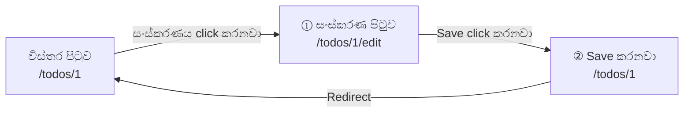
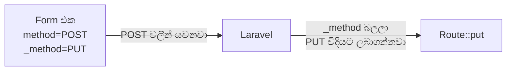
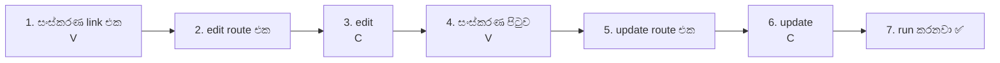
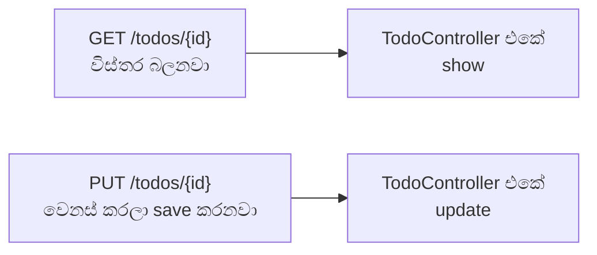
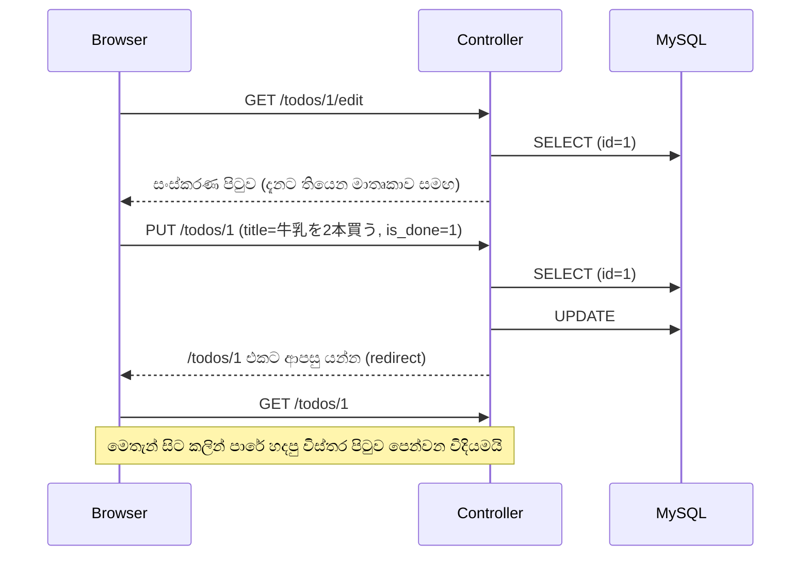
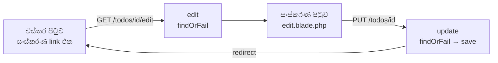

# Laravel හැඳින්වීම — Todo සංස්කරණය කරමු (UPDATE)

> 🇯🇵 මුල් පිටපත (ජපන් භාෂාවෙන්): [20261029_資料_1.md](<../../../1年生_データ設計とアプリ開発/後期/20261029/20261029_資料_1.md>) <!-- original-ja-link -->

[කලින් පාරේ](../20261022/20261022_資料_2.md) හදපු විස්තර පිටුවට "සංස්කරණය" button එකක් දාලා, **ලියාපදිංචි කරපු Todo එකේ මාතෘකාව සහ තත්ත්වය (සම්පූර්ණ・සම්පූර්ණ නැති) වෙනස් කරන (සංස්කරණය කරන) feature එකක්** හදමු.

## අද ඉලක්කය
- සංස්කරණ පිටුවක් හදලා, දැනට තියෙන මාතෘකාව සහ තත්ත්වය පෙන්වන්න පුළුවන් වීම
- PUT සහ `@method('PUT')` පාවිච්චි කරලා, වෙනස් කරපු දේ යවන්න පුළුවන් වීම
- වෙනස් කරපු මාතෘකාව සහ තත්ත්වය database එකේ save (UPDATE) කරන්න පුළුවන් වීම
- checkbox එකේ අගය ලබාගන්න විදිය තේරුම් ගැනීම

> පුහුණු පරිසරයේ (`php-study`) mysql සහ laravel start කරලා පටන් ගන්නවා.
> කලින් පාරේ "විස්තර පිටුව (`/todos/1` වගේ)" පෙන්වන්න පුළුවන් තත්ත්වයේ ඉඳන් පටන් ගන්නවා.

---

## 1. සංස්කරණය "පිටු දෙකකින්" හැදිලා තියෙන්නේ

එකතු කිරීම "form එක යවන" එක පාරකින් ඉවර වුණා.
සංස්කරණය, **① සංස්කරණ පිටුව open කරනවා** → **② වෙනස් කරලා යවනවා** කියලා පාර දෙකකට බෙදෙනවා.



| | URL | වර්ගය | භාර method එක | කරන දේ |
|---|---|---|---|---|
| ① | `/todos/1/edit` | GET | `edit` | සංස්කරණ පිටුව පෙන්වනවා (දැනට තියෙන මාතෘකාව input එකට කලින්ම දාලා තියනවා) |
| ② | `/todos/1` | PUT | `update` | වෙනස් කරපු මාතෘකාව save කරනවා |

දෙකේම URL එකේ තියෙන `1` කියන්නේ **සංස්කරණය කරන්න ඕන Todo එකේ `id` එක**.
කලින් පාරේ විස්තර පිටුව වගේම, **route parameter `{id}`** සහ **`findOrFail()`** පාවිච්චි කරනවා.

> **පළමු වාරයේ todo.php එකේදී?**
> පළමු වාරයේදී `index.php?edit=3` වගේ, `?edit=` වලින් සංස්කරණය කරන Todo එක තීරණය කළා.
> Laravel වලදී, `/todos/3/edit` වගේ **URL එක ඇතුළටම `id` එක දානවා**.

---

## 2. අලුතින් එන දේ: PUT සහ `@method('PUT')`

"දැනටමත් තියෙන data වෙනස් කරනකොට" **PUT** කියන වර්ගය පාවිච්චි කරන එක Laravel වල නීතියයි.

| වර්ගය | පාවිච්චි කරන අවස්ථාව | මෙතෙක් හදපු දේවල් |
|------|---------|-------------------|
| GET | බලනවා | ලැයිස්තුව (`/todos`)・විස්තර (`/todos/1`) |
| POST | අලුතින් එකතු කරනවා | එකතු කිරීම (`/todos`) |
| **PUT** | වෙනස් කරනවා | **අද හදන සංස්කරණය** |

හැබැයි, HTML form එකකට **GET සහ POST විතරයි යවන්න පුළුවන්**.
ඒ නිසා, form එක POST වලින් යවලා, `@method('PUT')` වලින් "ඇත්තටම මේක PUT" කියලා Laravel ට කියනවා.

```html
<form method="POST" action="/todos/1">
    @csrf
    @method('PUT')
    ...
</form>
```

`@method('PUT')` එක `<input type="hidden" name="_method" value="PUT">` කියන පේළියට වෙනස් වෙනවා.
Laravel මේ `_method` එක බලලා "PUT එකක් ආවා" කියලා හිතනවා.



---

## 3. හදලා බලමු



වෙනස් කරන file හතර මේවායි (`src` ඇතුළේ).

```
src/
├─ resources/views/todos/
│   ├─ show.blade.php ················· 1. සංස්කරණ link එක එකතු කරනවා
│   └─ edit.blade.php ················· 4. සංස්කරණ පිටුව (අලුතින් හදනවා)
├─ routes/
│   └─ web.php ························ 2・5. route එකතු කරනවා
└─ app/Http/Controllers/
    └─ TodoController.php ············· 3・6. edit සහ update එකතු කරනවා
```

---

### 1. විස්තර පිටුවට "සංස්කරණය" link එකක් දාමු (V)

> දැන් ඉන්නේ මෙතන: **🟢 1. සංස්කරණ link එක** → 2. edit route එක → 3. edit → 4. සංස්කරණ පිටුව → 5. update route එක → 6. update → 7. run කරනවා

කලින් පාරේ හදපු `resources/views/todos/show.blade.php` open කරලා, ★ තියෙන පේළිය එකතු කරන්න.

```html
<body>
    <h1>{{ $todo->title }}</h1>

    <p>番号：{{ $todo->id }}</p>

    <p>
        状態：
        @if ($todo->is_done)
            完了 ✅
        @else
            未完了
        @endif
    </p>

    <a href="/todos/{{ $todo->id }}/edit">編集</a>  {{-- ★ එකතු කළා --}}
    <a href="/todos">一覧にもどる</a>
</body>
```

`/todos/{{ $todo->id }}/edit` එක, `id` එක 1 වන Todo එකක් නම් `/todos/1/edit` වෙනවා.

(මේ වෙලාවේ "編集" (සංස්කරණය) එබුවොත් `404 Not Found` එනවා. තාම route එක නැති නිසා.)

---

### 2. සංස්කරණ පිටුවේ route එක ලියමු

> දැන් ඉන්නේ මෙතන: 1. සංස්කරණ link එක → **🟢 2. edit route එක** → 3. edit → 4. සංස්කරණ පිටුව → 5. update route එක → 6. update → 7. run කරනවා

`routes/web.php` එකට ★ තියෙන පේළිය එකතු කරන්න.

```php
Route::get('/todos', [TodoController::class, 'index']);
Route::post('/todos', [TodoController::class, 'store']);
Route::get('/todos/{id}', [TodoController::class, 'show']);
Route::get('/todos/{id}/edit', [TodoController::class, 'edit']);  // ★ එකතු කළා
```

```
Route::get( '/todos/{id}/edit' ,  [TodoController::class, 'edit'] );
~~~~~~~~~~   ~~~~~~~~~~~~~~~~     ~~~~~~~~~~~~~~~~~~~~~  ~~~~~~
GET එකෙන්     මේ URL එක open කළොත්  TodoController එකේ      edit එකට භාර දෙන්න
```

`edit` කියන්නේ "සංස්කරණය කරනවා" කියන තේරුමයි. Laravel වල, සංස්කරණ පිටුව පෙන්වන method එකට `edit` කියන නම ගොඩක් පාවිච්චි කරනවා.

---

### 3. edit method එක ලියමු (C)

> දැන් ඉන්නේ මෙතන: 1. සංස්කරණ link එක → 2. edit route එක → **🟢 3. edit** → 4. සංස්කරණ පිටුව → 5. update route එක → 6. update → 7. run කරනවා

`app/Http/Controllers/TodoController.php` එකට ★ තියෙන `edit` method එක එකතු කරන්න.

```php
    // (index・store・show මෙතන පෙන්වලා නැහැ)

    // ★ මෙතන ඉඳන් එකතු කරන්න
    public function edit($id)
    {
        // ① id එක භාවිතයෙන්, සංස්කරණය කිරීමට අවශ්‍ය Todo එක ලබාගන්නවා
        $todo = Todo::findOrFail($id);

        // ② සංස්කරණ පිටුව පෙන්වනවා
        return view('todos.edit', ['todo' => $todo]);
    }
    // ★ මෙතනට වෙනකම්
```

කලින් පාරේ `show` එකත් එක්ක සසඳලා බලමු. **වෙනස තියෙන්නේ පාවිච්චි කරන view එකේ විතරයි**.

| | `show` (විස්තර) | `edit` (සංස්කරණය) |
|---|---|---|
| ගේන දේ | `Todo::findOrFail($id)` | `Todo::findOrFail($id)` |
| View එක | `todos.show` | **`todos.edit`** |

---

### 4. සංස්කරණ පිටුව හදමු (V)

> දැන් ඉන්නේ මෙතන: 1. සංස්කරණ link එක → 2. edit route එක → 3. edit → **🟢 4. සංස්කරණ පිටුව** → 5. update route එක → 6. update → 7. run කරනවා

`resources/views/todos` ඇතුළේ `edit.blade.php` කියලා අලුත් file එකක් හදන්න.

```
resources/views/todos/
  ├─ index.blade.php
  ├─ show.blade.php
  └─ edit.blade.php   ← අලුතින් හදනවා
```

```html
<!DOCTYPE html>
<html lang="ja">
<head>
    <meta charset="UTF-8">
    <title>TODOの編集</title>
</head>
<body>
    <h1>TODOの編集</h1>

    <form method="POST" action="/todos/{{ $todo->id }}">
        @csrf
        @method('PUT')
        <input type="text" name="title" value="{{ $todo->title }}" required>
        <label>
            <input type="checkbox" name="is_done" value="1" @checked($todo->is_done)>
            完了
        </label>
        <button type="submit">保存</button>
    </form>

    <a href="/todos/{{ $todo->id }}">もどる</a>
</body>
</html>
```

| Code | තේරුම |
|--------|------|
| `action="/todos/{{ $todo->id }}"` | `/todos/1` වගේ, සංස්කරණය කරන Todo එකේ `id` එක ඇතුළත් URL එකට යවනවා |
| `@csrf` | රහස් වචනය (කලින් පාරේ එකතු කිරීමේ form එකේ වගේමයි) |
| `@method('PUT')` | "ඇත්තටම මේක PUT" කියලා Laravel ට කියනවා |
| `value="{{ $todo->title }}"` | input එකට **දැනට තියෙන මාතෘකාව මුල ඉඳන්ම දාලා තියනවා** |
| `name="is_done" value="1"` | tick එක **දාලා තියෙන වෙලාවට විතරක්** `is_done=1` යවනවා |
| `@checked($todo->is_done)` | සම්පූර්ණ Todo එකක් නම්, මුල ඉඳන්ම tick එක දාලා තියනවා (10/15 ලැයිස්තුවේ වගේමයි) |
| `<label>` 〜 `</label>` | "完了" (සම්පූර්ණයි) කියන අකුරු click කළත් tick එක මාරු වෙන්න සලස්වනවා |

#### checkbox එකේ වැදගත් ක්‍රියාකාරිත්වය

checkbox එකේ අගය යවන්නේ **tick එක දාලා තියෙන වෙලාවට විතරයි**.
tick එක අයින් කළාම, `is_done` එකම **යවන්නේ නැහැ**.

| Checkbox එක | යවන දේ |
|----------------|------------|
| ☑ tick කරලා | `title=…` සහ `is_done=1` |
| ☐ tick කරලා නැහැ | `title=…` විතරයි (`is_done` යවන්නේ නැහැ) |

ඒ නිසා controller එකේදී, "`is_done` **ආවද නැද්ද**" කියන එකෙන් සම්පූර්ණ・සම්පූර්ණ නැති බව තීරණය කරනවා (6 වෙනි පියවරේදී ලියනවා).

එකතු කිරීමේ form එකත් එක්ක වෙනස්කම් හතර මේවායි.

| | එකතු කිරීමේ form එක | සංස්කරණ form එක |
|---|---|---|
| යවන තැන | `/todos` | `/todos/{{ $todo->id }}` |
| `@method('PUT')` | නැහැ | **තියෙනවා** |
| Input එක | හිස් | **දැනට තියෙන මාතෘකාව තියෙනවා** (`value`) |
| තත්ත්වය | නැහැ (එකතු කරපු Todo සම්පූර්ණ නැහැ) | **සම්පූර්ණ බව පෙන්වන checkbox එක** (දැනට තියෙන තත්ත්වය තියෙනවා) |

✅ **පරීක්ෂාව**: විස්තර පිටුවේ "編集" (සංස්කරණය) එබුවාම, input එකේ දැනට තියෙන මාතෘකාවත්, checkbox එකේ දැනට තියෙන තත්ත්වයත් තියෙන සංස්කරණ පිටුවක් ආවොත් OK.
(තාම "保存" (Save) ඔබන්න එපා. එබුවොත් error එකක් එනවා.)

---

### 5. save කරන route එක ලියමු

> දැන් ඉන්නේ මෙතන: 1. සංස්කරණ link එක → 2. edit route එක → 3. edit → 4. සංස්කරණ පිටුව → **🟢 5. update route එක** → 6. update → 7. run කරනවා

`routes/web.php` එකට ★ තියෙන පේළිය එකතු කරන්න.

```php
Route::get('/todos', [TodoController::class, 'index']);
Route::post('/todos', [TodoController::class, 'store']);
Route::get('/todos/{id}', [TodoController::class, 'show']);
Route::get('/todos/{id}/edit', [TodoController::class, 'edit']);
Route::put('/todos/{id}', [TodoController::class, 'update']);  // ★ එකතු කළා
```

මෙතෙක් route පහක් හැදුණා.

| Route | භාර method එක | කරන දේ |
|--------|------|---------|
| `GET /todos` | `index` | ලැයිස්තුව පෙන්වනවා |
| `POST /todos` | `store` | අලුතින් එකතු කරනවා |
| `GET /todos/{id}` | `show` | එක Todo එකක් විස්තරාත්මකව පෙන්වනවා |
| `GET /todos/{id}/edit` | `edit` | සංස්කරණ පිටුව පෙන්වනවා |
| `PUT /todos/{id}` | `update` | වෙනස් කරලා save කරනවා |

`/todos/{id}` එකට, **GET නම් `show`, PUT නම් `update`** භාර වෙනවා.
`/todos` එකේදී "GET නම් `index`, POST නම් `store`" කියපු ක්‍රමයමයි.



---

### 6. update method එක ලියමු (C)

> දැන් ඉන්නේ මෙතන: 1. සංස්කරණ link එක → 2. edit route එක → 3. edit → 4. සංස්කරණ පිටුව → 5. update route එක → **🟢 6. update** → 7. run කරනවා

`TodoController.php` එකට ★ තියෙන `update` method එක එකතු කරන්න.

```php
    // ★ මෙතන ඉඳන් එකතු කරන්න
    public function update(Request $request, $id)
    {
        // ① id එක භාවිතයෙන්, වෙනස් කිරීමට අවශ්‍ය Todo එක ලබාගන්නවා
        $todo = Todo::findOrFail($id);

        // ② ඇතුළත් කළ මාතෘකාව සහ තෝරාගත් තත්ත්වය අනුව වෙනස් කරනවා
        $todo->title = $request->input('title');
        $todo->is_done = $request->has('is_done');

        // ③ database එකේ save කරනවා
        $todo->save();

        // ④ විස්තර පිටුවට ආපසු යනවා
        return redirect('/todos/' . $todo->id);
    }
    // ★ මෙතනට වෙනකම්
```

| Code | තේරුම |
|--------|------|
| `update(Request $request, $id)` | form එකේ අගයන් (`$request`) සහ URL එකේ `{id}` (`$id`) දෙකම ලබාගන්නවා |
| `$request->has('is_done')` | `is_done` ආවොත් `true` (සම්පූර්ණයි), නැත්නම් `false` (සම්පූර්ණ නැහැ). පළමු වාරයේ `isset($_POST['is_done'])` එකට සමානයි |
| `'/todos/' . $todo->id` | අකුරු එකතු කරලා `/todos/1` වගේ URL එකක් හදනවා (`.` කියන්නේ පළමු වාරයේ ඉගෙනගත්ත string එකතු කිරීම) |

කලින් පාරේ හදපු එකතු කිරීමේ `store` එකට බොහෝ දුරට සමාන හැඩයක්. වෙනස තියෙන්නේ **① සහ ④** වල.

| | `store` (එකතු කිරීම) | `update` (සංස්කරණය) |
|---|---|---|
| ① | `new Todo()` (අලුතින් හදනවා) | `Todo::findOrFail($id)` (දැනට තියෙන එක ගේනවා) |
| ② | `$todo->title = ...` | `$todo->title = ...` සහ `$todo->is_done = ...` |
| ③ | `save()` → `INSERT` | `save()` → **`UPDATE`** |
| ④ | ලැයිස්තුවට (`/todos`) ආපසු යනවා | විස්තර පිටුවට (`/todos/1` වගේ) ආපසු යනවා |

එකම `save()` වුණත්, **අලුතින් හදපු Todo එකක් නම් `INSERT`, ගෙනාපු Todo එකක් නම් `UPDATE`** කියලා Laravel ස්වයංක්‍රීයව තෝරලා පාවිච්චි කරනවා.

පළමු වාරයේ `todo.php` එකත් එක්ක සසඳලා බලමු.

```php
// පළමු වාරය
$id = (int)($_POST['id'] ?? 0);
$title = trim($_POST['title'] ?? '');
$stmt = $pdo->prepare("UPDATE todos SET title = :title WHERE id = :id");
$stmt->execute(['title' => $title, 'id' => $id]);
header('Location: index.php');
exit;

// Laravel
$todo = Todo::findOrFail($id);
$todo->title = $request->input('title');
$todo->is_done = $request->has('is_done');
$todo->save();
return redirect('/todos/' . $todo->id);
```

පළමු වාරයේ සංස්කරණයේදී මාතෘකාව විතරයි වෙනස් කළේ, නමුත් Laravel version එකේදී **තත්ත්වයත් එක්කම** වෙනස් කරනවා.

---

### 7. run කරලා බලමු ✅

> දැන් ඉන්නේ මෙතන: 1. සංස්කරණ link එක → 2. edit route එක → 3. edit → 4. සංස්කරණ පිටුව → 5. update route එක → 6. update → **🟢 7. run කරනවා**

1. http://localhost:8000/todos open කරන්න
2. "牛乳を買う" (කිරි ගන්න) click කරලා, විස්තර පිටුව open කරන්න
3. "編集" (සංස්කරණය) ඔබන්න
4. input එක "牛乳を2本買う" (කිරි බෝතල් 2ක් ගන්න) කියලා වෙනස් කරලා, "完了" (සම්පූර්ණයි) tick කරලා, `保存` (Save) ඔබන්න
5. විස්තර පිටුවට ආපසු ගිහින්, මාතෘකාව "牛乳を2本買う" විදියටත්, තත්ත්වය "完了 ✅" විදියටත් වෙනස් වෙලා නම් සාර්ථකයි
6. ආයෙත් සංස්කරණ පිටුව open කරලා, tick එක අයින් කරලා `保存` කළාම, "未完了" (සම්පූර්ණ නැහැ) එකට ආපහු එනවද කියලත් බලන්න



✅ **පරීක්ෂාව 1**: ලැයිස්තු පිටුවට ආපසු ගිහින්, ලැයිස්තුවේ මාතෘකාවත් checkbox එකත් වෙනස් වෙලාද බලන්න.

✅ **පරීක්ෂාව 2**: phpMyAdmin එකේ `todos` table එක open කරලා බලන්න.
වෙනස් කරපු Todo එකේ `updated_at` එක save කරපු වේලාවට වෙනස් වෙලා තියෙනවා (UTC නිසා, ජපාන වේලාවට වඩා පැය 9ක් පිටිපස්සෙන්).
`save()` කරනකොට, Laravel "update කරපු වේලාව" ස්වයංක්‍රීයව දැම්මා. `created_at` වෙනස් වෙන්නේ නැහැ.

> **මාතෘකාවවත් තත්ත්වයවත් වෙනස් නොකර "保存" (Save) කළොත්?**
> කිසිම දෙයක් වෙනස් වෙලා නැති වෙලාවට, Laravel `UPDATE` කරන්නේ නැහැ. ඒ නිසා `updated_at` එකත් වෙනස් වෙන්නේ නැහැ.

---

## 4. හරියට වැඩ නොකරන විට

> **🔥 වැඩ කරන්නේ නැත්නම්, log එකක් දාන්න!**
> error එකේ හේතුව තේරෙන්නේ නැත්නම්, `update` ඇතුළේ `Log::info()` පාවිච්චි කරලා `$id`・`title`・`is_done` වල අගයන් පරීක්ෂා කරන්න → [【වැදගත්】ලොග් (log) පෙන්වන ආකාරය](../20261022/【重要】ログの出し方.md)

| රෝග ලක්ෂණය | හේතුව තියෙන තැන | විසඳුම |
|------|----------|------|
| "編集" (සංස්කරණය) එබුවාම `404 Not Found` | Route | `routes/web.php` එකේ `Route::get('/todos/{id}/edit', ...)` ලිව්වද බලන්න |
| `Call to undefined method App\Http\Controllers\TodoController::edit()` | Controller | `TodoController.php` එකේ `edit` method එක ලිව්වද, නමේ අකුරු හරිද බලන්න (`update` එකටත් එහෙමමයි) |
| `View [todos.edit] not found.` | View | `resources/views/todos/edit.blade.php` හැදුවද, file නම හරිද බලන්න |
| සංස්කරණ පිටුවේ input එක හිස් | View | `<input>` එකේ `value="{{ $todo->title }}"` තියෙනවද බලන්න |
| "保存" (Save) එබුවාම `The POST method is not supported for route todos/1.` | View | සංස්කරණ පිටුවේ form එකේ `@method('PUT')` තියෙනවද බලන්න |
| "保存" (Save) එබුවාම `The PUT method is not supported for route todos/1.` | Route | `routes/web.php` එකේ `Route::put('/todos/{id}', ...)` ලිව්වද බලන්න |
| save කළත් මාතෘකාව වෙනස් වෙන්නේ නැහැ | Controller | `update` ඇතුළේ `$todo->save();` තියෙනවද බලන්න |
| tick කරලා save කළත්, සම්පූර්ණ නැති විදියටමයි | View・Controller | `name="is_done"` සහ `$request->has('is_done')` වල අකුරු එක වගේද බලන්න |
| tick එක අයින් කරලා save කළත්, සම්පූර්ණ විදියටමයි | Controller | `update` ඇතුළේ `$todo->is_done = $request->has('is_done');` තියෙනවද බලන්න |
| වෙනත් Todo එකක් වෙනස් වුණා | View | සංස්කරණ පිටුවේ `action="/todos/{{ $todo->id }}"` පරීක්ෂා කරන්න |

> `404`・`The ... method is not supported` වගේ error log එකට ලියවෙන්නේ නැහැ. තිරයේ පණිවිඩය කියවලා, route එක හරි form එක හරි පරීක්ෂා කරන්න.

---

## 5. සාරාංශය



| අද ලියපු දේ | කෙටියෙන් කිව්වොත් |
|--------------|-----------|
| `Route::get('/todos/{id}/edit', ...)` සහ `edit` | සංස්කරණ පිටුව පෙන්වනවා. `show` එකට බොහෝ දුරට සමානයි |
| `value="{{ $todo->title }}"` | input එකට දැනට තියෙන මාතෘකාව දාලා තියනවා |
| `<input type="checkbox" name="is_done" ...>` | තත්ත්වය සංස්කරණය කරන checkbox එක. tick කරලා තියෙන වෙලාවට විතරයි යවන්නේ |
| `$request->has('is_done')` | `is_done` ආවද නැද්ද කියන එකෙන් සම්පූර්ණ・සම්පූර්ණ නැති බව තීරණය කරනවා |
| `@method('PUT')` | form එක POST වලින් යවලා, "ඇත්තටම PUT" කියලා කියනවා |
| `Route::put('/todos/{id}', ...)` සහ `update` | වෙනස් කරලා save කරනවා |
| ගෙනාපු Todo එක `save()` කරනවා | `UPDATE` වෙනවා (අලුතින් හදපු Todo එකක් නම් `INSERT`) |

---

## 6. තව උත්සාහ කරලා බලමු (වෙලාව ඉතුරු වුණ අයට)

සංස්කරණ පිටුවේ ශීර්ෂය, "TODOの編集" (TODO සංස්කරණය) වෙනුවට "『牛乳を買う』の編集" (『කිරි ගන්න』 සංස්කරණය) වගේ, **සංස්කරණය කරන Todo එකේ මාතෘකාව ඇතුළත්** විදියට හදලා බලන්න.

<details>
<summary>ඉඟිය</summary>

`edit.blade.php` එකේ `<h1>` ඇතුළේ `{{ $todo->title }}` පාවිච්චි කරන්න.

```html
<h1>『{{ $todo->title }}』の編集</h1>
```

</details>

---

ඊළඟට, ලැයිස්තුවේ checkbox එකෙන් සම්පූර්ණ・සම්පූර්ණ නැති බව මාරු කරන feature එක හදමු → [සම්පූර්ණ සහ අසම්පූර්ණ තත්ත්වයන් අතර මාරු කරමු (PATCH)](./20261029_資料_2.md)

<!-- nav:start -->

---

| ⬅️ පෙර | 🗺️ සමස්ත සිතියම | ඊළඟ ➡️ |
|:--|:--:|--:|
| [10/22 Todo විස්තර (SHOW)](../20261022/20261022_資料_2.md) | [පාඩම් ද්‍රව්‍යවල සමස්ත සිතියම](../../README.md) | [10/29 සම්පූර්ණ බව මාරු කිරීම (PATCH)](20261029_資料_2.md) |

<!-- nav:end -->
