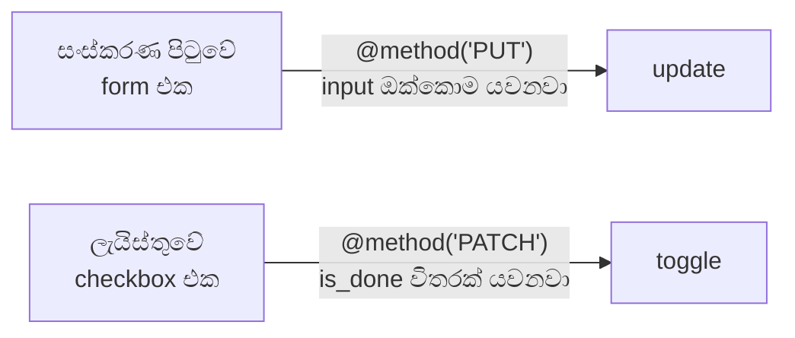
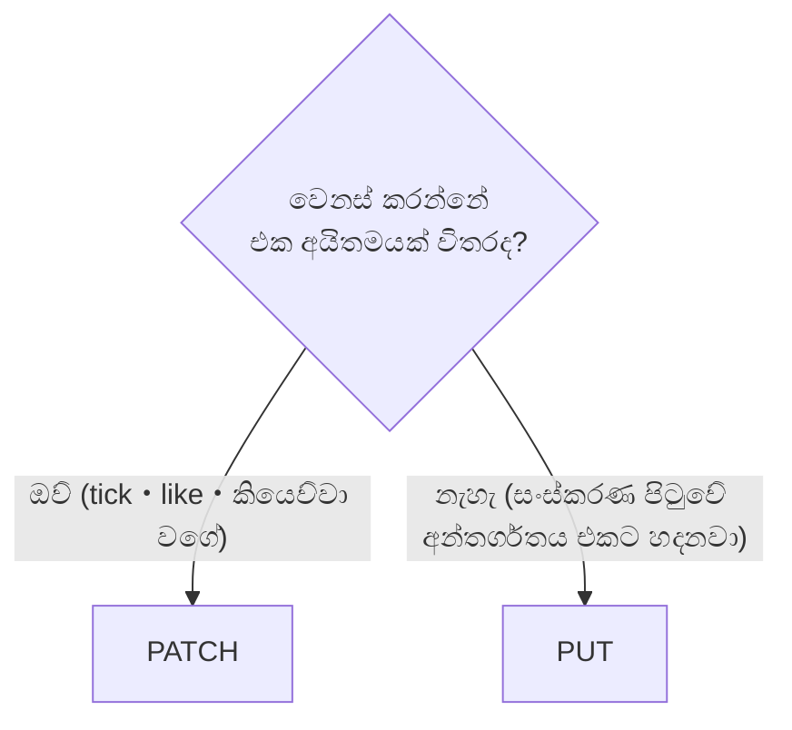
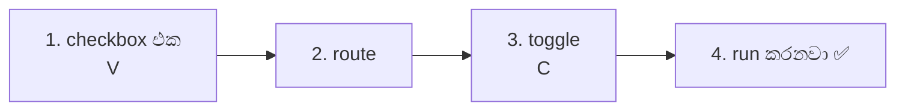
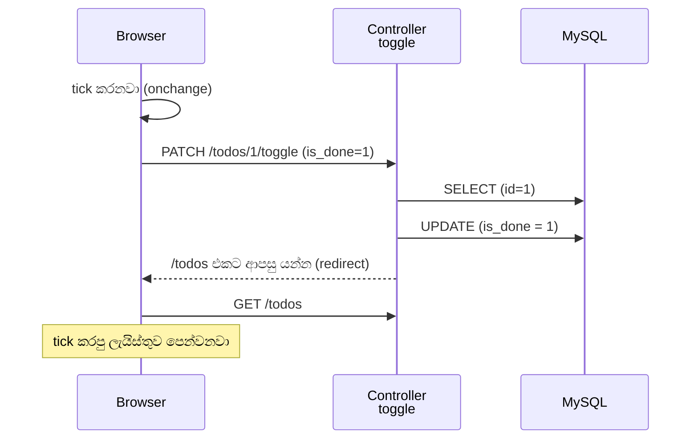
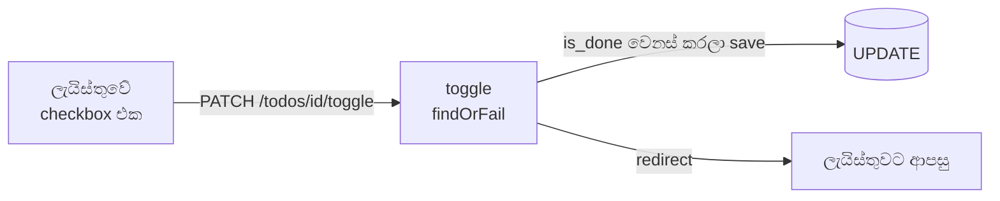

# Laravel හැඳින්වීම — සම්පූර්ණ සහ අසම්පූර්ණ තත්ත්වයන් අතර මාරු කරමු (PATCH)

> 🇯🇵 මුල් පිටපත (ජපන් භාෂාවෙන්): [20261029_資料_2.md](<../../../1年生_データ設計とアプリ開発/後期/20261029/20261029_資料_2.md>) <!-- original-ja-link -->

[පාඩම් ද්‍රව්‍ය 1](./20261029_資料_1.md) මගින් Todo එකේ මාතෘකාව සංස්කරණය කරන්න පුළුවන් වුණා. ඊළඟට, ලැයිස්තුවේ checkbox එකෙන් **සම්පූර්ණ සහ අසම්පූර්ණ තත්ත්වයන් අතර මාරු කරන පහසුකම** හදමු.

## අද ඉලක්කය
- PUT සහ PATCH අතර වෙනස තේරුම් ගැනීම
- PATCH සහ `@method('PATCH')` පාවිච්චි කරලා, කොටසක් විතරක් වෙනස් කරන්න කියන ඉල්ලීම යවන්න පුළුවන් වීම
- checkbox එකෙන් සම්පූර්ණ සහ අසම්පූර්ණ තත්ත්වයන් අතර මාරු කරන්න පුළුවන් වීම

> පාඩම් ද්‍රව්‍ය 1 හි "Todo සංස්කරණය කිරීම" අවසන් කර ඇති තත්ත්වයේ ඉඳන් පටන් ගන්නවා.

---

## 1. සම්පූර්ණ සහ අසම්පූර්ණ තත්ත්වයන් අතර මාරු කිරීම යනු කුමක්ද

පාඩම් ද්‍රව්‍ය 1 මගින්, සංස්කරණ පිටුවෙන් තත්ත්වය (`is_done`) වෙනස් කරන්න පුළුවන් වුණා.
නමුත් ලැයිස්තුවේ checkbox එක එබුවත්, **database එකේ save වෙන්නේ නැහැ** (පිටුව reload කළාම කලින් තිබ්බ විදියටම එනවා).
මෙතනදී, ලැයිස්තුවේ checkbox එක **එබුව ගමන්ම "සම්පූර්ණයි ⇄ සම්පූර්ණ නැහැ" මාරු වෙන්න** හදමු.
හැම පාරම සංස්කරණ පිටුව open නොකර, ලැයිස්තුවේ ඉඳන්ම එතනම මාරු කරන්න පුළුවන් වෙනවා.

```
TODOアプリ

☐ 牛乳を買う         ← tick කළාම "සම්පූර්ණයි" වෙනවා
☑ レポートを出す     ← tick එක අයින් කළාම නැවත "සම්පූර්ණ නැහැ" තත්ත්වයට පත් වෙනවා
```

ඇතුළේ වෙන්නේ, පාඩම් ද්‍රව්‍ය 1 හි හදපු `update` එකේ වගේම **UPDATE** එකක්. වෙනස් කරන්නේ `title` වෙනුවට `is_done` කියන එක විතරයි.

| URL | වර්ගය | භාර method එක | කරන දේ |
|-----|------|------|---------|
| `/todos/1/toggle` | **PATCH** | `toggle` | `is_done` වෙනස් කරනවා |

`toggle` කියන්නේ "on・off මාරු කරනවා" කියන තේරුමයි.

---

## 2. අලුතින් එන දේ: PATCH

වෙනස් කරනකොට පාවිච්චි කරන වර්ග අතරේ, **PUT** ට අමතරව **PATCH** එකකුත් තියෙනවා.
දෙකම "වෙනස් කරනවා" තමයි, නමුත් **කොච්චර දුරට වෙනස් කරනවද** කියන එකේ වෙනසක් තියෙනවා.

| වර්ගය | තේරුම | උපමාවක් විදියට |
|------|------|-----------|
| PUT | data **සම්පූර්ණයෙන්ම** වෙනස් කරනවා | ලියවිල්ල අලුතින් ලියලා, **මුළු එකම මාරු කරනවා** |
| **PATCH** | data වල **කොටසක් විතරක්** වෙනස් කරනවා | ලියවිල්ලේ **එක තැනකට විතරක්** correction tape එකක් ගහනවා |

`patch` කියන්නේ ඉංග්‍රීසියෙන් "අණ්ඩයක් (ඇඳුමක සිදුරකට රෙදි කෑල්ලක් තියලා මහලා හදන එක)" කියන තේරුමයි.

### ලිපින කාඩ්පතකින් සසඳලා බලමු

උදාහරණයක් විදියට, මේ වගේ "ලිපින කාඩ්පතක්" තියෙනවා කියලා හිතමු.

```
නම: 山田 花子
ලිපිනය: 東京都〇〇区…
දුරකථනය: 090-xxxx-xxxx
```

ගෙදර මාරු කළා, ඒ නිසා **ලිපිනය විතරක්** වෙනස් වුණා.

```
【PUT】අලුත් කාඩ්පතක් ලියලා, මුළු එකම මාරු කරනවා

  ┌────────────────────────────┐
  │ නම: 山田 花子              │ ← වෙනස් වෙලා නැති වුණත් ලියනවා
  │ ලිපිනය: 大阪府…(අලුත්)       │ ← වෙනස් වුණ තැන
  │ දුරකථනය: 090-xxxx-xxxx     │ ← වෙනස් වෙලා නැති වුණත් ලියනවා
  └────────────────────────────┘

【PATCH】දැනට තියෙන කාඩ්පතේ, ලිපිනය තියෙන තැනට විතරක් correction tape එකක් ගහනවා

  ┌────────────────────────────┐
  │ ලිපිනය: 大阪府…(අලුත්)       │ ← වෙනස් වුණ තැන විතරයි
  └────────────────────────────┘
```

| | PUT | PATCH |
|---|---|---|
| යවන දේ | **නම・ලිපිනය・දුරකථනය ඔක්කොම** (වෙනස් නොවුණ නම සහ දුරකථනයත් ලියනවා) | **ලිපිනය විතරයි** |
| ලියන්නේ නැති අයිතම? | "හිස් කරනවා" කියන තේරුම එනවා | "ඒ විදියටම තියනවා" කියන තේරුම එනවා |

PUT එකෙන් "මේ තමයි අලුත් කාඩ්පත" කියලා **ඔක්කොම** භාර දෙන නිසා, ලියන්න අමතක වුණ අයිතම හිස් වෙනවා.
PATCH එකෙන් "මෙතන විතරක් හදන්න" කියලා භාර දෙන නිසා, නොලියූ අයිතම ඒ විදියටම ඉතුරු වෙනවා.

### Todo app එකේදී

Todo app එකට ගැළපුවොත්, මෙහෙමයි.

| | සංස්කරණය (`update`) | සම්පූර්ණ සහ අසම්පූර්ණ තත්ත්වයන් අතර මාරු කිරීම (`toggle`) |
|---|---|---|
| මොන වගේ ක්‍රියාවක්ද? | සංස්කරණ පිටුවේ, **Todo එකේ අන්තර්ගතය නැවත ලියලා** save කරනවා | ලැයිස්තුවේ, **tick එක විතරක්** මාරු කරනවා |
| යවන දේ | සංස්කරණ පිටුවේ input **ඔක්කොම** (`title` සහ `is_done`) | **`is_done` විතරයි** |
| වර්ගය | **PUT** | **PATCH** |
| ලියන විදිය | `@method('PUT')` ／ `Route::put(...)` | `@method('PATCH')` ／ `Route::patch(...)` |



> **සංස්කරණ පිටුවෙනුත් තත්ත්වය වෙනස් කරන්න පුළුවන් නම්, ඇයි toggle එකක් හදන්නේ?**
> සංස්කරණ පිටුව කියන්නේ "මාතෘකාවයි තත්ත්වයයි **එකට** නැවත ලියන තිරයක්" (PUT).
> ලැයිස්තුවේ checkbox එක තියෙන්නේ "තත්ත්වය **විතරක්**, එතනම ඉක්මනින් වෙනස් කරන්න" (PATCH).
> දෙකෙන්ම `is_done` වෙනස් වෙනවා, නමුත් **යවන දේ (ඔක්කොමද, කොටසක්ද) වෙනස්** නිසා, වෙනම processing එකක් සහ වෙනම වර්ගයක් පාවිච්චි කරනවා.
> "තිරයේ අයිතම එකට නැවත යවන එක" PUT, "එක අයිතමයක් විතරක් නිශ්චිතවම වෙනස් කරන එක" PATCH.

### අවුල් වුණොත්



අපි හැමදාම පාවිච්චි කරන app වල, උදාහරණයක් විදියට මෙහෙම වෙන් කරලා පාවිච්චි කරනවා.

| ක්‍රියාව | වර්ගය | හේතුව |
|------|------|------|
| profile සංස්කරණ පිටුවේ "Save" | PUT | නම・ස්වයං හැඳින්වීම වගේ දේවල් එකට නැවත යවනවා |
| post එකකට "like" එකක් දානවා | PATCH | "like" කියන එක තැන විතරක් වෙනස් කරනවා |
| message එකක් "කියවා ඇත" ලෙස සලකුණු කරනවා | PATCH | "කියවා තිබේද නැද්ද" කියන තත්ත්වය විතරක් වෙනස් කරනවා |
| Todo එක tick කරනවා | PATCH | `is_done` කියන එක තැන විතරක් වෙනස් කරනවා |

### PUT සහ PATCH, මොකක් පාවිච්චි කළත් වැඩ කරනවද?

Laravel වල, මොකක් පාවිච්චි කළත් `save()` වලින් එකම විදියට save කරන්න පුළුවන්. **program එක වැඩ කරන විදිය වෙනස් වෙන්නේ නැහැ**.
(ලිපින කාඩ්පතේ කතාව "PUT සහ PATCH වල **තේරුම**" ගැනයි. Laravel වල, PUT එකෙන් නොයවපු අයිතම ස්වයංක්‍රීයව හිස් වෙන්නේ නැහැ)
එහෙම වුණත් වෙන් කරලා පාවිච්චි කරන්නේ, route එක බැලුව ගමන් **"මේක මොකක් කරන processing එකක්ද"** කියලා තේරෙන්න සලස්වන්නයි.

```php
Route::put('/todos/{id}', ...);           // "Todo එක සම්පූර්ණයෙන්ම නැවත ලියනවා නේද"
Route::patch('/todos/{id}/toggle', ...);  // "Todo එකේ කොටසක් වෙනස් කරනවා නේද"
```

> ඇත්ත development වලදී, සංස්කරණ පිටුවටත් PATCH පාවිච්චි කරන team තියෙනවා. වැදගත් වෙන්නේ, **team එක ඇතුළේ නීති එක විදියට තියාගන්න එක**.
> මේ පාඩමේදී, "සංස්කරණ පිටුවට PUT, එක අයිතමයක් විතරක් වෙනස් කරනකොට PATCH" කියලා එක විදියට පාවිච්චි කරනවා.

HTML form එකකට PATCH ත් යවන්න බැරි නිසා, PUT වගේම `@method('PATCH')` පාවිච්චි කරනවා.

> **පළමු වාරයේ todo.php එකේදීත් කළා**
> පළමු වාරයේදී `action=toggle` යවලා, `isset($_POST['is_done']) ? 1 : 0` වලින් සම්පූර්ණද අසම්පූර්ණද කියලා තීරණය කළා.
> Laravel වලත් ඒ අදහසින්ම හදනවා.

---

## 3. හදලා බලමු



වෙනස් කරන file තුන මේවායි (`src` ඇතුළේ).

```
src/
├─ resources/views/todos/
│   └─ index.blade.php ················ 1. checkbox එක form එකකින් වට කරනවා
├─ routes/
│   └─ web.php ························ 2. route එකක් එකතු කරනවා
└─ app/Http/Controllers/
    └─ TodoController.php ············· 3. toggle method එක එකතු කරනවා
```

---

### 1. ලැයිස්තුවේ checkbox එකෙන් save කරන්න පුළුවන් කරමු (V)

> දැන් ඉන්නේ මෙතන: **🟢 1. checkbox එක** → 2. route → 3. toggle → 4. run කරනවා

`resources/views/todos/index.blade.php` එකේ `<li>` ඇතුළත මේ විදියට වෙනස් කරන්න.
දැනට තියෙන checkbox එක **form එකකින් වට කරලා**, `name`・`value`・`onchange` එකතු කරන්න.

```html
    <ul>
        @foreach ($todos as $todo)
            <li>
                {{-- ★ මෙතන ඉඳන් වෙනස් කරන්න --}}
                <form method="POST" action="/todos/{{ $todo->id }}/toggle" style="display: inline;">
                    @csrf
                    @method('PATCH')
                    <input type="checkbox" name="is_done" value="1" onchange="this.form.submit()" @checked($todo->is_done)>
                </form>
                {{-- ★ මෙතනට වෙනකම් --}}
                <a href="/todos/{{ $todo->id }}">{{ $todo->title }}</a>
            </li>
        @endforeach
    </ul>
```

| | 10/15 සිට (එබුවත් save වෙන්නේ නැහැ) | අද සිට (එබුවාම save වෙනවා) |
|---|---|---|
| Form එක | නැහැ | `<form ...>` එකකින් වට කරනවා |
| `name="is_done" value="1"` | නැහැ | තියෙනවා |
| `onchange` | නැහැ | තියෙනවා |
| `@checked(...)` | තියෙනවා | තියෙනවා (ඒ විදියටම) |

| Code | තේරුම |
|--------|------|
| `action="/todos/{{ $todo->id }}/toggle"` | `/todos/1/toggle` වගේ, ඒ Todo එකේ `id` එක ඇතුළත් URL එකට යවනවා |
| `@method('PATCH')` | "ඇත්තටම මේක PATCH" කියලා Laravel ට කියනවා (කොටසක් විතරක් වෙනස් කරන නිසා) |
| `name="is_done" value="1"` | tick එක **දාලා තියෙන වෙලාවට විතරක්** `is_done=1` යවනවා |
| `onchange="this.form.submit()"` | tick එක වෙනස් කරපු ගමන්ම form එක යවනවා (submit button එකක් ඕන නැහැ) |
| `@checked($todo->is_done)` | සම්පූර්ණ Todo එකක් නම්, මුල ඉඳන්ම tick එක දාලා තියනවා (10/15 වගේමයි) |
| `style="display: inline;"` | form එකෙන් පස්සේ අලුත් පේළියකට නොගිහින්, මාතෘකාවත් එක්ක එක පේළියේ තියනවා |

> **checkbox එකේ වැදගත් ක්‍රියාකාරිත්වය (පාඩම් ද්‍රව්‍ය 1 නැවත මතක් කරමු)**
> checkbox එකෙන් `is_done=1` යවන්නේ **tick එක දාලා තියෙන වෙලාවට විතරයි**. tick එක අයින් කළාම, `is_done` එකම යවන්නේ නැහැ.
> ඒ නිසා controller එකේදී, පාඩම් ද්‍රව්‍ය 1 හි `update` එකේ වගේම, "`is_done` **එවා තිබේද නැද්ද**" කියන එකෙන් සම්පූර්ණද අසම්පූර්ණද කියලා තීරණය කරනවා.

---

### 2. route එක ලියමු

> දැන් ඉන්නේ මෙතන: 1. checkbox එක → **🟢 2. route** → 3. toggle → 4. run කරනවා

`routes/web.php` එකට ★ තියෙන පේළිය එකතු කරන්න.

```php
Route::get('/todos', [TodoController::class, 'index']);
Route::post('/todos', [TodoController::class, 'store']);
Route::get('/todos/{id}', [TodoController::class, 'show']);
Route::get('/todos/{id}/edit', [TodoController::class, 'edit']);
Route::put('/todos/{id}', [TodoController::class, 'update']);
Route::patch('/todos/{id}/toggle', [TodoController::class, 'toggle']);  // ★ එකතු කළා
```

`/todos/{id}` (මාතෘකාව සංස්කරණය කිරීම) සහ `/todos/{id}/toggle` (සම්පූර්ණ සහ අසම්පූර්ණ තත්ත්වයන් අතර මාරු කිරීම) යන URL වෙනස් නිසා, ඒවා වෙනම method වලට භාර වෙනවා.

---

### 3. toggle method එක ලියමු (C)

> දැන් ඉන්නේ මෙතන: 1. checkbox එක → 2. route → **🟢 3. toggle** → 4. run කරනවා

`TodoController.php` එකට ★ තියෙන `toggle` method එක එකතු කරන්න.

```php
    // ★ මෙතන ඉඳන් එකතු කරන්න
    public function toggle(Request $request, $id)
    {
        // ① id එකෙන්, තත්ත්වය වෙනස් කරන්න ඕන Todo එක ලබා ගන්නවා
        $todo = Todo::findOrFail($id);

        // ② is_done ආවොත් සම්පූර්ණයි (true), නැත්නම් සම්පූර්ණ නැහැ (false)
        $todo->is_done = $request->has('is_done');

        // ③ database එකේ save කරනවා
        $todo->save();

        // ④ ලැයිස්තු පිටුවට ආපසු යනවා
        return redirect('/todos');
    }
    // ★ මෙතනට වෙනකම්
```

| Code | තේරුම |
|--------|------|
| `$request->has('is_done')` | `is_done` ආවොත් `true`, නැත්නම් `false`. පළමු වාරයේ `isset($_POST['is_done'])` එකට සමානයි |

`update` එකත් එක්ක සසඳලා බලමු.

| | `update` (සංස්කරණ පිටුව) | `toggle` (ලැයිස්තුවේ checkbox එක) |
|---|---|---|
| ① | `Todo::findOrFail($id)` | `Todo::findOrFail($id)` |
| ② | `title` සහ `is_done` වෙනස් කරනවා | **`is_done` විතරක්** වෙනස් කරනවා |
| ③ | `save()` → `UPDATE` | `save()` → `UPDATE` |
| ④ | විස්තර පිටුවට ආපසු යනවා | ලැයිස්තු පිටුවට ආපසු යනවා |

පළමු වාරයේ `todo.php` එකත් එක්ක සසඳලා බලමු.

```php
// පළමු වාරය
$id = (int)($_POST['id'] ?? 0);
$isDone = isset($_POST['is_done']) ? 1 : 0;
$stmt = $pdo->prepare("UPDATE todos SET is_done = :is_done WHERE id = :id");
$stmt->execute(['is_done' => $isDone, 'id' => $id]);
header('Location: index.php');
exit;

// Laravel
$todo = Todo::findOrFail($id);
$todo->is_done = $request->has('is_done');
$todo->save();
return redirect('/todos');
```

---

### 4. run කරලා බලමු ✅

> දැන් ඉන්නේ මෙතන: 1. checkbox එක → 2. route → 3. toggle → **🟢 4. run කරනවා**

1. http://localhost:8000/todos open කරන්න
2. "牛乳を買う" (කිරි ගන්න) එකේ checkbox එක tick කරන්න
3. පිටුව reload වෙලා, tick එක ඒ විදියටම තියෙනවා නම් සාර්ථකයි
4. ආයෙත් tick එක අයින් කරලා, අයින් කරපු විදියටම තියෙනවද කියලත් බලන්න



✅ **පරීක්ෂාව 1**: tick කරපු Todo එකේ විස්තර පිටුව open කරලා, "完了 ✅" (සම්පූර්ණයි) කියලා තියෙනවද බලන්න.

✅ **පරීක්ෂාව 2**: phpMyAdmin එකේ `todos` table එක open කරලා, `is_done` එක `1` (සම්පූර්ණයි)・`0` (සම්පූර්ණ නැහැ) විදියට වෙනස් වෙලාද බලන්න.

---

## 4. හරියට වැඩ නොකරන විට

> **🔥 වැඩ කරන්නේ නැත්නම්, log එකක් දාන්න!**
> error එකේ හේතුව තේරෙන්නේ නැත්නම්, `toggle` ඇතුළේ `Log::info()` පාවිච්චි කරලා, `is_done` එනවද කියලා පරීක්ෂා කරන්න → [【වැදගත්】ලොග් (log) පෙන්වන ආකාරය](../20261022/【重要】ログの出し方.md)

| රෝග ලක්ෂණය | හේතුව තියෙන තැන | විසඳුම |
|------|----------|------|
| tick කළත් මුකුත් වෙන්නේ නැහැ | View | `<input>` එකේ `onchange="this.form.submit()"` තියෙනවද බලන්න |
| tick කළාම `404 Not Found` | Route | `routes/web.php` එකේ `Route::patch('/todos/{id}/toggle', ...)` ලිව්වද බලන්න |
| tick කළාම `The POST method is not supported for route todos/1/toggle.` | View | checkbox එකේ form එකේ `@method('PATCH')` තියෙනවද බලන්න |
| tick කළාම `The PATCH method is not supported for route todos/1/toggle.` | Route | `routes/web.php` එකේ `Route::put(...)` කියලා ලියලා නැද්ද බලන්න (`Route::patch(...)` කරන්න) |
| tick කළත්, tick එක අයින් වෙලා ආපහු එනවා | View・Controller | `name="is_done"` සහ `$request->has('is_done')` වල අකුරු එක වගේද බලන්න |
| සම්පූර්ණ Todo එකක් වුණත්, tick එක දාලා නැහැ | View | `<input>` එකේ `@checked($todo->is_done)` තියෙනවද බලන්න |

---

## 5. සාරාංශය



| අද ලියපු දේ | කෙටියෙන් කිව්වොත් |
|--------------|-----------|
| PATCH සහ `@method('PATCH')` | කොටසක් විතරක් වෙනස් කරනකොට පාවිච්චි කරනවා (සම්පූර්ණයෙන්ම නම් PUT) |
| `onchange="this.form.submit()"` | tick එක වෙනස් කරපු ගමන්ම form එක යවනවා |
| `name="is_done" value="1"` | tick කරලා තියෙන වෙලාවට විතරක් `is_done=1` යවනවා |
| `Route::patch('/todos/{id}/toggle', ...)` | PATCH එකෙන් ආවොත් `toggle` භාර ගන්නවා |
| `$request->has('is_done')` | `is_done` එවා තිබේද නැද්ද කියන එකෙන් සම්පූර්ණද අසම්පූර්ණද කියලා තීරණය කරනවා |

---

ඊළඟට, Todo මකා දමන feature එක හදමු → [Todo මකා දමමු (DELETE)](./20261029_資料_3.md)

<!-- nav:start -->

---

| ⬅️ පෙර | 🗺️ සමස්ත සිතියම | ඊළඟ ➡️ |
|:--|:--:|--:|
| [10/29 Todo සංස්කරණය (UPDATE)](20261029_資料_1.md) | [පාඩම් ද්‍රව්‍යවල සමස්ත සිතියම](../../README.md) | [10/29 Todo මකා දැමීම (DELETE)](20261029_資料_3.md) |

<!-- nav:end -->
