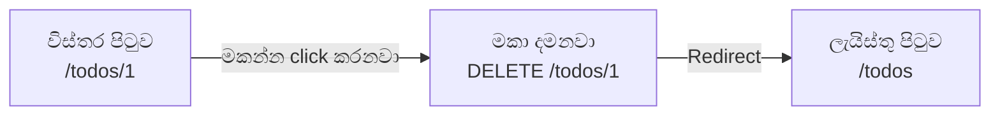
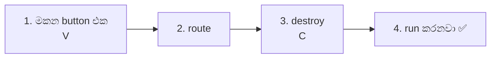
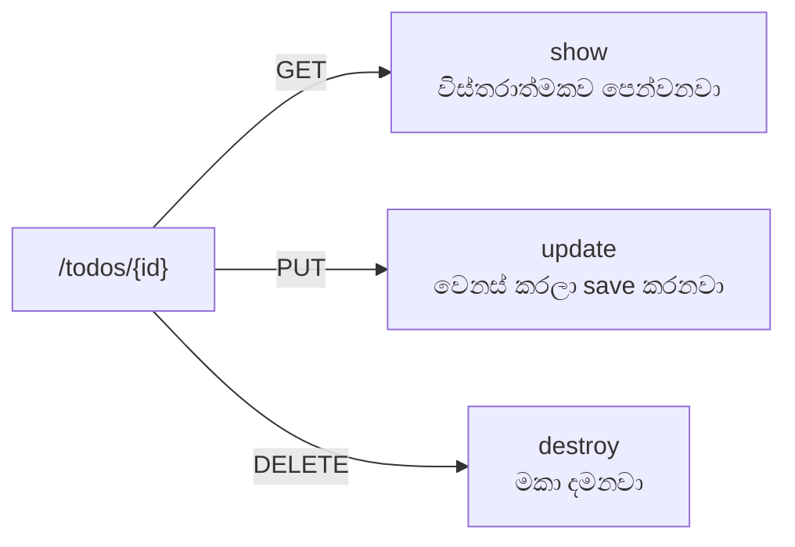
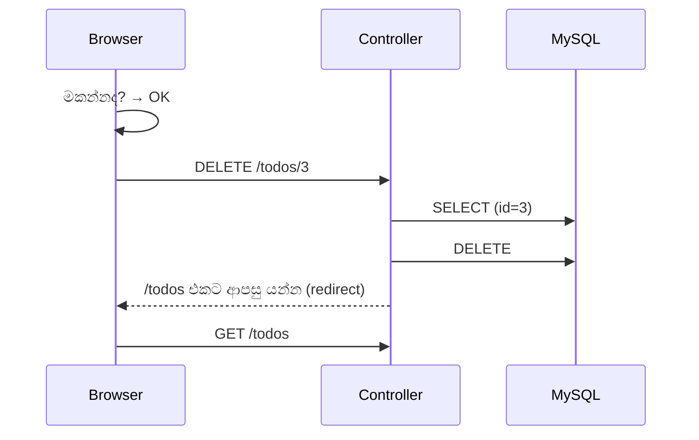
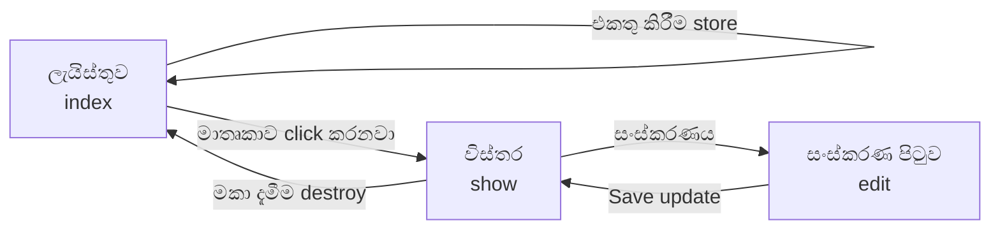

# Laravel හැඳින්වීම — Todo මකා දමමු (DELETE)

> 🇯🇵 මුල් පිටපත (ජපන් භාෂාවෙන්): [20261029_資料_3.md](<../../../1年生_データ設計とアプリ開発/後期/20261029/20261029_資料_3.md>) <!-- original-ja-link -->

[පාඩම් ද්‍රව්‍ය 1](./20261029_資料_1.md)・[පාඩම් ද්‍රව්‍ය 2](./20261029_資料_2.md) මගින් අපිට Todo සංස්කරණය කරන්න පුළුවන් වුණා. ඊළඟට, **Todo මකන (delete කරන) feature එක** හදමු.

## අද ඉලක්කය
- DELETE සහ `@method('DELETE')` පාවිච්චි කරලා, මකන්න කියන ඉල්ලීම යවන්න පුළුවන් වීම
- `delete()` වලින් Todo එකක් database එකෙන් මකන්න පුළුවන් වීම
- එකතු කිරීම・පෙන්වීම・සංස්කරණය・මකා දැමීම (CRUD) ගැන සමස්ත අවබෝධයක් ලබාගැනීම

> පාඩම් ද්‍රව්‍ය 2 හි "සම්පූර්ණ සහ අසම්පූර්ණ තත්ත්වයන් අතර මාරු කිරීම" ක්‍රියා කරන තත්ත්වයේ සිට පටන් ගනිමු.

---

## 1. මකා දැමීම වැඩ කරන විදිය

සංස්කරණයට වඩා වෙනස්ව, මකා දැමීම **පිටුවක් open නොකර, එක button එකකින් ඉවරයි**.



| URL | වර්ගය | භාර method එක | කරන දේ |
|-----|------|------|---------|
| `/todos/1` | **DELETE** | `destroy` | Todo එක මකා දමනවා |

### DELETE සහ `@method('DELETE')`

"data මකනකොට" **DELETE** කියන වර්ගය පාවිච්චි කරන එක Laravel වල නීතියයි.
PUT වගේම, HTML form එකකට DELETE යවන්න බැරි නිසා, `@method('DELETE')` පාවිච්චි කරනවා.

| වර්ගය | පාවිච්චි කරන අවස්ථාව | ලියන විදිය |
|------|---------|--------|
| PUT | වෙනස් කරනවා | form එකට `@method('PUT')` |
| PATCH | කොටසක් විතරක් වෙනස් කරනවා | form එකට `@method('PATCH')` |
| **DELETE** | මකනවා | form එකට `@method('DELETE')` |

> **ඇයි link එකක් (`<a>`) නොවී, form එකක button එකක්?**
> link එකක් open වෙන්නේ GET වලින්. GET කියන්නේ "බලන්න විතරයි" කියන නීතිය නිසා, data මකන processing වලට පාවිච්චි කරන්නේ නැහැ.
> link එකකින් මකන්න පුළුවන් නම්, URL එක open කළා විතරින් Todo එක මැකිලා යනවා.
> data වෙනස් කරනකොට (එකතු කිරීම・සංස්කරණය・මකා දැමීම), **form එකේ button එකෙන් යවන්න** ඕන කියලා මතක තියාගන්න.

---

## 2. හදලා බලමු



වෙනස් කරන file තුන මේවායි (`src` ඇතුළේ).

```
src/
├─ resources/views/todos/
│   └─ show.blade.php ················· 1. මකන button එක එකතු කරනවා
├─ routes/
│   └─ web.php ························ 2. route එකක් එකතු කරනවා
└─ app/Http/Controllers/
    └─ TodoController.php ············· 3. destroy method එක එකතු කරනවා
```

---

### 1. විස්තර පිටුවට "මකන්න" button එකක් දාමු (V)

> දැන් ඉන්නේ මෙතන: **🟢 1. මකන button එක** → 2. route → 3. destroy → 4. run කරනවා

`resources/views/todos/show.blade.php` එකට ★ තියෙන form එක එකතු කරන්න.

```html
    <a href="/todos/{{ $todo->id }}/edit">編集</a>

    {{-- ★ මෙතන ඉඳන් එකතු කරන්න --}}
    <form method="POST" action="/todos/{{ $todo->id }}" onsubmit="return confirm('削除しますか？');">
        @csrf
        @method('DELETE')
        <button type="submit">削除</button>
    </form>
    {{-- ★ මෙතනට වෙනකම් --}}

    <a href="/todos">一覧にもどる</a>
```

| Code | තේරුම |
|--------|------|
| `action="/todos/{{ $todo->id }}"` | `/todos/1` වගේ, මකන්න ඕන Todo එකේ `id` එක ඇතුළත් URL එකට යවනවා |
| `@method('DELETE')` | "ඇත්තටම මේක DELETE" කියලා Laravel ට කියනවා |
| `onsubmit="return confirm('削除しますか？');"` | යවන්න කලින් තහවුරු කිරීමේ dialog එකක් පෙන්වනවා. "Cancel" එබුවොත් යවන්නේ නැහැ |

ඇතුළත් කිරීමේ ක්ෂේත්‍ර නැහැ. **මකා දැමිය යුතු Todo එක කුමක්ද කියලා URL එකේ ඇති `id` එකෙන් පමණක් හඳුනාගන්න පුළුවන්** නිසා.

> **පළමු වාරයේ todo.php එකේදීත් කළා**
> `confirm()` වලින් තහවුරු කරලා මකන එක, පළමු වාරයේ `todo.php` එකේ වගේමයි.
> මකපු දේ ආපහු ගන්න බැරි නිසා, තහවුරු කිරීමක් පෙන්වන එක ආරක්ෂිතයි.

---

### 2. route එක ලියමු

> දැන් ඉන්නේ මෙතන: 1. මකන button එක → **🟢 2. route** → 3. destroy → 4. run කරනවා

`routes/web.php` එකට ★ තියෙන පේළිය එකතු කරන්න.

```php
Route::get('/todos', [TodoController::class, 'index']);
Route::post('/todos', [TodoController::class, 'store']);
Route::get('/todos/{id}', [TodoController::class, 'show']);
Route::get('/todos/{id}/edit', [TodoController::class, 'edit']);
Route::put('/todos/{id}', [TodoController::class, 'update']);
Route::patch('/todos/{id}/toggle', [TodoController::class, 'toggle']);
Route::delete('/todos/{id}', [TodoController::class, 'destroy']);  // ★ එකතු කළා
```

`destroy` කියන්නේ "විනාශ කරනවා・මකනවා" කියන තේරුමයි. Laravel වල, මකන method එකට `destroy` කියන නම ගොඩක් පාවිච්චි කරනවා.

දැන් `/todos/{id}` එකට, **GET නම් `show`, PUT නම් `update`, DELETE නම් `destroy`** භාර වෙනවා.

එකම URL එක වුණත්, යවන විදිය (වර්ගය) අනුව භාර method එක වෙනස් වෙනවා.



---

### 3. destroy method එක ලියමු (C)

> දැන් ඉන්නේ මෙතන: 1. මකන button එක → 2. route → **🟢 3. destroy** → 4. run කරනවා

`TodoController.php` එකට ★ තියෙන `destroy` method එක එකතු කරන්න.

```php
    // ★ මෙතන ඉඳන් එකතු කරන්න
    public function destroy($id)
    {
        // ① id එක භාවිතයෙන් මකා දැමීමට අවශ්‍ය Todo එක ලබාගන්නවා
        $todo = Todo::findOrFail($id);

        // ② database එකෙන් මකා දමනවා
        $todo->delete();

        // ③ ලැයිස්තු පිටුවට ආපසු යනවා
        return redirect('/todos');
    }
    // ★ මෙතනට වෙනකම්
```

| Code | තේරුම |
|--------|------|
| `$todo->delete()` | database එකෙන් මකා දමනවා. `DELETE FROM todos WHERE id = ?` එකට සමානයි |
| `redirect('/todos')` | ලැයිස්තු පිටුවට ආපසු යනවා (මකපු Todo එකේ විස්තර පිටුව තවදුරටත් නැති නිසා) |

පළමු වාරයේ `todo.php` එකත් එක්ක සසඳලා බලමු.

```php
// පළමු වාරය
$id = (int)($_POST['id'] ?? 0);
$stmt = $pdo->prepare("DELETE FROM todos WHERE id = :id");
$stmt->execute(['id' => $id]);
header('Location: index.php');
exit;

// Laravel
$todo = Todo::findOrFail($id);
$todo->delete();
return redirect('/todos');
```

---

### 4. run කරලා බලමු ✅

> දැන් ඉන්නේ මෙතන: 1. මකන button එක → 2. route → 3. destroy → **🟢 4. run කරනවා**

1. http://localhost:8000/todos open කරන්න
2. මැකුවත් කමක් නැති Todo එකක් (උදාහරණයක් විදියට "宿題をする" (ගෙදර වැඩ කරන්න)) click කරලා, විස්තර පිටුව open කරන්න
3. "削除" (මකන්න) ඔබන්න
4. "削除しますか？" (මකන්නද?) කියලා ආවොත් `OK` ඔබන්න
5. ලැයිස්තු පිටුවට ආපසු ගිහින්, ඒ Todo එක නැති වෙලා නම් සාර්ථකයි



✅ **පරීක්ෂාව 1**: phpMyAdmin එකේ `todos` table එක open කරලා, මකපු Todo එකේ පේළිය නැති වෙලාද බලන්න.

✅ **පරීක්ෂාව 2**: මකපු Todo එකේ විස්තර පිටුවේ URL එක (උදාහරණයක් විදියට http://localhost:8000/todos/3 ) කෙලින්ම open කරලා බලන්න.
තවදුරටත් නැති නිසා, `404 Not Found` එනවා. `findOrFail` වැඩ කරනවා.

✅ **පරීක්ෂාව 3**: "削除" (මකන්න) ඔබලා, තහවුරු කිරීමේ dialog එකේ `キャンセル` (Cancel) එබුවොත්, කිසිම දෙයක් මැකෙන්නේ නැති බවත් බලන්න.

---

## 3. හරියට වැඩ නොකරන විට

> **🔥 වැඩ කරන්නේ නැත්නම්, log එකක් දාන්න!**
> error එකේ හේතුව තේරෙන්නේ නැත්නම්, `destroy` ඇතුළේ `Log::info()` පාවිච්චි කරලා `$id` එකේ අගය පරීක්ෂා කරන්න → [【වැදගත්】ලොග් (log) පෙන්වන ආකාරය](../20261022/【重要】ログの出し方.md)

| රෝග ලක්ෂණය | හේතුව තියෙන තැන | විසඳුම |
|------|----------|------|
| "削除" (මකන්න) එබුවාම `The POST method is not supported for route todos/1.` | View | මකන form එකේ `@method('DELETE')` තියෙනවද බලන්න |
| "削除" (මකන්න) එබුවාම `The DELETE method is not supported for route todos/1.` | Route | `routes/web.php` එකේ `Route::delete('/todos/{id}', ...)` ලිව්වද බලන්න |
| `Call to undefined method App\Http\Controllers\TodoController::destroy()` | Controller | `TodoController.php` එකේ `destroy` method එක ලිව්වද, නමේ අකුරු හරිද බලන්න |
| මැකුවත්, ලැයිස්තුවේ තාමත් තියෙනවා | Controller | `destroy` ඇතුළේ `$todo->delete();` තියෙනවද බලන්න |
| තහවුරු කිරීමේ dialog එක එන්නේ නැහැ | View | `<form>` එකේ `onsubmit="return confirm('削除しますか？');"` තියෙනවද බලන්න |

---

## 4. CRUD සම්පූර්ණයි!

දැන් Todo **එකතු කිරීම・පෙන්වීම・සංස්කරණය・මකා දැමීම** ඔක්කොම කරන්න පුළුවන්.
මේ හතර එකට **CRUD** (ක්‍රඩ්) කියලා හඳුන්වනවා. බොහෝ Web app හැදිලා තියෙන්නේ මේ CRUD ක්‍රියා එකට යොදාගැනීමෙන්.

| | තේරුම | SQL | මේ Todo app එකේ | හදපු දවස |
|---|---|---|---|---|
| **C**reate | එකතු කිරීම | `INSERT` | `store` | 10/22 |
| **R**ead | පෙන්වීම | `SELECT` | `index`・`show` | 10/15・10/22 |
| **U**pdate | සංස්කරණය | `UPDATE` | `edit`・`update`・`toggle` | අද |
| **D**elete | මකා දැමීම | `DELETE` | `destroy` | අද |

route ඔක්කොම හතක් වුණා.

| Route | භාර method එක | කරන දේ |
|--------|------|---------|
| `GET /todos` | `index` | ලැයිස්තුව පෙන්වනවා |
| `POST /todos` | `store` | අලුතින් එකතු කරනවා |
| `GET /todos/{id}` | `show` | එක Todo එකක් විස්තරාත්මකව පෙන්වනවා |
| `GET /todos/{id}/edit` | `edit` | සංස්කරණ පිටුව පෙන්වනවා |
| `PUT /todos/{id}` | `update` | වෙනස් කරලා save කරනවා |
| `PATCH /todos/{id}/toggle` | `toggle` | සම්පූර්ණ සහ අසම්පූර්ණ තත්ත්වයන් අතර මාරු කරනවා |
| `DELETE /todos/{id}` | `destroy` | මකා දමනවා |



<!-- nav:start -->

---

| ⬅️ පෙර | 🗺️ සමස්ත සිතියම | ඊළඟ ➡️ |
|:--|:--:|--:|
| [10/29 සම්පූර්ණ බව මාරු කිරීම (PATCH)](20261029_資料_2.md) | [පාඩම් ද්‍රව්‍යවල සමස්ත සිතියම](../../README.md) | [11/05 Seeder・Factory](../20261105/20261105_資料_1.md) |

<!-- nav:end -->
