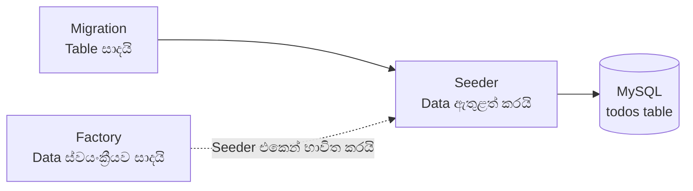
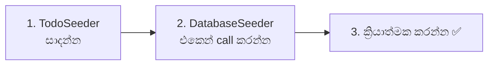
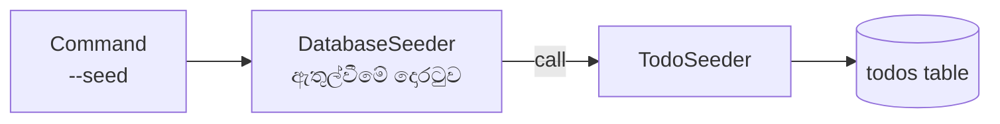
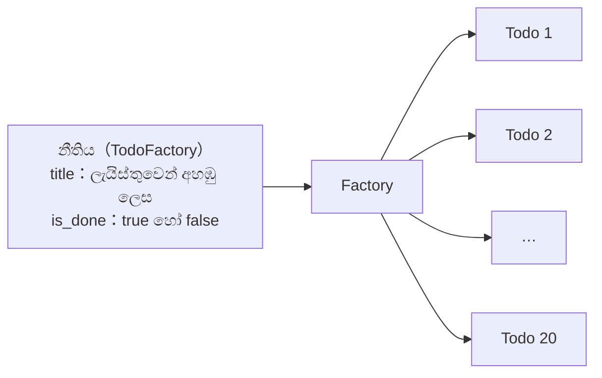
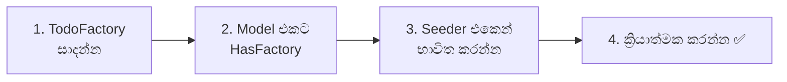
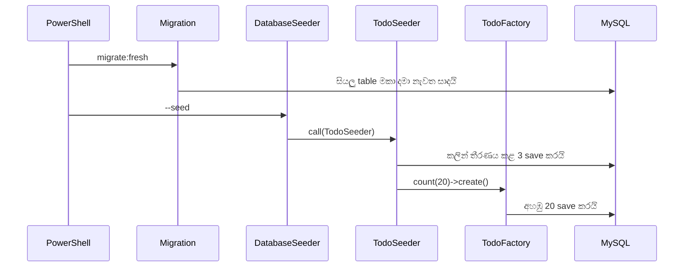
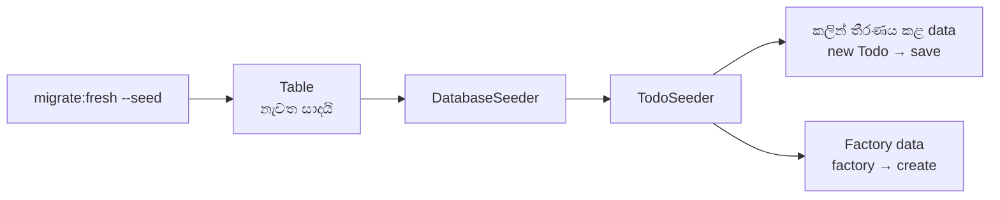

# Laravel හැඳින්වීම — test data ඇතුළත් කරමු（Seeder・Factory）

> 🇯🇵 මුල් පිටපත (ජපන් භාෂාවෙන්): [20261105_資料_1.md](<../../../1年生_データ設計とアプリ開発/後期/20261105/20261105_資料_1.md>) <!-- original-ja-link -->

මෙතෙක් අපි Todo data, phpMyAdmin හි එකින් එක අතින් ඇතුළත් කළා, නැත්නම් form එකෙන් එකතු කළා.
අද අපි ඉගෙන ගන්නේ **එක command එකකින් test data ඇතුළත් කරන ආකාරය** යි.

## අද දවසේ ඉලක්කය
- Seeder (සීඩර්) මගින්, කලින් තීරණය කළ test data ඇතුළත් කිරීමට හැකි වීම
- Factory (ෆැක්ටරි) මගින්, test data ගොඩක් ස්වයංක්‍රීයව සෑදීමට හැකි වීම
- `migrate:fresh --seed` මගින්, database එක ඕනෑම වෙලාවක මුල් තත්ත්වයට ආපසු ගෙන ඒමට හැකි වීම

> පුහුණු පරිසරයේ (`php-study`) mysql සහ laravel ආරම්භ කළ පසු පටන් ගනිමු.
> PowerShell හි **laravel folder එකට** ගිය පසු commands ක්‍රියාත්මක කරන්න.

---

## 1. Test data ඇතුළත් කරන ක්‍රමයක් අවශ්‍ය වන්නේ ඇයි?

මෙතෙක් මෙවැනි දේවල් සිදු වුණාද?

```
A：「මකා දැමීම පුහුණු වෙද්දී Todo සියල්ල නැති වුණා. ආයෙත් අතින් ඇතුළත් කරන්න ඕනෙද…?」
B：「ලැයිස්තු පිටුවේ පෙනුම පරීක්ෂා කරන්න ඕනේ, ඒත් Todo 3ක් විතරයි තියෙන්නේ」
C：「යාළුවාගේ PC එකේ තියෙන data මගේ එකට වඩා වෙනස්」
```

Test data **program එකක් මගින් ඇතුළත් කරන** ලෙස සකස් කළොත්, මෙහෙම වෙනවා.

| | phpMyAdmin හි අතින් ඇතුළත් කිරීම | Program එකක් මගින් ඇතුළත් කිරීම |
|---|---|---|
| ඇතුළත් කිරීමේ වෙහෙස | එකින් එක ඇතුළත් කළ යුතුයි | එක command එකක් |
| මැකී ගියොත් | ආයෙත් අතින් ඇතුළත් කළ යුතුයි | එක command එකකින් පෙර තත්ත්වයට |
| 100ක් අවශ්‍ය නම් | ඉතාම අමාරුයි | අංකය වෙනස් කළොත් ඇති |
| හැමෝගේම PC වල | එකිනෙකට වෙනස් | එකම data |

Laravel හි මෙය **Seeder** සහ **Factory** මගින් කරනවා.

---

## 2. Seeder සහ Factory

**Seeder** (සීඩර්) යනු "බීජ (seed) වපුරන දෙය" යන අර්ථයයි.
හිස් table එකකට, මුල් data නමැති "බීජ" වපුරනවා.

| නම | කාර්යය | උපමාවක් ලෙස |
|------|------|-----------|
| **Migration** | Table සාදයි (10/15 ඉගෙන ගත්තා) | කුඹුර සකස් කිරීම |
| **Seeder** | Table එකට data ඇතුළත් කරයි | බීජ වැපිරීම |
| **Factory** | Data ගොඩක් ස්වයංක්‍රීයව සාදයි | බීජ විශාල ප්‍රමාණයක් සාදන යන්ත්‍රය |



අද, පහත අනුපිළිවෙළට කොටස් 2ක් සාදමු.

1. **Seeder** මගින්, කලින් තීරණය කළ Todo 3ක් ඇතුළත් කිරීම
2. **Factory** මගින්, Todo 20ක් ස්වයංක්‍රීයව සාදා ඇතුළත් කිරීම

File තිබෙන්නේ `src` තුළ මෙතැනයි.

```
src/
└─ database/
    ├─ migrations/ ··········· Table වල සැලැස්ම (10/15 සෑදුවා)
    ├─ seeders/
    │   ├─ DatabaseSeeder.php ··· මුල සිටම තිබේ. මෙතැනින් සියලු Seeder ක්‍රියාත්මක කරයි
    │   └─ TodoSeeder.php ······· අද සාදනවා
    └─ factories/
        └─ TodoFactory.php ······ අද සාදනවා
```

---

## 3. Seeder මගින්, කලින් තීරණය කළ data ඇතුළත් කරමු



### 1. TodoSeeder සාදන්න

> ඔබ දැන් සිටින්නේ: **🟢 1. TodoSeeder** → 2. DatabaseSeeder → 3. ක්‍රියාත්මක කරන්න

පහත command එකෙන් Seeder file එක සාදන්න.

```powershell
docker compose exec laravel php artisan make:seeder TodoSeeder
```

`database/seeders/TodoSeeder.php` සෑදෙන නිසා, එහි අන්තර්ගතය පහත ආකාරයට වෙනස් කරන්න.

```php
<?php

namespace Database\Seeders;

use App\Models\Todo;  // ← Todo model එක භාවිත කිරීමට අවශ්‍ය පේළිය
use Illuminate\Database\Seeder;

class TodoSeeder extends Seeder
{
    public function run(): void
    {
        // ඇතුළත් කිරීමට අවශ්‍ය data, array එකක් ලෙස සූදානම් කරයි
        $todos = [
            ['title' => '牛乳を買う',     'is_done' => false],
            ['title' => 'レポートを出す', 'is_done' => true],
            ['title' => '宿題をする',     'is_done' => false],
        ];

        // එකින් එක, Todo සාදා save කරයි
        foreach ($todos as $data) {
            $todo = new Todo();
            $todo->title = $data['title'];
            $todo->is_done = $data['is_done'];
            $todo->save();
        }
    }
}
```

| Code | අර්ථය |
|--------|------|
| `run()` | Seeder ක්‍රියාත්මක කළ විට run වන method එක |
| `$todos = [ ... ]` | ඇතුළත් කිරීමට අවශ්‍ය data වල array එක (පළමු semester එකේ ඉගෙන ගත් associative array) |
| `foreach` | Array එකෙන් එකින් එක අයිතම ගෙන නැවත නැවත ක්‍රියාත්මක කරයි |
| `new Todo()` 〜 `save()` | 10/22 ඉගෙන ගත් `store` හි ලියූ ආකාරයටම, Todo එකක් save කරයි |

`store` හිදී form එකෙන් ලැබුණු අගයන් ඇතුළත් කළා, නමුත් Seeder එකේදී ඇතුළත් කරන්නේ **array එකේ අගයන්** යි. වෙනස එපමණයි.

---

### 2. DatabaseSeeder එකෙන් call කරන්න

> ඔබ දැන් සිටින්නේ: 1. TodoSeeder → **🟢 2. DatabaseSeeder** → 3. ක්‍රියාත්මක කරන්න

`database/seeders/DatabaseSeeder.php` යනු **Seeder වල ඇතුල්වීමේ දොරටුව** යි.
Seeder ක්‍රියාත්මක කරන command එක type කළ විට, මුලින්ම මෙම file එක run වෙනවා.

Open කළ විට, මුල සිටම "test සඳහා user කෙනෙක් සාදන" code එකක් ලියා තිබෙනවා.
දැනට අපි user භාවිත නොකරන නිසා, අන්තර්ගතය පහත ආකාරයට වෙනස් කරන්න.

```php
<?php

namespace Database\Seeders;

use Illuminate\Database\Seeder;

class DatabaseSeeder extends Seeder
{
    public function run(): void
    {
        // TodoSeeder ක්‍රියාත්මක කරයි
        $this->call(TodoSeeder::class);
    }
}
```

`$this->call(TodoSeeder::class)` යනු "`TodoSeeder` ක්‍රියාත්මක කරන්න" යන අර්ථයයි.
Seeder වැඩි වන විට, මෙතැනට `$this->call(...)` එකතු කරගෙන යනවා.



---

### 3. ක්‍රියාත්මක කරන්න ✅

> ඔබ දැන් සිටින්නේ: 1. TodoSeeder → 2. DatabaseSeeder → **🟢 3. ක්‍රියාත්මක කරන්න**

පහත command එක ක්‍රියාත්මක කරන්න.

```powershell
docker compose exec laravel php artisan migrate:fresh --seed
```

| කොටස | අර්ථය |
|------|------|
| `migrate:fresh` | **සියලු table මකා දමා**, migration මගින් නැවත සාදයි |
| `--seed` | නැවත සෑදූ පසු, Seeder මගින් data ඇතුළත් කරයි |

> ⚠️ **`migrate:fresh` සියලු data මකා දමයි**
> phpMyAdmin හෝ form එකෙන් ඇතුළත් කළ Todo ද සියල්ල මැකී යනවා.
> මෙය පුහුණු database එකක් නිසා ප්‍රශ්නයක් නැහැ, නමුත් **production database එකක කිසිසේත් භාවිත කරන්න එපා**.

✅ **පරීක්ෂාව 1**：http://localhost:8000/todos open කර, Todo 3ක් පෙන්වනවා නම් හරි.

✅ **පරීක්ෂාව 2**：phpMyAdmin හි `todos` table එක open කර බලමු.
`save()` මගින් ඇතුළත් කළ නිසා, `created_at` සහ `updated_at` වලටත් දිනය සහ වේලාව ඇතුළත් වී තිබෙනවා (අතින් ඇතුළත් කළ විට ඒවා හිස්ව තිබුණා).

✅ **පරීක්ෂාව 3**：Todo කිහිපයක් මකා දමා, නැවත `migrate:fresh --seed` ක්‍රියාත්මක කර බලමු.
**මුල් Todo 3 ආපසු එනවා.** මේ නිසා, ඕනෑම වෙලාවක පුහුණුව මුල සිට නැවත කළ හැකියි.

---

## 4. Factory මගින්, data ගොඩක් සාදමු

3ක් නම් අතින් ලියන්න පුළුවන්, නමුත් 20ක්, 100ක් වුණොත් අමාරුයි.
**Factory** භාවිත කළොත්, "මෙවැනි data සාදන්න" යන නීතිය එක වරක් ලිවීමෙන් පමණක්, ඕනෑම ප්‍රමාණයක් ස්වයංක්‍රීයව සාදන්න පුළුවන්.





### 1. TodoFactory සාදන්න

> ඔබ දැන් සිටින්නේ: **🟢 1. TodoFactory** → 2. HasFactory → 3. Seeder එකෙන් භාවිත කරන්න → 4. ක්‍රියාත්මක කරන්න

```powershell
docker compose exec laravel php artisan make:factory TodoFactory
```

`database/factories/TodoFactory.php` සෑදෙන නිසා, `definition()` තුළ ඇති දේ පහත ආකාරයට වෙනස් කරන්න.

```php
    public function definition(): array
    {
        return [
            'title' => fake()->randomElement([
                '牛乳を買う',
                'レポートを出す',
                '宿題をする',
                '部屋のそうじ',
                '本を返す',
                'ゴミを出す',
            ]),
            'is_done' => fake()->boolean(),
        ];
    }
```

| Code | අර්ථය |
|--------|------|
| `definition()` | "Todo එකක් කුමන අගයන් සමඟ සාදන්නේද" යන නීතිය ලියන තැන |
| `fake()` | Test data සඳහා අහඹු අගයන් සාදන මෙවලම (Faker) |
| `fake()->randomElement([...])` | Array එක තුළින් අහඹු ලෙස එකක් තෝරයි |
| `fake()->boolean()` | `true` හෝ `false` අහඹු ලෙස තෝරයි |

`id`・`created_at`・`updated_at` මෙතෙක් වගේම ස්වයංක්‍රීයව ඇතුළත් වන නිසා ලියන්නේ නැහැ.

---

### 2. Model එකට HasFactory ලියන්න

> ඔබ දැන් සිටින්නේ: 1. TodoFactory → **🟢 2. HasFactory** → 3. Seeder එකෙන් භාවිත කරන්න → 4. ක්‍රියාත්මක කරන්න

Factory භාවිත කිරීමට, model එකේ "Factory භාවිත කළ හැකි කරන" පේළියක් අවශ්‍යයි.
`app/Models/Todo.php` open කර, ★ සලකුණු කළ පේළි 2 එකතු කරන්න.

```php
<?php

namespace App\Models;

use Illuminate\Database\Eloquent\Factories\HasFactory;  // ★ එකතු කිරීම
use Illuminate\Database\Eloquent\Model;

class Todo extends Model
{
    use HasFactory;  // ★ එකතු කිරීම
}
```

දැන්, `Todo::factory()` ලිව්වොත් `TodoFactory` භාවිත කළ හැකියි.
（Laravel, model නම වන `Todo` අනුව `TodoFactory` ස්වයංක්‍රීයව සොයා ගන්නවා）

---

### 3. Seeder එකෙන් Factory භාවිත කරන්න

> ඔබ දැන් සිටින්නේ: 1. TodoFactory → 2. HasFactory → **🟢 3. Seeder එකෙන් භාවිත කරන්න** → 4. ක්‍රියාත්මක කරන්න

`database/seeders/TodoSeeder.php` හි `run()` එකේ අගට, ★ සලකුණු කළ පේළිය එකතු කරන්න.

```php
    public function run(): void
    {
        $todos = [
            ['title' => '牛乳を買う',     'is_done' => false],
            ['title' => 'レポートを出す', 'is_done' => true],
            ['title' => '宿題をする',     'is_done' => false],
        ];

        foreach ($todos as $data) {
            $todo = new Todo();
            $todo->title = $data['title'];
            $todo->is_done = $data['is_done'];
            $todo->save();
        }

        // ★ Factory මගින් Todo 20ක් සාදා save කරයි
        Todo::factory()->count(20)->create();
    }
```

```
Todo::factory() -> count(20) -> create();
~~~~~~~~~~~~~~~    ~~~~~~~~~    ~~~~~~~~
TodoFactory මගින්   20ක්         සාදා save කරයි
```

---

### 4. ක්‍රියාත්මක කරන්න ✅

> ඔබ දැන් සිටින්නේ: 1. TodoFactory → 2. HasFactory → 3. Seeder එකෙන් භාවිත කරන්න → **🟢 4. ක්‍රියාත්මක කරන්න**

```powershell
docker compose exec laravel php artisan migrate:fresh --seed
```

✅ **පරීක්ෂාව 1**：http://localhost:8000/todos open කර, **Todo 23ක්** (කලින් තීරණය කළ 3 ＋ Factory එකේ 20) පෙන්වනවා නම් හරි.

✅ **පරීක්ෂාව 2**：නැවත `migrate:fresh --seed` ක්‍රියාත්මක කර බලමු.
මුල් 3 එලෙසම තිබුණත්, Factory මගින් සෑදූ 20 **ක්‍රියාත්මක කරන සෑම වරකම title සහ සම්පූර්ණ/අසම්පූර්ණ තත්ත්වය වෙනස් වෙනවා**. ඒවා අහඹු ලෙස සාදන නිසයි.



---

## 5. Command සාරාංශය

| Command | කරන දේ |
|---------|---------|
| `php artisan make:seeder TodoSeeder` | Seeder file එක සාදයි |
| `php artisan make:factory TodoFactory` | Factory file එක සාදයි |
| `php artisan migrate:fresh --seed` | සියලු table නැවත සාදා, Seeder මගින් data ඇතුළත් කරයි |
| `php artisan db:seed` | Table එලෙසම තබා, Seeder මගින් data **එකතු කරයි** |

> **`db:seed` පමණක් type කළොත්, data වැඩි වෙමින් යනවා**
> `db:seed` දැනට ඇති data මකා නොදමා **එකතු කරනවා**. දෙවරක් type කළොත්, Todo ද දෙගුණයක් වෙනවා.
> "මුල් තත්ත්වයට ආපසු යන්න ඕනේ" නම්, `migrate:fresh --seed` භාවිත කරමු.

（ඕනෑම command එකක් ඉදිරියෙන් `docker compose exec laravel` එකතු කර ක්‍රියාත්මක කරන්න）

---

## 6. හරියට වැඩ නොකරන විට

> **🔥 වැඩ කරන්නේ නැත්නම්, log එකක් පෙන්වන්න!**
> Seeder තුළදීත් `Log::info()` භාවිත කළ හැකියි → [【වැදගත්】ලොග් (log) පෙන්වන ආකාරය](../20261022/【重要】ログの出し方.md)

| රෝග ලක්ෂණය | හේතුව ඇති තැන | විසඳුම |
|------|----------|------|
| `Class "Database\Seeders\Todo" not found` | Seeder | `TodoSeeder.php` හි ඉහළින් `use App\Models\Todo;` තිබේදැයි පරීක්ෂා කරන්න |
| `Call to undefined method App\Models\Todo::factory()` | Model | `Todo.php` හි `use HasFactory;` ලියා ඇත්දැයි පරීක්ෂා කරන්න (ඉහළින් `use Illuminate\...\HasFactory;` ද අවශ්‍යයි) |
| `Class "Database\Factories\TodoFactory" not found` | Factory | `database/factories/TodoFactory.php` තිබේද, file නම සහ class නම පරීක්ෂා කරන්න |
| `Duplicate entry 'test@example.com'` | DatabaseSeeder | Test user සාදන code එක ඉතිරිව තිබියදී `db:seed` දෙවරක් type කළා. `DatabaseSeeder.php` වෙනස් කරන්න, නැත්නම් `migrate:fresh --seed` භාවිත කරන්න |
| Todo දෙගුණ, තෙගුණ වුණා | Command | `db:seed` කිහිප වරක් type කළා. `migrate:fresh --seed` මගින් නැවත කරන්න |
| ක්‍රියාත්මක කළත් Todo ඇතුළත් වෙන්නේ නැහැ | DatabaseSeeder | `DatabaseSeeder.php` හි `$this->call(TodoSeeder::class);` තිබේදැයි පරීක්ෂා කරන්න |

---

## 7. සාරාංශය



| අද ලියූ දේ | කෙටියෙන් කිවොත් |
|--------------|-----------|
| `TodoSeeder` | කලින් තීරණය කළ test data ඇතුළත් කරයි |
| `DatabaseSeeder` හි `$this->call(...)` | Seeder වල ඇතුල්වීමේ දොරටුව. මෙතැනින් එක් එක් Seeder ක්‍රියාත්මක කරයි |
| `TodoFactory` හි `definition()` | දත්ත වාර්තාවක් කුමන අගයන් සමඟ සාදන්නේද යන නීතිය |
| Model එකේ `use HasFactory;` | `Todo::factory()` භාවිත කළ හැකි කරයි |
| `Todo::factory()->count(20)->create()` | නීතිය අනුව 20ක් සාදා save කරයි |
| `migrate:fresh --seed` | Database එක ඕනෑම වෙලාවක මුල් තත්ත්වයට ආපසු ගෙන එයි |

---

## 8. තවත් උත්සාහ කරමු (කාලය ඉතිරි වූ අය සඳහා)

1. Factory මගින් සාදන ප්‍රමාණය **100** කර, ලැයිස්තු පිටුව කෙසේ වෙනස් වේදැයි බලමු.
2. Factory හි `randomElement` ලැයිස්තුවට, ඔබම හිතූ Todo 5ක් එකතු කර බලමු.

<details>
<summary>ඉඟිය</summary>

1. `TodoSeeder.php` හි `count(20)` යන්න `count(100)` ලෙස වෙනස් කර, `migrate:fresh --seed` ක්‍රියාත්මක කරන්න.
2. `TodoFactory.php` හි `randomElement([...])` array එකට, `'買い物に行く',` (සාප්පු යාමට යන්න) වැනි ආකාරයට එකතු කරන්න.

</details>

<!-- nav:start -->

---

| ⬅️ පෙර | 🗺️ සමස්ත සිතියම | ඊළඟ ➡️ |
|:--|:--:|--:|
| [10/29 Todo මකා දැමීම (DELETE)](../20261029/20261029_資料_3.md) | [පාඩම් ද්‍රව්‍යවල සමස්ත සිතියම](../../README.md) | [11/05 වලංගුකරණය (validation)](20261105_資料_2.md) |

<!-- nav:end -->
