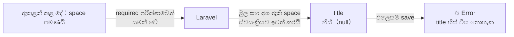
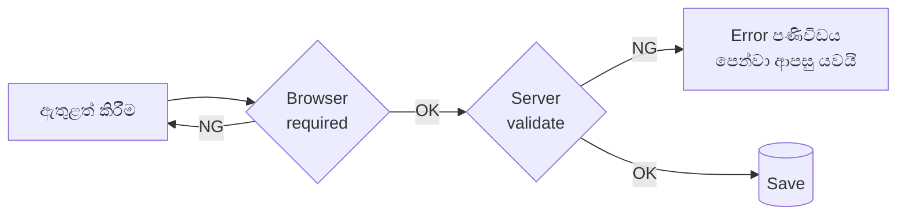
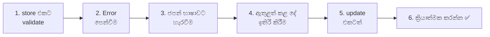
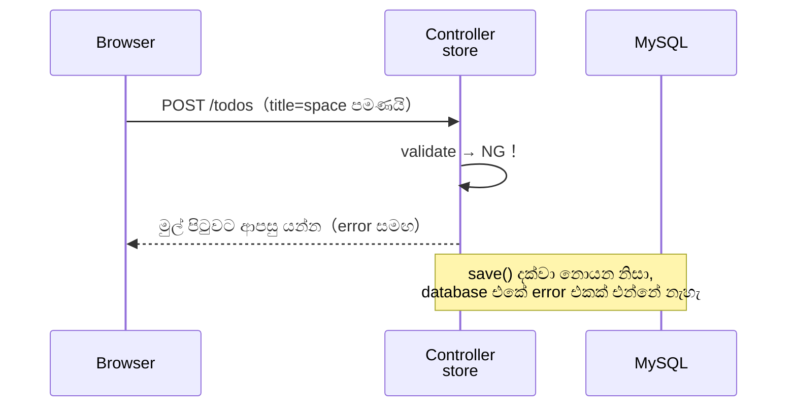
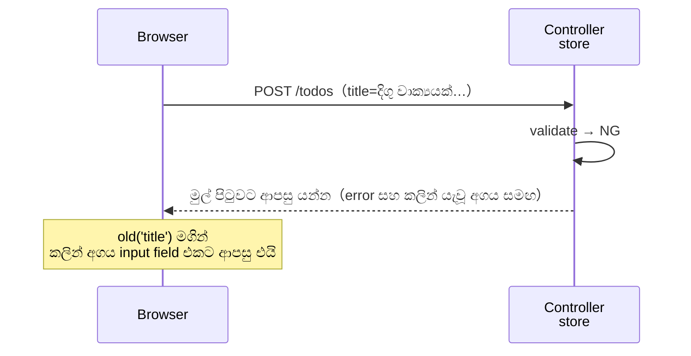
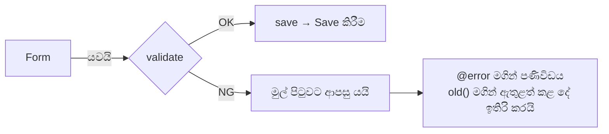

# Laravel හැඳින්වීම — ඇතුළත් කළ දේ පරීක්ෂා කරමු（වලංගුකරණය / validation）

> 🇯🇵 මුල් පිටපත (ජපන් භාෂාවෙන්): [20261105_資料_2.md](<../../../1年生_データ設計とアプリ開発/後期/20261105/20261105_資料_2.md>) <!-- original-ja-link -->

Todo එකතු කිරීම සහ සංස්කරණය කිරීම දැන් කළ හැකියි, නමුත් ඇත්තටම **වැරදි දෙයක් ඇතුළත් කළොත්, error තිරයක් පෙන්වන** ගැටලුවක් තිබෙනවා.
අද අපි, ඇතුළත් කළ අගයන් server පැත්තේදී පරීක්ෂා කරන **වලංගුකරණය (validation)** ඉගෙන ගනිමු.

## අද දවසේ ඉලක්කය
- Browser එකේ පරීක්ෂාව (`required`) පමණක් ප්‍රමාණවත් නොවන්නේ ඇයි කියා තේරුම් ගැනීම
- `$request->validate()` මගින් ඇතුළත් කළ දේ පරීක්ෂා කිරීමට හැකි වීම
- Error පණිවිඩය තිරයේ පෙන්වා, ඇතුළත් කළ අගය ඉතිරි කර තබා ගැනීමට හැකි වීම

> 10/29 හි "Todo සංස්කරණය කිරීම" දක්වා අවසන් කළ තත්ත්වයේ සිට පටන් ගනිමු.

---

## 1. උත්සාහ කර බලමු: space පමණක් ඇතුළත් කර එකතු කළොත්…？

http://localhost:8000/todos open කර, input field එකට **half-width space පමණක්** ඇතුළත් කර `追加` (එකතු කරන්න) button එක ඔබා බලමු.

```
SQLSTATE[23000]: Integrity constraint violation: 1048 Column 'title' cannot be null
```

Error තිරයක් පෙන්වුණා. මොකද වුණේ?



1. HTML හි `required` බලන්නේ "යමක් ඇතුළත් කර තිබේද" යන්න පමණයි. Space ද "ඇතුළත් කර ඇත" ලෙස සලකන නිසා, පරීක්ෂාවෙන් සමත් වෙනවා
2. Laravel, එවූ අගයේ **මුල සහ අග ඇති space ස්වයංක්‍රීයව ඉවත් කරනවා** (10/22 ඉගෙන ගත්තා). එහි ප්‍රතිඵලයක් ලෙස, title එක හිස් (`null`) වෙනවා
3. `todos` table එකේ `title` හිස් විය නොහැකි නිසා, save කරන විට error එකක් එනවා

ඊට අමතරව, browser එකේ developer tools (F12) භාවිත කළොත්, `required` ඉවත් කර යැවීමටත් පුළුවන්.

---

## 2. වලංගුකරණය (validation) යනු

**වලංගුකරණය**（validation）යනු "ඇතුළත් කළ අගය නිවැරදිද කියා **save කිරීමට පෙර** පරීක්ෂා කිරීම" යි.

පරීක්ෂාව browser එකේ සහ server එකේ යන තැන් 2කදී කළ හැකියි.

| | Browser එකේ පරීක්ෂාව | Server එකේ පරීක්ෂාව (validation) |
|---|---|---|
| ලියන තැන | HTML（`required` වැනි） | Controller（`$request->validate()`） |
| හොඳ පැත්ත | යැවීමට පෙර වහාම දන්වයි | **මඟ හැර යා නොහැක** |
| දුර්වල පැත්ත | Developer tools මගින් ඉවත් කළ හැක・space පමණක් ඇතුළත් කළත් පරීක්ෂාවෙන් සමත් වේ | වරක් server එකට යැවිය යුතුයි |



Browser එකේ පරීක්ෂාව "භාවිත කරන්නාට කරන කාරුණිකකමක්", server එකේ පරීක්ෂාව "යෙදුම ආරක්ෂා කරන යතුර" යි.
**Server එකේ පරීක්ෂාව අනිවාර්යයෙන්ම ලියන්න** කියා මතක තබා ගනිමු.

---

## 3. සාදා බලමු



වෙනස් කරන file 3 මෙන්න (`src` තුළ).

```
src/
├─ app/Http/Controllers/
│   └─ TodoController.php ············· 1・3・5. validate එකතු කරයි
└─ resources/views/todos/
    ├─ index.blade.php ················ 2・4. Error පෙන්වීම සහ old() එකතු කරයි
    └─ edit.blade.php ················· 5. Error පෙන්වීම සහ old() එකතු කරයි
```

---

### 1. store එකට validate ලියන්න（C）

> ඔබ දැන් සිටින්නේ: **🟢 1. validate** → 2. Error පෙන්වීම → 3. ජපන් භාෂාව → 4. ඇතුළත් කළ දේ ඉතිරි කිරීම → 5. update එකටත් → 6. ක්‍රියාත්මක කරන්න

`app/Http/Controllers/TodoController.php` හි `store` method එකේ **මුලින්ම**, ★ කොටස එකතු කරන්න.

```php
    public function store(Request $request)
    {
        // ★ ඇතුළත් කළ දේ පරීක්ෂා කරයි
        $request->validate([
            'title' => 'required|max:255',
        ]);

        $todo = new Todo();
        $todo->title = $request->input('title');
        $todo->save();

        return redirect('/todos');
    }
```

| Code | අර්ථය |
|--------|------|
| `$request->validate([...])` | එවූ අගයන් පරීක්ෂා කරයි |
| `'title' => ...` | Form එකේ `name="title"` හි අගය පරීක්ෂා කරයි |
| `required` | හිස් විය නොහැක (space පමණක් වුවත්, Laravel ඒවා ඉවත් කරන නිසා හිස් වෙනවා) |
| `max:255` | අකුරු 255 දක්වා (`title` column එක `VARCHAR(255)` නිසා) |
| `\|` | නීති වෙන් කරන ලකුණ. "`required` සහ `max:255`" යන අර්ථයයි |

**පරීක්ෂාවෙන් අසමත් වුවහොත්, එතැනින් නතර වී, ඇතුළත් කළ පිටුවට ස්වයංක්‍රීයව ආපසු යවනවා.** ඊට පහළින් ඇති `save()` ක්‍රියාත්මක වෙන්නේ නැහැ.



✅ **පරීක්ෂාව**：නැවතත් space පමණක් ඇතුළත් කර `追加` (එකතු කරන්න) ඔබා බලමු.
Error තිරය නොපෙන්වා, ලැයිස්තු පිටුවට ආපසු එනවා. Todo ද වැඩි වෙලා නැහැ.
……නමුත්, **ආපසු යැව්වේ ඇයි කියා තිරයෙන් තේරෙන්නේ නැහැ**. ඊළඟට, error පණිවිඩය පෙන්වමු.

---

### 2. Error පණිවිඩය පෙන්වන්න（V）

> ඔබ දැන් සිටින්නේ: 1. validate → **🟢 2. Error පෙන්වීම** → 3. ජපන් භාෂාව → 4. ඇතුළත් කළ දේ ඉතිරි කිරීම → 5. update එකටත් → 6. ක්‍රියාත්මක කරන්න

`resources/views/todos/index.blade.php` හි form එකට, ★ කොටස එකතු කරන්න.

```html
    <form method="POST" action="/todos">
        @csrf
        <input type="text" name="title" placeholder="新しいTODOを入力" required>
        <button type="submit">追加</button>

        {{-- ★ මෙතැන සිට එකතු කරන්න --}}
        @error('title')
            <p style="color: red;">{{ $message }}</p>
        @enderror
        {{-- ★ මෙතැන දක්වා --}}
    </form>
```

| Code | අර්ථය |
|--------|------|
| `@error('title')` 〜 `@enderror` | `title` පරීක්ෂාවෙන් අසමත් වූ විට පමණක්, ඇතුළත ඇති දේ පෙන්වයි |
| `{{ $message }}` | Error පණිවිඩය |

✅ **පරීක්ෂාව**：Space පමණක් ඇතුළත් කර `追加` (එකතු කරන්න) ඔබන විට, රතු අකුරින් මෙසේ පෙන්වනවා.

```
The title field is required.
```

ඉංග්‍රීසියෙන් පෙන්වුණා. ඊළඟට, එය ජපන් භාෂාවට හරවමු.

---

### 3. Error පණිවිඩය ජපන් භාෂාවට හරවන්න（C）

> ඔබ දැන් සිටින්නේ: 1. validate → 2. Error පෙන්වීම → **🟢 3. ජපන් භාෂාව** → 4. ඇතුළත් කළ දේ ඉතිරි කිරීම → 5. update එකටත් → 6. ක්‍රියාත්මක කරන්න

`validate` හි දෙවැනි argument එක ලෙස, **පණිවිඩ array එකක්** එකතු කරන්න.

```php
        $request->validate([
            'title' => 'required|max:255',
        ], [
            'title.required' => 'タイトルを入力してください。',        // ★ එකතු කිරීම
            'title.max' => 'タイトルは255文字以内で入力してください。',  // ★ එකතු කිරීම
        ]);
```

| Code | අර්ථය |
|--------|------|
| `'title.required' => '...'` | `title`, `required` පරීක්ෂාවෙන් අසමත් වූ විට පෙන්වන පණිවිඩය |
| `'title.max' => '...'` | `title`, `max` පරීක්ෂාවෙන් අසමත් වූ විට පෙන්වන පණිවිඩය |

`'column නම.නීතිය'` යන ආකාරයෙන්, එක් එක් නීතියට වෙනම පණිවිඩයක් තීරණය කළ හැකියි.

✅ **පරීක්ෂාව**：Space පමණක් ඇතුළත් කර `追加` (එකතු කරන්න) ඔබන විට, 「タイトルを入力してください。」(කරුණාකර title එක ඇතුළත් කරන්න.) ලෙස පෙන්වනවා නම් හරි.

---

### 4. ඇතුළත් කළ අගය ඉතිරි කර තබන්න（V）

> ඔබ දැන් සිටින්නේ: 1. validate → 2. Error පෙන්වීම → 3. ජපන් භාෂාව → **🟢 4. ඇතුළත් කළ දේ ඉතිරි කිරීම** → 5. update එකටත් → 6. ක්‍රියාත්මක කරන්න

Error නිසා ආපසු යවන විට, input field එක හිස් වෙනවා.
දිගු වාක්‍යයක් ඇතුළත් කර තිබුණා නම්, ආයෙත් මුල සිට type කරන්න වෙනවා.

`index.blade.php` හි `<input>` එකට, ★ සලකුණු කළ `value` එකතු කරන්න.

```html
        <input type="text" name="title" value="{{ old('title') }}" placeholder="新しいTODOを入力" required>
        {{--                            ~~~~~~~~~~~~~~~~~~~~~~~~~ ★ එකතු කිරීම --}}
```

`old('title')` යනු "**ටිකකට කලින් යැවූ `title` අගය**" යි.
Error නිසා ආපසු යවන විට, input field එකට කලින් අගයම දමා තබන්න පුළුවන්.

ආපසු යවන විට, Laravel "ටිකකට කලින් යැවූ අගය" ද එක්කම මතක තබා ගන්නා නිසා, `old()` මගින් එය ලබා ගත හැකියි.



---

### 5. update එකටත් validation එකතු කරන්න

> ඔබ දැන් සිටින්නේ: 1. validate → 2. Error පෙන්වීම → 3. ජපන් භාෂාව → 4. ඇතුළත් කළ දේ ඉතිරි කිරීම → **🟢 5. update එකටත්** → 6. ක්‍රියාත්මක කරන්න

සංස්කරණයේදීත්, space පමණක් දමා save කළොත් එම error එකම එනවා.
`TodoController.php` හි `update` එකටත්, `store` එකේ ලියූ `validate` එකම එකතු කරන්න.

```php
    public function update(Request $request, $id)
    {
        // ★ store එකේ පරීක්ෂාවම
        $request->validate([
            'title' => 'required|max:255',
        ], [
            'title.required' => 'タイトルを入力してください。',
            'title.max' => 'タイトルは255文字以内で入力してください。',
        ]);

        $todo = Todo::findOrFail($id);
        $todo->title = $request->input('title');
        $todo->is_done = $request->has('is_done');
        $todo->save();

        return redirect('/todos/' . $todo->id);
    }
```

`resources/views/todos/edit.blade.php` හි form එකත්, ★ ලෙස වෙනස් කරන්න.

```html
    <form method="POST" action="/todos/{{ $todo->id }}">
        @csrf
        @method('PUT')
        <input type="text" name="title" value="{{ old('title', $todo->title) }}" required>  {{-- ★ old භාවිත කරයි --}}
        <label>
            <input type="checkbox" name="is_done" value="1" @checked($todo->is_done)>
            完了
        </label>
        <button type="submit">保存</button>

        {{-- ★ මෙතැන සිට එකතු කරන්න --}}
        @error('title')
            <p style="color: red;">{{ $message }}</p>
        @enderror
        {{-- ★ මෙතැන දක්වා --}}
    </form>
```

`old('title', $todo->title)` යනු "කලින් යැවූ අගයක් තිබේ නම් එය, **නැත්නම් දැනට ඇති title එක**" යන අර්ථයයි.

| අවස්ථාව | Input field එකේ පෙන්වන අගය |
|------|----------------|
| සංස්කරණ පිටුව පළමු වරට open කළ විට | දැනට ඇති title එක（`$todo->title`） |
| Error නිසා ආපසු ආ විට | කලින් යැවූ අගය（`old('title')`） |

---

### 6. ක්‍රියාත්මක කරන්න ✅

> ඔබ දැන් සිටින්නේ: 1. validate → 2. Error පෙන්වීම → 3. ජපන් භාෂාව → 4. ඇතුළත් කළ දේ ඉතිරි කිරීම → 5. update එකටත් → **🟢 6. ක්‍රියාත්මක කරන්න**

පහත 4 උත්සාහ කර බලමු.

| | කළ යුතු දේ | මෙසේ වුණොත් හරි |
|---|---|---|
| ① | එකතු කිරීමේදී, space පමණක් ඇතුළත් කර `追加` (එකතු කරන්න) | 「タイトルを入力してください。」(කරුණාකර title එක ඇතුළත් කරන්න.) පෙන්වයි. Todo වැඩි වෙන්නේ නැහැ |
| ② | එකතු කිරීමේදී, සාමාන්‍ය ලෙස Todo එකක් ඇතුළත් කර `追加` (එකතු කරන්න) | මෙතෙක් වගේම එකතු වෙනවා |
| ③ | සංස්කරණයේදී, title එක space පමණක් කර `保存` (save කරන්න) | සංස්කරණ පිටුවට ආපසු ගොස්, 「タイトルを入力してください。」(කරුණාකර title එක ඇතුළත් කරන්න.) පෙන්වයි |
| ④ | Developer tools (F12) මගින් `<input>` හි `required` ඉවත් කර, හිස්ව තබාම `追加` (එකතු කරන්න) | Browser පරීක්ෂාව නැතත්, server පරීක්ෂාවෙන් නතර වෙනවා |

> **④ කරන ආකාරය**
> 1. Input field එක මත right-click කර →「検証」(Inspect) (හෝ「調べる」)
> 2. Developer tools තුළ `<input ... required>` හි `required` මත double-click කර ඉවත් කරන්න
> 3. Input field එක හිස්ව තබාම `追加` (එකතු කරන්න) ඔබන්න

✅ ④ හිදී 「タイトルを入力してください。」(කරුණාකර title එක ඇතුළත් කරන්න.) පෙන්වුවොත්, **browser පරීක්ෂාව මඟ හැරියත්, යෙදුම ආරක්ෂිතව පවතින බව** තහවුරු කර ගත හැකියි.

---

## 4. හරියට වැඩ නොකරන විට

> **🔥 වැඩ කරන්නේ නැත්නම්, log එකක් පෙන්වන්න!** → [【වැදගත්】ලොග් (log) පෙන්වන ආකාරය](../20261022/【重要】ログの出し方.md)
> නමුත්, validation එකෙන් අසමත් වූ බව log එකේ සටහන් වෙන්නේ නැහැ (එය සාමාන්‍ය ක්‍රියාකාරිත්වයක් මිස error එකක් නොවන නිසා).

| රෝග ලක්ෂණය | හේතුව ඇති තැන | විසඳුම |
|------|----------|------|
| Space පමණක් යැවූ විට, තවමත් `Column 'title' cannot be null` | Controller | `validate`, `save()` එකට **පෙර** ලියා ඇත්දැයි පරීක්ෂා කරන්න |
| ආපසු යැවුවත්, පණිවිඩය පෙන්වන්නේ නැහැ | View | `@error('title')` 〜 `@enderror` ලියා ඇත්ද, `'title'` අක්ෂර වින්‍යාසය නිවැරදිද කියා පරීක්ෂා කරන්න |
| පණිවිඩය තවමත් ඉංග්‍රීසියෙන් | Controller | `'title.required'` අක්ෂර වින්‍යාසය පරීක්ෂා කරන්න (`.` මගින් සම්බන්ධ කරයි) |
| ආපසු ආ විට, input field එක හිස් | View | `value="{{ old('title') }}"` ලියා ඇත්දැයි පරීක්ෂා කරන්න |
| සංස්කරණ පිටුව open කළ විට, input field එක හිස් | View | `old('title', $todo->title)` හි දෙවැන්න (`$todo->title`) ලියා ඇත්දැයි පරීක්ෂා කරන්න |
| සංස්කරණයේදී space පමණක් කළ විට, error තිරය | Controller | `update` එකටත් `validate` ලියා ඇත්දැයි පරීක්ෂා කරන්න |

---

## 5. සාරාංශය



| අද ලියූ දේ | කෙටියෙන් කිවොත් |
|--------------|-----------|
| `$request->validate([...])` | Save කිරීමට පෙර, server එකේදී ඇතුළත් කළ දේ පරීක්ෂා කරයි |
| `'required\|max:255'` | හිස් විය නොහැක・අකුරු 255 දක්වා |
| `'title.required' => '...'` | Error පණිවිඩය ජපන් භාෂාවට හරවයි |
| `@error('title')` 〜 `@enderror` | Error පණිවිඩය පෙන්වයි |
| `old('title')` | Error නිසා ආපසු ආ විට, කලින් ඇතුළත් කළ දේ ඉතිරි කරයි |

**Browser පරීක්ෂාව කාරුණිකකමක්, server පරීක්ෂාව යතුරක්. Server පරීක්ෂාව අනිවාර්යයෙන්ම ලියන්න.**

---

## 6. තවත් උත්සාහ කරමු (කාලය ඉතිරි වූ අය සඳහා)

Title එක **අකුරු 20 දක්වා** සීමා කර බලමු. අකුරු 21ක් හෝ ඊට වැඩි Todo එකක් එකතු කිරීමට උත්සාහ කළ විට, 「タイトルは20文字以内で入力してください。」(කරුණාකර title එක අකුරු 20ක් හෝ ඊට අඩුවෙන් ඇතුළත් කරන්න.) ලෙස පෙන්වන ලෙස සකසමු.

<details>
<summary>ඉඟිය</summary>

`store` සහ `update` යන දෙකෙහිම, `max:255` යන්න `max:20` ලෙසත්, පණිවිඩයත් 「20文字以内」(අකුරු 20ක් හෝ ඊට අඩුවෙන්) ලෙසත් වෙනස් කරන්න.

```php
        $request->validate([
            'title' => 'required|max:20',
        ], [
            'title.required' => 'タイトルを入力してください。',
            'title.max' => 'タイトルは20文字以内で入力してください。',
        ]);
```

</details>

<!-- nav:start -->

---

| ⬅️ පෙර | 🗺️ සමස්ත සිතියම | ඊළඟ ➡️ |
|:--|:--:|--:|
| [11/05 Seeder・Factory](20261105_資料_1.md) | [පාඩම් ද්‍රව්‍යවල සමස්ත සිතියම](../../README.md) | [11/12 පොදු කොටස් සංරචක (parts) බවට පත් කිරීම（@include）](../20261112/20261112_資料_1.md) |

<!-- nav:end -->
