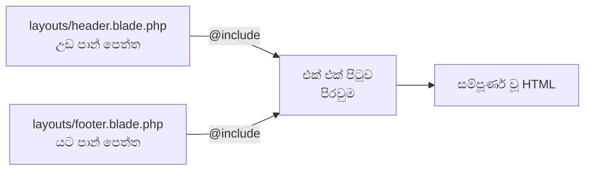
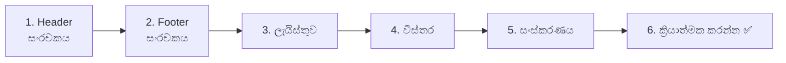
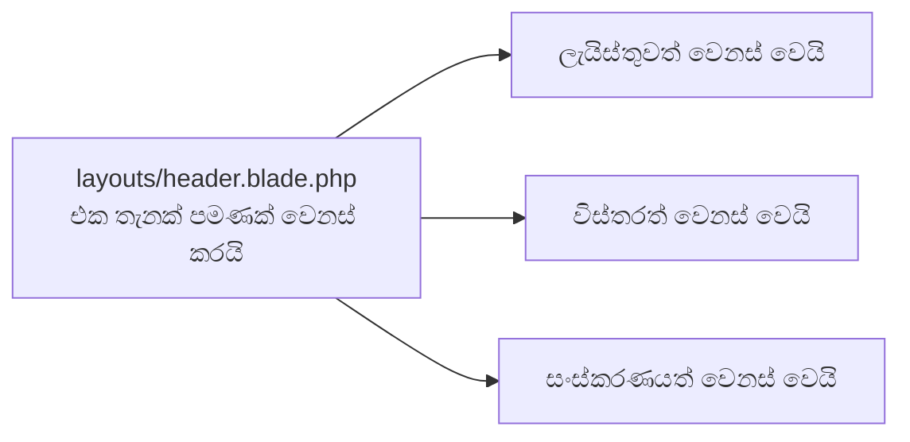
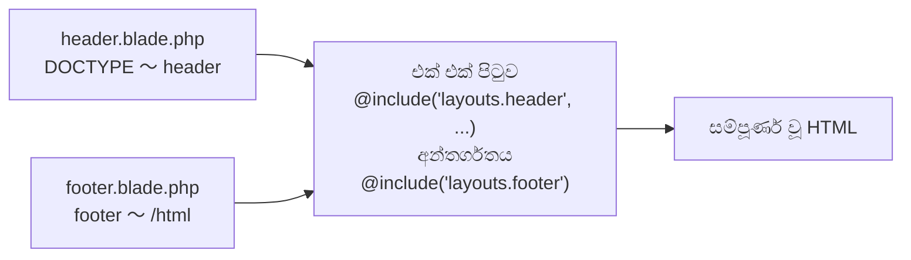

# Laravel හැඳින්වීම — පොදු කොටස් සංරචක (parts) බවට පත් කරමු（@include）

> 🇯🇵 මුල් පිටපත (ජපන් භාෂාවෙන්): [20261112_資料_1.md](<../../../1年生_データ設計とアプリ開発/後期/20261112/20261112_資料_1.md>) <!-- original-ja-link -->

ලැයිස්තුව, විස්තර, සංස්කරණය ලෙස දැන් පිටු 3ක් තිබෙනවා.
නමුත්, හැම file එකකම **එකම HTML** නැවත නැවත ලියා තිබෙනවා. අද අපි, එම පොදු කොටස **සංරචක file** වලට වෙන් කර, ඒවා load කරන ආකාරය ඉගෙන ගනිමු.

## අද දවසේ ඉලක්කය
- පොදු කොටස් සංරචක බවට පත් කිරීමෙන් ලැබෙන වාසි තේරුම් ගැනීම
- Header සහ footer, සංරචක file වලට වෙන් කර, `@include` මගින් load කිරීමට හැකි වීම
- `@include` වෙත අගයක් ලබා දී, එක් එක් පිටුවට අනුව title එක වෙනස් කිරීමට හැකි වීම
- සංරචකයේ එක තැනක් වෙනස් කළ විට, සියලු පිටු වෙනස් වන බව තහවුරු කර ගැනීමට හැකි වීම

> 11/5 හි "වලංගුකරණය (validation)" දක්වා අවසන් කළ තත්ත්වයේ සිට පටන් ගනිමු.

---

## 1. එකම HTML නැවත නැවත ලියනවා

දැනට ඇති view 3 එකිනෙක සසඳා බලමු.

```
index.blade.php（ලැයිස්තුව）    show.blade.php（විස්තර）        edit.blade.php（සංස්කරණය）
┌─────────────────────────┐   ┌─────────────────────────┐   ┌─────────────────────────┐
│ <!DOCTYPE html>         │   │ <!DOCTYPE html>         │   │ <!DOCTYPE html>         │
│ <html lang="ja">        │   │ <html lang="ja">        │   │ <html lang="ja">        │
│ <head>                  │   │ <head>                  │   │ <head>                  │
│   <meta charset=...>    │   │   <meta charset=...>    │   │   <meta charset=...>    │
│   <title>TODOアプリ     │   │   <title>TODOの詳細     │   │   <title>TODOの編集     │
│ </head>                 │   │ </head>                 │   │ </head>                 │
│ <body>                  │   │ <body>                  │   │ <body>                  │
│ ┌─────────────────────┐ │   │ ┌─────────────────────┐ │   │ ┌─────────────────────┐ │
│ │ ලැයිස්තුවේ අන්තර්ගතය  │ │   │ │ විස්තරවල අන්තර්ගතය    │ │   │ │ සංස්කරණයේ අන්තර්ගතය  │ │
│ └─────────────────────┘ │   │ └─────────────────────┘ │   │ └─────────────────────┘ │
│ </body>                 │   │ </body>                 │   │ </body>                 │
│ </html>                 │   │ </html>                 │   │ </html>                 │
└─────────────────────────┘   └─────────────────────────┘   └─────────────────────────┘
```

පිටුවෙන් පිටුවට වෙනස් වන්නේ **`<title>` සහ `<body>` තුළ ඇති දේ පමණයි**. ඉතිරි සියල්ල, තුනේම එක සමානයි.

එකම දේ නැවත නැවත ලිව්වොත්, මෙවැනි දේ සිදු වෙනවා.

```
A：「හැම පිටුවකම උඩින්『TODOアプリ』(TODO යෙදුම) වෙත link එකක් දාන්න ඕනේ. File 3ම වෙනස් කරන්න ඕනෙද…？」
B：「හැම පිටුවකම යටින් footer එකක් දැම්මා, ඒත් විස්තර පිටුවට විතරක් දාන්න අමතක වුණා」
C：「පිටු 10ක් වුණොත්, තැන් 10ක් වෙනස් කරන්න වෙනවා」
```

---

## 2. පොදු කොටස "සංරචක" බවට පත් කරන්න

ඒ නිසා, පොදු කොටස **උඩ භාගය** සහ **යට භාගය** ලෙස සංරචක file 2කට වෙන් කරනවා.
එක් එක් පිටුවේ කරන්නේ, මුලින් උඩ භාගයත්, අගින් යට භාගයත් **load කිරීම** පමණයි.

```
layouts/header.blade.php（උඩ භාගයේ සංරචකය）
┌─────────────────────────┐
│ <!DOCTYPE html>         │
│ <html> <head> … </head> │
│ <body>                  │
│ <header>…</header>      │ ← තිරයේ උඩින් පෙන්වන කොටස
└─────────────────────────┘
            ＋
todos/index.blade.php（එක් එක් පිටුව）
┌─────────────────────────┐
│ ලැයිස්තුවේ අන්තර්ගතය පමණයි │
└─────────────────────────┘
            ＋
layouts/footer.blade.php（යට භාගයේ සංරචකය）
┌─────────────────────────┐
│ <footer>…</footer>      │ ← තිරයේ යටින් පෙන්වන කොටස
│ </body>                 │
│ </html>                 │
└─────────────────────────┘
```

උපමාවක් ලෙස කිවොත්, මෙය **sandwich** එකක් වගේ.
උඩ පාන් පෙත්ත (header) සහ යට පාන් පෙත්ත (footer) හැම විටම එක සමානයි, මැදට දමන පිරවුම (එක් එක් පිටුවේ අන්තර්ගතය) පමණක් වෙනස් වෙනවා.

සංරචක load කිරීමට, Blade හි **`@include`** භාවිත කරනවා.

| ලියන ආකාරය | අර්ථය |
|--------|------|
| `@include('layouts.header')` | `resources/views/layouts/header.blade.php` හි අන්තර්ගතය, **මෙතැනටම එලෙසම ඇතුළත් කරයි** |
| `@include('layouts.header', ['title' => '一覧'])` | සංරචකය ඇතුළත් කරන විට, `$title` යන නමින් 「一覧」(ලැයිස්තුව) ලබා දෙයි |



> **`<head>` සහ `<header>` වෙනස් දේවල්**
> නම් සමාන වුණත්, කාර්යය වෙනස්.
>
> | Tag | කාර්යය | තිරයේ පෙනේද？ |
> |------|------|-------------|
> | `<head>` | පිටුවේ තොරතුරු (character encoding・tab එකේ title වැනි). Browser එක සඳහා වන දේ | නොපෙනේ |
> | `<header>` | පිටුවේ උඩින් පෙන්වන කොටස (යෙදුමේ නම・menu වැනි) | පෙනේ |
>
> අද සාදන `header.blade.php` තුළ, මේ **දෙකම** ඇතුළත් වෙනවා.

---

## 3. සාදා බලමු



වෙනස් කරන file 5 මෙන්න (`src` තුළ).

```
src/
└─ resources/views/
    ├─ layouts/
    │   ├─ header.blade.php ········· 1. Header සංරචකය (අලුතින් සාදයි)
    │   └─ footer.blade.php ········· 2. Footer සංරචකය (අලුතින් සාදයි)
    └─ todos/
        ├─ index.blade.php ·········· 3. සංරචක load කරන ලෙස වෙනස් කරයි
        ├─ show.blade.php ··········· 4. සංරචක load කරන ලෙස වෙනස් කරයි
        └─ edit.blade.php ··········· 5. සංරචක load කරන ලෙස වෙනස් කරයි
```

---

### 1. Header සංරචකය සාදන්න

> ඔබ දැන් සිටින්නේ: **🟢 1. Header** → 2. Footer → 3. ලැයිස්තුව → 4. විස්තර → 5. සංස්කරණය → 6. ක්‍රියාත්මක කරන්න

`resources/views` තුළ `layouts` folder එකක් සාදා, `header.blade.php` නමින් file එකක් සාදන්න.

```html
<!DOCTYPE html>
<html lang="ja">
<head>
    <meta charset="UTF-8">
    <title>{{ $title }} | TODOアプリ</title>
</head>
<body>
    <header>
        <a href="/todos">TODOアプリ</a>
    </header>
```

| Code | අර්ථය |
|--------|------|
| `{{ $title }}` | එක් එක් පිටුවෙන් ලබා දුන් title එක මෙහි ඇතුළත් වන අතර browser එකේ tab එකෙහි පෙන්වයි |
| `<header>` 〜 `</header>` | සියලු පිටුවල උඩින් පෙන්වන කොටස |

`</body>` සහ `</html>` මෙතැන ලියන්නේ නැහැ. ඒවා **footer සංරචකයේ** ලියනවා.

---

### 2. Footer සංරචකය සාදන්න

> ඔබ දැන් සිටින්නේ: 1. Header → **🟢 2. Footer** → 3. ලැයිස්තුව → 4. විස්තර → 5. සංස්කරණය → 6. ක්‍රියාත්මක කරන්න

එලෙසම `resources/views/layouts` තුළ, `footer.blade.php` සාදන්න.

```html
    <footer>
        <p>© 2026 TODOアプリ</p>
    </footer>
</body>
</html>
```

Header එකේ විවෘත කළ `<body>` සහ `<html>`, මෙතැනදී වසනවා.

---

### 3. ලැයිස්තු පිටුව වෙනස් කරන්න

> ඔබ දැන් සිටින්නේ: 1. Header → 2. Footer → **🟢 3. ලැයිස්තුව** → 4. විස්තර → 5. සංස්කරණය → 6. ක්‍රියාත්මක කරන්න

`resources/views/todos/index.blade.php`, පහත ආකාරයට වෙනස් කරන්න.

```html
@include('layouts.header', ['title' => '一覧'])

    <h1>TODOアプリ</h1>

    <form method="POST" action="/todos">
        @csrf
        <input type="text" name="title" value="{{ old('title') }}" placeholder="新しいTODOを入力" required>
        <button type="submit">追加</button>

        @error('title')
            <p style="color: red;">{{ $message }}</p>
        @enderror
    </form>

    <ul>
        @foreach ($todos as $todo)
            <li>
                <form method="POST" action="/todos/{{ $todo->id }}/toggle" style="display: inline;">
                    @csrf
                    @method('PATCH')
                    <input type="checkbox" name="is_done" value="1" onchange="this.form.submit()" @checked($todo->is_done)>
                </form>
                <a href="/todos/{{ $todo->id }}">{{ $todo->title }}</a>
            </li>
        @endforeach
    </ul>

@include('layouts.footer')
```

වෙනස් කිරීමට පෙර තිබූ ආකාරය සමඟ සසඳා බැලුවොත්, වෙනස්කම් මෙසේයි.

| | වෙනස් කිරීමට පෙර | වෙනස් කිරීමෙන් පසු |
|---|---|---|
| `<!DOCTYPE html>` 〜 `<body>` | ලියා තිබේ | `@include('layouts.header', ['title' => '一覧'])` යන එක පේළිය බවට පත් කරයි |
| `<body>` තුළ ඇති දේ | එලෙසම | එලෙසම |
| `</body>` `</html>` | ලියා තිබේ | `@include('layouts.footer')` යන එක පේළිය බවට පත් කරයි |

`['title' => '一覧']` යනු, controller එකේ `view('todos.index', ['todos' => $todos])` ලෙස ලියූ ආකාරයම යි.
සංරචකය තුළදී, `$title` යන නමින් 「一覧」(ලැයිස්තුව) භාවිත කළ හැකියි.

✅ **පරීක්ෂාව**：http://localhost:8000/todos open කර, ලැයිස්තුවට උඩින්「TODOアプリ」(TODO යෙදුම) link එකත්, යටින්「© 2026 TODOアプリ」ත් පෙන්වනවා නම් හරි.
Browser tab එකේ「一覧 | TODOアプリ」(ලැයිස්තුව | TODO යෙදුම) ලෙස පෙන්වන බවත් තහවුරු කර ගනිමු.

---

### 4. විස්තර පිටුව වෙනස් කරන්න

> ඔබ දැන් සිටින්නේ: 1. Header → 2. Footer → 3. ලැයිස්තුව → **🟢 4. විස්තර** → 5. සංස්කරණය → 6. ක්‍රියාත්මක කරන්න

`resources/views/todos/show.blade.php`, පහත ආකාරයට වෙනස් කරන්න.

```html
@include('layouts.header', ['title' => $todo->title])

    <h1>{{ $todo->title }}</h1>

    <p>番号：{{ $todo->id }}</p>

    <p>
        状態：
        @if ($todo->is_done)
            完了 ✅
        @else
            未完了
        @endif
    </p>

    <a href="/todos/{{ $todo->id }}/edit">編集</a>

    <form method="POST" action="/todos/{{ $todo->id }}" onsubmit="return confirm('削除しますか？');">
        @csrf
        @method('DELETE')
        <button type="submit">削除</button>
    </form>

    <a href="/todos">一覧にもどる</a>

@include('layouts.footer')
```

`['title' => $todo->title]` වගේ, **variable** එකක් වුණත් ලබා දිය හැකියි.
「牛乳を買う」(කිරි මිලදී ගැනීම) යන TODO එකේ විස්තර පිටුව නම්, tab එකේ「牛乳を買う | TODOアプリ」ලෙස පෙන්වනවා.

✅ **පරීක්ෂාව**：ලැයිස්තුවෙන් Todo එකක් click කර, විස්තර පිටුවේත් header සහ footer පෙන්වනවා නම් හරි.

---

### 5. සංස්කරණ පිටුව වෙනස් කරන්න

> ඔබ දැන් සිටින්නේ: 1. Header → 2. Footer → 3. ලැයිස්තුව → 4. විස්තර → **🟢 5. සංස්කරණය** → 6. ක්‍රියාත්මක කරන්න

`resources/views/todos/edit.blade.php`, පහත ආකාරයට වෙනස් කරන්න.

```html
@include('layouts.header', ['title' => '編集'])

    <h1>TODOの編集</h1>

    <form method="POST" action="/todos/{{ $todo->id }}">
        @csrf
        @method('PUT')
        <input type="text" name="title" value="{{ old('title', $todo->title) }}" required>
        <label>
            <input type="checkbox" name="is_done" value="1" @checked($todo->is_done)>
            完了
        </label>
        <button type="submit">保存</button>

        @error('title')
            <p style="color: red;">{{ $message }}</p>
        @enderror
    </form>

    <a href="/todos/{{ $todo->id }}">もどる</a>

@include('layouts.footer')
```

✅ **පරීක්ෂාව**：විස්තර පිටුවෙන්「編集」(සංස්කරණය) ඔබා, සංස්කරණ පිටුවේත් header සහ footer පෙන්වනවා නම් හරි.

---

### 6. ක්‍රියාත්මක කරන්න ✅：සංරචකයේ එක තැනක් වෙනස් කළොත්…？

> ඔබ දැන් සිටින්නේ: 1. Header → 2. Footer → 3. ලැයිස්තුව → 4. විස්තර → 5. සංස්කරණය → **🟢 6. ක්‍රියාත්මක කරන්න**

සංරචක බවට පත් කිරීමේ විශාලතම වාසිය මෙතැන් සිට පෙනෙනවා.
`layouts/header.blade.php` **පමණක්** open කර,「TODOアプリ」යන්න「わたしのTODO」(මගේ TODO) ලෙස වෙනස් කර බලමු.

```html
    <header>
        <a href="/todos">わたしのTODO</a>  {{-- ★ වෙනස් කිරීම --}}
    </header>
```

✅ **පරීක්ෂාව**：ලැයිස්තුව・විස්තර・සංස්කරණය යන **පිටු 3ම** නැවත open කර බලමු.
**හැම පිටුවකම** header එක「わたしのTODO」ලෙස වෙනස් වී ඇත්නම් සාර්ථකයි.



සංරචක බවට පත් නොකළා නම්, file 3ම වෙනස් කරන්න සිදු වෙනවා.
**වෙනස් කරන්නේ එක තැනක්, වෙනස් වන්නේ සියලු පිටු**. සංරචක බවට පත් කිරීමේ බලය මෙයයි.

---

## 4. හරියට වැඩ නොකරන විට

> **🔥 වැඩ කරන්නේ නැත්නම්, log එකක් පෙන්වන්න!** → [【වැදගත්】ලොග් (log) පෙන්වන ආකාරය](../20261022/【重要】ログの出し方.md)

| රෝග ලක්ෂණය | හේතුව ඇති තැන | විසඳුම |
|------|----------|------|
| `View [layouts.header] not found.` | සංරචකය | `resources/views/layouts/header.blade.php` හි ස්ථානය සහ file නම පරීක්ෂා කරන්න (`layouts` හි අගට `s` එකක් ඇත. `footer` ද එසේමයි) |
| `Undefined variable $title` | එක් එක් පිටුව | `@include('layouts.header', ['title' => ...])` හි `['title' => ...]` ලියන්න අමතක වී නැත්දැයි පරීක්ෂා කරන්න |
| Tab එකේ title එක වැරදියි | එක් එක් පිටුව | `['title' => ...]` හි `'title'` සහ සංරචකයේ `{{ $title }}` හි නම සමානදැයි පරීක්ෂා කරන්න |
| Footer එක පෙන්වන්නේ නැහැ | එක් එක් පිටුව | පිටුවේ අගට `@include('layouts.footer')` ලියා ඇත්දැයි පරීක්ෂා කරන්න |
| `<!DOCTYPE html>` දෙවරක් පෙන්වනවා | එක් එක් පිටුව | එක් එක් පිටුවේ `<!DOCTYPE html>` 〜 `<body>` ඉතිරිව නැත්දැයි පරීක්ෂා කරන්න (header සංරචකයේ ඇති නිසා මකා දමන්න) |

> **`@include` තිබිය යුත්තේ මුලින් සහ අගින් යන තැන් 2කයි**
> එක් එක් පිටුවේ, `@include('layouts.header', ...)` සහ `@include('layouts.footer')` යන **තැන් 2ම** අනිවාර්යයෙන්ම ලියන්න.
> Footer එක ලියන්න අමතක වුණොත්, `</body>` සහ `</html>` නැති HTML එකක් වෙනවා (browser එක පෙන්වුවත්, එය නිවැරදි HTML එකක් නොවේ).

---

## 5. සාරාංශය



| අද ලියූ දේ | කෙටියෙන් කිවොත් |
|--------------|-----------|
| `layouts/header.blade.php` | සියලු පිටුවල උඩ භාගය（`<!DOCTYPE html>` 〜 `<header>`） |
| `layouts/footer.blade.php` | සියලු පිටුවල යට භාගය（`<footer>` 〜 `</html>`） |
| `@include('layouts.header', ['title' => ...])` | උඩ භාගයේ සංරචකය load කර, title එක ලබා දෙයි |
| `@include('layouts.footer')` | යට භාගයේ සංරචකය load කරයි |

**පොදු කොටස් සංරචක බවට. වෙනස් කරන්නේ එක තැනක්, වෙනස් වන්නේ සියලු පිටු.**

> **වෙනත් ලියන ක්‍රමත් තිබෙනවා**
> Laravel හි, පිටුවේ සම්පූර්ණ "රාමුව" එක file එකක තබා භාවිත කරන `@extends`・`@section`・`@yield` මෙන්ම, `<x-layout>` ලෙස ලියන **component** නම් ක්‍රමයද තිබෙනවා.
> Internet එකේ දැක්කොත්, "එකම දේ වෙනත් ආකාරයකින් ලියා තිබෙනවා" කියා සිතන්න.

<!-- nav:start -->

---

| ⬅️ පෙර | 🗺️ සමස්ත සිතියම | ඊළඟ ➡️ |
|:--|:--:|--:|
| [11/05 වලංගුකරණය (validation)](../20261105/20261105_資料_2.md) | [පාඩම් ද්‍රව්‍යවල සමස්ත සිතියම](../../README.md) | [11/12 ප්‍රවර්ග (category) එකතු කරමු](20261112_資料_2.md) |

<!-- nav:end -->
