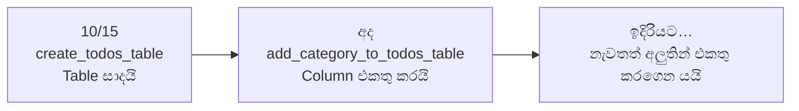
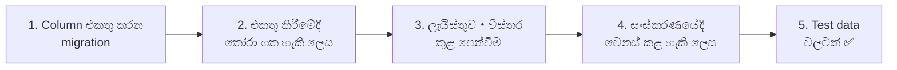
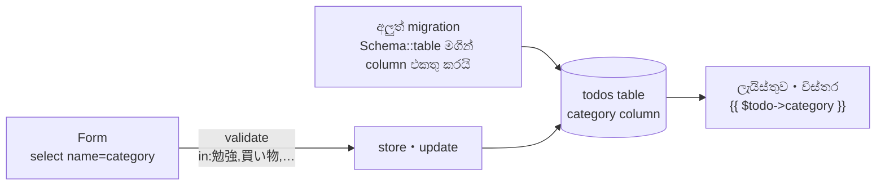

# Laravel හැඳින්වීම — Todo වලට ප්‍රවර්ග (category) එකතු කරමු（column එකතු කරන migration）

> 🇯🇵 මුල් පිටපත (ජපන් භාෂාවෙන්): [20261112_資料_2.md](<../../../1年生_データ設計とアプリ開発/後期/20261112/20261112_資料_2.md>) <!-- original-ja-link -->

Todo වැඩි වන විට, "මේක පාඩම් කිරීම සඳහායි", "මේක බඩු මිලදී ගැනීම සඳහායි" කියා **වර්ගීකරණය** කරන්න හිතෙනවා.
අද අපි, Todo වලට **ප්‍රවර්ගයක් (category)** එකතු කළ හැකි ලෙස සකසමු.

## අද දවසේ ඉලක්කය
- දැනටමත් ඇති table එකකට, **migration මගින් column එකක් එකතු කිරීමට** හැකි වීම
- Select box එකක් මගින්, කලින් තීරණය කළ විකල්ප අතරින් category එකක් තෝරා ගැනීමට හැකි වීම
- තෝරා ගත හැකි category හැර වෙනත් අගයක් එවා ඇත්දැයි validation (`in`) මගින් පරීක්ෂා කිරීමට හැකි වීම

> [පාඩම් ද්‍රව්‍ය 1](./20261112_資料_1.md) හි "පොදු කොටස් සංරචක (parts) බවට පත් කරමු" දක්වා අවසන් කළ තත්ත්වයේ සිට පටන් ගනිමු.

---

## 1. අද සාදන දේ

Category, පහත **4 අතරින් තෝරා ගන්නා** ලෙස තීරණය කරමු.

| Category |
|---------|
| 勉強 (පාඩම්) |
| 買い物 (සාප්පු යාම) |
| 家のこと (ගෙදර වැඩ) |
| その他 (වෙනත්) |

```
TODOアプリ

[ 新しいTODOを入力 ] [ 勉強 ▼ ] [追加]

☐ [勉強] レポートを書く
☑ [買い物] 牛乳を買う
☐ [家のこと] 部屋のそうじ
```

`todos` table එකට, `category` (ප්‍රවර්ගය) column එකක් එකතු කරනවා.

| id | title | **category** | is_done | created_at | updated_at |
|----|-------|-------------|---------|-----------|-----------|
| 1 | レポートを書く | **勉強** | 0 | … | … |
| 2 | 牛乳を買う | **買い物** | 1 | … | … |

---

## 2. අලුතින් ඉගෙන ගන්නා දේ: column එකතු කරන migration

10/15 දින, migration මගින් `todos` table එක **සෑදුවා**.
අද, දැනටමත් ඇති `todos` table එකට **column එකක් එකතු කරනවා**.

මෙතැනදී වැදගත් නීතියක් තිබෙනවා.

> **වරක් ක්‍රියාත්මක කළ migration එකක් වෙනස් කරන්න එපා. අලුත් migration එකක් එකතු කරන්න.**



10/15 හි migration එකට (`create_todos_table`) `category` එකතු කළත්, **එය දැනටමත් ක්‍රියාත්මක කර ඇති නිසා, `migrate` කළත් ක්‍රියාත්මක වෙන්නේ නැහැ**.
Migration යනු table එකේ **වෙනස්කම් පිළිබඳ වාර්තාව (දිනපොත)** යි. පරණ දිනපොත් සටහන් වෙනස් නොකර, අලුත් පිටුවක "අද column එකක් එකතු කළා" කියා ලියාගෙන යනවා.

| | Table සෑදීම (10/15) | Column එකතු කිරීම (අද) |
|---|---|---|
| File නම | `create_todos_table` | `add_category_to_todos_table` |
| අන්තර්ගතය | `Schema::create('todos', ...)` | `Schema::table('todos', ...)` |
| අර්ථය | අලුතින් table එකක් සාදයි | දැනටමත් ඇති table එකක් වෙනස් කරයි |

---

## 3. සාදා බලමු



වෙනස් කරන file මෙන්න (`src` තුළ).

```
src/
├─ database/
│   ├─ migrations/
│   │   └─ xxxx_add_category_to_todos_table.php ··· 1. අලුතින් සාදයි
│   ├─ seeders/TodoSeeder.php ····················· 5. Category එකතු කරයි
│   └─ factories/TodoFactory.php ·················· 5. Category එකතු කරයි
├─ resources/views/todos/
│   ├─ index.blade.php ···························· 2・3. Select box සහ පෙන්වීම
│   ├─ show.blade.php ····························· 3. පෙන්වීම
│   └─ edit.blade.php ····························· 4. Select box
└─ app/Http/Controllers/
    └─ TodoController.php ························· 2・4. store සහ update
```

---

### 1. Column එකතු කරන migration එක සාදන්න

> ඔබ දැන් සිටින්නේ: **🟢 1. Migration** → 2. එකතු කිරීම → 3. පෙන්වීම → 4. සංස්කරණය → 5. Test data

පහත command එකෙන් migration file එක සාදන්න.

```powershell
docker compose exec laravel php artisan make:migration add_category_to_todos_table
```

නම `add_〇〇_to_△△_table` ලෙස දැම්මොත්, Laravel "`△△` table එක වෙනස් කරනවා" කියා තේරුම් ගෙන, ආකෘතියක් (template) සාදා දෙනවා.

`database/migrations/` තුළ `2026_11_12_xxxxxx_add_category_to_todos_table.php` සෑදෙන නිසා, `up()` සහ `down()` තුළ පහත ආකාරයට ලියන්න.

```php
    public function up(): void
    {
        Schema::table('todos', function (Blueprint $table) {
            $table->string('category')->default('その他')->after('title');
        });
    }

    public function down(): void
    {
        Schema::table('todos', function (Blueprint $table) {
            $table->dropColumn('category');
        });
    }
```

| Code | අර්ථය |
|--------|------|
| `Schema::table('todos', ...)` | දැනටමත් ඇති `todos` table එක වෙනස් කරයි (සාදන විට `Schema::create`) |
| `$table->string('category')` | `category` නමින් අකුරු (string) column එකක් එකතු කරයි |
| `->default('その他')` | කිසිවක් ඇතුළත් නොකළ විට 「その他」(වෙනත්) ලෙස තබයි |
| `->after('title')` | `title` column එකට පසුව එකතු කරයි (phpMyAdmin හි බැලීමට පහසු වීමට) |
| `up()` | `migrate` කළ විට කරන දේ (column එක එකතු කරයි) |
| `down()` | ආපසු පෙර තත්ත්වයට ගෙන යන විට කරන දේ (column එක මකයි) |

> **`default('その他')` එකතු කරන්නේ ඇයි？**
> `todos` table එකේ දැනටමත් Todo කිහිපයක් තිබෙනවා.
> Column එකක් එකතු කළ විට, දැනට ඇති Todo වල `category` එකට මොනවා දාන්නද？ `default` තිබේ නම්, දැනට ඇති සියලු Todo 「その他」(වෙනත්) බවට පත් වෙනවා.

Save කළ පසු, migration එක ක්‍රියාත්මක කරන්න.

```powershell
docker compose exec laravel php artisan migrate
```

✅ **පරීක්ෂාව**：phpMyAdmin හි `todos` table එක open කර බලමු.
`title` එකට පසුව `category` column එක සෑදී, දැනට ඇති සියලු Todo 「その他」(වෙනත්) ලෙස තිබේ නම් හරි.
**දැනට ඇති Todo මැකී ගිහින් නැහැ**. `migrate` ක්‍රියාත්මක කරන්නේ තවම ක්‍රියාත්මක නොකළ migration (අද සෑදූ එක) පමණක් නිසයි.

| Command | කරන දේ | දැනට ඇති data |
|---------|---------|------------|
| `migrate` | තවම ක්‍රියාත්මක නොකළ migration පමණක් ක්‍රියාත්මක කරයි | **ඉතිරි වෙයි** |
| `migrate:fresh` | සියලු table මකා දමා, සියලු migration මුල සිට ක්‍රියාත්මක කරයි | මැකී යයි |

---

### 2. එකතු කිරීමේදී category තෝරා ගත හැකි ලෙස සකසන්න

> ඔබ දැන් සිටින්නේ: 1. Migration → **🟢 2. එකතු කිරීම** → 3. පෙන්වීම → 4. සංස්කරණය → 5. Test data

#### ① එකතු කිරීමේ form එකට select box එකක් එකතු කරන්න（V）

`resources/views/todos/index.blade.php` හි එකතු කිරීමේ form එකට, ★ සලකුණු කළ select box එක එකතු කරන්න.

```html
    <form method="POST" action="/todos">
        @csrf
        <input type="text" name="title" value="{{ old('title') }}" placeholder="新しいTODOを入力" required>

        {{-- ★ මෙතැන සිට එකතු කරන්න --}}
        <select name="category">
            <option value="勉強">勉強</option>
            <option value="買い物">買い物</option>
            <option value="家のこと">家のこと</option>
            <option value="その他">その他</option>
        </select>
        {{-- ★ මෙතැන දක්වා --}}

        <button type="submit">追加</button>

        @error('title')
            <p style="color: red;">{{ $message }}</p>
        @enderror
    </form>
```

| Code | අර්ථය |
|--------|------|
| `<select name="category">` | `category` යන නමින්, තෝරාගත් දේ යවයි |
| `<option value="勉強">勉強</option>` | විකල්පයක්. `value` හි අගය යවනු ලබයි |

#### ② store එකේදී category එකත් save කරන්න（C）

`app/Http/Controllers/TodoController.php` හි `store` එකට, ★ කොටස එකතු කරන්න.

```php
    public function store(Request $request)
    {
        $request->validate([
            'title' => 'required|max:255',
            'category' => 'required|in:勉強,買い物,家のこと,その他',  // ★ එකතු කිරීම
        ], [
            'title.required' => 'タイトルを入力してください。',
            'title.max' => 'タイトルは255文字以内で入力してください。',
            'category.required' => 'カテゴリを選んでください。',           // ★ එකතු කිරීම
            'category.in' => 'カテゴリは、リストの中から選んでください。',  // ★ එකතු කිරීම
        ]);

        $todo = new Todo();
        $todo->title = $request->input('title');
        $todo->category = $request->input('category');  // ★ එකතු කිරීම
        $todo->save();

        return redirect('/todos');
    }
```

| Code | අර්ථය |
|--------|------|
| `'category' => 'required\|in:勉強,買い物,家のこと,その他'` | `category` මේ 4 අතරින් **එකක්** විය යුතුයි, නැත්නම් අසමත් |
| `$todo->category = $request->input('category')` | තෝරාගත් category එක දමයි |

> **Select box එකක් වුණත්, `in` මගින් පරීක්ෂා කරන්නේ ඇයි？**
> Select box එකේ විකල්ප 4ක් පමණක් තිබුණත්, 11/5 ඉගෙන ගත් පරිදි, **browser පරීක්ෂාව මඟ හැරිය හැකියි**.
> Developer tools මගින් `<option value="勉強">` යන්න `<option value="ゲーム">` ලෙස වෙනස් කර යැවීමටත් පුළුවන්.
> Server පැත්තේ `in` මගින්, කලින් තීරණය කළ 4 හැර අනෙක් සියල්ල ප්‍රතික්ෂේප කරනවා.

---

### 3. ලැයිස්තුවේ සහ විස්තර පිටුවේ category පෙන්වන්න

> ඔබ දැන් සිටින්නේ: 1. Migration → 2. එකතු කිරීම → **🟢 3. පෙන්වීම** → 4. සංස්කරණය → 5. Test data

#### ① ලැයිස්තුව（V）

`index.blade.php` හි `<li>` තුළට, ★ කොටස එකතු කරන්න.

```html
            <li>
                <form method="POST" action="/todos/{{ $todo->id }}/toggle" style="display: inline;">
                    @csrf
                    @method('PATCH')
                    <input type="checkbox" name="is_done" value="1" onchange="this.form.submit()" @checked($todo->is_done)>
                </form>
                [{{ $todo->category }}]  {{-- ★ එකතු කිරීම --}}
                <a href="/todos/{{ $todo->id }}">{{ $todo->title }}</a>
            </li>
```

#### ② විස්තර（V）

`show.blade.php` හි「番号」(අංකය) යටින්, ★ සලකුණු කළ පේළිය එකතු කරන්න.

```html
    <p>番号：{{ $todo->id }}</p>

    <p>カテゴリ：{{ $todo->category }}</p>  {{-- ★ එකතු කිරීම --}}
```

✅ **පරීක්ෂාව**：ලැයිස්තුවේ category එකක් තෝරා Todo එකක් එකතු කර බලමු.
ලැයිස්තුවේ `[勉強] レポートを書く` වගේ පෙන්වා, විස්තර පිටුවේත්「カテゴリ：勉強」(Category: පාඩම්) ලෙස පෙන්වනවා නම් හරි.

---

### 4. සංස්කරණයේදී category වෙනස් කළ හැකි ලෙස සකසන්න

> ඔබ දැන් සිටින්නේ: 1. Migration → 2. එකතු කිරීම → 3. පෙන්වීම → **🟢 4. සංස්කරණය** → 5. Test data

#### ① සංස්කරණ form එකට select box එකක් එකතු කරන්න（V）

`edit.blade.php` හි form එකට, ★ සලකුණු කළ select box එක එකතු කරන්න.

```html
    <form method="POST" action="/todos/{{ $todo->id }}">
        @csrf
        @method('PUT')
        <input type="text" name="title" value="{{ old('title', $todo->title) }}" required>

        {{-- ★ මෙතැන සිට එකතු කරන්න --}}
        <select name="category">
            <option value="勉強" @selected($todo->category === '勉強')>勉強</option>
            <option value="買い物" @selected($todo->category === '買い物')>買い物</option>
            <option value="家のこと" @selected($todo->category === '家のこと')>家のこと</option>
            <option value="その他" @selected($todo->category === 'その他')>その他</option>
        </select>
        {{-- ★ මෙතැන දක්වා --}}

        <label>
            <input type="checkbox" name="is_done" value="1" @checked($todo->is_done)>
            完了
        </label>
        <button type="submit">保存</button>

        @error('title')
            <p style="color: red;">{{ $message }}</p>
        @enderror
    </form>
```

| Code | අර්ථය |
|--------|------|
| `@selected($todo->category === '勉強')` | දැනට ඇති category එක 「勉強」(පාඩම්) නම්, මුල සිටම මෙම විකල්පය තෝරා තබයි |

`@selected` යනු checkbox එකේ `@checked` හි select box අනුවාදය යි.
`( )` තුළ ඇති දේ `true` වූ විට පමණක්, `<option>` එකට `selected` එකතු කරයි.

#### ② update එකේදී category එකත් save කරන්න（C）

`TodoController.php` හි `update` එකට, `store` එකේ වගේම ★ කොටස එකතු කරන්න.

```php
    public function update(Request $request, $id)
    {
        $request->validate([
            'title' => 'required|max:255',
            'category' => 'required|in:勉強,買い物,家のこと,その他',  // ★ එකතු කිරීම
        ], [
            'title.required' => 'タイトルを入力してください。',
            'title.max' => 'タイトルは255文字以内で入力してください。',
            'category.required' => 'カテゴリを選んでください。',           // ★ එකතු කිරීම
            'category.in' => 'カテゴリは、リストの中から選んでください。',  // ★ එකතු කිරීම
        ]);

        $todo = Todo::findOrFail($id);
        $todo->title = $request->input('title');
        $todo->category = $request->input('category');  // ★ එකතු කිරීම
        $todo->is_done = $request->has('is_done');
        $todo->save();

        return redirect('/todos/' . $todo->id);
    }
```

✅ **පරීක්ෂාව**：සංස්කරණ පිටුව open කළ විට, දැනට ඇති category එක මුල සිටම තෝරා ඇත්දැයි බලමු.
Category එක වෙනස් කර `保存` (save කරන්න) ඔබා, විස්තර පිටුවේ category එක වෙනස් වුණොත් හරි.

---

### 5. Test data වලටත් category ඇතුළත් කරන්න

> ඔබ දැන් සිටින්නේ: 1. Migration → 2. එකතු කිරීම → 3. පෙන්වීම → 4. සංස්කරණය → **🟢 5. Test data**

11/5 සෑදූ Seeder සහ Factory වලටත්, category එකතු කර තබමු.

#### ① TodoSeeder（කලින් තීරණය කළ data）

`database/seeders/TodoSeeder.php` හි array එකට සහ `foreach` එකට, ★ කොටස එකතු කරන්න.

```php
        $todos = [
            ['title' => '牛乳を買う',     'category' => '買い物', 'is_done' => false],  // ★ category එකතු කිරීම
            ['title' => 'レポートを出す', 'category' => '勉強',   'is_done' => true],   // ★
            ['title' => '宿題をする',     'category' => '勉強',   'is_done' => false],  // ★
        ];

        foreach ($todos as $data) {
            $todo = new Todo();
            $todo->title = $data['title'];
            $todo->category = $data['category'];  // ★ එකතු කිරීම
            $todo->is_done = $data['is_done'];
            $todo->save();
        }
```

#### ② TodoFactory（ස්වයංක්‍රීයව සාදන data）

`database/factories/TodoFactory.php` හි `definition()` එකට, ★ සලකුණු කළ පේළිය එකතු කරන්න.

```php
        return [
            'title' => fake()->randomElement([
                '牛乳を買う',
                'レポートを出す',
                '宿題をする',
                '部屋のそうじ',
                '本を返す',
                'ゴミを出す',
            ]),
            'category' => fake()->randomElement(['勉強', '買い物', '家のこと', 'その他']),  // ★ එකතු කිරීම
            'is_done' => fake()->boolean(),
        ];
```

```powershell
docker compose exec laravel php artisan migrate:fresh --seed
```

✅ **පරීක්ෂාව**：ලැයිස්තුව විවෘත කර, Todo 23ටම වෙන වෙනම category එකක් තිබේ නම් හරි.
`migrate:fresh` සියලු migration මුල සිට ක්‍රියාත්මක කරන නිසා, **අද සෑදූ migration එකත් එක්කම** ක්‍රියාත්මක වෙනවා.

---

## 4. හරියට වැඩ නොකරන විට

> **🔥 වැඩ කරන්නේ නැත්නම්, log එකක් පෙන්වන්න!** → [【වැදගත්】ලොග් (log) පෙන්වන ආකාරය](../20261022/【重要】ログの出し方.md)

| රෝග ලක්ෂණය | හේතුව ඇති තැන | විසඳුම |
|------|----------|------|
| `Unknown column 'category'` | Migration | `php artisan migrate` ක්‍රියාත්මක කළාදැයි පරීක්ෂා කරන්න |
| `migrate` කළත්, `category` column එක සෑදෙන්නේ නැහැ | Migration | 10/15 හි migration එකට එකතු කළේ නැත්දැයි පරීක්ෂා කරන්න (**අලුත් migration එකක** ලියන්න) |
| 「カテゴリは、リストの中から選んでください。」(Category එක ලැයිස්තුවෙන් තෝරන්න.) පෙන්වනවා | View・Controller | `<option value="...">` සහ `in:...` හි category නම් **එක අකුරක්වත් වෙනස් නොවී** සමානදැයි පරීක්ෂා කරන්න |
| එකතු කළත්, සියලු category 「その他」(වෙනත්) වෙනවා | Controller | `store` හි `$todo->category = $request->input('category');` තිබේදැයි පරීක්ෂා කරන්න |
| සංස්කරණ පිටුවේ, දැනට ඇති category එක තෝරා නැහැ | View | `@selected($todo->category === '...')` ලියා ඇත්ද, category නම පරීක්ෂා කරන්න |

---

## 5. සාරාංශය



| අද ලියූ දේ | කෙටියෙන් කිවොත් |
|--------------|-----------|
| `make:migration add_category_to_todos_table` | දැනටමත් ඇති table එකකට column එකක් එකතු කරන migration එකක් සාදයි |
| `Schema::table(...)` සහ `->default(...)` | Column එකක් එකතු කරයි. දැනට ඇති data වලට `default` අගය වැටෙයි |
| `php artisan migrate` | තවම ක්‍රියාත්මක නොකළ migration පමණක් ක්‍රියාත්මක කරයි (data ඉතිරි වෙයි) |
| `<select>` සහ `<option>` | කලින් තීරණය කළ විකල්ප අතරින් තෝරයි |
| `@selected(...)` | දැනට ඇති අගය මුල සිටම තෝරා තබයි (`@checked` හි select box අනුවාදය) |
| `'in:勉強,買い物,…'` | කලින් තීරණය කළ අගයන් හැර අනෙක් ඒවා server පැත්තේදී ප්‍රතික්ෂේප කරයි |

**වරක් ක්‍රියාත්මක කළ migration එකක් වෙනස් කරන්න එපා. වෙනස්කම්, අලුත් migration මගින් එකතු කරගෙන යන්න.**

---

## 6. තවත් උත්සාහ කරමු (කාලය ඉතිරි වූ අය සඳහා)

Category වලට 「部活」(club ක්‍රියාකාරකම්) එකතු කර බලමු.
කුමන file වෙනස් කළ යුතුදැයි, ඔබම සිතා බලන්න.

<details>
<summary>ඉඟිය</summary>

「部活」පහත **තැන් 4ට** එකතු කරන්න.

1. `index.blade.php` හි එකතු කිරීමේ form එකේ `<option>`
2. `edit.blade.php` හි සංස්කරණ form එකේ `<option>`（`@selected` ද）
3. `TodoController.php` හි `store` එකේ `in:...`
4. `TodoController.php` හි `update` එකේ `in:...`

（Factory එකෙනුත්「部活」එන්න ඕනේ නම්, `TodoFactory.php` හි `randomElement` එකටත් එකතු කරන්න）

එකම category ලැයිස්තුව **තැන් 4ක ලියා ඇති බව** ඔබ දුටුවාද？
එක තැනකට එකතු කරන්න අමතක වුණොත්, "තෝරන්න පුළුවන්, ඒත් save කරන්න බැහැ" වැනි bug එකක් ඇති වෙනවා. මෙවැනි තැන්වලත්, පාඩම් ද්‍රව්‍ය 1 හි කළා වගේ **පොදු කොටසක් ලෙස භාවිතා කළ හැකි ලෙස සකස් කිරීම** වඩා හොඳයි.

</details>

<!-- nav:start -->

---

| ⬅️ පෙර | 🗺️ සමස්ත සිතියම | ඊළඟ ➡️ |
|:--|:--:|--:|
| [11/12 පොදු කොටස් සංරචක (parts) බවට පත් කිරීම（@include）](20261112_資料_1.md) | [පාඩම් ද්‍රව්‍යවල සමස්ත සිතියම](../../README.md) | [11/19 ශිෂ්‍ය කළමනාකරණය ① ලැයිස්තුව, විස්තර](../20261119/20261119_資料_1.md) |

<!-- nav:end -->
