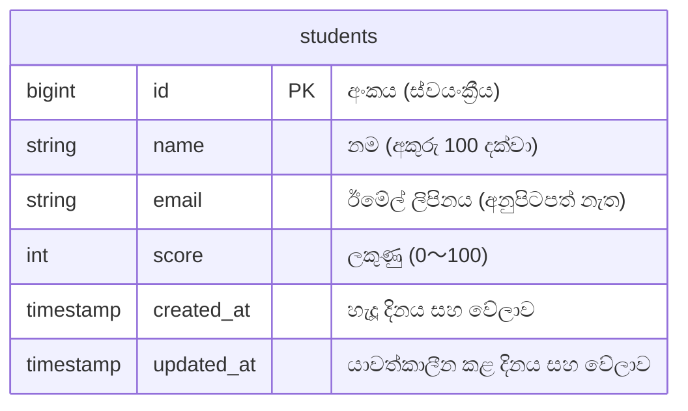
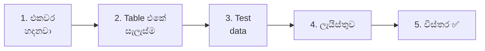
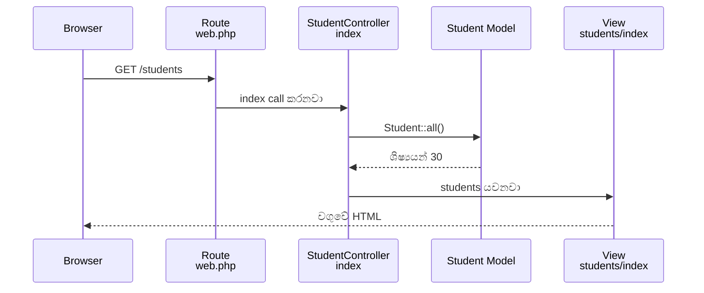

# ශිෂ්‍ය කළමනාකරණ යෙදුමක් හදමු ① — සූදානම සහ ලැයිස්තුව, විස්තර

> 🇯🇵 මුල් පිටපත (ජපන් භාෂාවෙන්): [20261119_資料_1.md](<../../../1年生_データ設計とアプリ開発/後期/20261119/20261119_資料_1.md>) <!-- original-ja-link -->

අද ඉඳන් අපි අලුත් **ශිෂ්‍ය කළමනාකරණ යෙදුමක්** හදනවා.
Todo යෙදුමෙන් ඉගෙනගත්ත දේවල් පාවිච්චි කරලා, මේ පාර **ඔයාගේම හැකියාවෙන්** හදාගෙන යමු.

## අද ඉලක්කය
- `make:model -mf` එකෙන් Model, Migration, Factory එකවර හදන්න පුළුවන් වීම
- ශිෂ්‍යයන්ගේ table එක හදලා, test data දාන්න පුළුවන් වීම
- ශිෂ්‍යයන්ගේ ලැයිස්තු පිටුව සහ විස්තර පිටුව හදන්න පුළුවන් වීම

> පුහුණු පරිසරයේ (`php-study`) mysql සහ laravel start කරලා පටන් ගන්නවා.
> Todo යෙදුම තියෙන **ඒ project එකටම (`src`)** ශිෂ්‍ය කළමනාකරණ යෙදුම එකතු කරගෙන යනවා.

---

## 1. ශිෂ්‍ය කළමනාකරණ යෙදුම කියන්නේ මොකක්ද?

ගුරුවරයෙක්ට ශිෂ්‍යයන්ගේ **නම, ඊමේල් ලිපිනය, ලකුණු** කළමනාකරණය කරන්න පුළුවන් යෙදුමක්.

```
生徒管理アプリ

[ 生徒を追加 ]

| 名前       | 点数 |
|------------|------|
| 山田 太郎  |  85  |
| 佐藤 花子  |  92  |
| 鈴木 一郎  |  70  |
```

මේ යෙදුම ඉදිරි පාඩම් 3කදී ටිකෙන් ටික දියුණු කරගෙන යනවා.

| වාරය | හදන දේ |
|----|---------|
| **1 වෙනි වාරය (අද)** | ශිෂ්‍යයන්ගේ ලැයිස්තුව, විස්තර, එකතු කිරීම, සංස්කරණය, මකා දැමීම (CRUD) |
| 2 වෙනි වාරය | Login (ගුරුවරුන්ට විතරක් පාවිච්චි කරන්න පුළුවන් විදිහට හදනවා) |
| 3 වෙනි වාරය | Relation (ශිෂ්‍යයාව register කළේ කවර ගුරුවරයාද කියලා සටහන් කරනවා) |

> **2 වසරට සම්බන්ධ වෙන යෙදුමක්**
> 2 වසරේදී මේ යෙදුම **API** එකක් (තිරයක් වෙනුවට data පමණක් ආපසු ලබා දෙන ක්‍රමයක්) විදිහට නැවත හදනවා.
> අද හදන table එකයි URL ටිකයි 2 වසරේදීත් ඒ විදිහටම පාවිච්චි කරනවා.

### Todo යෙදුමත් එක්ක සංසන්දනය කරලා බලමු

හදන විදිහ Todo යෙදුමට ගොඩක්ම සමානයි.

| | Todo යෙදුම | ශිෂ්‍ය කළමනාකරණ යෙදුම |
|---|---|---|
| Table | `todos` | `students` |
| Model | `Todo` | `Student` |
| Controller | `TodoController` | `StudentController` |
| URL | `/todos` | `/students` |
| View folder එක | `resources/views/todos/` | `resources/views/students/` |

### ශිෂ්‍යයන්ගේ table එක



Todo table එකට වඩා වෙනස් වෙන්නේ මෙන්න මේ තැන්.

| Column | අලුත් දේ |
|----|------------|
| `email` | **එකම ඊමේල් ලිපිනයෙන් ශිෂ්‍යයන් දෙන්නෙක් register කරන්න බැහැ** (අනුපිටපත් නැත) |
| `score` | අකුරු නෙවෙයි, **පූර්ණ සංඛ්‍යාවක්** (`integer`) දානවා |

---

## 2. හදලා බලමු



### 1. Model, Migration, Factory එකවර හදනවා

> දැන් ඉන්නේ මෙතන: **🟢 1. එකවර හදනවා** → 2. සැලැස්ම → 3. Test data → 4. ලැයිස්තුව → 5. විස්තර

Todo වෙලාවේදී Migration, Model, Factory එකින් එක හැදුවා.
මේ පාර **එක command එකකින් එකවර** හදනවා.

```powershell
docker compose exec laravel php artisan make:model Student -mf
```

| කොටස | තේරුම |
|------|------|
| `make:model Student` | `Student` Model එක හදනවා |
| `-m` | Migration එකත් එක්කම හදනවා (**m**igration) |
| `-f` | Factory එකත් එක්කම හදනවා (**f**actory) |

මේ files 3 හැදෙනවා.

```
src/
├─ app/Models/Student.php ··································· Model
├─ database/migrations/xxxx_create_students_table.php ······· Migration
└─ database/factories/StudentFactory.php ···················· Factory
```

`-f` දැම්ම නිසා Model එකේ මුල ඉඳන්ම `HasFactory` තියෙනවා (Todo වෙලාවේදී අපි ඒක අතින් ලිව්වා).

```php
class Student extends Model
{
    /** @use HasFactory<\Database\Factories\StudentFactory> */
    use HasFactory;
}
```

---

### 2. Table එකේ සැලැස්ම ලියනවා (Migration)

> දැන් ඉන්නේ මෙතන: 1. එකවර හදනවා → **🟢 2. සැලැස්ම** → 3. Test data → 4. ලැයිස්තුව → 5. විස්තර

`database/migrations/xxxx_create_students_table.php` open කරලා, `up()` ඇතුළත මෙහෙම ලියන්න.

```php
    public function up(): void
    {
        Schema::create('students', function (Blueprint $table) {
            $table->id();
            $table->string('name', 100);
            $table->string('email')->unique();
            $table->integer('score')->default(0);
            $table->timestamps();
        });
    }
```

| Code | තේරුම |
|--------|------|
| `$table->string('name', 100)` | නම. අකුරු 100 දක්වා |
| `$table->string('email')->unique()` | ඊමේල් ලිපිනය. **එකම අගය දෙපාරක් දාන්න බැහැ** |
| `$table->integer('score')->default(0)` | ලකුණු. පූර්ණ සංඛ්‍යාවක්, මුකුත් දැම්මේ නැත්නම් 0 |

👀 **Run කරන්න කලින් බලන්න**: phpMyAdmin (http://localhost:8080) එකේ `laravel` database එකේ `students` table එක **තවම නැති** බව තහවුරු කරගන්න.
සැලැස්ම ලිව්වා කියලා විතරක් table එක තවම හැදෙන්නේ නැහැ.

```powershell
docker compose exec laravel php artisan migrate
```

✅ **පරීක්ෂා කරන්න**: phpMyAdmin එකේ `students` table එක හැදිලා තියෙනවා නම් OK.

---

### 3. Test data දානවා (Factory, Seeder)

> දැන් ඉන්නේ මෙතන: 1. එකවර හදනවා → 2. සැලැස්ම → **🟢 3. Test data** → 4. ලැයිස්තුව → 5. විස්තර

#### ① Factory එකේ ශිෂ්‍යයෙක් හදන විදිහ ලියනවා

`database/factories/StudentFactory.php` එකේ `definition()` ඇතුළත මෙහෙම ලියන්න.

```php
    public function definition(): array
    {
        return [
            'name' => fake('ja_JP')->name(),
            'email' => fake()->unique()->safeEmail(),
            'score' => fake()->numberBetween(0, 100),
        ];
    }
```

| Code | තේරුම |
|--------|------|
| `fake('ja_JP')->name()` | **ජපන් නමක්** අහඹු ලෙස හදනවා (උදා: 山田 太郎) |
| `fake()->unique()->safeEmail()` | ඊමේල් ලිපිනයක් අහඹු ලෙස හදනවා. `unique()` නිසා එකම එක දෙපාරක් එන්නේ නැහැ |
| `fake()->numberBetween(0, 100)` | 0〜100 අතර පූර්ණ සංඛ්‍යාවක් අහඹු ලෙස හදනවා |

> ඇත්ත ශිෂ්‍යයන්ගේ නම් හෝ ඊමේල් ලිපින පුහුණුවට පාවිච්චි කරන්නේ නැහැ. Factory එකෙන් **කල්පිත data** හදනවා.

#### ② Seeder එකක් හදලා ශිෂ්‍යයන් 30ක් දානවා

```powershell
docker compose exec laravel php artisan make:seeder StudentSeeder
```

`database/seeders/StudentSeeder.php` එකේ `run()` ඇතුළත මෙහෙම ලියන්න.

```php
<?php

namespace Database\Seeders;

use App\Models\Student;
use Illuminate\Database\Seeder;

class StudentSeeder extends Seeder
{
    public function run(): void
    {
        Student::factory()->count(30)->create();
    }
}
```

`database/seeders/DatabaseSeeder.php` එකට ★ තියෙන පේළිය එකතු කරන්න.

```php
    public function run(): void
    {
        $this->call(TodoSeeder::class);
        $this->call(StudentSeeder::class);  // ★ එකතු කළා
    }
```

```powershell
docker compose exec laravel php artisan migrate:fresh --seed
```

✅ **පරීක්ෂා කරන්න**: phpMyAdmin එකේ `students` table එක open කරලා, ශිෂ්‍යයන් 30ක් ඉන්නවා නම් OK.
(`migrate:fresh` නිසා Todo data ත් මුල් තත්ත්වයට එනවා)

---

### 4. ලැයිස්තු පිටුව හදනවා

> දැන් ඉන්නේ මෙතන: 1. එකවර හදනවා → 2. සැලැස්ම → 3. Test data → **🟢 4. ලැයිස්තුව** → 5. විස්තර

#### ① Controller එක හදනවා

```powershell
docker compose exec laravel php artisan make:controller StudentController
```

`app/Http/Controllers/StudentController.php` මෙහෙම ලියන්න.

```php
<?php

namespace App\Http\Controllers;

use App\Models\Student;
use Illuminate\Http\Request;

class StudentController extends Controller
{
    public function index()
    {
        $students = Student::all();

        return view('students.index', ['students' => $students]);
    }
}
```

`TodoController` එකේ `index` එකේ `Todo` කියන එක `Student` වුණා විතරයි.

#### ② Route එක ලියනවා

`routes/web.php` එකට ★ තියෙන පේළි 2 එකතු කරන්න.

```php
use App\Http\Controllers\StudentController;  // ★ එකතු කළා (උඩ කොටසේ ලියන්න)

// (Todo routes මෙතන පෙන්වලා නැහැ)

Route::get('/students', [StudentController::class, 'index']);  // ★ එකතු කළා
```

#### ③ View එක හදනවා

`resources/views` ඇතුළේ `students` folder එකක් හදලා, `index.blade.php` හදන්න.
11/12 දින හදපු **header, footer කොටස්** මෙතනත් පාවිච්චි කරනවා.

```html
@include('layouts.header', ['title' => '生徒一覧'])

    <h1>生徒一覧</h1>

    <table border="1">
        <tr>
            <th>名前</th>
            <th>点数</th>
        </tr>
        @foreach ($students as $student)
            <tr>
                <td><a href="/students/{{ $student->id }}">{{ $student->name }}</a></td>
                <td>{{ $student->score }}</td>
            </tr>
        @endforeach
    </table>

@include('layouts.footer')
```

| Code | තේරුම |
|--------|------|
| `<table>` | වගුවක් හදනවා. `<tr>` එක පේළියක්, `<th>` ශීර්ෂයක්, `<td>` කොටුවක් |
| `border="1"` | වගුවට රාමු ඉරි දානවා |

#### ④ Header එකට 「生徒管理」 (ශිෂ්‍ය කළමනාකරණය) link එක එකතු කරනවා

`resources/views/layouts/header.blade.php` එකට ★ තියෙන link එක එකතු කරන්න.

```html
    <header>
        <a href="/todos">TODOアプリ</a>
        <a href="/students">生徒管理</a>  {{-- ★ එකතු කළා --}}
    </header>
```

**කොටස එක තැනක විතරක් වෙනස් කළාම, Todo පිටුවලත් ශිෂ්‍ය පිටුවලත් link එක පේනවා** (මේ 11/12 දින ඉගෙනගත්ත පොදු කොටස් හැදීමේ බලය).

`/students` open කරලා ලැයිස්තුව පේන්න එනකම් වෙන දේවල්වල අනුපිළිවෙළ Todo වෙලාවේදී වගේමයි.



✅ **පරීක්ෂා කරන්න**: http://localhost:8000/students open කරලා, ශිෂ්‍යයන් 30 වගුවක පේනවා නම් OK.

---

### 5. විස්තර පිටුව හදනවා

> දැන් ඉන්නේ මෙතන: 1. එකවර හදනවා → 2. සැලැස්ම → 3. Test data → 4. ලැයිස්තුව → **🟢 5. විස්තර**

#### ① Controller එකට show එකතු කරනවා

`StudentController.php` එකට ★ තියෙන `show` එකතු කරන්න.

```php
    // ★ මෙතන ඉඳන් එකතු කරන්න
    public function show($id)
    {
        $student = Student::findOrFail($id);

        return view('students.show', ['student' => $student]);
    }
    // ★ මෙතනින් ඉවරයි
```

#### ② Route එක එකතු කරනවා

```php
Route::get('/students', [StudentController::class, 'index']);
Route::get('/students/{id}', [StudentController::class, 'show']);  // ★ එකතු කළා
```

#### ③ View එක හදනවා

`resources/views/students/show.blade.php` හදන්න.

```html
@include('layouts.header', ['title' => $student->name])

    <h1>{{ $student->name }}</h1>

    <p>番号：{{ $student->id }}</p>
    <p>メールアドレス：{{ $student->email }}</p>
    <p>点数：{{ $student->score }}点</p>

    <a href="/students">一覧にもどる</a>

@include('layouts.footer')
```

✅ **පරීක්ෂා කරන්න**: ලැයිස්තුවේ ශිෂ්‍යයෙක්ගේ නම click කළාම විස්තර පිටුව පේනවා නම් OK.
http://localhost:8000/students/999 වගේ, නැති ශිෂ්‍යයෙක්ගේ URL එකක් open කළාම `404 Not Found` එන බවත් තහවුරු කරගමු.

---

## 3. හරියට වැඩ නොකරන විට

> **🔥 වැඩ කරන්නේ නැත්නම්, log එක පෙන්වන්න!** → [【වැදගත්】ලොග් (log) පෙන්වන ආකාරය](../20261022/【重要】ログの出し方.md)

| ගැටලුව | හේතුව තියෙන තැන | විසඳුම |
|------|----------|------|
| `Table 'laravel.students' doesn't exist` | Migration | `php artisan migrate` (නැත්නම් `migrate:fresh --seed`) run කළාද බලන්න |
| `Call to undefined method App\Models\Student::factory()` | Model | `make:model` එකට `-f` දාන්න අමතක වුණා. `Student.php` එකට `use HasFactory;` එකතු කරන්න |
| නම ඉංග්‍රීසියෙන් (උදා: John Smith) එනවා | Factory | `fake('ja_JP')->name()` එකේ `'ja_JP'` ලිව්වාද බලන්න |
| `Target class [StudentController] does not exist.` | Route | `web.php` එකේ උඩ `use App\Http\Controllers\StudentController;` තියෙනවාද බලන්න |
| `View [students.index] not found.` | View | `resources/views/students/index.blade.php` තියෙන තැන බලන්න (`students` අගට `s` එනවා) |
| `Undefined variable $title` | View | `@include('layouts.header', ['title' => ...])` එකේ `['title' => ...]` ලියන්න අමතක වුණාද බලන්න |

---

## 4. සාරාංශය

| අද ලියපු දේ | කෙටියෙන් කිව්වොත් |
|--------------|-----------|
| `make:model Student -mf` | Model, Migration, Factory එකවර හදනවා |
| `->unique()` (Migration) | එකම අගය දෙපාරක් දාන්න බැරි column එකක් කරනවා |
| `$table->integer(...)` | පූර්ණ සංඛ්‍යා column එකක් |
| `fake('ja_JP')->name()` | ජපන් නම් අහඹු ලෙස හදනවා |
| `index` සහ `show` | Todo යෙදුමේ වගේම ලැයිස්තුව සහ විස්තර පිටුව හදනවා |
| `<table>` | ලැයිස්තුව වගුවකින් පෙන්වනවා |

**හදන විදිහ Todo වගේමයි. නම `Todo` ඉඳන් `Student` වලට මාරු කරලා හිතුවොත්, ඔයාටම හදන්න පුළුවන්.**

ඊළඟට, ශිෂ්‍යයන් එකතු කරන්න, සංස්කරණය කරන්න, මකන්න පුළුවන් කරනවා → [ශිෂ්‍ය කළමනාකරණ යෙදුමක් හදමු ② — එකතු කිරීම, සංස්කරණය, මකා දැමීම](./20261119_資料_2.md)

<!-- nav:start -->

---

| ⬅️ පෙර | 🗺️ සමස්ත සිතියම | ඊළඟ ➡️ |
|:--|:--:|--:|
| [11/12 ප්‍රවර්ග (category) එකතු කරමු](../20261112/20261112_資料_2.md) | [පාඩම් ද්‍රව්‍යවල සමස්ත සිතියම](../../README.md) | [11/19 ශිෂ්‍ය කළමනාකරණය ② එකතු කිරීම, සංස්කරණය, මකා දැමීම](20261119_資料_2.md) |

<!-- nav:end -->
