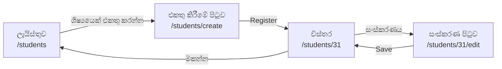
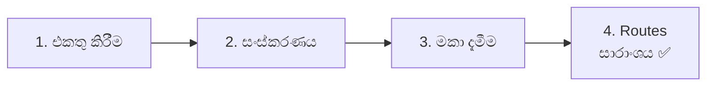
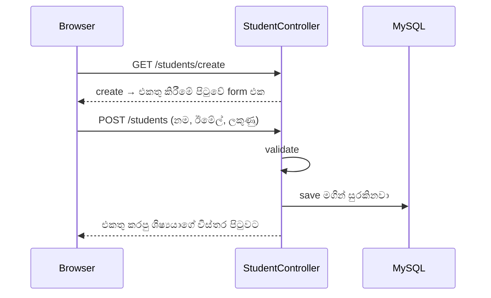
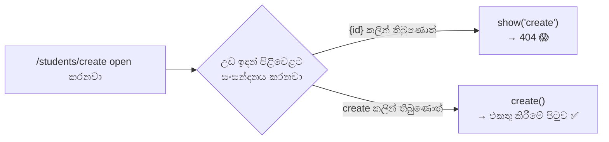
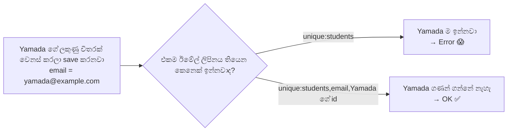

# ශිෂ්‍ය කළමනාකරණ යෙදුමක් හදමු ② — එකතු කිරීම, සංස්කරණය, මකා දැමීම

> 🇯🇵 මුල් පිටපත (ජපන් භාෂාවෙන්): [20261119_資料_2.md](<../../../1年生_データ設計とアプリ開発/後期/20261119/20261119_資料_2.md>) <!-- original-ja-link -->

[පාඩම් ද්‍රව්‍ය 1](./20261119_資料_1.md) මගින් ශිෂ්‍යයන්ගේ ලැයිස්තුව සහ විස්තර පිටුව හැදුවා.
ඊළඟට, ශිෂ්‍යයන් **එකතු කරන්න, සංස්කරණය කරන්න, මකන්න** පුළුවන් කරනවා.

## අද ඉලක්කය
- Input fields ගොඩක් තියෙන form එකක්, එකතු කිරීම සඳහාම වෙන පිටුවක් විදිහට හදන්න පුළුවන් වීම
- ඊමේල් ලිපිනය අනුපිටපත් වීම (`unique`) සහ ලකුණුවල පරාසය (`integer`, `min`, `max`) පරීක්ෂා කරන්න පුළුවන් වීම
- සංස්කරණය කරන විට, **තමන්ගේම ඊමේල් ලිපිනය අනුපිටපත් පරීක්ෂාවෙන් අයින් කරන්න** පුළුවන් වීම

> පාඩම් ද්‍රව්‍ය 1 හි "ලැයිස්තුව, විස්තර" හදලා ඉවර තත්ත්වයේ ඉඳන් පටන් ගන්නවා.

---

## 1. Todo එකට වඩා වෙනස් තැන්

හදන විදිහ Todo එකට ගොඩක් සමානයි, ඒත් වෙනස් තැන් 2ක් තියෙනවා.

| | Todo යෙදුම | ශිෂ්‍ය කළමනාකරණ යෙදුම |
|---|---|---|
| එකතු කිරීමේ form එක තියෙන තැන | ලැයිස්තු පිටුවේ උඩ | **එකතු කිරීම සඳහාම පිටුවක්** (`/students/create`) හදනවා |
| Input fields | මාතෘකාව විතරයි | නම, ඊමේල් ලිපිනය, ලකුණු කියන **3ම** |

Input fields ගොඩක් තියෙන නිසා ලැයිස්තුවේ උඩින් දැම්මොත් බලන්න අමාරු වෙනවා. ඒ නිසා **එකතු කිරීම සඳහාම පිටුවක්** වෙනම හදනවා.



---

## 2. හදලා බලමු



### 1. එකතු කරන්න පුළුවන් කරනවා

> දැන් ඉන්නේ මෙතන: **🟢 1. එකතු කිරීම** → 2. සංස්කරණය → 3. මකා දැමීම → 4. Routes සාරාංශය

#### ① එකතු කිරීමේ පිටුව පෙන්වනවා (create)

`StudentController.php` එකට ★ තියෙන `create` එකතු කරන්න.

```php
    // ★ මෙතන ඉඳන් එකතු කරන්න
    public function create()
    {
        return view('students.create');
    }
    // ★ මෙතනින් ඉවරයි
```

`create` කියන්නේ **එකතු කිරීමේ form එක පෙන්වන එක විතරක්** කරන method එකක්. Database එක පාවිච්චි කරන්නේ නැහැ.

#### ② එකතු කිරීමේ පිටුවේ View එක හදනවා

`resources/views/students/create.blade.php` හදන්න.

```html
@include('layouts.header', ['title' => '生徒の追加'])

    <h1>生徒の追加</h1>

    <form method="POST" action="/students">
        @csrf

        <p>
            名前：
            <input type="text" name="name" value="{{ old('name') }}" required>
            @error('name') <span style="color: red;">{{ $message }}</span> @enderror
        </p>

        <p>
            メールアドレス：
            <input type="email" name="email" value="{{ old('email') }}" required>
            @error('email') <span style="color: red;">{{ $message }}</span> @enderror
        </p>

        <p>
            点数：
            <input type="number" name="score" value="{{ old('score') }}" min="0" max="100" required>
            @error('score') <span style="color: red;">{{ $message }}</span> @enderror
        </p>

        <button type="submit">登録</button>
    </form>

    <a href="/students">一覧にもどる</a>

@include('layouts.footer')
```

| Code | තේරුම |
|--------|------|
| `type="email"` | ඊමේල් ලිපින සඳහා input field එකක්. ඒක ඊමේල් ලිපිනයක හැඩයෙන්ද කියලා browser එක පරීක්ෂා කරනවා |
| `type="number" min="0" max="100"` | සංඛ්‍යා සඳහා input field එකක්. 0 සිට 100 දක්වා අගයන් පමණක් ඇතුළත් කළ හැකි ලෙස සකස් කරනවා |
| `@error('name')` 〜 `@enderror` | එක එක input field එකට අදාළ error message එක පෙන්වනවා (11/5 වගේමයි) |
| `old('name')` | Error එකක් නිසා ආපහු ආවම, ටයිප් කරපු අගය ඉතුරු කරනවා (11/5 වගේමයි) |

ලැයිස්තු පිටුවේ (`students/index.blade.php`) `<h1>` එකට පහළින්, එකතු කිරීමේ පිටුවට යන link එකකුත් එකතු කරන්න.

```html
    <h1>生徒一覧</h1>

    <a href="/students/create">生徒を追加</a>  {{-- ★ එකතු කළා --}}
```

#### ③ Save කරනවා (store)

`StudentController.php` එකට ★ තියෙන `store` එකතු කරන්න.

```php
    // ★ මෙතන ඉඳන් එකතු කරන්න
    public function store(Request $request)
    {
        $request->validate([
            'name' => 'required|max:100',
            'email' => 'required|email|unique:students',
            'score' => 'required|integer|min:0|max:100',
        ], [
            'name.required' => '名前を入力してください。',
            'name.max' => '名前は100文字以内で入力してください。',
            'email.required' => 'メールアドレスを入力してください。',
            'email.email' => 'メールアドレスの形で入力してください。',
            'email.unique' => 'そのメールアドレスは、すでに登録されています。',
            'score.required' => '点数を入力してください。',
            'score.integer' => '点数は整数で入力してください。',
            'score.min' => '点数は0以上で入力してください。',
            'score.max' => '点数は100以下で入力してください。',
        ]);

        $student = new Student();
        $student->name = $request->input('name');
        $student->email = $request->input('email');
        $student->score = $request->input('score');
        $student->save();

        return redirect('/students/' . $student->id);
    }
    // ★ මෙතනින් ඉවරයි
```

අලුතින් එන validation rules මේවා.

| Rule | තේරුම |
|--------|------|
| `email` | ඊමේල් ලිපිනයක හැඩයෙන්ද (`@` තියෙනවාද වගේ) |
| `unique:students` | `students` table එකේ **එකම අගය තවම නැද්ද** |
| `integer` | පූර්ණ සංඛ්‍යාවක්ද |
| `min:0`, `max:100` | 0 හෝ ඊට වැඩිද, 100 හෝ ඊට අඩුද (`integer` එක්ක පාවිච්චි කළාම, **සංඛ්‍යාවේ විශාලත්වයෙන්** පරීක්ෂා කරනවා) |

> **`max:100` තැන් දෙකේ තේරුම වෙනස්**
> `name` එකේ `max:100` කියන්නේ "**අකුරු 100** දක්වා", `score` එකේ `max:100` කියන්නේ "**100 හෝ ඊට අඩු**".
> `integer` තියෙනවා නම් සංඛ්‍යාවේ විශාලත්වයෙන්, නැත්නම් අකුරු ගණනින් පරීක්ෂා කරනවා.

Save කළාට පස්සේ, එකතු කරපු ශිෂ්‍යයාගේ විස්තර පිටුවට යනවා.

එකතු කිරීම "form එක පෙන්වීම (`create`)" සහ "save කිරීම (`store`)" කියලා **request-response වට 2කට** බෙදිලා තියෙනවා.



#### ④ Routes එකතු කරනවා

`routes/web.php` එකට ★ තියෙන පේළි 2 එකතු කරන්න. **ලියන අනුපිළිවෙළ ගැන සැලකිලිමත් වෙන්න.**

```php
Route::get('/students', [StudentController::class, 'index']);
Route::get('/students/create', [StudentController::class, 'create']);  // ★ එකතු කළා ({id} එකට උඩින්!)
Route::post('/students', [StudentController::class, 'store']);         // ★ එකතු කළා
Route::get('/students/{id}', [StudentController::class, 'show']);
```

> ⚠️ **`/students/create` ලියන්න ඕනේ `/students/{id}` එකට උඩින්**
> Routes සංසන්දනය කරන්නේ **උඩ ඉඳන් පිළිවෙළට**.
> `/students/{id}` කලින් ලිව්වොත්, `/students/create` එකේ `create` කියන එක `{id}` එකක් කියලා හිතනවා.
> එතකොට `show('create')` run වෙලා, `id` එක `create` වෙච්ච ශිෂ්‍යයෙක්ව හොයනවා, ඊට පස්සේ `404 Not Found` එනවා.



✅ **පරීක්ෂා කරන්න**: ලැයිස්තුවේ 「生徒を追加」 (ශිෂ්‍යයෙක් එකතු කරන්න) link එකෙන් ශිෂ්‍යයෙක් register කරලා බලමු. මේ 3ත් අත්හදා බලන්න.

| කරන දේ | මෙහෙම වුණොත් OK |
|---------|------------|
| සාමාන්‍ය විදිහට register කරනවා | විස්තර පිටුව පේනවා |
| ලැයිස්තුවේ ඉන්න ශිෂ්‍යයෙකුගේ **ඊමේල් ලිපිනයම** දාලා register කරනවා | 「そのメールアドレスは、すでに登録されています。」 (ඒ ඊමේල් ලිපිනය දැනටමත් register කරලා තියෙනවා) කියලා පේනවා |
| Developer tools වලින් ලකුණු field එකේ `max="100"` අයින් කරලා, `150` දාලා register කරනවා | 「点数は100以下で入力してください。」 (ලකුණු 100 හෝ ඊට අඩුවෙන් දාන්න) කියලා පේනවා |

---

### 2. සංස්කරණය කරන්න පුළුවන් කරනවා

> දැන් ඉන්නේ මෙතන: 1. එකතු කිරීම → **🟢 2. සංස්කරණය** → 3. මකා දැමීම → 4. Routes සාරාංශය

#### ① සංස්කරණ පිටුව පෙන්වනවා (edit)

`StudentController.php` එකට ★ තියෙන `edit` එකතු කරන්න.

```php
    // ★ මෙතන ඉඳන් එකතු කරන්න
    public function edit($id)
    {
        $student = Student::findOrFail($id);

        return view('students.edit', ['student' => $student]);
    }
    // ★ මෙතනින් ඉවරයි
```

#### ② සංස්කරණ පිටුවේ View එක හදනවා

`resources/views/students/edit.blade.php` හදන්න. එකතු කිරීමේ පිටුවට වඩා වෙනස් තැන්වලට ★ දාලා තියෙනවා.

```html
@include('layouts.header', ['title' => '生徒の編集'])

    <h1>生徒の編集</h1>

    <form method="POST" action="/students/{{ $student->id }}">  {{-- ★ යවන තැන --}}
        @csrf
        @method('PUT')  {{-- ★ PUT --}}

        <p>
            名前：
            <input type="text" name="name" value="{{ old('name', $student->name) }}" required>  {{-- ★ දැනට තියෙන අගය --}}
            @error('name') <span style="color: red;">{{ $message }}</span> @enderror
        </p>

        <p>
            メールアドレス：
            <input type="email" name="email" value="{{ old('email', $student->email) }}" required>  {{-- ★ දැනට තියෙන අගය --}}
            @error('email') <span style="color: red;">{{ $message }}</span> @enderror
        </p>

        <p>
            点数：
            <input type="number" name="score" value="{{ old('score', $student->score) }}" min="0" max="100" required>  {{-- ★ දැනට තියෙන අගය --}}
            @error('score') <span style="color: red;">{{ $message }}</span> @enderror
        </p>

        <button type="submit">保存</button>
    </form>

    <a href="/students/{{ $student->id }}">もどる</a>

@include('layouts.footer')
```

විස්තර පිටුවටත් (`students/show.blade.php`) සංස්කරණ පිටුවට යන link එකක් එකතු කරන්න.

```html
    <p>点数：{{ $student->score }}点</p>

    <a href="/students/{{ $student->id }}/edit">編集</a>  {{-- ★ එකතු කළා --}}
```

#### ③ Save කරනවා (update)

`StudentController.php` එකට ★ තියෙන `update` එකතු කරන්න.

```php
    // ★ මෙතන ඉඳන් එකතු කරන්න
    public function update(Request $request, $id)
    {
        // ① මුලින්ම, සංස්කරණය කරන ශිෂ්‍යයාව ගන්නවා
        $student = Student::findOrFail($id);

        // ② පරීක්ෂා කරනවා (email එකේදී, මේ ශිෂ්‍යයාව අනුපිටපත් පරීක්ෂාවෙන් අයින් කරනවා)
        $request->validate([
            'name' => 'required|max:100',
            'email' => 'required|email|unique:students,email,' . $student->id,
            'score' => 'required|integer|min:0|max:100',
        ], [
            'name.required' => '名前を入力してください。',
            'name.max' => '名前は100文字以内で入力してください。',
            'email.required' => 'メールアドレスを入力してください。',
            'email.email' => 'メールアドレスの形で入力してください。',
            'email.unique' => 'そのメールアドレスは、すでに登録されています。',
            'score.required' => '点数を入力してください。',
            'score.integer' => '点数は整数で入力してください。',
            'score.min' => '点数は0以上で入力してください。',
            'score.max' => '点数は100以下で入力してください。',
        ]);

        // ③ අගයන් වෙනස් කරලා save කරනවා
        $student->name = $request->input('name');
        $student->email = $request->input('email');
        $student->score = $request->input('score');
        $student->save();

        return redirect('/students/' . $student->id);
    }
    // ★ මෙතනින් ඉවරයි
```

##### `unique:students,email,` එකට පස්සේ `$student->id` දාන්නේ ඇයි?

සංස්කරණ පිටුවේ **ලකුණු විතරක්** වෙනස් කරලා save කළා කියලා හිතන්න.
ඊමේල් ලිපිනය වෙනස් කරලා නැති නිසා, `students` table එකේ **තමන්ගේම ඊමේල් ලිපිනය** දැනටමත් තියෙනවා.
`store` එකේ වගේම `unique:students` විතරක් තිබුණොත්, "දැනටමත් register කරලා තියෙනවා" කියලා error එකක් එනවා.



| ලියන විදිහ | තේරුම |
|--------|------|
| `unique:students` | `students` table එකේ එකම අගය නැද්ද |
| `unique:students,email,` . `$student->id` | `students` table එකේ `email` column එකේ එකම අගය නැද්ද. **හැබැයි මේ ශිෂ්‍යයාව (`$student->id`) ගණන් ගන්නේ නැහැ** |

> **`$id` වෙනුවට `$student->id` පාවිච්චි කරන්නේ ඇයි?**
> `$id` කියන්නේ URL එකෙන් එන අගයක්. URL එක පාවිච්චි කරන කෙනාට ඕන විදිහකට වෙනස් කරන්න පුළුවන්.
> `findOrFail` එකෙන් එක පාරක් අරගත්ත `$student->id` කියන්නේ **database එකෙන් ආපු, විශ්වාස කරන්න පුළුවන් අගයක්**.
> Laravel නිල documentation එකේත්, අනුපිටපත් පරීක්ෂාවෙන් අයින් කරන ID එකට "පාවිච්චි කරන්නා එවපු අගය පාවිච්චි කරන්න එපා" කියලා අවවාද කරනවා.
> ඒ නිසා තමයි **මුලින්ම `findOrFail` එකෙන් ගන්න** අනුපිළිවෙළට ලියලා තියෙන්නේ.

#### ④ Routes එකතු කරනවා

```php
Route::get('/students/{id}', [StudentController::class, 'show']);
Route::get('/students/{id}/edit', [StudentController::class, 'edit']);  // ★ එකතු කළා
Route::put('/students/{id}', [StudentController::class, 'update']);     // ★ එකතු කළා
```

✅ **පරීක්ෂා කරන්න**: මේ 3 අත්හදා බලමු.

| කරන දේ | මෙහෙම වුණොත් OK |
|---------|------------|
| ලකුණු විතරක් වෙනස් කරලා save කරනවා | Error එකක් එන්නේ නැතුව, විස්තර පිටුවේ ලකුණු වෙනස් වෙනවා |
| නම වෙනස් කරලා save කරනවා | විස්තර පිටුවේ නම වෙනස් වෙනවා |
| ඊමේල් ලිපිනය **වෙන ශිෂ්‍යයෙක්ගේ** එකට සමාන කරලා save කරනවා | 「そのメールアドレスは、すでに登録されています。」 (ඒ ඊමේල් ලිපිනය දැනටමත් register කරලා තියෙනවා) කියලා පේනවා |

---

### 3. මකන්න පුළුවන් කරනවා

> දැන් ඉන්නේ මෙතන: 1. එකතු කිරීම → 2. සංස්කරණය → **🟢 3. මකා දැමීම** → 4. Routes සාරාංශය

#### ① destroy ලියනවා

`StudentController.php` එකට ★ තියෙන `destroy` එකතු කරන්න.

```php
    // ★ මෙතන ඉඳන් එකතු කරන්න
    public function destroy($id)
    {
        $student = Student::findOrFail($id);
        $student->delete();

        return redirect('/students');
    }
    // ★ මෙතනින් ඉවරයි
```

#### ② විස්තර පිටුවට මකන button එක එකතු කරනවා

`students/show.blade.php` එකේ සංස්කරණ link එකට පහළින්, ★ තියෙන form එක එකතු කරන්න.

```html
    <a href="/students/{{ $student->id }}/edit">編集</a>

    {{-- ★ මෙතන ඉඳන් එකතු කරන්න --}}
    <form method="POST" action="/students/{{ $student->id }}" onsubmit="return confirm('削除しますか？');">
        @csrf
        @method('DELETE')
        <button type="submit">削除</button>
    </form>
    {{-- ★ මෙතනින් ඉවරයි --}}
```

#### ③ Route එක එකතු කරනවා

```php
Route::delete('/students/{id}', [StudentController::class, 'destroy']);  // ★ එකතු කළා
```

✅ **පරීක්ෂා කරන්න**: විස්තර පිටුවේ 「削除」 (මකන්න) button එක එබුවම, ඒ ශිෂ්‍යයා ලැයිස්තුවෙන් අයින් වුණොත් OK.

---

### 4. Routes සාරාංශය ✅

> දැන් ඉන්නේ මෙතන: 1. එකතු කිරීම → 2. සංස්කරණය → 3. මකා දැමීම → **🟢 4. Routes සාරාංශය**

ශිෂ්‍ය කළමනාකරණ යෙදුමේ routes මුළු **7ක්** වුණා. `routes/web.php` දැන් මෙහෙමයි.

```php
Route::get('/students', [StudentController::class, 'index']);
Route::get('/students/create', [StudentController::class, 'create']);
Route::post('/students', [StudentController::class, 'store']);
Route::get('/students/{id}', [StudentController::class, 'show']);
Route::get('/students/{id}/edit', [StudentController::class, 'edit']);
Route::put('/students/{id}', [StudentController::class, 'update']);
Route::delete('/students/{id}', [StudentController::class, 'destroy']);
```

| Route | භාර method එක | කරන දේ | තිරය |
|--------|------|---------|------|
| `GET /students` | `index` | ලැයිස්තුව පෙන්වනවා | තියෙනවා |
| `GET /students/create` | `create` | එකතු කිරීමේ පිටුව පෙන්වනවා | තියෙනවා |
| `POST /students` | `store` | එකතු කරලා save කරනවා | නැහැ (විස්තර පිටුවට) |
| `GET /students/{id}` | `show` | විස්තර පෙන්වනවා | තියෙනවා |
| `GET /students/{id}/edit` | `edit` | සංස්කරණ පිටුව පෙන්වනවා | තියෙනවා |
| `PUT /students/{id}` | `update` | අගයන් වෙනස් කරලා save කරනවා | නැහැ (විස්තර පිටුවට) |
| `DELETE /students/{id}` | `destroy` | මකනවා | නැහැ (ලැයිස්තුවට) |

> **මේ 7 Laravel එකේ සම්මත ආකෘතියක්**
> ලැයිස්තුව, එකතු කිරීම, විස්තර, සංස්කරණය, මකා දැමීම ඔක්කොම තියෙනවා නම්, ගොඩක් යෙදුම්වල routes මේ 7 ම වෙනවා.
> ඒ නිසා Laravel එකේ මේ 7 **එක පේළියකින් ලියන්න පුළුවන්** `Route::resource('students', StudentController::class);` කියන ලියන ක්‍රමයකුත් තියෙනවා.
> අද, එක් එක් route එකේ තේරුම පැහැදිලි කරගැනීමට පේළි 7කින් ලිව්වා.
>
> **2 වසරේදී**, මේවායින් **තිරය පෙන්වීමට විතරක් තියෙන `create`, `edit` නැතුව ඉතුරු 5**, API එකක් විදිහට නැවත හදනවා.

---

## 3. හරියට වැඩ නොකරන විට

> **🔥 වැඩ කරන්නේ නැත්නම්, log එක පෙන්වන්න!** → [【වැදගත්】ලොග් (log) පෙන්වන ආකාරය](../20261022/【重要】ログの出し方.md)

| රෝග ලක්ෂණය | හේතුව තියෙන තැන | විසඳුම |
|------|----------|------|
| 「生徒を追加」 (ශිෂ්‍යයෙක් එකතු කරන්න) එබුවම `404 Not Found` | Route | `/students/create` route එක `/students/{id}` එකට **උඩින්** තියෙනවාද බලන්න |
| ලකුණු විතරක් වෙනස් කරලා save කළාම 「すでに登録されています」 (දැනටමත් register කරලා තියෙනවා) එනවා | Controller | `update` එකේ `unique:students,email,` එකට පස්සේ `. $student->id` තියෙනවාද බලන්න |
| වෙන ශිෂ්‍යයෙකුගේ ඊමේල් ලිපිනයම දාලා register කරන්න පුළුවන් වෙනවා | Controller | `store` එකේ `unique:students` තියෙනවාද බලන්න |
| `SQLSTATE[23000]: ... Duplicate entry` | Controller | Validation එකේ `unique` ලියන්න අමතක වුණාද බලන්න (database පැත්තේ `unique` එකෙන් නවත්තලා තියෙන්නේ) |
| ලකුණුවලට `150` දැම්මත් register වෙනවා | Controller | `score` එකේ `integer` තියෙනවාද බලන්න (නැත්නම් සංඛ්‍යාවේ විශාලත්වය නෙවෙයි, **අකුරු ගණන** (අකුරු 3) බලලා පරීක්ෂා කරනවා) |
| Error එකක් නිසා ආපහු ආවම input fields හිස් වෙනවා | View | `value="{{ old('...') }}"` ලිව්වාද බලන්න |

---

## 4. සාරාංශය

| අද ලියපු දේ | කෙටියෙන් කිව්වොත් |
|--------------|-----------|
| `create` සහ `create.blade.php` | එකතු කිරීමේ form එක පෙන්වන එක විතරක් කරන පිටුව |
| `email`, `unique:students` | ඊමේල් ලිපිනයක හැඩයෙන්ද, අනුපිටපත් නැද්ද |
| `integer`, `min:0`, `max:100` | 0〜100 අතර පූර්ණ සංඛ්‍යාවක්ද |
| `unique:students,email,` . `$student->id` | සංස්කරණය කරන විට, තමන්වම අනුපිටපත් පරීක්ෂාවෙන් අයින් කරනවා |
| `/students/create` එක `{id}` එකට උඩින් | Routes සංසන්දනය කරන්නේ උඩ ඉඳන් පිළිවෙළට |
| Routes 7 | ලැයිස්තුව, එකතු කිරීම, විස්තර, සංස්කරණය, මකා දැමීම සඳහා Laravel එකේ සම්මත ආකෘතිය |

**Todo එකෙන් ඉගෙනගත්ත දේවල් විතරක් පාවිච්චි කරලා, අලුත් යෙදුමක් හදන්න පුළුවන් වුණා.** ඊළඟ පාඩමේදී මේ යෙදුමට **login** එකතු කරලා, ගුරුවරුන්ට විතරක් පාවිච්චි කරන්න පුළුවන් කරනවා.

<!-- nav:start -->

---

| ⬅️ පෙර | 🗺️ සමස්ත සිතියම | ඊළඟ ➡️ |
|:--|:--:|--:|
| [11/19 ශිෂ්‍ය කළමනාකරණය ① ලැයිස්තුව, විස්තර](20261119_資料_1.md) | [පාඩම් ද්‍රව්‍යවල සමස්ත සිතියම](../../README.md) | [11/26 ශිෂ්‍ය කළමනාකරණය ③ Login](../20261126/20261126_資料_1.md) |

<!-- nav:end -->
