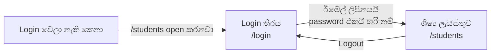
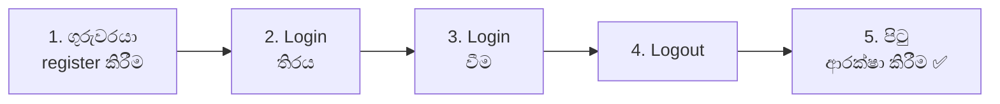
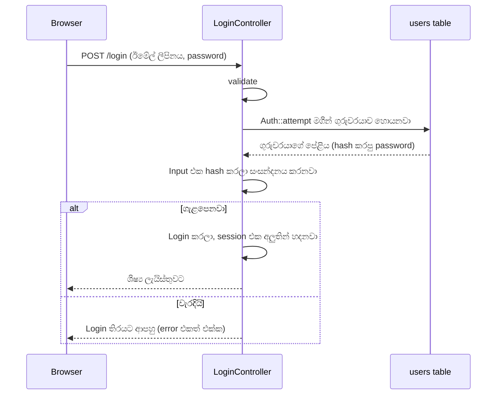
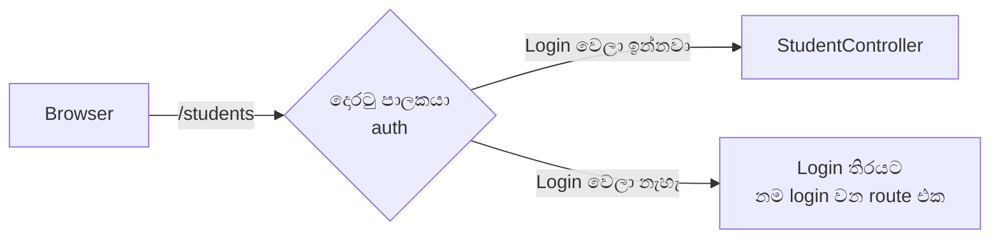
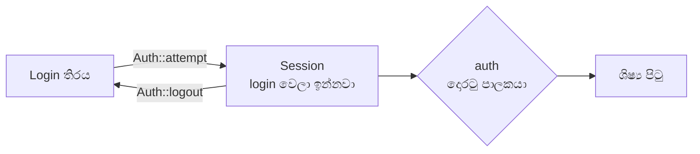

# ශිෂ්‍ය කළමනාකරණ යෙදුමක් හදමු ③ — Login

> 🇯🇵 මුල් පිටපත (ජපන් භාෂාවෙන්): [20261126_資料_1.md](<../../../1年生_データ設計とアプリ開発/後期/20261126/20261126_資料_1.md>) <!-- original-ja-link -->

ශිෂ්‍යයන්ගේ නම් සහ ඊමේල් ලිපින **ඕනෑම කෙනෙක්ට බලන්න දෙන්න බැරි තොරතුරු**.
අද ශිෂ්‍ය කළමනාකරණ යෙදුමට **login** එකතු කරලා, ගුරුවරුන්ට විතරක් පාවිච්චි කරන්න පුළුවන් කරනවා.

## අද ඉලක්කය
- Login වැඩ කරන ක්‍රමය (password hash කිරීම, session) තේරුම් ගැනීම
- Login තිරයයි logout එකයි හදන්න පුළුවන් වීම
- Login වෙලා නැති අයට ශිෂ්‍ය පිටු බලන්න බැරි කරන්න පුළුවන් වීම (`auth`)

> 11/19 දින "ශිෂ්‍ය කළමනාකරණ යෙදුම (එකතු කිරීම, සංස්කරණය, මකා දැමීම)" හදලා ඉවර තත්ත්වයේ ඉඳන් පටන් ගන්නවා.

---

## 1. Login වැඩ කරන ක්‍රමය

### අද හදන දේ



- Login වෙලා නැති කෙනෙක් `/students` open කළොත්, **login තිරයට යවනවා**
- හරි ඊමේල් ලිපිනයයි password එකයි දැම්මොත්, ශිෂ්‍ය පිටු පාවිච්චි කරන්න පුළුවන්
- Todo යෙදුමේ පිටු කලින් වගේම ඕනෑම කෙනෙක්ට පාවිච්චි කරන්න පුළුවන්

### ගුරුවරුන්ව `users` table එකට දානවා

Login වෙන ගුරුවරුන්ව Laravel එකේ **මුල ඉඳන්ම තියෙන `users` table එකට** දානවා.
(ඇත්තටම, පුහුණු පරිසරය මුලින්ම start කරපු වෙලාවේ ඉඳන්ම ඒක තිබුණා)

| Column | තේරුම |
|----|------|
| `name` | ගුරුවරයාගේ නම |
| `email` | Login වෙන්න පාවිච්චි කරන ඊමේල් ලිපිනය |
| `password` | Password එක (**hash කරලා** දානවා) |

### Password එක "hash කිරීම"

Password එක **ඒ විදිහටම database එකට දාන්න එපා**.
Database එකේ තියෙන දේවල් එළියට ගියොත්, හැමෝගෙම password දැනගන්න පුළුවන් වෙන නිසා.

ඒ නිසා password එක **hash කරලා** (ආපහු මුල් තත්ත්වයට හරවන්න බැරි, අවුල් අකුරු පෙළක් බවට හරවලා) තමයි දාන්නේ.

```
ටයිප් කරපු password එක      Database එකට යන දේ
password          ─→     $2y$12$Kx8f3...(අකුරු 60ක් විතර තියෙන අවුල් අකුරු පෙළක්)
```

| | සාමාන්‍ය encryption | Hash කිරීම |
|---|---|---|
| ආපහු මුල් තත්ත්වයට හරවන්න පුළුවන්ද? | පුළුවන් (key එක තියෙනවා නම්) | **බැහැ** |
| Login වෙන වෙලාවේදී? | — | ටයිප් කරපු password එකත් ඒ විදිහටම hash කරලා **සංසන්දනය කරනවා** |

Hash කිරීම Laravel එක ස්වයංක්‍රීයව කරනවා.

### Session: "login වෙලා ඉන්නවා" කියලා මතක තියාගන්න ක්‍රමය

එක පාරක් login වුණාට පස්සේ, පිටුවෙන් පිටුවට යන හැම වෙලාවකම password එක ආයෙත් දානවා කියන්නේ මහ කරදරයක්.
Laravel එක **session** කියන ක්‍රමයෙන් "මේ කෙනා login වෙලා ඉන්නවා" කියලා මතක තියාගන්නවා.

> උපමාවක් විදිහට කිව්වොත්, මේක **විනෝද උද්‍යානයක ඇතුළුවීමේ wristband එකක්** වගේ.
> ඇතුළුවීමේ දොරටුවේදී (login තිරය) ticket එක (password එක) පෙන්නුවම, wristband එකක් දෙනවා.
> ඊට පස්සේ, wristband එක පෙන්නුවා විතරක් ඇති, ඕනෑම විනෝද අංගයකට (පිටුවකට) ඇතුළු වෙන්න පුළුවන්.

---

## 2. හදලා බලමු



වෙනස් කරන files මේවා (`src` ඇතුළේ).

```
src/
├─ database/seeders/
│   ├─ UserSeeder.php ·················· 1. ගුරුවරයා register කරනවා (අලුතින් හදනවා)
│   └─ DatabaseSeeder.php ·············· 1. UserSeeder call කරනවා
├─ app/Http/Controllers/
│   └─ LoginController.php ············· 2, 3, 4. Login, Logout (අලුතින් හදනවා)
├─ resources/views/
│   ├─ login.blade.php ················· 2. Login තිරය (අලුතින් හදනවා)
│   └─ layouts/header.blade.php ········ 4. ගුරුවරයාගේ නම සහ logout button එක
└─ routes/web.php ······················ 2, 3, 4, 5. Routes
```

---

### 1. ගුරුවරයා register කරනවා (Seeder)

> දැන් ඉන්නේ මෙතන: **🟢 1. ගුරුවරයා register කිරීම** → 2. Login තිරය → 3. Login වීම → 4. Logout → 5. පිටු ආරක්ෂා කිරීම

```powershell
docker compose exec laravel php artisan make:seeder UserSeeder
```

`database/seeders/UserSeeder.php` මෙහෙම ලියන්න.

```php
<?php

namespace Database\Seeders;

use App\Models\User;
use Illuminate\Database\Seeder;

class UserSeeder extends Seeder
{
    public function run(): void
    {
        $user = new User();
        $user->name = '山田先生';
        $user->email = 'teacher@example.com';
        $user->password = 'password';  // Save කරන වෙලාවේදී ස්වයංක්‍රීයව hash වෙනවා
        $user->save();
    }
}
```

`database/seeders/DatabaseSeeder.php` එකේ **මුලින්ම**, ★ තියෙන පේළිය එකතු කරන්න.

```php
    public function run(): void
    {
        $this->call(UserSeeder::class);  // ★ එකතු කළා
        $this->call(TodoSeeder::class);
        $this->call(StudentSeeder::class);
    }
```

```powershell
docker compose exec laravel php artisan migrate:fresh --seed
```

✅ **පරීක්ෂා කරන්න**: phpMyAdmin එකේ `users` table එක open කරලා බලමු.
山田先生 (Yamada ගුරුතුමා) ගේ `password` එක `password` නෙවෙයි, **`$2y$12$...` වගේ අවුල් අකුරු පෙළක්** වෙලා තියෙනවා නම් OK.

> **ස්වයංක්‍රීයව hash වෙන්නේ ඇයි?**
> `app/Models/User.php` open කළොත්, `'password' => 'hashed'` කියලා පේළියක් තියෙනවා.
> ඒකේ තේරුම "`password` එකට අගයක් දැම්මොත්, ස්වයංක්‍රීයව hash කරන්න" කියන setting එක. Laravel එක මුල ඉඳන්ම ඒක ලියලා තියෙනවා.

> ⚠️ **phpMyAdmin එකෙන් ගුරුවරුන්ව කෙලින්ම එකතු කරන්න එපා**
> phpMyAdmin එකේ `password` එකට `password` කියලා දැම්මොත්, hash නොවී ඒ විදිහටම යනවා, ඊට පස්සේ login වෙන්න බැහැ.
> ගුරුවරුන්ව register කරන්නේ Seeder එකෙන් (නැත්නම් මේ පාඩමේ ඉදිරියට හදන වගේ තිරයකින්).

---

### 2. Login තිරය හදනවා

> දැන් ඉන්නේ මෙතන: 1. ගුරුවරයා register කිරීම → **🟢 2. Login තිරය** → 3. Login වීම → 4. Logout → 5. පිටු ආරක්ෂා කිරීම

#### ① Controller එක හදනවා

```powershell
docker compose exec laravel php artisan make:controller LoginController
```

`app/Http/Controllers/LoginController.php` මෙහෙම ලියන්න.

```php
<?php

namespace App\Http\Controllers;

use Illuminate\Http\Request;
use Illuminate\Support\Facades\Auth;

class LoginController extends Controller
{
    // Login තිරය පෙන්වනවා
    public function showForm()
    {
        return view('login');
    }
}
```

#### ② View එක හදනවා

`resources/views/login.blade.php` හදන්න.

```html
@include('layouts.header', ['title' => 'ログイン'])

    <h1>ログイン</h1>

    <form method="POST" action="/login">
        @csrf

        <p>
            メールアドレス：
            <input type="email" name="email" value="{{ old('email') }}" required>
        </p>

        <p>
            パスワード：
            <input type="password" name="password" required>
        </p>

        @error('email')
            <p style="color: red;">{{ $message }}</p>
        @enderror

        <button type="submit">ログイン</button>
    </form>

@include('layouts.footer')
```

| Code | තේරුම |
|--------|------|
| `type="password"` | ටයිප් කරන අකුරු `●●●` විදිහට පෙන්වන input field එකක් |
| Password එකට `old()` නැහැ | ආරක්ෂාව සඳහා, error එකක් නිසා ආපහු ආවත් password එක ඉතුරු කරන්නේ නැහැ |

#### ③ Route එක ලියනවා

`routes/web.php` එකට ★ තියෙන කොටස් එකතු කරන්න.

```php
use App\Http\Controllers\LoginController;  // ★ එකතු කළා (උඩ කොටසේ ලියන්න)

Route::get('/login', [LoginController::class, 'showForm'])->name('login');  // ★ එකතු කළා
```

| Code | තේරුම |
|--------|------|
| `->name('login')` | මේ route එකට `login` කියලා **නමක්** දානවා |

> **නමක් දාන්නේ ඇයි?**
> ඉදිරියට "5. පිටු ආරක්ෂා කිරීම" කොටසේදී, login වෙලා නැති අයව **login තිරයට යවන** ක්‍රමයක් පාවිච්චි කරනවා.
> එතකොට Laravel එක `login` කියන නම තියෙන route එක හොයලා, එතනට යවනවා. නමක් නැත්නම්, කොහෙට යවන්නද කියලා දන්නේ නැහැ.

✅ **පරීක්ෂා කරන්න**: http://localhost:8000/login open කරලා, login තිරය පේනවා නම් OK.

---

### 3. Login වෙන්න පුළුවන් කරනවා

> දැන් ඉන්නේ මෙතන: 1. ගුරුවරයා register කිරීම → 2. Login තිරය → **🟢 3. Login වීම** → 4. Logout → 5. පිටු ආරක්ෂා කිරීම

#### ① login method එක ලියනවා

`LoginController.php` එකට ★ තියෙන `login` එකතු කරන්න.

```php
    // ★ මෙතන ඉඳන් එකතු කරන්න
    public function login(Request $request)
    {
        // ① Input එක පරීක්ෂා කරනවා
        $credentials = $request->validate([
            'email' => 'required|email',
            'password' => 'required',
        ]);

        // ② ඊමේල් ලිපිනයයි password එකයි හරිද කියලා තහවුරු කරනවා
        if (Auth::attempt($credentials)) {
            // ③ හරි නම්, session එක අලුතින් හදලා ශිෂ්‍ය ලැයිස්තුවට
            $request->session()->regenerate();

            return redirect()->intended('/students');
        }

        // ④ වැරදි නම්, login තිරයට ආපහු යවනවා
        return back()->withErrors([
            'email' => 'メールアドレスかパスワードがちがいます。',
        ])->onlyInput('email');
    }
    // ★ මෙතනින් ඉවරයි
```

| Code | තේරුම |
|--------|------|
| `$credentials = $request->validate([...])` | පරීක්ෂා කරලා, `email` සහ `password` අරගන්නවා |
| `Auth::attempt($credentials)` | `users` table එකෙන් ඒ ඊමේල් ලිපිනය තියෙන ගුරුවරයාව හොයලා, password එක hash කරලා සංසන්දනය කරනවා. ගැළපෙනවා නම් **login කරලා** `true` දෙනවා |
| `$request->session()->regenerate()` | Session එක (wristband එක) අලුතින් හදනවා. වෙන කෙනෙක්ගේ wristband එකක් පාවිච්චි කරන්න බැරි වෙන්න |
| `redirect()->intended('/students')` | Login වෙන්න කලින් open කරන්න හදපු පිටුවට යනවා. එහෙම පිටුවක් නැත්නම් `/students` වලට |
| `back()->withErrors([...])` | කලින් පිටුවට (login තිරයට) ආපහු යවලා, error message එක පෙන්වනවා |
| `->onlyInput('email')` | ආපහු ආවම, ඊමේල් ලිපිනය විතරක් ඉතුරු කරනවා (password එක ඉතුරු කරන්නේ නැහැ) |

Login වෙන ක්‍රියාවලිය diagram එකකින් පෙන්නුවොත් මෙහෙමයි.



> **"ඊමේල් ලිපිනය හෝ password එක වැරදියි" කියලා එකට කියන්නේ ඇයි?**
> "මේ ඊමේල් ලිපිනය register කරලා නැහැ" කියලා කිව්වොත්, නරක අදහස් තියෙන කෙනෙක්ට "මේ ඊමේල් ලිපිනය register කරලා තියෙනවා" කියලා දැනගන්න පුළුවන් වෙනවා.
> වැරදි මොකක්ද කියලා, හිතාමතාම කියන්නේ නැහැ.

#### ② Route එක එකතු කරනවා

```php
Route::get('/login', [LoginController::class, 'showForm'])->name('login');
Route::post('/login', [LoginController::class, 'login']);  // ★ එකතු කළා
```

✅ **පරීක්ෂා කරන්න**: Login තිරයේ මේ 2 අත්හදා බලමු.

| Input | මෙහෙම වුණොත් OK |
|------|------------|
| `teacher@example.com` ／ `password` | ශිෂ්‍ය ලැයිස්තුවට යනවා |
| `teacher@example.com` ／ `abc` | 「メールアドレスかパスワードがちがいます。」 (ඊමේල් ලිපිනය හෝ password එක වැරදියි) කියලා පේනවා |

---

### 4. Logout සහ login වෙලා ඉන්න බව පෙන්වීම

> දැන් ඉන්නේ මෙතන: 1. ගුරුවරයා register කිරීම → 2. Login තිරය → 3. Login වීම → **🟢 4. Logout** → 5. පිටු ආරක්ෂා කිරීම

#### ① logout method එක ලියනවා

`LoginController.php` එකට ★ තියෙන `logout` එකතු කරන්න.

```php
    // ★ මෙතන ඉඳන් එකතු කරන්න
    public function logout(Request $request)
    {
        Auth::logout();

        $request->session()->invalidate();
        $request->session()->regenerateToken();

        return redirect('/login');
    }
    // ★ මෙතනින් ඉවරයි
```

| Code | තේරුම |
|--------|------|
| `Auth::logout()` | Logout වෙනවා |
| `$request->session()->invalidate()` | Session එක (wristband එක) පාවිච්චි කරන්න බැරි කරනවා |
| `$request->session()->regenerateToken()` | `@csrf` එකේ රහස් වචනයත් අලුතින් හදනවා |

#### ② Route එක එකතු කරනවා

```php
Route::post('/logout', [LoginController::class, 'logout']);  // ★ එකතු කළා
```

> **Logout එකත් POST**
> Logout කියන්නේ "login වෙලා ඉන්නවා" කියන **තත්ත්වය වෙනස් කරන** ක්‍රියාවක් නිසා, link එකකින් (GET) නෙවෙයි, form එකක button එකකින් (POST) යවනවා.
> (10/29 දින ඉගෙනගත්ත "data වෙනස් කරනකොට, form එකක button එකකින් යවන්න" කියන අදහසමයි)

#### ③ Header එකේ ගුරුවරයාගේ නමයි logout button එකයි පෙන්වනවා

`resources/views/layouts/header.blade.php` එකට ★ තියෙන කොටස එකතු කරන්න.

```html
    <header>
        <a href="/todos">TODOアプリ</a>
        <a href="/students">生徒管理</a>

        {{-- ★ මෙතන ඉඳන් එකතු කරන්න --}}
        @auth
            {{ Auth::user()->name }} さん
            <form method="POST" action="/logout" style="display: inline;">
                @csrf
                <button type="submit">ログアウト</button>
            </form>
        @endauth

        @guest
            <a href="/login">ログイン</a>
        @endguest
        {{-- ★ මෙතනින් ඉවරයි --}}
    </header>
```

| Code | තේරුම |
|--------|------|
| `@auth` 〜 `@endauth` | **Login වෙලා ඉන්නකොට** විතරක් පෙන්වනවා |
| `@guest` 〜 `@endguest` | **Login වෙලා නැතිකොට** විතරක් පෙන්වනවා |
| `Auth::user()->name` | Login වෙලා ඉන්න ගුරුවරයාගේ නම |

✅ **පරීක්ෂා කරන්න**: Login වුණාම, header එකේ 「山田先生 さん」 (Yamada ගුරුතුමා) සහ 「ログアウト」 (Logout) button එක පේනවා.
「ログアウト」 එබුවම login තිරයට ආපහු ගිහින්, header එක 「ログイン」 (Login) link එකට මාරු වුණොත් OK.
(Header එක පොදු කොටසක් නිසා, Todo පිටුවලත් ඒ විදිහටම පේනවා)

---

### 5. Login වෙලා නැති අයගෙන් පිටු ආරක්ෂා කරනවා

> දැන් ඉන්නේ මෙතන: 1. ගුරුවරයා register කිරීම → 2. Login තිරය → 3. Login වීම → 4. Logout → **🟢 5. පිටු ආරක්ෂා කිරීම**

මෙතෙක් තියෙන විදිහට, login වෙලා නැති වුණත් `/students` open කරන්න පුළුවන්.
`routes/web.php` එකේ ශිෂ්‍ය routes, ★ තියෙන විදිහට **`auth` group එකකින්** වට කරන්න.

```php
// ★ මෙතන ඉඳන්: login වෙලා ඉන්න අයට විතරක් පාවිච්චි කරන්න පුළුවන් routes
Route::middleware('auth')->group(function () {
    Route::get('/students', [StudentController::class, 'index']);
    Route::get('/students/create', [StudentController::class, 'create']);
    Route::post('/students', [StudentController::class, 'store']);
    Route::get('/students/{id}', [StudentController::class, 'show']);
    Route::get('/students/{id}/edit', [StudentController::class, 'edit']);
    Route::put('/students/{id}', [StudentController::class, 'update']);
    Route::delete('/students/{id}', [StudentController::class, 'destroy']);
});
// ★ මෙතනින් ඉවරයි
```

| Code | තේරුම |
|--------|------|
| `Route::middleware('auth')` | "Login වෙලා ඉන්නවාද" කියලා route එකට **කලින්** පරීක්ෂා කරනවා |
| `->group(function () { ... })` | `{ }` ඇතුළේ තියෙන routes **ඔක්කොටම** ඒ පරීක්ෂාව දානවා |

**Middleware** කියන්නේ controller එකට **ඉස්සරහින් ඉන්න දොරටු පාලකයෙක්** වගේ.



✅ **පරීක්ෂා කරන්න**: මේ පිළිවෙළට අත්හදා බලමු.

1. Logout වෙලා, http://localhost:8000/students open කරන්න → **login තිරයට යවනවා**
2. එතනම login වෙන්න → **ශිෂ්‍ය ලැයිස්තුවට ආපහු යනවා** (`intended` නිසා)
3. Logout වෙලා, http://localhost:8000/todos open කරන්න → **Todo එක login නැතුවම පාවිච්චි කරන්න පුළුවන්**

---

## 3. Routes සාරාංශය

`routes/web.php` එකේ login සහ ශිෂ්‍ය routes දැන් මෙහෙමයි.

```php
// Login, Logout
Route::get('/login', [LoginController::class, 'showForm'])->name('login');
Route::post('/login', [LoginController::class, 'login']);
Route::post('/logout', [LoginController::class, 'logout']);

// Login වෙලා ඉන්න අයට විතරයි
Route::middleware('auth')->group(function () {
    Route::get('/students', [StudentController::class, 'index']);
    // … (ශිෂ්‍යයන්ගේ routes 7)
});
```

---

## 4. හරියට වැඩ නොකරන විට

> **🔥 වැඩ කරන්නේ නැත්නම්, log එක පෙන්වන්න!** → [【වැදගත්】ලොග් (log) පෙන්වන ආකාරය](../20261022/【重要】ログの出し方.md)

| රෝග ලක්ෂණය | හේතුව තියෙන තැන | විසඳුම |
|------|----------|------|
| `Route [login] not defined.` | Route | `/login` route එකට `->name('login')` දැම්මාද බලන්න |
| හරි කියලා හිතන input එකෙන් login වෙන්න බැහැ | Data | phpMyAdmin එකේ ගුරුවරයාගේ `password` එක `$2y$...` වෙලා තියෙනවාද බලන්න. ටයිප් කරපු අකුරුම තියෙනවා නම්, `migrate:fresh --seed` එකෙන් Seeder හරහා ආයෙත් දාන්න |
| `Class "App\Http\Controllers\Auth" not found` | Controller | `LoginController.php` එකේ උඩ `use Illuminate\Support\Facades\Auth;` තියෙනවාද බලන්න |
| Logout එබුවම `419 Page Expired` | View | Logout form එකේ `@csrf` තියෙනවාද බලන්න (පුහුණු පරිසරයේ `@csrf` නැති වුණත් මේක නොපෙන්වන්න පුළුවන්) |
| Logout link එක එබුවම `The GET method is not supported` | View | Logout එක `<a>` එකක් නෙවෙයි, `<form method="POST">` එකේ button එකක් කරන්න |
| Login වෙලා නැති වුණත් ශිෂ්‍ය පිටු බලන්න පුළුවන් | Route | ශිෂ්‍ය routes `Route::middleware('auth')->group(...)` එකේ `{ }` **ඇතුළේ** තියෙනවාද බලන්න |

---

## 5. සාරාංශය



| අද ලියපු දේ | කෙටියෙන් කිව්වොත් |
|--------------|-----------|
| `'password' => 'hashed'` (User Model) | Password එක ස්වයංක්‍රීයව hash කරනවා (මුල ඉඳන්ම ලියලා තියෙනවා) |
| `Auth::attempt($credentials)` | ඊමේල් ලිපිනයයි password එකයි හරි නම් login කරනවා |
| `$request->session()->regenerate()` | Login වුණාම session එක අලුතින් හදනවා |
| `Auth::logout()` | Logout වෙනවා |
| `@auth`, `@guest` | පිළිවෙළින් login වෙලා ඉන්නකොට සහ login වෙලා නැතිකොට පමණක් පෙන්වනවා |
| `Auth::user()` | Login වෙලා ඉන්න ගුරුවරයා |
| `Route::middleware('auth')->group(...)` | Login වෙලා ඉන්න අයට විතරක් පාවිච්චි කරන්න පුළුවන් routes කරනවා |
| `->name('login')` | Login වෙලා නැති අයව යවන තැන |

**Password එක hash කරනවා. Login තත්ත්වය session එකෙන්. පිටු ආරක්ෂා කරන්නේ middleware එකෙන්.**

> **2 වසරේදී**, මේ session එක වෙනුවට **token** (Sanctum) එකකින් login තහවුරු කරන ක්‍රමයකට නැවත හදනවා.
> තිරයක් නැති API එකකදී, "wristband" එක වෙනුවට "රහස් අක්ෂර පෙළක්" හැම පාරම එක්කම යවන නිසා.

ඊළඟ පාඩමේදී, ශිෂ්‍යයාව **register කළේ කවර ගුරුවරයාද** කියලා සටහන් කරන්න පුළුවන් කරනවා (Relation).

<!-- nav:start -->

---

| ⬅️ පෙර | 🗺️ සමස්ත සිතියම | ඊළඟ ➡️ |
|:--|:--:|--:|
| [11/19 ශිෂ්‍ය කළමනාකරණය ② එකතු කිරීම, සංස්කරණය, මකා දැමීම](../20261119/20261119_資料_2.md) | [පාඩම් ද්‍රව්‍යවල සමස්ත සිතියම](../../README.md) | [12/03 ශිෂ්‍ය කළමනාකරණය ④ Relation](../20261203/20261203_資料_1.md) |

<!-- nav:end -->
