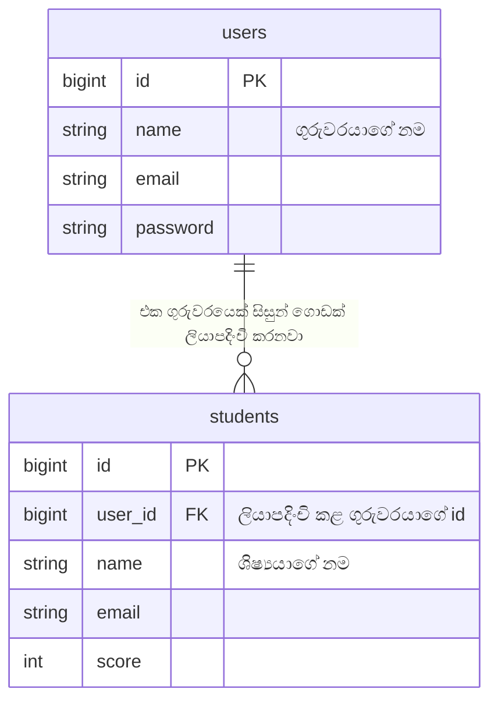
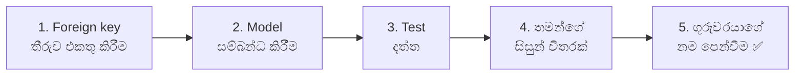
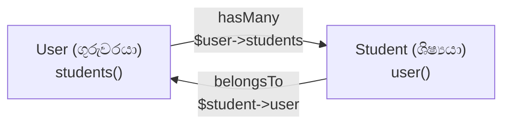
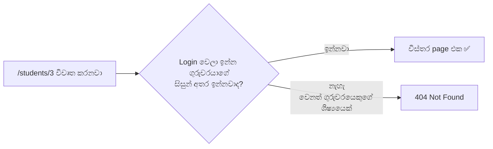
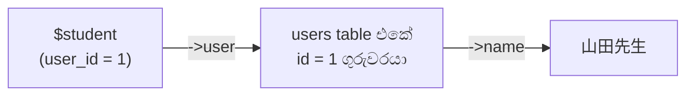
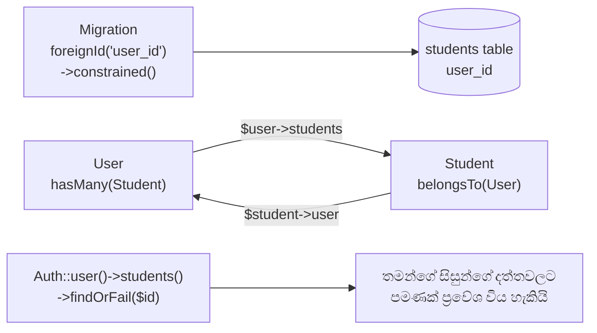

# ශිෂ්‍ය කළමනාකරණ app එක හදමු ④ — Relation (ගුරුවරුන් සහ සිසුන් සම්බන්ධ කිරීම)

> 🇯🇵 මුල් පිටපත (ජපන් භාෂාවෙන්): [20261203_資料_1.md](<../../../1年生_データ設計とアプリ開発/後期/20261203/20261203_資料_1.md>) <!-- original-ja-link -->

පහුගිය පාඩමේදී ගුරුවරුන්ට login වෙන්න පුළුවන් වුණා.
හැබැයි දැනට, **කවුරු login වුණත් හැම ශිෂ්‍යයෙක්ම පේනවා**.
අද අපි, ශිෂ්‍යයා **ලියාපදිංචි කළේ මොන ගුරුවරයාද** කියලා සටහන් කරලා, **තමන්ගේ සිසුන් විතරක්** කළමනාකරණය කරන්න පුළුවන් විදිහට හදනවා.

## අද ඉලක්කය
- එකට-බොහෝ (one-to-many) සම්බන්ධතාවය ER රූප සටහනකින් සහ table (foreign key) එකකින් පෙන්වන්න පුළුවන් වීම
- `hasMany`・`belongsTo` වලින් model එකිනෙකට සම්බන්ධ කරන්න පුළුවන් වීම
- Login වෙලා ඉන්න ගුරුවරයාගේ සිසුන් විතරක් ලැයිස්තුගත කරන්න, විස්තර බලන්න, සංස්කරණය කරන්න සහ මකන්න පුළුවන් වීම

> 11/26 පාඩමේ "Login" දක්වා සම්පූර්ණ කරපු තත්ත්වයේ සිට පටන් ගන්නවා.

---

## 1. ගුරුවරුන් සහ සිසුන් අතර සම්බන්ධතාවය

### එක ගුරුවරයෙක් සිසුන් ගොඩක් භාර ගන්නවා



| ගුරුවරයා (users) | ශිෂ්‍යයා (students) |
|--------------|-----------------|
| 山田先生 (id: 1) | 山田先生 ගේ සිසුන් 15 දෙනයි |
| 佐藤先生 (id: 2) | 佐藤先生 ගේ සිසුන් 15 දෙනයි |

මේ වගේ සම්බන්ධතාවයකට **එකට-බොහෝ** (one-to-many) කියලා කියනවා.

- ගුරුවරයාගේ පැත්තෙන් බැලුවොත්, සිසුන් **ගොඩක්** (බොහෝ)
- ශිෂ්‍යයාගේ පැත්තෙන් බැලුවොත්, ගුරුවරයා **එක්කෙනයි** (එක)

### Foreign key: ශිෂ්‍යයාට "ගුරුවරයාගේ අංකය" දෙනවා

සිසුන්ගේ table එකට, **ලියාපදිංචි කළ ගුරුවරයාගේ `id`** දාන තීරුවක් (`user_id`) එකතු කරනවා.

| id | **user_id** | name | email | score |
|----|------------|------|-------|-------|
| 1 | **1** | 田中 一郎 | … | 85 |
| 2 | **1** | 鈴木 花子 | … | 92 |
| 3 | **2** | 高橋 次郎 | … | 70 |

`user_id` එක `1` වෙච්ච සිසුන් 山田先生 ගේ සිසුන්, `2` වෙච්ච සිසුන් 佐藤先生 ගේ සිසුන්.

මේ විදිහට **වෙනත් table එකක `id` එක දාන තීරුවට** **foreign key** කියලා කියනවා.

> **ඇයි ගුරුවරයාගේ "නම" වෙනුවට "id" එක දාන්නේ?**
> නම දැම්මොත්, ගුරුවරයා නම වෙනස් කළ විට සිසුන්ගේ පේළි සියල්ල වෙනස් කරන්න වෙනවා.
> `id` එක දැම්මොත්, ගුරුවරයාගේ නම වෙනස් වුණත් සිසුන්ගේ පේළි වෙනස් කරන්න අවශ්‍ය නැහැ.

---

## 2. හදලා බලමු



වෙනස් කරන files මේවා (`src` ඇතුළේ).

```
src/
├─ database/
│   ├─ migrations/xxxx_add_user_id_to_students_table.php ··· 1. අලුතින් හදනවා
│   ├─ factories/StudentFactory.php ························· 3. user_id එකතු කරනවා
│   └─ seeders/
│       ├─ UserSeeder.php ··································· 3. ගුරුවරුන් දෙන්නෙක් කරනවා
│       └─ StudentSeeder.php ································ 3. ගුරුවරයා අනුව සිසුන් හදනවා
├─ app/Models/
│   ├─ User.php ············································· 2. students() එකතු කරනවා
│   └─ Student.php ·········································· 2. user() එකතු කරනවා
├─ app/Http/Controllers/StudentController.php ··············· 4. තමන්ගේ සිසුන් විතරක් කරනවා
└─ resources/views/students/show.blade.php ·················· 5. ගුරුවරයාගේ නම පෙන්වනවා
```

---

### 1. Foreign key තීරුව එකතු කිරීම (migration)

> දැන් ඉන්නේ: **🟢 1. Foreign key** → 2. Model → 3. Test දත්ත → 4. තමන්ගේ සිසුන් විතරක් → 5. ගුරුවරයාගේ නම

11/12 පාඩමේ ඉගෙන ගත්ත "**තීරුවක් එකතු කරන migration එක**" හදනවා.

```powershell
docker compose exec laravel php artisan make:migration add_user_id_to_students_table
```

`up()` සහ `down()` ඇතුළත මෙහෙම ලියන්න.

```php
    public function up(): void
    {
        Schema::table('students', function (Blueprint $table) {
            $table->foreignId('user_id')
                ->after('id')
                ->constrained()
                ->cascadeOnDelete();
        });
    }

    public function down(): void
    {
        Schema::table('students', function (Blueprint $table) {
            $table->dropForeign(['user_id']);
            $table->dropColumn('user_id');
        });
    }
```

| Code | තේරුම |
|--------|------|
| `foreignId('user_id')` | Foreign key සඳහා `user_id` තීරුව එකතු කරනවා (`id` වගේම ලොකු integer තීරුවක්) |
| `->after('id')` | `id` තීරුවට පස්සේ එකතු කරනවා (බලන්න ලේසි වෙන්න) |
| `->constrained()` | `user_id` එකට **`users` table එකේ තියෙන `id` විතරක් දාන්න පුළුවන්** විදිහට කරනවා (foreign key constraint) |
| `->cascadeOnDelete()` | ගුරුවරයා මැකුවොත්, ඒ ගුරුවරයාගේ සිසුනුත් එක්කම මකනවා |
| `dropForeign` → `dropColumn` | ආපසු කලින් තත්ත්වයට ගේනකොට, මුලින් constraint එක අයින් කරලා පස්සේ තීරුව මකනවා |

> **`constrained()` එකට "`users` table එක" කියලා තේරෙන්නේ කොහොමද?**
> තීරුවේ නම `user_id` නිසා. Laravel "`user_id` නම් `users` table එකේ `id` එක" කියලා හිතලා ගන්නවා.

**තවම `migrate` කරන්නේ නැහැ.** හේතුව "3. Test දත්ත" කොටසේ පැහැදිලි කරනවා.

---

### 2. Model සම්බන්ධ කිරීම (hasMany・belongsTo)

> දැන් ඉන්නේ: 1. Foreign key → **🟢 2. Model** → 3. Test දත්ත → 4. තමන්ගේ සිසුන් විතරක් → 5. ගුරුවරයාගේ නම

Table සම්බන්ධ කරපු එක විතරක් මදි, PHP code එකෙන් "මේ ගුරුවරයාගේ සිසුන්" ගන්න බැහැ.
**Model එකෙත් සම්බන්ධතාවය ලියනවා.**

#### ① ගුරුවරයාට (User) "සිසුන් ගොඩක්" කියලා ලියනවා

`app/Models/User.php` එකට ★ තියෙන කොටස එකතු කරන්න.

```php
use Illuminate\Database\Eloquent\Relations\HasMany;  // ★ එකතු කරනවා (උඩ තියෙන use පේළි අතරට)

class User extends Authenticatable
{
    // (මුල ඉඳලා තියෙන code එක එහෙම්මම තියන්න)

    // ★ මෙතැන සිට එකතු කරනවා: මේ ගුරුවරයා ලියාපදිංචි කළ සිසුන්
    public function students(): HasMany
    {
        return $this->hasMany(Student::class);
    }
    // ★ මෙතැන දක්වා
}
```

#### ② ශිෂ්‍යයාට (Student) "ගුරුවරයා එක්කෙනයි" කියලා ලියනවා

`app/Models/Student.php` එකට ★ තියෙන කොටස එකතු කරන්න.

```php
<?php

namespace App\Models;

use Illuminate\Database\Eloquent\Factories\HasFactory;
use Illuminate\Database\Eloquent\Model;
use Illuminate\Database\Eloquent\Relations\BelongsTo;  // ★ එකතු කරනවා

class Student extends Model
{
    /** @use HasFactory<\Database\Factories\StudentFactory> */
    use HasFactory;

    // ★ මෙතැන සිට එකතු කරනවා: මේ ශිෂ්‍යයා ලියාපදිංචි කළ ගුරුවරයා
    public function user(): BelongsTo
    {
        return $this->belongsTo(User::class);
    }
    // ★ මෙතැන දක්වා
}
```

| Model | ලියපු දේ | තේරුම | භාවිත කරන විදිහ |
|--------|----------|------|-------|
| `User` | `hasMany(Student::class)` | ගුරුවරයාට සිසුන් **ගොඩක් ඉන්නවා** (has many) | `$user->students` වලින් ඒ ගුරුවරයාගේ සිසුන් **හැමෝම** |
| `Student` | `belongsTo(User::class)` | ශිෂ්‍යයා එක ගුරුවරයෙකුට **අයිතියි** (belongs to) | `$student->user` වලින් ඒ ශිෂ්‍යයාගේ ගුරුවරයා **එක්කෙනා** |



> **නම් තැබීමේ නීතිය**
> "ගොඩක්" පැත්ත **බහු වචනයෙන්** (`students`), "එක්කෙනා" පැත්ත **ඒක වචනයෙන්** (`user`) ලියනවා.
> ඉංග්‍රීසියෙන් කියෙව්වොත්, `$user->students` (ගුරුවරයාගේ සිසුන්) · `$student->user` (ශිෂ්‍යයාගේ ගුරුවරයා) කියලා ස්වාභාවිකව කියවෙනවා.

---

### 3. Test දත්ත නැවත හැදීම

> දැන් ඉන්නේ: 1. Foreign key → 2. Model → **🟢 3. Test දත්ත** → 4. තමන්ගේ සිසුන් විතරක් → 5. ගුරුවරයාගේ නම

#### ඇයි `migrate` වෙනුවට `migrate:fresh` කරන්නේ?

දැනට `students` table එකේ සිසුන් 30 දෙනෙක් ඉන්නවා.
මෙතනට `user_id` තීරුව එකතු කළොත්, **දැනට ඉන්න 30 දෙනාගේ `user_id` එකට මොනවද දාන්නේ?**
`constrained()` තියෙන නිසා, `users` table එකේ නැති අංක දාන්න බැහැ.

ඒ නිසා මේ පාර, `migrate:fresh --seed` වලින් **table නැවත හදලා, එක් එක් ශිෂ්‍යයාට ගුරුවරයෙක් සම්බන්ධ කර නැවත දත්ත ඇතුළත් කරනවා**.
ඒකට, මුලින්ම Seeder සහ Factory හදාගන්නවා.

#### ① ගුරුවරුන් දෙන්නෙක් කරනවා (UserSeeder)

`database/seeders/UserSeeder.php` එකේ `run()` එකට ★ තියෙන දෙවන ගුරුවරයා එකතු කරන්න.

```php
    public function run(): void
    {
        $user = new User();
        $user->name = '山田先生';
        $user->email = 'teacher@example.com';
        $user->password = 'password';
        $user->save();

        // ★ මෙතැන සිට එකතු කරනවා
        $user = new User();
        $user->name = '佐藤先生';
        $user->email = 'teacher2@example.com';
        $user->password = 'password';
        $user->save();
        // ★ මෙතැන දක්වා
    }
```

#### ② එක් එක් ගුරුවරයාට සිසුන් 15 දෙනෙකු බැගින් හදනවා (StudentSeeder)

`database/seeders/StudentSeeder.php` එකේ `run()` එක මෙහෙම වෙනස් කරන්න.

```php
<?php

namespace Database\Seeders;

use App\Models\Student;
use App\Models\User;  // ★ එකතු කරනවා
use Illuminate\Database\Seeder;

class StudentSeeder extends Seeder
{
    public function run(): void
    {
        // එක් එක් ගුරුවරයාට සිසුන් 15 දෙනෙකු බැගින් හදනවා
        foreach (User::all() as $user) {
            Student::factory()->count(15)->for($user)->create();
        }
    }
}
```

| Code | තේරුම |
|--------|------|
| `User::all()` | හැම ගුරුවරයෙක්ම ගන්නවා |
| `->for($user)` | "මේ ගුරුවරයාගේ ශිෂ්‍යයෙක් විදිහට හදන්න". `user_id` එකට `$user->id` දානවා |

#### ③ Factory එකටත් user_id එකතු කරනවා (StudentFactory)

`database/factories/StudentFactory.php` එකේ `definition()` එකට ★ තියෙන පේළිය එකතු කරන්න.

```php
use App\Models\User;  // ★ එකතු කරනවා (උඩ පැත්තේ ලියන්න)

    public function definition(): array
    {
        return [
            'user_id' => User::factory(),  // ★ එකතු කරනවා
            'name' => fake('ja_JP')->name(),
            'email' => fake()->unique()->safeEmail(),
            'score' => fake()->numberBetween(0, 100),
        ];
    }
```

`User::factory()` කියන්නේ "ගුරුවරයෙක් දීලා නැත්නම්, ගුරුවරයෙකුත් හදන්න" කියන එක.
අද Seeder එකේ `->for($user)` වලින් ගුරුවරයා දීලා තියෙන නිසා, අලුත් ගුරුවරුන් හැදෙන්නේ නැහැ.

#### ④ නැවත හදනවා

```powershell
docker compose exec laravel php artisan migrate:fresh --seed
```

✅ **පරීක්ෂා කිරීම**: phpMyAdmin එකෙන් මේ දෙක තහවුරු කරගමු.

- `users` table එකේ 山田先生 සහ 佐藤先生 කියන දෙන්නා ඉන්නවා
- `students` table එකේ `user_id` තීරුව තියෙනවා, `1` වෙච්ච සිසුන් 15 දෙනයි, `2` වෙච්ච සිසුන් 15 දෙනයි ඉන්නවා

---

### 4. තමන්ගේ සිසුන් විතරක් බලන්න පුළුවන් විදිහට හදනවා

> දැන් ඉන්නේ: 1. Foreign key → 2. Model → 3. Test දත්ත → **🟢 4. තමන්ගේ සිසුන් විතරක්** → 5. ගුරුවරයාගේ නම

`app/Http/Controllers/StudentController.php` වෙනස් කරනවා.
උඩ පැත්තේ `use Illuminate\Support\Facades\Auth;` එකතු කරලා, ★ තියෙන තැන් වෙනස් කරන්න.

```php
use Illuminate\Support\Facades\Auth;  // ★ එකතු කරනවා
```

#### ① ලැයිස්තුව (index): තමන්ගේ සිසුන් විතරක්

```php
    public function index()
    {
        $students = Auth::user()->students;  // ★ Student::all() එකෙන් වෙනස් කරනවා

        return view('students.index', ['students' => $students]);
    }
```

`Auth::user()` කියන්නේ login වෙලා ඉන්න ගුරුවරයා.
`->students` වලින් **ඒ ගුරුවරයාගේ සිසුන් විතරක්** ගන්න පුළුවන්. 2 දී ලියපු `hasMany` නිසා තමයි මේක වෙන්නේ.

#### ② එකතු කිරීම (store): ලියාපදිංචි කළ ගුරුවරයා සටහන් කරනවා

```php
        $student = new Student();
        $student->user_id = Auth::id();  // ★ එකතු කරනවා: login වෙලා ඉන්න ගුරුවරයාගේ id එක
        $student->name = $request->input('name');
        $student->email = $request->input('email');
        $student->score = $request->input('score');
        $student->save();
```

| Code | තේරුම |
|--------|------|
| `Auth::id()` | Login වෙලා ඉන්න ගුරුවරයාගේ `id` එක |

#### ③ විස්තර · සංස්කරණය · මකීම: තමන්ගේ සිසුන්ගේ දත්තවලට පමණක් ප්‍රවේශ විය හැකි ලෙස සකස් කරනවා

`show`・`edit`・`update`・`destroy` කියන හතරේම තියෙන `Student::findOrFail($id)`, **ඔක්කොම** මෙහෙම වෙනස් කරන්න.

```php
        // වෙනස් කරන්න කලින්
        $student = Student::findOrFail($id);

        // වෙනස් කළාට පස්සේ
        $student = Auth::user()->students()->findOrFail($id);
```

`Auth::user()->students()` කියන්නේ "login වෙලා ඉන්න ගුරුවරයාගේ සිසුන් අතරින්", `findOrFail($id)` කියන්නේ "`id` එක ගැළපෙන ශිෂ්‍යයා හොයනවා" කියන එක.
**වෙනත් ගුරුවරයෙකුගේ ශිෂ්‍යයෙකුගේ `id` එක විවෘත කරන්න හැදුවත්, හොයාගන්න බැරි නිසා `404 Not Found`** වෙනවා.



> **`students` සහ `students()` අතර වෙනස**
>
> | ලියන විදිහ | තේරුම | භාවිත කරන අවස්ථාව |
> |-------|------|---------|
> | `Auth::user()->students` | ඒ ගුරුවරයාගේ සිසුන් **හැමෝම ගන්නවා** | ලැයිස්තුව (හැමෝම ඕනේ) |
> | `Auth::user()->students()` | "ඒ ගුරුවරයාගේ සිසුන් අතරින්" කියන **කොන්දේසිය විතරක්** දානවා. ඊට පස්සේ `->findOrFail($id)` වගේ දේවල් දිගටම ලියන්න පුළුවන් | විස්තර · සංස්කරණය · මකීම (එක්කෙනෙක් හොයන්න ඕනේ) |

✅ **පරීක්ෂා කිරීම**: මේ පිළිවෙළට අත්හදා බලමු.

| කරන දේ | මෙහෙම වුණොත් හරි |
|---------|------------|
| 山田先生 (`teacher@example.com`) විදිහට login වෙලා ලැයිස්තුව විවෘත කරන්න | සිසුන් 15 දෙනා විතරක් පෙන්වනවා |
| ශිෂ්‍යයෙක් එකතු කරන්න | phpMyAdmin එකේ, එකතු කරපු ශිෂ්‍යයාගේ `user_id` එක `1` වෙලා තියෙනවා |
| ලැයිස්තුවෙන් ශිෂ්‍යයෙකුගේ විස්තර page එක විවෘත කරලා, URL එකේ අංකය සටහන් කරගන්න (උදා: `/students/3`) | — |
| Logout වෙලා, 佐藤先生 (`teacher2@example.com`) විදිහට login වෙන්න | ලැයිස්තුවේ 山田先生 ගේ සිසුන්ට වඩා වෙනස් 15 දෙනෙක් පෙන්වනවා |
| සටහන් කරගත්ත 山田先生 ගේ ශිෂ්‍යයාගේ URL එක කෙලින්ම විවෘත කරන්න | **`404 Not Found`** වෙනවා (වෙනත් ගුරුවරයෙකුගේ සිසුන් බලන්න බැහැ) |

---

### 5. විස්තර page එකේ ලියාපදිංචි කළ ගුරුවරයාගේ නම පෙන්වනවා

> දැන් ඉන්නේ: 1. Foreign key → 2. Model → 3. Test දත්ත → 4. තමන්ගේ සිසුන් විතරක් → **🟢 5. ගුරුවරයාගේ නම**

`resources/views/students/show.blade.php` එකට ★ තියෙන පේළිය එකතු කරන්න.

```html
    <p>番号：{{ $student->id }}</p>
    <p>メールアドレス：{{ $student->email }}</p>
    <p>点数：{{ $student->score }}点</p>
    <p>登録した先生：{{ $student->user->name }}</p>  {{-- ★ එකතු කරනවා --}}
```

`$student->user` වලින් ඒ ශිෂ්‍යයාගේ ගුරුවරයා (`belongsTo`), `->name` වලින් ඒ ගුරුවරයාගේ නම ගන්න පුළුවන්.
SQL `JOIN` ලියන්නේ නැතුවම, Laravel `users` table එකෙන් ඒක අරන් දෙනවා.

✅ **පරීක්ෂා කිරීම**: විස්තර page එකේ "登録した先生：山田先生" (ලියාපදිංචි කළ ගුරුවරයා: 山田先生) වගේ පෙන්වනවා නම් හරි.



---

## 3. හරියට වැඩ නොකරන විට

> **🔥 වැඩ කරන්නේ නැත්නම්, log එක පෙන්වන්න!** → [【වැදගත්】ලොග් (log) පෙන්වන ආකාරය](../20261022/【重要】ログの出し方.md)

| රෝග ලක්ෂණය | හේතුව තියෙන තැන | විසඳුම |
|------|----------|------|
| `migrate` කරනකොට `Cannot add or update a child row: a foreign key constraint fails` | Migration | දැනට ඉන්න සිසුන්ට දාන්න ගුරුවරයෙක් නැහැ. `migrate:fresh --seed` වලින් නැවත හදන්න |
| `Call to undefined method App\Models\User::students()` | Model | `User.php` එකේ `students()` method එක ලිව්වාද කියලා බලන්න |
| `Return value must be of type App\Models\HasMany` | Model | `User.php` එකේ උඩින් `use Illuminate\Database\Eloquent\Relations\HasMany;` තියෙනවාද කියලා බලන්න (`Student.php` එකේ `BelongsTo` එකත් එහෙමයි) |
| ලැයිස්තුවේ හැමෝම (30 දෙනා) පෙන්වනවා | Controller | `index` එක `Auth::user()->students` වෙලාද කියලා බලන්න |
| වෙනත් ගුරුවරයෙකුගේ ශිෂ්‍යයෙකුගේ විස්තර page එක බලන්න පුළුවන් | Controller | `show`・`edit`・`update`・`destroy` **හතරම** `Auth::user()->students()->findOrFail($id)` විදිහට වෙනස් කළාද කියලා බලන්න |
| ශිෂ්‍යයෙක් එකතු කරනකොට `Field 'user_id' doesn't have a default value` | Controller | `store` එකේ `$student->user_id = Auth::id();` තියෙනවාද කියලා බලන්න |
| ගුරුවරයාගේ නම පෙන්වන තැන `Attempt to read property "name" on null` | Model · දත්ත | `Student.php` එකේ `user()` ලිව්වාද, ඒ ශිෂ්‍යයාගේ `user_id` එකට අදාළ ගුරුවරයා ඉන්නවාද කියලා බලන්න |

---

## 4. සාරාංශය



| අද ලියපු දේ | කෙටියෙන් කිව්වොත් |
|--------------|-----------|
| `foreignId('user_id')->constrained()` | Foreign key තීරුවක් එකතු කරලා, `users` එකේ තියෙන `id` විතරක් දාන්න පුළුවන් විදිහට කරනවා |
| `hasMany(Student::class)` | ගුරුවරයාට සිසුන් ගොඩක් ඉන්නවා (`$user->students`) |
| `belongsTo(User::class)` | ශිෂ්‍යයා එක ගුරුවරයෙකුට අයිතියි (`$student->user`) |
| `->for($user)` (Factory) | මේ ගුරුවරයාගේ සිසුන් විදිහට test දත්ත හදනවා |
| `Auth::id()` | Login වෙලා ඉන්න ගුරුවරයාගේ `id` එක |
| `Auth::user()->students` | Login වෙලා ඉන්න ගුරුවරයාගේ සිසුන් හැමෝම |
| `Auth::user()->students()->findOrFail($id)` | තමන්ගේ සිසුන් අතරින් එක්කෙනෙක් හොයනවා. වෙනත් ගුරුවරයෙකුගේ ශිෂ්‍යයෙක් නම් 404 |

**Table සම්බන්ධ කරන්නේ foreign key වලින්. Model සම්බන්ධ කරන්නේ hasMany・belongsTo වලින්.**

මේකෙන් ශිෂ්‍ය කළමනාකරණ app එක සම්පූර්ණයි 🎉
ලැයිස්තුව · එකතු කිරීම · විස්තර · සංස්කරණය · මකීම (CRUD), login, relation කියන Web app එකක වැදගත් ක්‍රියාකාරකම් ඔක්කොම දැන් තියෙනවා.

> **2 වන වසරේදී**, මේ app එක **API** එකක් විදිහට නැවත හදනවා.
> Table (`users`・`students`) සහ relation (`hasMany`・`belongsTo`) **එහෙම්මම** භාවිත කරනවා.
> වෙනස් වෙන්නේ, "HTML screen එකක් return කරන" කොටස "JSON දත්ත return කරන" එකක් වෙන එකයි, login එක session වෙනුවට token එකක් වෙන එකයි.

<!-- nav:start -->

---

| ⬅️ පෙර | 🗺️ සමස්ත සිතියම | ඊළඟ ➡️ |
|:--|:--:|--:|
| [11/26 ශිෂ්‍ය කළමනාකරණය ③ Login](../20261126/20261126_資料_1.md) | [පාඩම් ද්‍රව්‍යවල සමස්ත සිතියම](../../README.md) | [12/10 ශිෂ්‍ය කළමනාකරණය ⑤ ගුරුවරුන් අලුතින් ලියාපදිංචි කිරීම](../20261210/20261210_資料_1.md) |

<!-- nav:end -->
