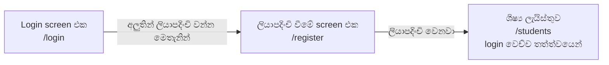
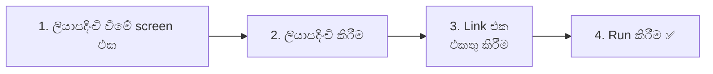
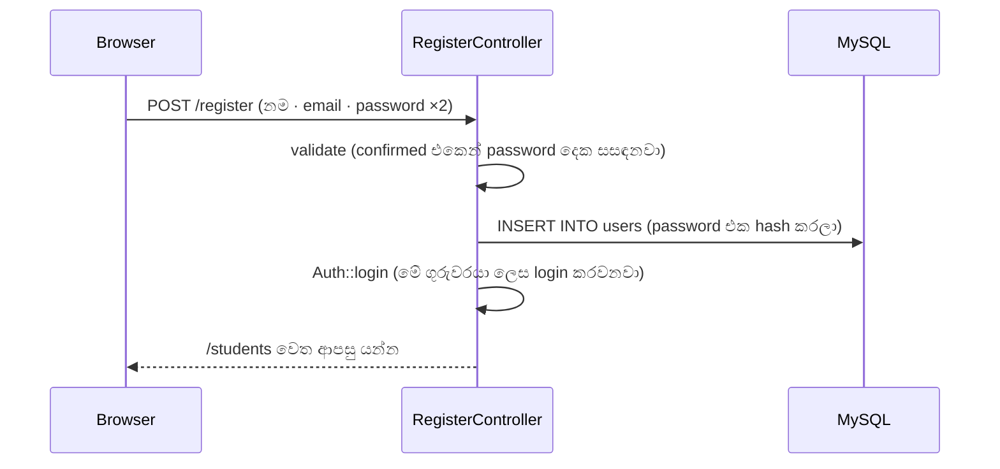

# ශිෂ්‍ය කළමනාකරණ app එක හදමු ⑤ — ගුරුවරුන් අලුතින් ලියාපදිංචි කිරීම

> 🇯🇵 මුල් පිටපත (ජපන් භාෂාවෙන්): [20261210_資料_1.md](<../../../1年生_データ設計とアプリ開発/後期/20261210/20261210_資料_1.md>) <!-- original-ja-link -->

දැනට ගුරුවරුන් **ලියාපදිංචි කරන්න පුළුවන් Seeder එකෙන් විතරයි**. අලුත් ගුරුවරයෙක් එන හැම වතාවකම program එක වෙනස් කරන එක අමාරු වැඩක්.
අද අපි screen එකෙන්ම **ගුරුවරයෙකුගේ account එකක් හදන්න පුළුවන්** (අලුතින් ලියාපදිංචි කිරීම) විදිහට හදනවා.

## අද ඉලක්කය
- ලියාපදිංචි වීමේ screen එක හදලා, ගුරුවරයා `users` table එකේ save කරන්න පුළුවන් වීම
- Password එකේ "තහවුරු කිරීමේ input එක" validation (`confirmed`) එකෙන් පරීක්ෂා කරන්න පුළුවන් වීම
- ලියාපදිංචි වුණාම, එහෙම්මම login වෙච්ච තත්ත්වයට පත් කරන්න පුළුවන් වීම (`Auth::login`)

> 12/3 පාඩමේ "Relation" දක්වා සම්පූර්ණ කරපු තත්ත්වයේ සිට පටන් ගන්නවා.

---

## 1. අද හදන දේ



```
新規登録

名前：             [ 鈴木先生            ]
メールアドレス：   [ suzuki@example.com  ]
パスワード：       [ ●●●●●●●●            ]
パスワード（確認）：[ ●●●●●●●●            ]

[登録]
```

### Login එකත් එක්ක තියෙන වෙනස

11/26 පාඩමේ login එකට ගොඩක්ම සමාන ආකාරයක් තමයි තියෙන්නේ.

| | Login (11/26) | අලුතින් ලියාපදිංචි කිරීම (අද) |
|---|---|---|
| URL | `/login` | `/register` |
| කරන දේ | `users` එකේ ඉන්න ගුරුවරයෙක්ද කියලා **තහවුරු කරනවා** | `users` එකට අලුත් ගුරුවරයෙක් **එකතු කරනවා** |
| Input කොටු | Email address · password | නම · email address · password · **password (තහවුරු කිරීම)** |
| අන්තිමට | `Auth::attempt()` වලින් login වෙනවා | `Auth::login()` වලින් login වෙනවා |

> **2 වන වසරේදී**, මේ අලුතින් ලියාපදිංචි කිරීමත් API (`POST /api/register`) එකක් විදිහට නැවත හදනවා.
> පරීක්ෂා කරන නීති (validation) 2 වන වසරේදීත් එහෙම්මම භාවිත කරනවා.

---

## 2. හදලා බලමු



වෙනස් කරන files මේවා (`src` ඇතුළේ).

```
src/
├─ app/Http/Controllers/
│   └─ RegisterController.php ·········· 1・2. අලුතින් ලියාපදිංචි කිරීම (අලුතින් හදනවා)
├─ resources/views/
│   ├─ register.blade.php ·············· 1. ලියාපදිංචි වීමේ screen එක (අලුතින් හදනවා)
│   ├─ login.blade.php ················· 3. ලියාපදිංචි වීමට link එක
│   └─ layouts/header.blade.php ········ 3. ලියාපදිංචි වීමට link එක
└─ routes/web.php ······················ 1・2. Route
```

---

### 1. ලියාපදිංචි වීමේ screen එක හදනවා

> දැන් ඉන්නේ: **🟢 1. ලියාපදිංචි screen එක** → 2. ලියාපදිංචි කිරීම → 3. Link → 4. Run කිරීම

#### ① Controller එක හදනවා

```powershell
docker compose exec laravel php artisan make:controller RegisterController
```

`app/Http/Controllers/RegisterController.php` මෙහෙම වෙනස් කරන්න.

```php
<?php

namespace App\Http\Controllers;

use App\Models\User;
use Illuminate\Http\Request;
use Illuminate\Support\Facades\Auth;

class RegisterController extends Controller
{
    // ලියාපදිංචි වීමේ screen එක පෙන්වනවා
    public function showForm()
    {
        return view('register');
    }
}
```

#### ② View එක හදනවා

`resources/views/register.blade.php` හදන්න.

```html
@include('layouts.header', ['title' => '新規登録'])

    <h1>新規登録</h1>

    <form method="POST" action="/register">
        @csrf

        <p>
            名前：
            <input type="text" name="name" value="{{ old('name') }}" required>
            @error('name') <span style="color: red;">{{ $message }}</span> @enderror
        </p>

        <p>
            メールアドレス：
            <input type="email" name="email" value="{{ old('email') }}" required>
            @error('email') <span style="color: red;">{{ $message }}</span> @enderror
        </p>

        <p>
            パスワード（8文字以上）：
            <input type="password" name="password" required>
            @error('password') <span style="color: red;">{{ $message }}</span> @enderror
        </p>

        <p>
            パスワード（確認）：
            <input type="password" name="password_confirmation" required>
        </p>

        <button type="submit">登録</button>
    </form>

    <a href="/login">ログインはこちら</a>

@include('layouts.footer')
```

| Code | තේරුම |
|--------|------|
| `name="password"` | Password එක |
| `name="password_confirmation"` | Password එකේ **තහවුරු කිරීමේ input එක**. නම `password` ට පස්සේ `_confirmation` එකතු කරලා දාන එක **නීතියක්** |

> **ඇයි password එක දෙපාරක් දාන්නේ?**
> Password එක `●●●` විදිහට පෙන්වන නිසා, වැරදියට type කළත් අපිට තේරෙන්නේ නැහැ.
> දෙපාරක් දාලා, ඒ දෙක **සමානද කියලා** සසඳලා බැලුවොත්, type කරපු වැරැද්ද අහු වෙනවා.

#### ③ Route එක ලියනවා

`routes/web.php` එකට ★ තියෙන කොටස එකතු කරන්න.

```php
use App\Http\Controllers\RegisterController;  // ★ එකතු කරනවා (උඩ පැත්තේ ලියන්න)

Route::get('/register', [RegisterController::class, 'showForm']);  // ★ එකතු කරනවා
```

✅ **පරීක්ෂා කිරීම**: http://localhost:8000/register විවෘත කරලා, ලියාපදිංචි වීමේ screen එක පෙන්වනවා නම් හරි.

---

### 2. ලියාපදිංචි කරන්න පුළුවන් විදිහට හදනවා

> දැන් ඉන්නේ: 1. ලියාපදිංචි screen එක → **🟢 2. ලියාපදිංචි කිරීම** → 3. Link → 4. Run කිරීම

#### ① register method එක ලියනවා

`RegisterController.php` එකට ★ තියෙන `register` එක එකතු කරන්න.

```php
    // ★ මෙතැන සිට එකතු කරනවා
    public function register(Request $request)
    {
        // ① Input එක පරීක්ෂා කරනවා
        $request->validate([
            'name' => 'required|string|max:255',
            'email' => 'required|email|unique:users,email',
            'password' => 'required|min:8|confirmed',
        ], [
            'name.required' => '名前を入力してください。',
            'name.max' => '名前は255文字以内で入力してください。',
            'email.required' => 'メールアドレスを入力してください。',
            'email.email' => 'メールアドレスの形で入力してください。',
            'email.unique' => 'そのメールアドレスは、すでに登録されています。',
            'password.required' => 'パスワードを入力してください。',
            'password.min' => 'パスワードは8文字以上で入力してください。',
            'password.confirmed' => 'パスワード（確認）が一致しません。',
        ]);

        // ② ගුරුවරයා save කරනවා
        $user = new User();
        $user->name = $request->input('name');
        $user->email = $request->input('email');
        $user->password = $request->input('password');  // Save කරන වෙලාවේ ස්වයංක්‍රීයව hash කරනවා
        $user->save();

        // ③ එහෙම්මම login කරවනවා
        Auth::login($user);
        $request->session()->regenerate();

        // ④ ශිෂ්‍ය ලැයිස්තුවට
        return redirect('/students');
    }
    // ★ මෙතැන දක්වා
```

අලුතින් එන දේවල් මේවා.

| Code | තේරුම |
|--------|------|
| `string` | අකුරු (string) වීම |
| `unique:users,email` | `users` table එකේ `email` තීරුවේ එකම අගය නැද්ද කියලා (එකම email address එකෙන් දෙපාරක් ලියාපදිංචි වෙන්න බැහැ) |
| `min:8` | අක්ෂර 8ක් හෝ ඊට වැඩි (`integer` නැති නිසා, **අක්ෂර ගණන** පරීක්ෂා කරනවා) |
| `confirmed` | `password` සහ `password_confirmation` **සමානද** කියලා |
| `Auth::login($user)` | Password එක පරීක්ෂා නොකර, **මේ ගුරුවරයා ලෙස login කරවනවා** |

> **`Auth::attempt` සහ `Auth::login` අතර වෙනස**
>
> | | `Auth::attempt($credentials)` (11/26) | `Auth::login($user)` (අද) |
> |---|---|---|
> | Password එක | තහවුරු කරනවා | තහවුරු කරන්නේ නැහැ |
> | භාවිත කරන අවස්ථාව | Login screen එක (ඒ කෙනාමද කියලා දන්නේ නැහැ) | ලියාපදිංචි වුණු ගමන් (දැන් ලියාපදිංචි වුණේ ඒ කෙනාම බව දන්නවා) |
>
> ලියාපදිංචි වුණු ගමන්ම ආයෙත් login screen එකේ password එක දාන්න කියන එක කරදරයක් නේද?
> දැන් ලියාපදිංචි වුණේ ඒ කෙනාම නිසා, එහෙම්මම login කරවනවා.

> **Password එක එහෙම්මම දැම්මට කමක් නැද්ද?**
> 11/26 පාඩමේ ඉගෙන ගත්ත විදිහට, `User` model එකේ `'password' => 'hashed'` නිසා, **save කරන වෙලාවේ ස්වයංක්‍රීයව hash වෙනවා**.
> 2 වන වසරේ පාඩම් ද්‍රව්‍යවල `Hash::make(...)` භාවිත කරලා අපිම hash කරනවා. හැබැයි Laravel "දැනටමත් hash කරපු අගයක්" දෙපාරක් hash කරන්නේ නැති නිසා, ක්‍රම දෙකෙන්ම හරියට වැඩ කරනවා.

#### ② Route එක එකතු කරනවා

```php
Route::get('/register', [RegisterController::class, 'showForm']);
Route::post('/register', [RegisterController::class, 'register']);  // ★ එකතු කරනවා
```



---

### 3. ලියාපදිංචි වීමට link එක එකතු කරනවා

> දැන් ඉන්නේ: 1. ලියාපදිංචි screen එක → 2. ලියාපදිංචි කිරීම → **🟢 3. Link** → 4. Run කිරීම

#### ① Login screen එකට

`resources/views/login.blade.php` එකේ `</form>` ට පහළින්, ★ තියෙන පේළිය එකතු කරන්න.

```html
        <button type="submit">ログイン</button>
    </form>

    <a href="/register">新規登録はこちら</a>  {{-- ★ එකතු කරනවා --}}
```

#### ② Header එකට

`resources/views/layouts/header.blade.php` එකේ `@guest` ඇතුළට, ★ තියෙන පේළිය එකතු කරන්න.

```html
        @guest
            <a href="/login">ログイン</a>
            <a href="/register">新規登録</a>  {{-- ★ එකතු කරනවා --}}
        @endguest
```

Login වෙලා නැති වෙලාවට විතරක් header එකේ "新規登録" (අලුතින් ලියාපදිංචි වන්න) පෙන්වනවා.

---

### 4. Run කිරීම ✅

> දැන් ඉන්නේ: 1. ලියාපදිංචි screen එක → 2. ලියාපදිංචි කිරීම → 3. Link → **🟢 4. Run කිරීම**

Logout වෙලා, මේ පිළිවෙළට අත්හදා බලමු.

| | කරන දේ | මෙහෙම වුණොත් හරි |
|---|---|---|
| ① | ලියාපදිංචි වීමේ screen එකෙන්, නම "鈴木先生" · email address `suzuki@example.com` · password `password123` (දෙපාරම එකම එක) දාලා ලියාපදිංචි වෙන්න | ශිෂ්‍ය ලැයිස්තුවට යනවා, header එකේ "鈴木先生 さん" කියලා පෙන්වනවා |
| ② | ශිෂ්‍ය ලැයිස්තුව බලන්න | **සිසුන් 0යි** (鈴木先生 තවම කිසිම ශිෂ්‍යයෙක් ලියාපදිංචි කරලා නැති නිසා. මේක කළ හැක්කේ 12/3 පාඩමේ relation එක නිසයි) |
| ③ | phpMyAdmin එකෙන් `users` table එක බලන්න | 鈴木先生 ඉන්නවා, `password` එක hash කරලා (`$2y$12$...`) තියෙනවා |
| ④ | Logout වෙලා, 鈴木先生 ගේ email address එකයි password එකයි දාලා login වෙන්න | Login වෙන්න පුළුවන් |
| ⑤ | ආයෙත් `suzuki@example.com` එකෙන් ලියාපදිංචි වෙන්න | "そのメールアドレスは、すでに登録されています。" (ඒ email address එක දැනටමත් ලියාපදිංචි කරලා තියෙනවා) කියලා පෙන්වනවා |
| ⑥ | Password එකටයි තහවුරු කිරීමටයි වෙනස් දේවල් දාලා ලියාපදිංචි වෙන්න | "パスワード（確認）が一致しません。" (Password (තහවුරු කිරීම) ගැළපෙන්නේ නැහැ) කියලා පෙන්වනවා |
| ⑦ | Password එක `abc` කරලා ලියාපදිංචි වෙන්න | "パスワードは8文字以上で入力してください。" (Password එක අකුරු 8ක් හෝ ඊට වැඩියෙන් දාන්න) කියලා පෙන්වනවා |

---

## 3. Route වල සාරාංශය

Login සහ ලියාපදිංචි කිරීමට අදාළ routes දැන් මෙහෙමයි.

```php
// Login · logout
Route::get('/login', [LoginController::class, 'showForm'])->name('login');
Route::post('/login', [LoginController::class, 'login']);
Route::post('/logout', [LoginController::class, 'logout']);

// අලුතින් ලියාපදිංචි කිරීම
Route::get('/register', [RegisterController::class, 'showForm']);
Route::post('/register', [RegisterController::class, 'register']);
```

ලියාපදිංචි කිරීමේ routes, `Route::middleware('auth')` එකෙන් **පිටත** ලියන්න.
මොකද මේක තවම account එකක් නැති (login වෙන්න බැරි) අය භාවිත කරන page එකක් නිසා.

---

## 4. හරියට වැඩ නොකරන විට

> **🔥 වැඩ කරන්නේ නැත්නම්, log එක පෙන්වන්න!** → [【වැදගත්】ලොග් (log) පෙන්වන ආකාරය](../20261022/【重要】ログの出し方.md)

| රෝග ලක්ෂණය | හේතුව තියෙන තැන | විසඳුම |
|------|----------|------|
| එකම password එක දැම්මත් "ගැළපෙන්නේ නැහැ" කියලා පෙන්වනවා | View | තහවුරු කිරීමේ input කොටුවේ නම `password_confirmation` ද කියලා බලන්න (අකුරක් හරි වැරදුණොත් සසඳන්න බැහැ) |
| ලියාපදිංචි වීමේ screen එක විවෘත කළාම login screen එකට යවනවා | Route | `/register` route එක `Route::middleware('auth')` එකේ `{ }` වලින් **පිටත** තියෙනවාද කියලා බලන්න |
| ලියාපදිංචි වුණත් login වෙච්ච තත්ත්වයට එන්නේ නැහැ | Controller | `Auth::login($user);` ලිව්වාද කියලා බලන්න |
| ලියාපදිංචි කරපු ගුරුවරයා ලෙස login වෙන්න බැහැ | දත්ත | phpMyAdmin එකෙන් `password` එක hash කරලා තියෙනවාද කියලා බලන්න. `User.php` එකේ `'password' => 'hashed'` මකලා නැද්ද කියලා බලන්න |
| `Class "App\Http\Controllers\User" not found` | Controller | `RegisterController.php` එකේ උඩින් `use App\Models\User;` තියෙනවාද කියලා බලන්න |
| `Target class [RegisterController] does not exist.` | Route | `web.php` එකේ උඩින් `use App\Http\Controllers\RegisterController;` තියෙනවාද කියලා බලන්න |

---

## 5. සාරාංශය

| අද ලියපු දේ | කෙටියෙන් කිව්වොත් |
|--------------|-----------|
| `name="password_confirmation"` | Password එක තහවුරු කිරීමට නැවත ඇතුළත් කිරීම. Input එකේ නම නියමිත ආකාරයට තැබිය යුතුයි |
| `confirmed` | `password` සහ `password_confirmation` සමානද කියලා පරීක්ෂා කරනවා |
| `unique:users,email` | එකම email address එකෙන් ගුරුවරුන් දෙන්නෙක් ලියාපදිංචි කරන්න බැහැ |
| `min:8` | Password එක අක්ෂර 8ක් හෝ ඊට වැඩි විය යුතුයි |
| `new User()` → `save()` | ගුරුවරයා save කරනවා (password එක ස්වයංක්‍රීයව hash වෙනවා) |
| `Auth::login($user)` | Password එක පරීක්ෂා නොකර, ඒ ගුරුවරයා ලෙස login කරවනවා |

**අලුතින් ලියාපදිංචි කිරීම කියන්නේ "user කෙනෙක් එකතු කරලා, එහෙම්මම login කරවීම". Login කියන්නේ "ඒ කෙනාමද කියලා තහවුරු කරලා, login කරවීම".**

මේකෙන්, ගුරුවරුන්ට තමන්ගේම account එකක් හදලා, තමන්ගේ සිසුන් කළමනාකරණය කරන්න පුළුවන් app එකක් හැදුණා.

<!-- nav:start -->

---

| ⬅️ පෙර | 🗺️ සමස්ත සිතියම | ඊළඟ ➡️ |
|:--|:--:|--:|
| [12/03 ශිෂ්‍ය කළමනාකරණය ④ Relation](../20261203/20261203_資料_1.md) | [පාඩම් ද්‍රව්‍යවල සමස්ත සිතියම](../../README.md) | — |

<!-- nav:end -->
