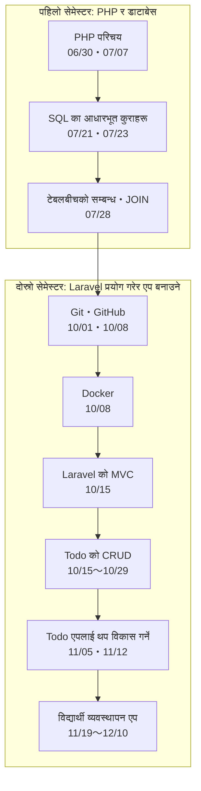

# पहिलो वर्ष｜डाटा डिजाइन र एप विकास — सामग्रीहरूको समग्र नक्सा

> 🇯🇵 मूल प्रति (जापानी भाषामा): [README.md](<../1年生_データ設計とアプリ開発/README.md>) <!-- original-ja-link -->

यो कक्षामा हामी **PHP प्रयोग गरेर चल्ने पेज बनाउने → डाटाबेसमा डाटा सेभ गर्ने → Laravel प्रयोग गरेर एप बनाउने** क्रममा अगाडि बढ्छौँ।

हरेक सामग्रीमा, **पेजको सबैभन्दा तलको गाइड** बाट अघिल्लो/पछिल्लो सामग्री वा यो पेजमा जान सकिन्छ।
अलमल भयो भने, यो पेजमा फर्किनुहोस्।

## समग्र प्रवाह

समस्या पर्दा हेर्ने पेजहरू

| यस्तो बेला | हेर्ने पेज |
|:--|:--|
| कमान्ड बिर्सियो | [महत्त्वपूर्ण कमान्डहरूको सूची](後期/重要コマンド一覧.md) |
| Laravel सोचेजस्तो चल्दैन | [【महत्त्वपूर्ण】लग निकाल्ने तरिका](後期/20261022/【重要】ログの出し方.md) |
| पहिलो सेमेस्टरको PHP・MySQL सुरु गर्ने तरिका बिर्सियो | [Todo व्यवस्थापन एप सुरु गर्ने तरिका](前期/20260723/Todo管理アプリ起動する流れ.md) |

---

## पहिलो सेमेस्टर: PHP र डाटाबेस

| मिति | सामग्री | अभ्यास・उत्तर | थप जानकारी |
|:--|:--|:--|:--|
| 06/30 | [PHP परिचय](前期/20260630/20260630_資料.md) | [अभ्यास](前期/20260630/20260630_演習.md)・[उत्तर](前期/20260630/20260630_解答.md) | [PHP डेभलपमेन्ट सर्भर कसरी सुरु गर्ने](前期/PHP開発サーバーの立て方.md) |
| 07/07 | [PHP का आधारभूत कुरा र फर्म](前期/20260707/20260707_資料.md) | [अभ्यास](前期/20260707/20260707_演習.md)・[उत्तर](前期/20260707/20260707_解答.md) | |
| 07/14 | [अभ्यास प्रश्नहरू](前期/20260714/20260714_資料_1.md) | | |
| 07/21 | [DB किन चाहिन्छ](前期/20260721/20260721_資料.md) [SQL का आधारभूत कुराहरू ① (SELECT)](前期/20260721/20260721_資料_2.md) | [अभ्यास](前期/20260721/20260721_演習.md)・[उत्तर](前期/20260721/20260721_解答.md) | [डाटाबेस सर्भर कसरी स्थापना गर्ने (XAMPP संस्करण)](前期/データベースサーバーの立て方/データベースサーバーの立て方.md) [रिलेसनल डाटाबेस परिचय](前期/20260721/リレーショナルデータベース入門.md) |
| 07/23 | [SQL का आधारभूत कुराहरू ② (INSERT・UPDATE・DELETE)](前期/20260723/20260723_資料.md) | [अभ्यास](前期/20260723/20260723_演習.md)・[उत्तर](前期/20260723/20260723_解答.md) | [Todo व्यवस्थापन एप सुरु गर्ने तरिका](前期/20260723/Todo管理アプリ起動する流れ.md) [PDO_MySQL जडान त्रुटिको समाधान](前期/20260723/PDO_MySQL接続エラー対処法.md) |
| 07/28 | [टेबलबीचको सम्बन्ध・JOIN](前期/20260728/20260728_資料.md) | [अभ्यास](前期/20260728/20260728_演習.md)・[उत्तर](前期/20260728/20260728_解答.md) | [JOIN परिचय](前期/20260728/JOIN入門.md) |

## दोस्रो सेमेस्टर: Laravel प्रयोग गरेर एप बनाउने

| मिति | सामग्री | थप जानकारी |
|:--|:--|:--|
| 10/01 | [पहिलो सेमेस्टरको पुनरावलोकन](後期/20261001/20261001_復習.md) [सोर्स कोड व्यवस्थापन परिचय](後期/20261001/20261001_資料_1.md) | |
| 10/08 | [GitHub खाता र रिपोजिटरी](後期/20261008/20261008_資料_1.md) [अभ्यास वातावरण push गर्ने](後期/20261008/20261008_資料_2.md) [Docker परिचय](後期/20261008/20261008_資料_3.md) | |
| 10/15 | [MVC को संरचना](後期/20261015/20261015_資料_1.md) [Todo सूची](後期/20261015/20261015_資料_2.md) | |
| 10/22 | [Todo थप्ने (CREATE)](後期/20261022/20261022_資料_1.md) [Todo विवरण (SHOW)](後期/20261022/20261022_資料_2.md) | [【महत्त्वपूर्ण】लग निकाल्ने तरिका](後期/20261022/【重要】ログの出し方.md) |
| 10/29 | [Todo सम्पादन (UPDATE)](後期/20261029/20261029_資料_1.md) [पूरा भएको/नभएको बदल्ने (PATCH)](後期/20261029/20261029_資料_2.md) [Todo मेटाउने (DELETE)](後期/20261029/20261029_資料_3.md) | |
| 11/05 | [Seeder・Factory](後期/20261105/20261105_資料_1.md) [भ्यालिडेसन](後期/20261105/20261105_資料_2.md) | |
| 11/12 | [साझा भागलाई कम्पोनेन्ट बनाउने (@include)](後期/20261112/20261112_資料_1.md) [क्याटेगरी जोड्ने](後期/20261112/20261112_資料_2.md) | |
| 11/19 | [विद्यार्थी व्यवस्थापन ① सूची・विवरण](後期/20261119/20261119_資料_1.md) [विद्यार्थी व्यवस्थापन ② थप्ने・सम्पादन・मेटाउने](後期/20261119/20261119_資料_2.md) | |
| 11/26 | [विद्यार्थी व्यवस्थापन ③ लगइन](後期/20261126/20261126_資料_1.md) | |
| 12/03 | [विद्यार्थी व्यवस्थापन ④ रिलेसन](後期/20261203/20261203_資料_1.md) | |
| 12/10 | [विद्यार्थी व्यवस्थापन ⑤ शिक्षकको नयाँ दर्ता](後期/20261210/20261210_資料_1.md) | |

जुनसुकै बेला प्रयोग गर्न सकिने पेज: [महत्त्वपूर्ण कमान्डहरूको सूची](後期/重要コマンド一覧.md)
