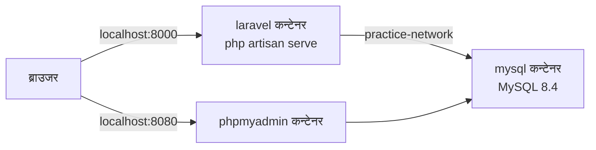
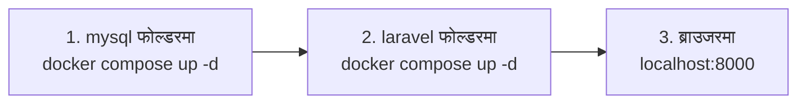

# Laravel × MySQL अभ्यास वातावरण (Docker)

> 🇯🇵 मूल प्रति (जापानी भाषामा): [README.md](<../../1年生_データ設計とアプリ開発/practice/README.md>) <!-- original-ja-link -->

Laravel र MySQL लाई **छुट्टाछुट्टै कन्टेनर** को रूपमा सुरु गर्छौँ।
यी २ वटा कन्टेनर `practice-network` नामको नेटवर्कले जोडिएका छन्।



```
practice/
  mysql/
    compose.yaml    ← MySQL र phpMyAdmin
  laravel/
    compose.yaml    ← Laravel
    Dockerfile
    entrypoint.sh
    src/            ← पहिलो पटक सुरु गर्दा Laravel आफैँ बनिन्छ
```

> Docker Desktop सुरु गरेर, तल बायाँ कुनामा **Engine running** देखिएको छ कि छैन जाँच गरेपछि मात्र सुरु गर्नुहोस्।
> Docker Desktop कसरी इन्स्टल गर्ने → [Docker Desktop इन्स्टल गर्ने](../後期/20261008/20261008_資料.md)

> **XAMPP बन्द गरिराख्नुहोस्**
> XAMPP प्रयोग गर्दै हुनुहुन्छ भने, XAMPP Control Panel खोलेर चलिरहेका सबै (Apache・MySQL आदि) लाई **Stop** गरेपछि सुरु गर्नुहोस्।
> XAMPP को MySQL चलिरहेको छ भने, त्यसले पनि उही `3306` नम्बरको पोर्ट प्रयोग गर्ने भएकाले MySQL कन्टेनर सुरु हुन सक्दैन।

---

## 1. राख्ने ठाउँ

C ड्राइभमा `git` नामको फोल्डर बनाएर, त्यसभित्र हरेक प्रोजेक्ट राख्दै जानुहोस्।

```
C:\git\practice
```

डेस्कटपमा राखे पनि हुन्छ।

> **कहाँ सेभ गर्नुभयो सम्झिराख्नुहोस्**
> सुरु वा बन्द गर्दा हरेक पटक `cd` ले त्यो फोल्डरमा जानुपर्छ। सेभ गरेको ठाउँ थाहा भएन भने काम गर्न सकिँदैन।

> **OneDrive भित्र नराख्नुहोस्**
> `C:\Users\<प्रयोगकर्ता नाम>\OneDrive\...` भित्र राख्दा सिंक्रोनाइजेसनसँग टकराएर ढिलो हुन सक्छ वा त्रुटि आउन सक्छ।
> कतिपय PC मा डेस्कटप नै OneDrive भित्र हुन्छ, त्यसैले अलमल भयो भने `C:\git` मा राख्नुहोस्।

---

## 2. सुरु गर्ने (क्रम महत्त्वपूर्ण छ)

**सधैँ mysql → laravel को क्रममा** सुरु गर्नुहोस्।
किनभने `practice-network` नेटवर्क mysql तर्फ बनाइन्छ।



PowerShell मा चलाउनुहोस्। (`C:\git\practice` बाहेक अन्य ठाउँमा राख्नुभएको छ भने, त्यसको सट्टा आफूले सेभ गरेको ठाउँ प्रयोग गर्नुहोस्)

```powershell
cd C:\git\practice\mysql
docker compose up -d
```

```powershell
cd C:\git\practice\laravel
docker compose up -d
```

**पहिलो पटक मात्र**, Laravel इन्स्टल हुन केही मिनेट लाग्छ। कहाँसम्म पुग्यो भनेर तलको कमान्डले हेर्न सकिन्छ (`Ctrl + C` थिचेर हेर्न बन्द गर्न सकिन्छ)।

```powershell
docker compose logs -f
```

`Server running on [http://0.0.0.0:8000]` देखियो भने तयार भयो।

| खोल्ने URL | देखिने कुरा |
|---------|--------------|
| http://localhost:8000 | Laravel को मुख्य पेज ✅ |
| http://localhost:8080 | phpMyAdmin (`laravel` डाटाबेसमा टेबलहरू बनेका छन् ✅) |

---

## 3. बन्द गर्ने

सुरु गर्दाको **उल्टो क्रममा** (laravel → mysql) बन्द गर्नुहोस्।

```powershell
cd C:\git\practice\laravel
docker compose down
```

```powershell
cd C:\git\practice\mysql
docker compose down
```

`down` गरे पनि डाटाबेसभित्रको डाटा मेटिँदैन (`mysql-data` भोल्युममा बाँकी रहन्छ)।

---

## 4. कनेक्सन जानकारी

| विषय | Laravel बाट | PC (A5:SQL Mk-2 आदि) बाट |
|------|-------------|--------------------------|
| होस्ट | `mysql` | `127.0.0.1` |
| पोर्ट | `3306` | `3306` |
| डाटाबेस | `laravel` | `laravel` |
| प्रयोगकर्ता नाम | `laravel` | `laravel` |
| पासवर्ड | `password` | `password` |

PC तर्फको पोर्ट XAMPP को MySQL जस्तै `3306` हो। त्यसैले XAMPP को MySQL बन्द गरिराख्नुहोस्।
Laravel को सेटिङ `laravel/src/.env` मा लेखिएको छ।

---

## 5. artisan कमान्ड प्रयोग गर्ने

`php artisan` लाई laravel कन्टेनरभित्र चलाउनुहोस्। laravel फोल्डरमा तल जस्तै टाइप गर्नुहोस्।

```powershell
docker compose exec laravel php artisan migrate
docker compose exec laravel php artisan make:controller TodoController
```

---

## 6. काम नगरेमा

| लक्षण | समाधान |
|------|------|
| `network practice-network declared as external, but could not be found` | mysql पहिले सुरु गरिएको छैन → mysql फोल्डरमा `docker compose up -d` |
| लगमा `MySQL の起動を待っています...` (MySQL सुरु हुने प्रतीक्षा गर्दै...) लगातार देखिन्छ | mysql कन्टेनर चलिरहेको छ कि छैन, Docker Desktop को `Containers` मा जाँच गर्नुहोस् |
| `port is already allocated` (पोर्ट प्रयोगमा छ) | XAMPP Control Panel मा MySQL आदिलाई Stop गर्नुहोस्। `php -S` जस्ता उही पोर्ट प्रयोग गर्ने अरू कुरा पनि बन्द गर्नुहोस् |
| पहिलो पटकको इन्स्टल बीचमै असफल भयो | laravel फोल्डरमा `docker compose down` → `src` फोल्डर मेटाउने → फेरि `docker compose up -d` |
| डाटाबेसलाई फेरि सुरुदेखि बनाउन चाहनुहुन्छ | mysql फोल्डरमा `docker compose down -v` (**सबै डाटा मेटिन्छ**) |
