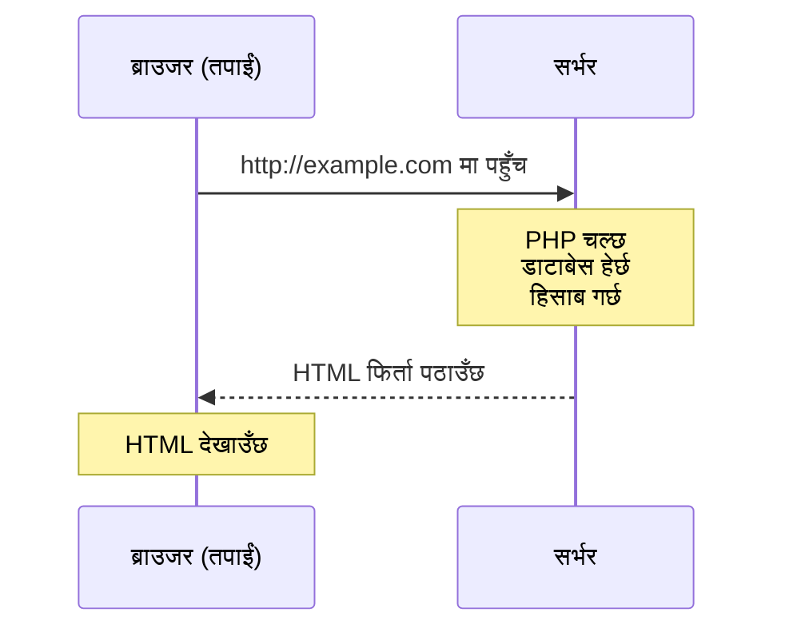

# पहिलो वर्ष｜डाटा डिजाइन र एप विकास — 2026/06/30

> 🇯🇵 मूल प्रति (जापानी भाषामा): [20260630_資料.md](<../../../1年生_データ設計とアプリ開発/前期/20260630/20260630_資料.md>) <!-- original-ja-link -->

---

## यो कक्षाको मूल्याङ्कनबारे

| विषय | प्रतिशत |
| --- | --- |
| उपस्थिति दर | 30% |
| कक्षामा व्यवहार | 10% |
| बुझाउनुपर्ने काम | 60% |

> ⚠️ **महत्त्वपूर्ण: उपस्थिति दर 60% भन्दा कम भएमा, बुझाएको काम र कक्षाको व्यवहारको मूल्याङ्कन जस्तोसुकै भए पनि क्रेडिट पाइँदैन।**\
> ढिलो आउनु वा चाँडै जानुलाई विषय शिक्षकको निर्णय अनुसार अनुपस्थिति मानिन सक्छ। सधैँ समयमै उपस्थित हुनुहोस्।

---

## आजको लक्ष्य

- सर्भर साइड र क्लाइन्ट साइडको फरक बताउन सक्ने
- PHP चल्ने वातावरण तयार गर्न सक्ने
- पहिलो PHP फाइल चलाउन सक्ने

---

## 1. क्लाइन्ट साइड र सर्भर साइडको फरक

```
क्लाइन्ट साइड (पहिलो सेमेस्टरमा सिकेको)
  ब्राउजरमा चल्छ → HTML / CSS / JavaScript
  प्रयोगकर्ताको डिभाइसमा चल्छ

सर्भर साइड (यो सेमेस्टरदेखि सिक्ने)
  सर्भरमा चल्छ → PHP / Python / Ruby / Go आदि
  सर्भरमा चलेपछि नतिजा ब्राउजरमा पठाइन्छ
```

**सर्भर साइड किन चाहिन्छ?**

| गर्न चाहेको काम | क्लाइन्ट मात्रले | सर्भर चाहिन्छ |
| --- | --- | --- |
| टेक्स्ट देखाउने | ✅ सकिन्छ | — |
| डाटाबेस पढ्ने | ❌ सकिँदैन | ✅ चाहिन्छ |
| पासवर्ड सुरक्षित रूपमा व्यवस्थापन गर्ने | ❌ खतरनाक | ✅ चाहिन्छ |
| लगइन सुविधा | ❌ सकिँदैन | ✅ चाहिन्छ |

---

## 2. PHP भनेको के हो

**PHP = सर्भर साइडको प्रोग्रामिङ भाषा। वेब एप विकासका लागि विशेष रूपमा बनाइएको।**

ब्राउजर र सर्भरबीचको आदानप्रदान यस्तो क्रममा हुन्छ।



**JavaScript सँग तुलना गरौँ:**

| विषय | JavaScript | PHP |
| --- | --- | --- |
| चल्ने ठाउँ | ब्राउजर | सर्भर |
| भेरिएबल लेख्ने तरिका | `let x = 5;` | `$x = 5;` |
| स्ट्रिङ जोड्ने | `"Hello" + "World"` | `"Hello" . "World"` |
| एरे | `let arr = [1, 2, 3]` | `$arr = [1, 2, 3]` |
| आउटपुट | `console.log()` | `echo` |

---

## 3. वातावरण तयारी: PHP इन्स्टल गर्ने

### Mac को लागि (Homebrew प्रयोग गरेर)

Homebrew इन्स्टल गरिएको छैन भने, [brew.sh](https://brew.sh) को निर्देशन अनुसार पहिले इन्स्टल गर्नुहोस्।

```bash
brew install php
```

### Windows को लागि

1. [windows.php.net/download](https://windows.php.net/download/) मा जानुहोस्
2. "VS16 x64 Non Thread Safe" को ZIP डाउनलोड गर्नुहोस्
3. `C:\php` मा extract गर्नुहोस्
4. PATH environment variable मा `C:\php` थप्नुहोस्

### चल्छ कि चल्दैन जाँच

```bash
php --version
# → PHP 8.x.x ... देखियो भने ठिक छ
```

---

## 4. पहिलो PHP फाइल

### काम गर्ने फोल्डर बनाउने (जहाँ बनाए पनि हुन्छ)

```
Mac:     ~/study/
Windows: C:\Users\प्रयोगकर्ता_नाम\study\
```

### `index.php` बनाउने

```php
<?php
// PHP को कोड <?php बाट सुरु हुन्छ
// JS को console.log को बराबर PHP मा echo हो

echo "こんにちは PHP！";

// भेरिएबल $ बाट सुरु हुन्छ (JavaScript सँगको ठूलो फरक)
$namae = "田中太郎";
$nenrei = 20;

// स्ट्रिङभित्र भेरिएबल राख्ने (डबल कोटमा मात्र)
echo "名前: $namae";
echo "年齢: {$nenrei}歳";  // भेरिएबललाई {} भित्र राख्दा स्पष्ट हुन्छ

// JS को टेम्प्लेट लिटरलसँग मिल्दोजुल्दो
// JS: `名前: ${namae}`
// PHP: "名前: {$namae}"
?>
```

**लोकल सर्भर सुरु गरेर ब्राउजरमा जाँच गर्ने:**

```bash
# study फोल्डरमा गएपछि चलाउनुहोस्
cd ~/study
php -S localhost:8000
```

`http://localhost:8000/index.php` मा जानुहोस्

---

## 5. PHP को आधारभूत सिन्ट्याक्स (JS सँग तुलना)

```php
<?php
// ========== भेरिएबल ==========
$name = "Alice";      // JS को let जस्तै ($ चाहिन्छ)
$age = 20;
$pi = 3.14;
$isStudent = true;

// ========== आउटपुट ==========
echo "Hello";          // नयाँ लाइन बिना आउटपुट
echo "World\n";        // \n ले नयाँ लाइन
echo $name . "\n";     // . ले स्ट्रिङ जोड्ने (JS को + जस्तै)

// PHP ट्याग र HTML सँगै मिसाएर लेख्न सकिन्छ (PHP को विशेषता)
?>
<h1>こんにちは、<?= $name ?>さん！</h1>
<!-- <?= भनेको echo को छोटो रूप हो -->
<?php

// ========== सर्तअनुसार शाखा विभाजन (JS जस्तै तरिकाले) ==========
if ($age >= 18) {
    echo "成人です\n";
} else {
    echo "未成年です\n";
}

// ========== लुप ==========
for ($i = 1; $i <= 5; $i++) {   // $i भनेको JS को i जस्तै हो
    echo $i . "回目\n";
}

// ========== एरे ==========
$fruits = ["りんご", "みかん", "ぶどう"];
echo $fruits[0] . "\n";  // → りんご

// एरेको लुप
foreach ($fruits as $fruit) {  // JS को forEach जस्तै
    echo $fruit . "\n";
}
?>
```

---

## सारांश

| अवधारणा | JavaScript | PHP |
| --- | --- | --- |
| भेरिएबल | `let x` | `$x` |
| आउटपुट | `console.log()` | `echo` |
| स्ट्रिङ जोड्ने | `"a" + "b"` | `"a" . "b"` |
| एरे लुप | `forEach` | `foreach` |
| चल्ने ठाउँ | ब्राउजर | सर्भर |

---

## अर्को कक्षाको पूर्वावलोकन

PHP का भेरिएबल・टाइप・अपरेटर・एरे・एसोसिएटिभ एरे राम्रोसँग सिक्नेछौँ।\
"JavaScript मा भएकै अवधारणा फरक तरिकाले लेखिन्छ" भन्ने कुरामा ध्यान दिँदै अगाडि बढौँ।

<!-- nav:start -->

---

📎 यो पनि पढ्नुहोस् → [PHP डेभलपमेन्ट सर्भर कसरी सुरु गर्ने](../PHP開発サーバーの立て方.md)

| ⬅️ अघिल्लो | 🗺️ समग्र नक्सा | अर्को ➡️ |
|:--|:--:|--:|
| — | [सामग्रीको समग्र नक्सा](../../README.md) | [06/30 अभ्यास](20260630_演習.md) |

<!-- nav:end -->
