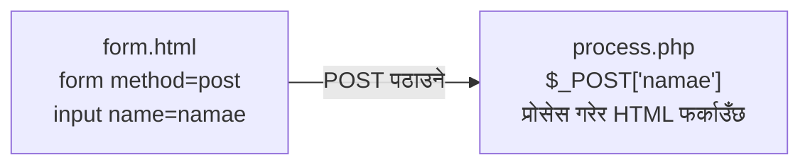
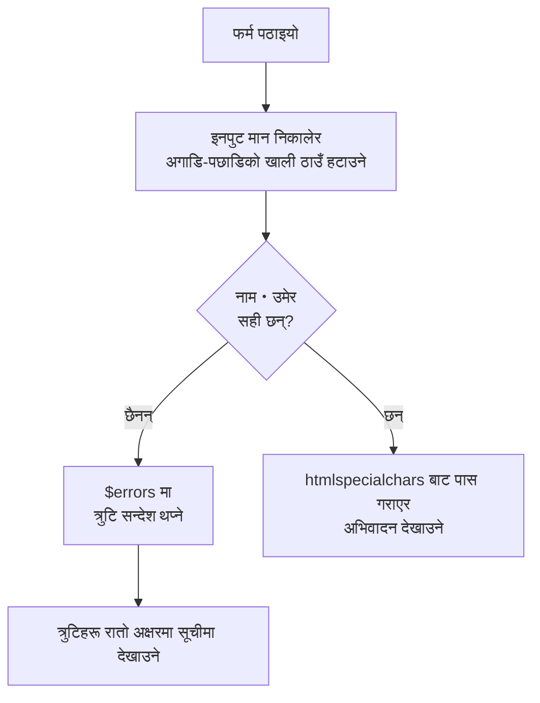

# पहिलो वर्ष｜डाटा डिजाइन र एप विकास — 2026/07/07

> 🇯🇵 मूल प्रति (जापानी भाषामा): [20260707_資料.md](<../../../1年生_データ設計とアプリ開発/前期/20260707/20260707_資料.md>) <!-- original-ja-link -->

---

## आजको लक्ष्य

- PHP का भेरिएबल・टाइप・एरे・एसोसिएटिभ एरे प्रयोग गर्न सक्ने
- सर्तअनुसार शाखा विभाजन गर्ने कोड र फङ्सन लेख्न सक्ने
- HTML फर्मको डाटा PHP मा प्राप्त गरेर, सुरक्षित रूपमा प्रोसेस गर्न सक्ने

---

## 1. भेरिएबल र टाइप

```php
<?php
// भेरिएबल सधैँ $ बाट सुरु हुन्छ
$namae    = "田中太郎";   // स्ट्रिङ (string)
$nenrei   = 20;           // पूर्णाङ्क (int)
$身長     = 1.75;         // दशमलव सङ्ख्या (float)
$isStudent = true;        // सत्य/असत्य मान (bool)

// gettype() ले टाइप जाँच्ने (JS को typeof जस्तै)
echo gettype($namae);     // → string
echo gettype($nenrei);    // → integer

// टाइप रूपान्तरण
$str = "42";
$num = (int)$str;         // स्ट्रिङलाई पूर्णाङ्कमा बदल्ने
echo $num + 1;            // → 43
```

---

## 2. स्ट्रिङसँग काम गर्ने

```php
<?php
$namae = "田中太郎";

echo mb_strlen($namae);   // → 4 (अक्षर सङ्ख्या। mb_ फङ्सनले जापानी अक्षरहरू पनि सही रूपमा गन्छ)

// स्ट्रिङभित्र भेरिएबलको मान राख्ने
echo "名前: {$namae}さん";

// धेरै प्रयोग हुने स्ट्रिङ फङ्सनहरू
echo strtolower("HELLO");              // → hello
echo strtoupper("hello");              // → HELLO
echo trim("  hello  ");                // → hello (अगाडि र पछाडिको खाली ठाउँ हटाउँछ)
echo str_replace("猫", "犬", "猫が好き"); // → 犬が好き
```

---

## 3. एरे

```php
<?php
$scores = [85, 72, 91, 68, 78];

echo $scores[0];          // → 85 (0 बाट सुरु हुन्छ)
echo count($scores);      // → 5 (JS को .length जस्तै)

$scores[] = 95;           // अन्तिममा थप्ने (JS को push जस्तै)
sort($scores);            // सानोबाट ठूलो क्रममा मिलाउने
rsort($scores);           // ठूलोबाट सानो क्रममा मिलाउने

// धेरै प्रयोग हुने एरे फङ्सनहरू
$doubled  = array_map(fn($x) => $x * 2, $scores);       // JS को map
$big      = array_filter($scores, fn($x) => $x >= 80);  // JS को filter
$total    = array_sum($scores);                           // जम्मा
$average  = array_sum($scores) / count($scores);          // औसत
```

---

## 4. एसोसिएटिभ एरे (JS को अब्जेक्ट जस्तै)

```php
<?php
// एसोसिएटिभ एरे = key र value को जोडी
$person = [
    "namae"  => "田中太郎",
    "nenrei" => 20,
    "email"  => "tanaka@example.com",
];

echo $person["namae"];   // → 田中太郎

$person["hobby"] = "プログラミング";  // key थप्ने
$person["nenrei"] = 21;               // value बदल्ने

// foreach ले key र value निकाल्ने
foreach ($person as $key => $value) {
    echo "{$key}: {$value}\n";
}

// ========== एसोसिएटिभ एरेहरूको एरे (JS को अब्जेक्टहरूको एरे) ==========
$students = [
    ["id" => 1, "name" => "田中太郎", "score" => 85],
    ["id" => 2, "name" => "鈴木花子", "score" => 72],
];

foreach ($students as $student) {
    echo "ID:{$student['id']} {$student['name']} {$student['score']}点\n";
}
```

---

## 5. सर्तअनुसार शाखा विभाजन

```php
<?php
$score = 72;

// if/elseif/else (PHP मा elseif लेखिन्छ)
if ($score >= 90) {
    echo "S評価";
} elseif ($score >= 80) {
    echo "A評価";
} elseif ($score >= 70) {
    echo "B評価";
} else {
    echo "D評価";
}

// टर्नरी अपरेटर (JS जस्तै)
$result = ($score >= 60) ? "合格" : "不合格";

// match एक्सप्रेसन (PHP 8.0 देखि・switch को सुधारिएको रूप)
$status = "active";
$label = match($status) {
    "active"   => "有効",
    "inactive" => "無効",
    default    => "不明",
};
echo $label;  // → 有効
```

---

## 6. फङ्सन

```php
<?php
// टाइप घोषणासहितको फङ्सन (आर्गुमेन्ट र रिटर्न मानको टाइप लेख्न सकिन्छ)
function calcTax(float $price, float $taxRate = 0.1): float {
    return $price * (1 + $taxRate);
}

echo calcTax(1000);       // → 1100 (डिफल्ट 10%)
echo calcTax(1000, 0.08); // → 1080 (8%)

// धेरै मान फर्काउने (एसोसिएटिभ एरेको रूपमा फर्काउने)
function calcStats(array $numbers): array {
    return [
        "total"   => array_sum($numbers),
        "average" => array_sum($numbers) / count($numbers),
        "max"     => max($numbers),
        "min"     => min($numbers),
    ];
}

$stats = calcStats([85, 72, 91, 68]);
echo "平均: " . $stats["average"];  // → 平均: 79

// एरो फङ्सन (PHP 7.4 देखि)
$double = fn($n) => $n * 2;
echo $double(5);  // → 10
```

---

## 7. फर्म र डाटा प्राप्त गर्ने ($_POST)

फर्ममा भरेको कुरा, यसरी PHP सम्म पुग्छ।



### form.html

```html
<form action="process.php" method="post">
  <input type="text"  name="namae"   placeholder="名前">
  <input type="number" name="age"    placeholder="年齢">
  <textarea name="message"></textarea>
  <button type="submit">送信する</button>
</form>
```

### process.php

```php
<?php
$namae   = $_POST["namae"]   ?? "";
$age     = $_POST["age"]     ?? "";
$message = $_POST["message"] ?? "";

// !! महत्त्वपूर्ण !! XSS बाट बच्ने उपाय: htmlspecialchars ले HTML ट्यागलाई निष्क्रिय बनाउने
$safeName    = htmlspecialchars($namae,   ENT_QUOTES, 'UTF-8');
$safeMessage = htmlspecialchars($message, ENT_QUOTES, 'UTF-8');

echo "<p>名前: {$safeName}</p>";
echo "<p>年齢: {$age}歳</p>";
echo "<p>メッセージ: {$safeMessage}</p>";
?>
```

---

## 8. XSS बाट बच्ने उपाय

```php
<?php
// ❌ खतरनाक उदाहरण (htmlspecialchars बिना)
$input = "<script>alert('ハッキング！')</script>";
echo $input;
// → ब्राउजरले <script> चलाइदिन्छ!

// ✅ सुरक्षित उदाहरण
echo htmlspecialchars($input, ENT_QUOTES, 'UTF-8');
// → &lt;script&gt;... भनेर साधारण टेक्स्टको रूपमा देखिन्छ
?>
```

> **नियम:** प्रयोगकर्ताको इनपुटलाई सधैँ `htmlspecialchars()` बाट पास गराएर मात्र देखाउनुहोस्!

---

## 9. भ्यालिडेसन (इनपुट जाँच)

तलको कोडले यो क्रममा इनपुट जाँच गर्छ।



```php
<?php
$errors = [];
$namae  = "";
$age    = "";

if ($_SERVER["REQUEST_METHOD"] === "POST") {
    $namae = trim($_POST["namae"] ?? "");
    $age   = trim($_POST["age"]   ?? "");

    if (empty($namae)) {
        $errors[] = "名前は必須です";
    } elseif (mb_strlen($namae) > 50) {
        $errors[] = "名前は50文字以内にしてください";
    }

    if (empty($age)) {
        $errors[] = "年齢は必須です";
    } elseif (!is_numeric($age) || $age < 0 || $age > 150) {
        $errors[] = "年齢は0〜150の数値を入力してください";
    }

    if (empty($errors)) {
        $safeName = htmlspecialchars($namae, ENT_QUOTES, 'UTF-8');
        echo "<p>こんにちは、{$safeName}さん（{$age}歳）！</p>";
    }
}

if (!empty($errors)) {
    echo "<ul style='color:red;'>";
    foreach ($errors as $error) {
        echo "<li>" . htmlspecialchars($error) . "</li>";
    }
    echo "</ul>";
}
?>
```

---

## सारांश

| सुविधा | JavaScript | PHP |
| --- | --- | --- |
| भेरिएबल | `let x = 1` | `$x = 1` |
| एरेको लम्बाइ | `arr.length` | `count($arr)` |
| अन्तिममा थप्ने | `arr.push(v)` | `$arr[] = v` |
| forEach | `arr.forEach(fn)` | `foreach ($arr as $v)` |
| अब्जेक्ट | `{key: value}` | `["key" => value]` |
| else if | `else if` | `elseif` |
| एरो फङ्सन | `(x) => x * 2` | `fn($x) => $x * 2` |
| फर्म डाटा प्राप्त गर्ने | `fetch` / `FormData` | `$_POST["name"]` |
| XSS बाट बच्ने उपाय | `textContent` प्रयोग गर्ने | `htmlspecialchars()` |

---

## अर्को कक्षाको पूर्वावलोकन

"डाटाबेस किन चाहिन्छ" भन्ने कुरा आफैँ गरेर सिक्नेछौँ।  
PHP को एरे मात्र प्रयोग गरेर डाटा व्यवस्थापन गर्न खोज्दा, कस्ता सीमाहरू आउँछन् भन्ने कुरा आफैँ अनुभव गर्नेछौँ।

<!-- nav:start -->

---

| ⬅️ अघिल्लो | 🗺️ समग्र नक्सा | अर्को ➡️ |
|:--|:--:|--:|
| [06/30 अभ्यास](../20260630/20260630_演習.md) | [सामग्रीको समग्र नक्सा](../../README.md) | [07/07 अभ्यास](20260707_演習.md) |

<!-- nav:end -->
