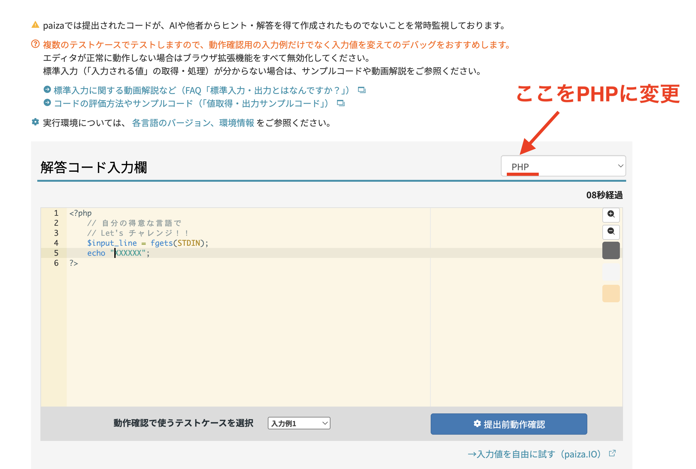

# अभ्यास प्रश्नहरू (2026 जुलाई 14)

> 🇯🇵 मूल प्रति (जापानी भाषामा): [20260714_資料_1.md](<../../../1年生_データ設計とアプリ開発/前期/20260714/20260714_資料_1.md>) <!-- original-ja-link -->

PHP को सर्भर चलाउन सकियो, त्यसैले सबैभन्दा पहिले अहिलेसम्मका अभ्यास प्रश्नहरू गरेर हेर्नुहोस्।

## तयारी

- [PHP डेभलपमेन्ट सर्भर कसरी सुरु गर्ने](../PHP開発サーバーの立て方.md)

## अभ्यास

1. [20260630_演習](../20260630/20260630_演習.md)
2. [20260707_演習](../20260707/20260707_演習.md)


सबै प्रश्न एउटै `index.php` मा लेखे पनि हुन्छ, तर [PHP डेभलपमेन्ट सर्भर कसरी सुरु गर्ने](../PHP開発サーバーの立て方.md) को "अध्याय अनुसारको डाइरेक्टरी संरचनाबाट एक्सेस गर्ने" भन्ने तरिकाले, प्रश्नपिच्छे फाइल छुट्याए पनि हुन्छ (उदाहरण: `1-1.php` / `1-2.php`)।

### डाइरेक्टरी संरचनाको उदाहरण

```
study/
  index.php
  0630/
    1.php
    2.php
    3.php
    4.php
  0707/
    1-1.php
    1-2.php
    2-1.php
```

### सर्भर सुरु गर्ने कमान्ड

"cd" भनेको हालको डाइरेक्टरी परिवर्तन गर्ने भन्ने अर्थ हो।

```bash
cd /Users/<प्रयोगकर्ता नाम>/Desktop/study
php -S localhost:8000
```

### URL मा कसरी जाने

सर्भर `study` डाइरेक्टरीमै सुरु हुन्छ (`php -S localhost:8000`), त्यसैले URL चाहिँ `study/` बाटको relative path सँग मेल खान्छ।

```
http://localhost:8000/0630/1.php
http://localhost:8000/0630/2.php
http://localhost:8000/0707/1-1.php
http://localhost:8000/0707/1-2.php
```

## AI प्रयोग गर्ने तरिकाबारे

**Gemini जस्ता AI प्रयोग गर्न पाइन्छ!** तर, तलका कुरामा ध्यान दिनुहोस्।

- भाषा (प्रोग्रामिङ भाषा) बुझ्ने
- खोजेर थाहा पाउन सकिने कुरा कण्ठ नगर्ने
- बुझिएन भने "कोडमा व्याख्या गर्ने कमेन्ट राखिदेऊ" भनेर AI लाई अनुरोध गर्ने


## अभ्यास सकेपछि समय बाँकी हुनेहरूले Paiza मा दर्ता गरेर PHP प्रयोग गरी स्किल चेक गर्नुहोस्

https://paiza.jp/challenges

कोड पेस गर्ने भाषा डिफल्टमा अर्कै हुन्छ, त्यसैले तलको चित्रमा जस्तै PHP मा परिवर्तन गर्नुहोस्।



**ध्यान दिनुहोस्: Paiza को स्किल चेकमा, AI वा अरूबाट सङ्केत・उत्तर लिएर बनाइएको कोड हो कि होइन भनेर सधैँ निगरानी गरिन्छ।** अहिलेसम्मका अभ्यासभन्दा फरक, AI प्रयोग नगरी आफ्नै क्षमताले हल गर्नुहोस्।

<!-- nav:start -->

---

| ⬅️ अघिल्लो | 🗺️ समग्र नक्सा | अर्को ➡️ |
|:--|:--:|--:|
| [07/07 अभ्यास](../20260707/20260707_演習.md) | [सामग्रीको समग्र नक्सा](../../README.md) | [07/21 DB किन चाहिन्छ](../20260721/20260721_資料.md) |

<!-- nav:end -->
