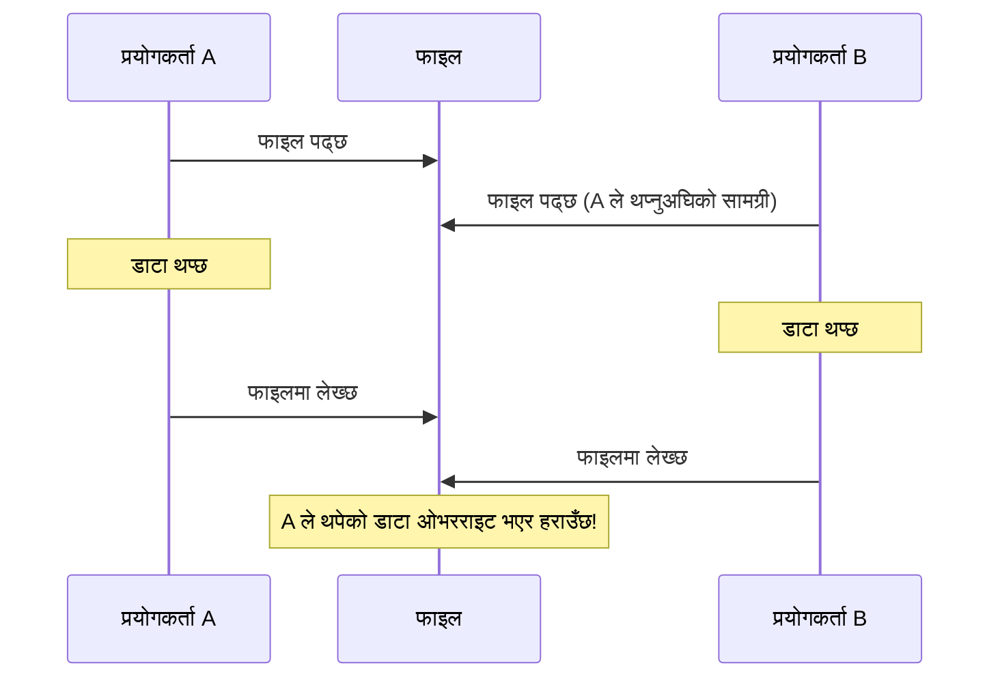
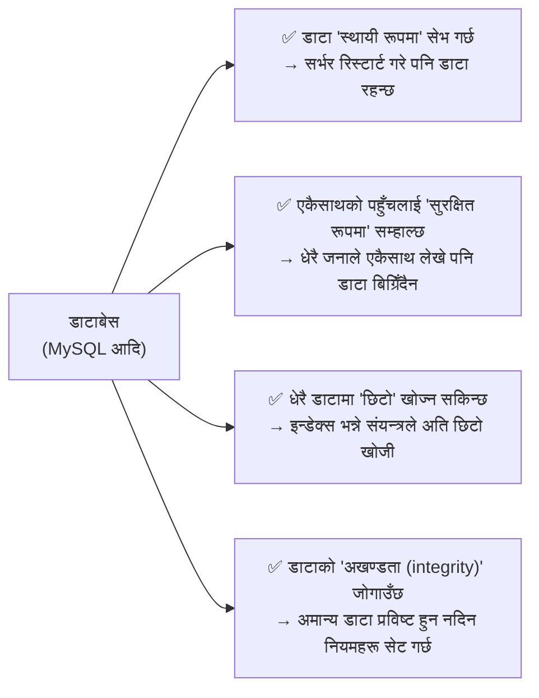
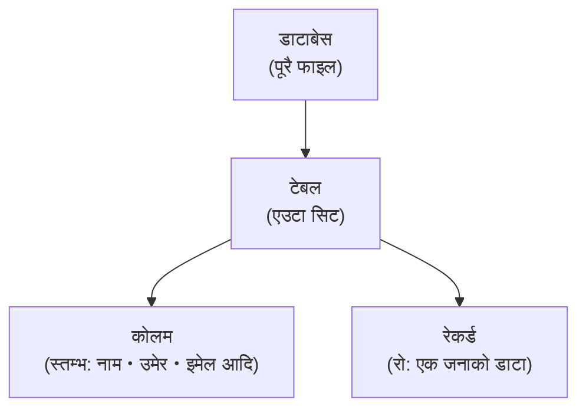
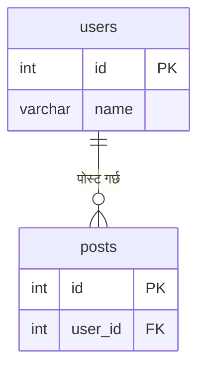

# कक्षा 06｜DB किन चाहिन्छ — PHP को एरे मात्र प्रयोग गर्नुका सीमाहरू

> 🇯🇵 मूल प्रति (जापानी भाषामा): [20260721_資料.md](<../../../1年生_データ設計とアプリ開発/前期/20260721/20260721_資料.md>) <!-- original-ja-link -->

## आजको लक्ष्य
- PHP को एरे मात्र प्रयोग गरेर डाटा व्यवस्थापन गर्दा आउने समस्याहरू बताउन सक्ने
- डाटाबेसले के-के समस्या समाधान गर्छ भनेर बुझ्ने
- MySQL का आधारभूत अवधारणाहरू (टेबल・रो・कोलम) बताउन सक्ने

---

## 1. एरे मात्रले डाटा व्यवस्थापन गरेर हेर्ने

सबैभन्दा पहिले, PHP को एरे मात्र प्रयोग गरेर "प्रयोगकर्ता व्यवस्थापन प्रणाली" बनाएर हेरौँ।

```php
<?php
// फाइलमा अवस्था (state) सेभ गर्ने प्रयास
// users.php
$users = [
    ["id" => 1, "name" => "田中太郎", "email" => "tanaka@example.com"],
    ["id" => 2, "name" => "鈴木花子", "email" => "suzuki@example.com"],
];

// नयाँ प्रयोगकर्ता थप्ने फङ्सन
function addUser(array &$users, string $name, string $email): void {
    $newId = count($users) + 1;
    $users[] = ["id" => $newId, "name" => $name, "email" => $email];
}

addUser($users, "山田次郎", "yamada@example.com");

// देखाउने
foreach ($users as $user) {
    echo "{$user['id']}: {$user['name']}\n";
}
```

### समस्या 1: सर्भर रिस्टार्ट गर्दा डाटा हराउँछ

```
PHP को प्रोग्राम हरेक पटक रिक्वेस्ट आउँदा सुरुदेखि चल्छ
 → हरेक पटक $users = [] बाट सुरु हुन्छ
 → अघिल्लो पटक थपेको डाटा हराउँछ!
```

### समस्या 2: धेरै जनाले एकैसाथ पहुँच गर्दा डाटा बिग्रिन्छ

A र B ले लगभग एकैसाथ लेख्दा, यस्तो हुन्छ।



### समस्या 3: डाटा बढ्दै जाँदा खोजी ढिलो हुन्छ

```php
// 10 लाख प्रयोगकर्तामध्येबाट एउटा निश्चित इमेल ठेगाना खोज्ने
foreach ($users as $user) {
    if ($user["email"] === "target@example.com") {
        return $user;  // सबैभन्दा खराब अवस्थामा 10 लाख पटक लुप चल्छ...
    }
}
```

---

## 2. डाटाबेसले समाधान गर्ने कुराहरू



---

## 3. डाटाबेसका आधारभूत अवधारणा

डाटाबेसलाई **स्प्रेडसिटसँग मिल्दोजुल्दो संरचना** को रूपमा सोच्दा बुझ्न सजिलो हुन्छ।



```
उदाहरण: users टेबल

 id │ name     │ email                │ created_at
────┼──────────┼──────────────────────┼─────────────────
  1 │ 田中太郎 │ tanaka@example.com   │ 2024-01-01 10:00
  2 │ 鈴木花子 │ suzuki@example.com   │ 2024-01-02 11:00
  3 │ 山田次郎 │ yamada@example.com   │ 2024-01-03 12:00
```

---

## 4. MySQL का आधारभूत कुरा

**MySQL = संसारमा सबैभन्दा धेरै प्रयोग हुने ओपन सोर्स रिलेसनल डाटाबेस**

[रिलेसनल डाटाबेसबारे](./リレーショナルデータベース入門.md)

Laravel मा पनि सामान्यतया यही प्रयोग गरिन्छ।

```
रिलेसनल डाटाबेस (RDB) भनेको:
- डाटालाई टेबल (तालिका) मा व्यवस्थापन गर्छ
- टेबलहरूलाई "सम्बन्ध (रिलेसन)" ले जोड्न सकिन्छ
- SQL (Structured Query Language) भन्ने भाषाले चलाइन्छ

उदाहरण:
  users टेबल (प्रयोगकर्ताको जानकारी)
  posts टेबल (पोस्टको जानकारी)
  → posts.user_id ले कुन प्रयोगकर्ताको पोस्ट हो भनेर व्यवस्थापन गर्न सकिन्छ
```

users र posts को सम्बन्धलाई चित्रमा देखाउँदा यस्तो हुन्छ (एक जना प्रयोगकर्ताका धेरै पोस्ट हुन सक्छन्)।



---

## 5. MySQL तयार गर्ने (Windows: XAMPP / Mac: DBngin)

आफ्नो OS अनुसार, कुनै एउटा प्रयोग गर्नुहोस्।

### Windows को लागि: XAMPP

**XAMPP = Apache / MySQL (MariaDB) / PHP / phpMyAdmin एकैपटक इन्स्टल गर्न सकिने निःशुल्क टुल**

#### इन्स्टल

[apachefriends.org](https://www.apachefriends.org/) बाट डाउनलोड गरेर इन्स्टल गर्नुहोस्

#### MySQL सर्भर सुरु गर्ने

1. XAMPP Control Panel खोल्नुहोस्
2. "MySQL" को लाइनमा भएको "Start" क्लिक गरेर सुरु गर्नुहोस्

### Mac को लागि: DBngin

**DBngin = MySQL / PostgreSQL / Redis एक क्लिकमै सुरु गर्न सकिने निःशुल्क टुल**

#### इन्स्टल

[dbngin.com](https://dbngin.com/) बाट डाउनलोड गरेर इन्स्टल गर्नुहोस्

#### MySQL सर्भर बनाउने・सुरु गर्ने

1. DBngin खोल्नुहोस्
2. "+" बटन → "MySQL" छान्नुहोस्
3. भर्सन छानेर "Create" गर्नुहोस् (जुनसुकै भर्सन भए पनि हुन्छ, अलमल भयो भने सबैभन्दा नयाँ stable भर्सन)
4. बनाएको सर्भरको "Start" क्लिक गरेर सुरु गर्नुहोस्

### साझा कनेक्सन जानकारी

दुवै टुलमा, डिफल्टमा तलको सेटिङले MySQL सुरु हुन्छ।

```
Host:     127.0.0.1
Port:     3306
User:     root
Password: (खाली भए पनि हुन्छ)
```

※ 3306 नम्बरको पोर्ट पहिले नै अर्को MySQL ले प्रयोग गरिरहेको छ भने, टुलमै अर्को पोर्ट नम्बरमा बदल्नुहोस् (त्यस अवस्थामा GUI टुलको कनेक्सन सेटिङ पनि त्यही पोर्ट नम्बरमा मिलाउनुहोस्)।

---

## 6. GUI टुलबाट MySQL चलाउने (Windows: phpMyAdmin / Mac: TablePlus)

### Windows को लागि: phpMyAdmin

**phpMyAdmin = XAMPP सँगै आउने MySQL व्यवस्थापन स्क्रिन (ब्राउजरबाट चलाइन्छ)**

XAMPP Control Panel मा MySQL Start गरेको अवस्थामा, ब्राउजरबाट तलको ठेगानामा जानुहोस्।

```
http://localhost/phpmyadmin/
```

कनेक्सन जानकारी भर्नु पर्दैन (XAMPP सुरु हुँदा root प्रयोगकर्ताको रूपमा स्वतः कनेक्ट हुन्छ)।

### Mac को लागि: TablePlus

**TablePlus = MySQL लाई GUI बाट चलाउन सकिने टुल (आफैँ SQL लेखेर अभ्यास गर्न सकिन्छ)**

#### इन्स्टल

[tableplus.com](https://tableplus.com/) बाट डाउनलोड गर्नुहोस्

#### कनेक्सन सेटिङ (DBngin ले सुरु गरेको MySQL मा कनेक्ट गर्दा)

```
Name:     local
Host:     127.0.0.1
Port:     3306
User:     root
Password: (खाली भए पनि हुन्छ)
Database: (पछि बनाउने)
```

---

## 7. पहिलो डाटाबेस बनाउने

Windows मा phpMyAdmin को "SQL" ट्याब, Mac मा TablePlus को SQL ट्याबमा तलको कोड चलाउनुहोस्:

```sql
-- डाटाबेस बनाउने
CREATE DATABASE school_db;

-- बनाएको डाटाबेस प्रयोग गर्ने
USE school_db;

-- टेबल बनाउने
CREATE TABLE users (
    id    INT AUTO_INCREMENT PRIMARY KEY,  -- आफैँ नम्बर लाग्छ
    name  VARCHAR(100) NOT NULL,           -- बढीमा 100 अक्षरको स्ट्रिङ (अनिवार्य)
    email VARCHAR(255) NOT NULL UNIQUE,    -- UNIQUE = दोहोरिन नपाइने
    age   INT,                             -- पूर्णाङ्क (ऐच्छिक)
    created_at TIMESTAMP DEFAULT CURRENT_TIMESTAMP  -- बनाइएको मिति र समय
);

-- डाटा राखेर हेर्ने
INSERT INTO users (name, email, age) VALUES ('田中太郎', 'tanaka@example.com', 20);
INSERT INTO users (name, email, age) VALUES ('鈴木花子', 'suzuki@example.com', 22);

-- डाटा निकाल्ने
SELECT * FROM users;
```

---

## थप: PHP बाट SQL चलाउने उदाहरण

PHP मा **PDO (PHP Data Objects)** भन्ने, DB कनेक्सनका लागि मानक सुविधा छ।

```php
<?php
$pdo = new PDO(
    'mysql:host=127.0.0.1;port=3306;dbname=school_db;charset=utf8mb4',
    'root',
    '' // XAMPP/DBngin को डिफल्ट पासवर्ड खाली हुन्छ
);

// चलाउने SQL स्टेटमेन्ट
$sql = "SELECT * FROM users";

$stmt = $pdo->query($sql);
$users = $stmt->fetchAll(PDO::FETCH_ASSOC);

foreach ($users as $user) {
    echo "{$user['id']}: {$user['name']}\n";
}
```

---

## सारांश

| समस्या | एरे मात्र | डाटाबेस |
|------|---------|------------|
| डाटाको स्थायित्व | ❌ हराउँछ | ✅ रहन्छ |
| एकैसाथको पहुँच | ❌ बिग्रिन्छ | ✅ सुरक्षित |
| धेरै डाटामा खोजी | ❌ ढिलो | ✅ छिटो |
| डाटाको अखण्डता | ❌ जाँच हुँदैन | ✅ नियमहरूद्वारा जोगाउन सकिन्छ |

---

## अर्को कक्षा (कक्षा 07) को पूर्वावलोकन

SQL का आधारभूत कुराहरू: `SELECT` / `WHERE` / `ORDER BY` प्रयोग गरेर डाटा निकाल्ने तरिका सिक्नेछौँ।  
TablePlus मा वास्तवमै SQL लेखेर चलाउँदै अभ्यास गर्नेछौँ।

<!-- nav:start -->

---

📎 यो पनि पढ्नुहोस् → [डाटाबेस सर्भर कसरी स्थापना गर्ने (XAMPP संस्करण)](../データベースサーバーの立て方/データベースサーバーの立て方.md)・[रिलेसनल डाटाबेस परिचय](リレーショナルデータベース入門.md)

| ⬅️ अघिल्लो | 🗺️ समग्र नक्सा | अर्को ➡️ |
|:--|:--:|--:|
| [07/14 अभ्यास प्रश्नहरू](../20260714/20260714_資料_1.md) | [सामग्रीको समग्र नक्सा](../../README.md) | [07/21 SQL का आधारभूत कुराहरू ① (SELECT)](20260721_資料_2.md) |

<!-- nav:end -->
