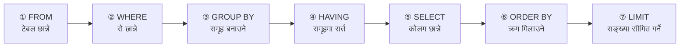

# कक्षा 07｜SQL का आधारभूत कुराहरू ① — SELECT / WHERE / ORDER BY

> 🇯🇵 मूल प्रति (जापानी भाषामा): [20260721_資料_2.md](<../../../1年生_データ設計とアプリ開発/前期/20260721/20260721_資料_2.md>) <!-- original-ja-link -->

## आजको लक्ष्य
- SELECT ले डाटा निकाल्न सक्ने
- WHERE ले सर्त तोकेर छान्न सक्ने
- ORDER BY ले क्रम मिलाउन सक्ने
- LIMIT ले निकाल्ने सङ्ख्या सीमित गर्न सक्ने

---

## तयारी: अभ्यासका लागि डाटा राख्ने

TablePlus को SQL ट्याबमा चलाउनुहोस्:

```sql
-- डाटाबेस र टेबल बनाउने
CREATE DATABASE IF NOT EXISTS school_db;
USE school_db;

-- विद्यार्थी टेबल
CREATE TABLE IF NOT EXISTS students (
    id         INT AUTO_INCREMENT PRIMARY KEY,
    name       VARCHAR(100) NOT NULL,
    age        INT NOT NULL,
    class      VARCHAR(10) NOT NULL,
    score      INT NOT NULL,
    enrolled_at DATE NOT NULL
);

-- टेस्ट डाटा राख्ने
INSERT INTO students (name, age, class, score, enrolled_at) VALUES
('田中太郎', 18, 'A', 85, '2024-04-01'),
('鈴木花子', 19, 'A', 72, '2024-04-01'),
('山田次郎', 18, 'B', 91, '2024-04-01'),
('佐藤三郎', 20, 'B', 58, '2024-04-01'),
('伊藤美咲', 18, 'A', 78, '2024-04-01'),
('渡辺一郎', 19, 'C', 95, '2024-04-01'),
('加藤幸子', 18, 'C', 45, '2024-04-01'),
('吉田健太', 20, 'B', 88, '2024-04-01'),
('山本麻衣', 19, 'A', 67, '2024-04-01'),
('中村龍一', 18, 'C', 73, '2024-04-01');
```

---

## 1. SELECT — डाटा निकाल्ने

```sql
-- सबै कोलम र सबै रो निकाल्ने (* = सबै कोलम)
SELECT * FROM students;

-- तोकिएका कोलम मात्र निकाल्ने
SELECT name, score FROM students;

-- कोलमलाई उपनाम दिने (AS)
SELECT name AS 名前, score AS 点数 FROM students;
```

---

## 2. WHERE — सर्त राखेर छान्ने

```sql
-- score 80 वा बढी भएका विद्यार्थी
SELECT * FROM students WHERE score >= 80;

-- class 'A' भएका विद्यार्थी
SELECT * FROM students WHERE class = 'A';

-- age 18 र score 70 वा बढी
SELECT * FROM students WHERE age = 18 AND score >= 70;

-- class 'A' वा 'B'
SELECT * FROM students WHERE class = 'A' OR class = 'B';

-- class 'A' वा 'B' (IN प्रयोग गर्दा छोटो लेख्न सकिन्छ)
SELECT * FROM students WHERE class IN ('A', 'B');

-- score 60 वा बढी र 90 भन्दा कम (BETWEEN)
SELECT * FROM students WHERE score BETWEEN 60 AND 89;

-- name मा "太" भएका (LIKE = आंशिक मेल)
SELECT * FROM students WHERE name LIKE '%太%';
-- % = जति अक्षर भए पनि हुन्छ (वाइल्डकार्ड)

-- score NULL नभएका (IS NOT NULL)
SELECT * FROM students WHERE score IS NOT NULL;
```

---

## 3. ORDER BY — क्रम मिलाउने

```sql
-- score को बढ्दो क्रम (कमदेखि बढी)
SELECT * FROM students ORDER BY score ASC;   -- ASC = ascending (बढ्दो क्रम)

-- score को घट्दो क्रम (बढीदेखि कम)
SELECT * FROM students ORDER BY score DESC;  -- DESC = descending (घट्दो क्रम)

-- class मा बढ्दो क्रम, एउटै class भित्र score को घट्दो क्रम
SELECT * FROM students ORDER BY class ASC, score DESC;
```

---

## 4. LIMIT — निकाल्ने सङ्ख्या सीमित गर्ने

```sql
-- शीर्ष 5 वटा मात्र निकाल्ने
SELECT * FROM students ORDER BY score DESC LIMIT 5;

-- 6 औँ रेकर्डदेखि 5 वटा निकाल्ने (pagination मा प्रयोग हुन्छ)
-- LIMIT सङ्ख्या OFFSET सुरु हुने स्थान
SELECT * FROM students ORDER BY id ASC LIMIT 5 OFFSET 5;
```

---

## 5. एग्रिगेट फङ्सन

```sql
-- रो सङ्ख्या गन्ने
SELECT COUNT(*) FROM students;
-- → 10

-- score को जम्मा, औसत, अधिकतम र न्यूनतम
SELECT
    COUNT(*)    AS 人数,
    SUM(score)  AS 合計点,
    AVG(score)  AS 平均点,
    MAX(score)  AS 最高点,
    MIN(score)  AS 最低点
FROM students;

-- GROUP BY: कक्षा अनुसार औसत अङ्क
SELECT class, AVG(score) AS 平均点, COUNT(*) AS 人数
FROM students
GROUP BY class
ORDER BY 平均点 DESC;
```

---

## 6. SELECT चल्ने क्रम (महत्त्वपूर्ण!)

SQL लेखिएको क्रममा होइन, तलको क्रममा चल्छ।



```sql
SELECT name, score       -- ⑤ निकाल्ने कोलम छान्ने
FROM students            -- ① टेबल छान्ने
WHERE score >= 70        -- ② सर्त राखेर छान्ने
GROUP BY class           -- ③ समूह बनाउने
HAVING AVG(score) >= 75  -- ④ समूहमा सर्त (WHERE पछि)
ORDER BY score DESC      -- ⑥ क्रम मिलाउने
LIMIT 5;                 -- ⑦ सङ्ख्या सीमित गर्ने
```

---

## सारांश

| SQL | अर्थ |
|-----|------|
| `SELECT * FROM टेबल` | सबै डाटा निकाल्ने |
| `WHERE सर्त` | सर्त राखेर छान्ने |
| `AND` / `OR` | धेरै सर्तहरू मिलाउने |
| `IN (मान1, मान2)` | धेरै मानमध्ये कुनै एकसँग मिल्ने |
| `LIKE '%अक्षर%'` | आंशिक मेलले खोज्ने |
| `ORDER BY कोलम ASC/DESC` | क्रम मिलाउने |
| `LIMIT सङ्ख्या` | निकाल्ने सङ्ख्या सीमित गर्ने |
| `COUNT(*)` / `AVG()` / `SUM()` | एग्रिगेट फङ्सन |
| `GROUP BY कोलम` | समूह बनाउने |

---

## अर्को कक्षा (कक्षा 08) को पूर्वावलोकन

INSERT / UPDATE / DELETE सिक्नेछौँ।  
डाटा थप्न, अपडेट गर्न र मेटाउन सक्ने हुनेछौँ।

<!-- nav:start -->

---

| ⬅️ अघिल्लो | 🗺️ समग्र नक्सा | अर्को ➡️ |
|:--|:--:|--:|
| [07/21 DB किन चाहिन्छ](20260721_資料.md) | [सामग्रीको समग्र नक्सा](../../README.md) | [07/21 अभ्यास](20260721_演習.md) |

<!-- nav:end -->
