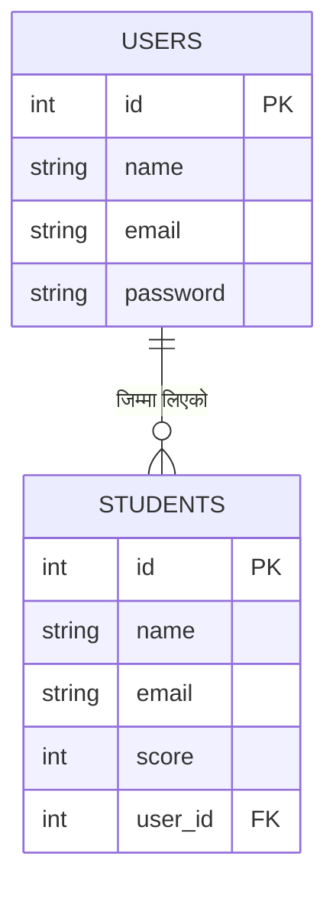

> 🇯🇵 मूल प्रति (जापानी भाषामा): [リレーショナルデータベース入門.md](<../../../1年生_データ設計とアプリ開発/前期/20260721/リレーショナルデータベース入門.md>) <!-- original-ja-link -->

## यो लेखबाट के थाहा हुन्छ

- टेबल, row र column
- प्राइमरी की (Primary Key)
- फरेन की (Foreign Key) र टेबलहरूबीचको सम्बन्ध
- टेबलहरू किन छुट्याइन्छ

## डाटाबेस = व्यवस्थित गरिएका टेबलहरूको संग्रह

कागजमा जताततै छरिएर नोट लेख्नुको सट्टा, डाटालाई टेबलको रूपमा व्यवस्थित गरेर सुरक्षित राख्ने प्रणालीलाई "डाटाबेस" भनिन्छ। RDB (रिलेसनल डाटाबेस) को विशेषता भनेको यस्ता धेरै टेबलहरूलाई एकअर्कासँग जोडेर (= relation बनाएर) चलाउन सकिनु हो।

## टेबल, row र column

यो एपमा फरक-फरक भूमिका भएका 2 वटा टेबल छन्। प्रत्येकलाई उदाहरण बनाएर, हरेक भागको नाम के हो हेरौं।

### 🎓 students टेबल (विद्यार्थीको डाटा)

| id | name | email | score |
|----|------|-------|-------|
| 1  | 田中太郎 | tanaka@example.com | 80 |
| 2  | 佐藤花子 | sato@example.com | 95 |

- **टेबल**: यो तालिका आफैं (प्रयोजन अनुसार धेरैवटा बनाइन्छ)
- **column (कलम)**: `id` `name` `email` `score` जस्ता ठाडो दिशामा रहेका फिल्डहरू
- **row (रेकर्ड)**: एउटा डाटा (यहाँ एक जना विद्यार्थीको जानकारी)

### 🔑 users टेबल (शिक्षक र प्रशासकको लगइन जानकारी)

| id | name | email | password |
|----|------|-------|----------|
| 1  | 小山先生 | koyama@example.com | $2y$10$abcdefGhIjKlmn...(ह्यास गरिसकिएको) |
| 2  | 田中先生 | tanaka-t@example.com | $2y$10$OpQrStUvWxYz...(ह्यास गरिसकिएको) |

- **टेबल**: `users` (लगइनका लागि अकाउन्ट जानकारी। students भन्दा फरक भूमिका)
- **column (कलम)**: `id` `name` `email` `password`
- **row (रेकर्ड)**: एउटा डाटा (यहाँ एक जना शिक्षक वा प्रशासकको लगइन जानकारी)

> 💡 `password` लाई प्रयोगकर्ताले प्रविष्ट गरेको जस्ताको तस्तै पाठ (plain text) का रूपमा नभई, ह्यासिङ (hashing) भनिने उल्टाउन नसकिने रूपान्तरण गरेर मात्र भण्डारण गरिन्छ। डाटाबेसको सामग्री चुहिए पनि मूल पासवर्ड थाहा नहोस् भनेर यसो गरिन्छ।

## प्राइमरी की: प्रत्येक डाटालाई अरूबाट छुट्टै पहिचान गर्ने ID

`name` (नाम) बाट मात्र खोज्दा, एउटै नाम र थर भएका मानिस भएमा कुन व्यक्ति हो भनेर छुट्याउन सकिँदैन। त्यसैले अरू कुनै row सँग कहिल्यै नदोहोरिने नम्बर (**प्राइमरी की**) प्रयोग गरिन्छ। माथिको टेबलको `id` नै यही हो। "id = 1 भएको डाटा देऊ" भन्यो भने, 田中太郎 को एउटा मात्र डाटा छानिन्छ। प्राइमरी कीलाई जापानको माई नम्बर वा सदस्यता नम्बरजस्तै हो भनेर सोच्दा बुझ्न सजिलो हुन्छ।

## फरेन की: टेबलहरूबीचको सम्बन्ध

धेरै टेबलहरूलाई ID मार्फत एकअर्कासँग जोड्न सकिनु नै RDB को मूल कुरा हो (= "रिलेसनल" शब्द यहीँबाट आएको हो)।

यो एपमा लगइनका लागि `users` टेबल (शिक्षक र प्रशासकको अकाउन्ट) र
विद्यार्थीको डाटा राख्ने `students` टेबल गरी 2 वटा टेबल छन्। अहिलेसम्म यी दुई
ID ले नजोडिएका, स्वतन्त्र टेबल हुन्।

यदि "कुन शिक्षक (user) ले कुन विद्यार्थी (student) दर्ता गरेको वा हेरिरहेको छ" भनेर
रेकर्ड गर्न मन लाग्यो भने, `students` टेबलमा `user_id` भन्ने column थपेर जोडिन्छ।

`USERS.id` (प्राइमरी की) लाई `STUDENTS.user_id` (फरेन की) ले रेफर गर्ने बनाएमा,
एक जना शिक्षक (user) ले धेरै विद्यार्थी (student) को जिम्मा लिन सक्ने सम्बन्ध (एक-धेरै / one-to-many) देखाउन सकिन्छ।

## टेबलहरू किन छुट्याइन्छ

टेबल नछुट्याई एउटै तालिकामा सबै राख्दा, जिम्मेवार शिक्षकको नाम र इमेल ठेगाना उहाँले हेर्ने विद्यार्थी जति छन् त्यति नै पटक दोहोरिन्छ।

| student_id | student_name | staff_name | staff_email |
|-----------|-------|-------------|---------------|
| 101 | 田中花子 | 小山先生 | koyama@example.com |
| 103 | 田中次郎 | 小山先生 | koyama@example.com |

यसो गर्दा, 小山 सरले इमेल ठेगाना परिवर्तन गर्नुभयो भने सम्बन्धित सबै row खोजेर सच्याउनुपर्छ, र कुनै छुट्ने सम्भावना बढ्छ। users टेबल र students टेबल छुट्याएर ID ले जोडेमा, 小山 सरको जानकारी एउटै ठाउँमा मात्र हुन्छ, र सच्याउँदा पनि एउटै ठाउँमा सच्याए पुग्छ। यसरी "दोहोरिनबाट बच्न टेबल छुट्याउने" सोचलाई **नर्मलाइजेसन (Normalization)** भनिन्छ।

## सारांश

- डाटाबेस भनेको डाटालाई व्यवस्थित गरेर सुरक्षित राख्ने प्रणाली हो
- RDB ले डाटालाई "टेबल (तालिका)" को रूपमा व्यवस्थापन गर्छ, र टेबल "column (फिल्ड)" र "row (एउटा रेकर्डको डाटा)" मिलेर बनेको हुन्छ
- प्राइमरी की भनेको हरेक डाटालाई नदोहोरिने गरी छुट्याउने चिनो (ID) हो
- फरेन की भनेको अर्को टेबलको प्राइमरी कीलाई रेफर गरेर टेबलहरूलाई जोड्ने प्रणाली हो
- टेबल छुट्याएर जोड्दा, एउटै जानकारी दोहोरिनबाट रोकिन्छ र डाटा व्यवस्थित गर्न सजिलो हुन्छ

अब अगाडि "SQL", "इन्डेक्स (Index)", "ट्रान्ज्याक्सन (Transaction)" जस्ता विषय पनि आउनेछन्, तर पहिले यी आधारभूत कुराको अवधारणा बुझ्न सके पुग्छ।

<!-- nav:start -->

---

| ⬅️ पछाडि | 🗺️ समग्र नक्सा | अर्को ➡️ |
|:--|:--:|--:|
| [07/21 DB किन चाहिन्छ](20260721_資料.md) | [सामग्रीको समग्र नक्सा](../../README.md) | [07/21 SQL का आधारभूत कुराहरू ① (SELECT)](20260721_資料_2.md) |

<!-- nav:end -->
