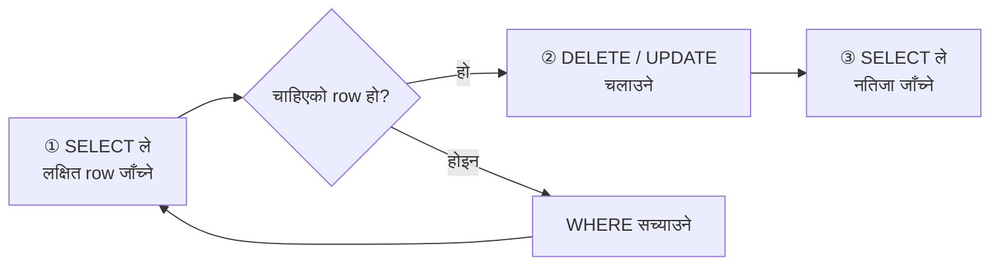
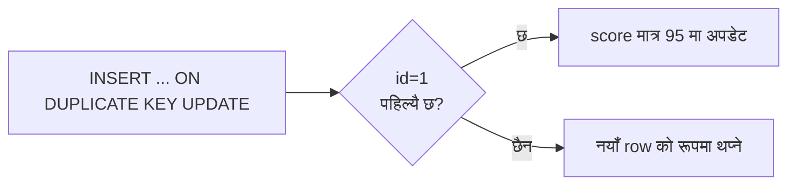

# कक्षा 08｜SQL का आधारभूत कुराहरू ② — INSERT / UPDATE / DELETE

> 🇯🇵 मूल प्रति (जापानी भाषामा): [20260723_資料.md](<../../../1年生_データ設計とアプリ開発/前期/20260723/20260723_資料.md>) <!-- original-ja-link -->

## आजको लक्ष्य
- INSERT ले डाटा थप्न सक्ने
- UPDATE ले डाटा अपडेट गर्न सक्ने
- DELETE ले डाटा मेटाउन सक्ने
- WHERE को महत्त्व (बिर्सियो भने सबै row परिवर्तन हुन्छन्) बुझेको हुने

---

## 1. INSERT — डाटा थप्ने

```sql
-- सबै column मा मान राख्ने अवस्थामा (column को नाम लेख्न नपर्ने)
INSERT INTO students VALUES (NULL, '新入生A', 18, 'A', 80, '2024-04-01');
-- ↑ id AUTO_INCREMENT भएकाले NULL राखे पुग्छ

-- केही निश्चित column मात्र तोकेर राख्ने (सिफारिस गरिएको)
INSERT INTO students (name, age, class, score, enrolled_at)
VALUES ('新入生B', 19, 'B', 75, '2024-04-01');

-- धेरै row एकै पटक राख्ने
INSERT INTO students (name, age, class, score, enrolled_at)
VALUES
    ('新入生C', 18, 'C', 88, '2024-04-01'),
    ('新入生D', 20, 'A', 62, '2024-04-01'),
    ('新入生E', 19, 'B', 71, '2024-04-01');
```

---

## 2. UPDATE — डाटा अपडेट गर्ने

```sql
-- !! अत्यन्त महत्त्वपूर्ण !!
-- WHERE लेख्न बिर्सियो भने सबै row अपडेट हुन्छन्!
-- सधैं WHERE जाँचेर मात्र चलाउनुहोस्!

-- id 1 भएको विद्यार्थीको score लाई 90 मा अपडेट गर्ने
UPDATE students SET score = 90 WHERE id = 1;

-- धेरै column एकै पटक अपडेट गर्ने (comma ले छुट्याएर)
UPDATE students SET score = 95, class = 'S' WHERE id = 1;

-- WHERE बिना (खतरनाक! सबै row अपडेट हुन्छन्)
-- UPDATE students SET score = 0;  ← यो गर्नुभयो भने सबैको अंक 0 हुन्छ!

-- हालको मान प्रयोग गरेर अपडेट गर्ने (उदाहरण: सबैलाई +5 अंक)
UPDATE students SET score = score + 5;  -- जानीजानी गरेको हो भने ठीक छ
```

---

## 3. DELETE — डाटा मेटाउने

```sql
-- !! अत्यन्त महत्त्वपूर्ण !!
-- WHERE लेख्न बिर्सियो भने सबै row मेटिन्छन्!
-- DELETE गरेपछि फिर्ता ल्याउन सकिँदैन!

-- id 5 भएको विद्यार्थीलाई मेटाउने
DELETE FROM students WHERE id = 5;

-- score 50 भन्दा कम भएका सबै विद्यार्थीलाई मेटाउने
DELETE FROM students WHERE score < 50;

-- WHERE बिना (कहिल्यै नगर्नुहोस्)
-- DELETE FROM students;  ← टेबल खाली हुन्छ!
```

> **कामकाजमा पालना गर्नुपर्ने नियम:**  
> 1. UPDATE/DELETE अघि SELECT ले लक्षित row जाँच्ने  
> 2. चलाउनुअघि ब्याकअप लिने  
> 3. WHERE सधैं जाँच्ने

---

## 4. सुरक्षित रूपमा UPDATE/DELETE गर्ने तरिका

सिधै नचलाई, तलको क्रममा अगाडि बढ्नुहोस्।



```sql
-- चरण 1: पहिले SELECT ले लक्षित row जाँच्ने
SELECT * FROM students WHERE score < 50;
-- → मेटिने row हरू प्रत्यक्ष जाँच्ने

-- चरण 2: समस्या नभए DELETE चलाउने
DELETE FROM students WHERE score < 50;

-- जाँच
SELECT * FROM students;
```

---

## 5. धेरै प्रयोग हुने ढाँचा: UPSERT

```sql
-- INSERT OR UPDATE (डाटा पहिल्यै छ भने अपडेट, छैन भने नयाँ थप्ने)
-- MySQL मा INSERT ... ON DUPLICATE KEY UPDATE प्रयोग गरिन्छ
INSERT INTO students (id, name, score)
VALUES (1, '田中太郎', 95)
ON DUPLICATE KEY UPDATE score = 95;
-- id=1 पहिल्यै छ → score मात्र 95 मा अपडेट हुन्छ
-- id=1 छैन → नयाँ row थपिन्छ
```

चित्रमा देखाउँदा, यसरी दुई अवस्थामा विभाजन हुन्छ।



---

## 6. CRUD सारांश

| काम | SQL | अर्थ |
|------|-----|------|
| **C**reate (बनाउने) | `INSERT INTO ... VALUES ...` | डाटा थप्ने |
| **R**ead (पढ्ने) | `SELECT ... FROM ...` | डाटा निकाल्ने |
| **U**pdate (अपडेट) | `UPDATE ... SET ... WHERE ...` | डाटा अपडेट गर्ने |
| **D**elete (मेटाउने) | `DELETE FROM ... WHERE ...` | डाटा मेटाउने |

> **CRUD = Create / Read / Update / Delete** वेब एपका आधारभूत कामहरू हुन्।  
> Laravel को अभ्यासमा पनि ठ्याक्कै यही अवधारणा आउँछ।

---

## अर्को कक्षा (कक्षा 09) को झलक

टेबलहरूबीचको सम्बन्ध र JOIN सिक्नेछौं।  
"प्रयोगकर्ता टेबल र अर्डर टेबललाई जोडेर कसले के अर्डर गरेको छ" भन्ने कुरा SQL को एउटै statement बाट निकाल्न सक्ने हुनेछौं।

<!-- nav:start -->

---

| ⬅️ अघिल्लो | 🗺️ समग्र नक्सा | अर्को ➡️ |
|:--|:--:|--:|
| [07/21 अभ्यास](../20260721/20260721_演習.md) | [सामग्रीको समग्र नक्सा](../../README.md) | [07/23 अभ्यास](20260723_演習.md) |

<!-- nav:end -->
